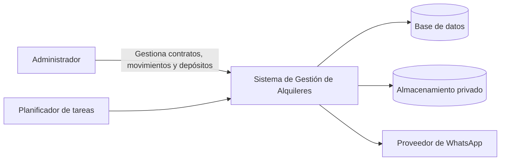
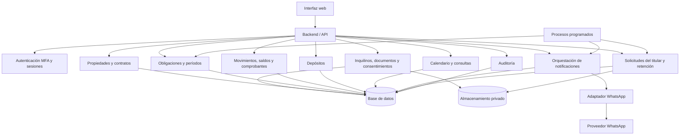

# Documento de Arquitectura de Software (DAS)

## Sistema de Gestión de Alquileres

**Identificador:** DAS-SGA-001
**Versión:** 0.10
**Estado:** Borrador para revisión; no aprobado
**Fecha:** 20 de octubre de 2026
**ERS de referencia:** ERS-SGA-001 v1.8 (borrador no aprobado)
**Valores regionales por defecto:** monedas CRC y USD; zona horaria `America/Costa_Rica`

Este borrador incorpora el impacto arquitectónico de ERS-SGA-001 v1.8 (la v0.10 incorpora los avisos de seguridad de la cuenta por correo y su reintentador (ADR-026), por decisión del solicitante del 20-oct-2026; la v0.9 incorpora las decisiones del stack del 20-oct-2026: PostgreSQL 18 (ADR-002), disco privado servido por Django (ADR-003), temporizador de systemd (ADR-013), alojamiento en DigitalOcean con Ubuntu 26.04, Nginx, Certbot y Gunicorn (ADR-023), respaldos (ADR-024) e integración continua (ADR-025); la v0.8 fija Python y Django como lenguaje y framework, con interfaz renderizada por el servidor (ADR-022), por decisión del solicitante del 20-oct-2026; la v0.7 cierra DP-26, fija la serie global de comprobantes como decisión provisional y añade el ADR-021 por las obligaciones OL-19 a OL-21 del Reglamento 37554-JP; la v0.6 cerró DP-07 y DP-08, difiere DP-04, añade restricciones, árbol de calidad y glosario, y recoge los cambios del modelo de datos MDD-SGA-001 v0.2). Impacto de la ERS v1.5 y v1.6: período por aniversario, prorrateo del último período, reajustes y correcciones, estados derivados, movimientos inmutables con anulación, comprobantes numerados, pagos en otra moneda, saldo de apertura, autenticación multifactor, y las obligaciones legales de la Ley 7527 y la Ley 8968 (derechos del titular, consentimiento y retención). No se selecciona todavía el proveedor de WhatsApp; el lenguaje, el framework, el motor de base de datos y el alojamiento quedan fijados en los ADR-002 y ADR-022 a ADR-026, con tamaño del Droplet y región pendientes. **Este documento no es asesoría legal ni autoriza iniciar la implementación.**

## Control e historial

| Campo | Valor |
|---|---|
| Propósito | Describir la estructura propuesta, responsabilidades, interacciones, riesgos y decisiones arquitectónicas. |
| Estado | Borrador sujeto a validación y aprobación. |
| Historial | **v0.10 añade el ADR-026 (avisos de seguridad de la cuenta por correo con Resend, dos direcciones y reintentador) y ajusta ADR-013 y ADR-023.** **v0.9 incorpora las decisiones del stack del 20-oct-2026 (ADR-002, ADR-003, ADR-013 y nuevos ADR-023 a ADR-025) y actualiza RE-03 y RE-04.** **v0.8 fija Python y Django con interfaz renderizada por el servidor (ADR-022) y actualiza RE-04; el motor de base de datos sigue sin fijarse.** v0.1 primera propuesta; v0.2 depósitos, prorrateo, privacidad e internacionalización; v0.3 abonos de alquiler, períodos contractuales, fechas retroactivas y reglas de actualización; **v0.4 modelo de movimientos con saldos derivados, estados derivados, procesos programados idempotentes, comprobantes, protección de datos personales (consentimiento, derechos del titular, retención), autenticación multifactor, zona horaria única y decisiones pendientes unificadas con la ERS.** v0.5 cierra DP-22, DP-24 y DP-25: el reajuste registra el tope digitado y su fuente, el vencimiento es configurable con el día de inicio por defecto y el saldo de apertura incluye todos los períodos iniciados. **v0.7 cierra DP-26 (hora local más zona), fija la serie global de comprobantes como decisión provisional (ADR-018, DP-20) y añade el ADR-021 (incidentes y documentación de seguridad).** v0.6 cierra DP-07 (respaldo) y DP-08 (VPS administrado por el solicitante), difiere DP-04, añade restricciones RE-01 a RE-11, árbol de calidad y glosario, y adopta ADR-014 a ADR-020 a partir del modelo de datos (condiciones del contrato, saldo de apertura como obligación, ajustes inmutables, auditoría sin valores personales, serie global de comprobantes, Argon2id, idempotencia por clave de solicitud).** Correcciones de QA del 17-oct-2026: módulo y entidad de incidentes en las secciones 5, 6 y 8 (ver actualización 2026-10-17e). |

## 1. Propósito y alcance

La arquitectura debe soportar inquilinos, propiedades, contratos, obligaciones por período de alquiler, movimientos de alquiler y de depósito con saldos derivados, comprobantes de pago, calendario, notificaciones web y WhatsApp, auditoría, y almacenamiento privado de fotografías de documentos de identidad, cumpliendo los controles que derivan de las obligaciones legales de la ERS (sección 3).

La primera versión no procesa dinero automáticamente, no calcula intereses ni multas, no consulta tipos de cambio, no gestiona devoluciones ni deducciones del depósito y no prorratea períodos completos.

### 1.1 Restricciones

Origen: la evaluación de la metodología encontró que el DAS v0.5 no tenía sección de restricciones frente a la plantilla arc42 (fuente: [arc42](https://docs.arc42.org/home/), leída por resumen). Los identificadores RE-nn son propios de esta sección.

**Técnicas**

| ID | Restricción | Origen |
|---|---|---|
| RE-01 | Se usan herramientas de software libre o sin costo de licencia. | Solicitante, 17-oct-2026 |
| RE-02 | El costo mensual de operación debe ser mínimo; no hay tope numérico definido. | Solicitante, 17-oct-2026 |
| RE-03 | El sistema se aloja en un servidor virtual (VPS) administrado por el solicitante, accesible por internet con HTTPS. Desde la v0.9, el proveedor es DigitalOcean (ADR-023). | DP-08; solicitante, 20-oct-2026 |
| RE-04 | Lenguaje, framework y motor de base de datos: Python, Django y PostgreSQL 18 (ADR-022 y ADR-002, decisiones del solicitante del 20-oct-2026). Hasta la v0.7 esta restricción decía que no se fijaba ninguno de los tres porque el solicitante no indicó preferencia (17-oct-2026). | Solicitante, 17-oct-2026 y 20-oct-2026 |
| RE-05 | El canal de WhatsApp no depende de un proveedor comercial concreto; se integra mediante una interfaz con un proyecto aparte, aún inexistente. | DP-04 |
| RE-06 | La interfaz funciona en las dos últimas versiones mayores de Chrome, Edge, Firefox y Safari, en escritorio y móvil. | ERS RNF-10 |

**De recursos y organización**

| ID | Restricción | Origen |
|---|---|---|
| RE-07 | Hay una única cuenta administradora y un único usuario humano. | ERS RN-25 |
| RE-08 | Volumen de diseño: hasta 50 propiedades. | ERS RNF-08 |
| RE-09 | La administración del servidor (actualizaciones, firewall, HTTPS, respaldos) recae en el propio solicitante. | DP-08 |

**Legales y de cumplimiento**

| ID | Restricción | Origen |
|---|---|---|
| RE-10 | Las reglas de la Ley 7527 y de la Ley 8968 son obligatorias, sujetas a validación por un abogado. | ERS sección 3; DP-17 |
| RE-11 | Los respaldos deben respetar la eliminación de datos personales por retención (35 días de respaldos). | DP-07; DP-18 |

**Efecto sobre la arquitectura.** RE-01, RE-02 y RE-09 empujan hacia pocas piezas y software con comunidad amplia. El monolito modular (ADR-001) encaja con ellas, pero no se justifica por ellas: lo justifica el volumen. RE-09 es un riesgo operativo: el solicitante, y no una plataforma, asume la seguridad del servidor.

## 2. Principios y referencias

Se toma como orientación SEI *Views and Beyond*, arc42, el modelo C4 y las guías de OWASP y NIST. Estas referencias guían el diseño, pero no certifican el sistema.

Principios:
- Separar interfaz, casos de uso, reglas de negocio y adaptadores de infraestructura.
- Mantener la lógica de contratos, obligaciones, movimientos y depósitos en servicios de dominio, no en la interfaz.
- **Los movimientos y los ajustes de importe son inmutables**: se anulan con una reversión o se corrigen con otro ajuste; nunca se editan ni se borran.
- **Los saldos y los estados se derivan** de los movimientos y de las fechas; no se almacenan como fuente de verdad.
- Procesos programados idempotentes.
- Autorización en el backend para cada operación sensible y cada descarga de documento.
- Conservar la moneda original por contrato y registrar toda conversión como dato ingresado, no calculado.
- Minimizar los datos personales almacenados, enviados y registrados.
- Hacer explícitas las decisiones pendientes mediante ADR.

## 3. Contexto del sistema

| Elemento | Responsabilidad |
|---|---|
| Administrador | Gestiona inquilinos, propiedades, contratos, movimientos, depósitos, configuración y solicitudes de titulares. |
| Aplicación SGA | Coordina reglas de negocio, consultas, auditoría y acceso a documentos. |
| Base de datos | Persiste registros, relaciones, movimientos, y el historial. |
| Almacenamiento privado | Conserva fotografías de cédula sin acceso público directo. |
| Planificador de procesos | Genera obligaciones, avisos y alertas, y ejecuta la retención. |
| Proveedor de WhatsApp | Envía mensajes mediante una interfaz de canal de salida; el proveedor es un proyecto aparte del solicitante, aún inexistente (DP-04). |

## 4. Drivers arquitectónicos y atributos de calidad

| Driver | Implicación arquitectónica |
|---|---|
| Una cuenta administradora | Autenticación multifactor obligatoria, códigos de recuperación de un solo uso, sesión corta y notificación de recuperación. No hay otro administrador que recupere el acceso. |
| Historia financiera | Movimientos inmutables; correcciones por anulación y nuevo registro; fecha real y fecha/hora de registro por separado. |
| Saldos y estados derivados | Evitar valores almacenados que puedan divergir; calcular desde movimientos y fechas. |
| Período por aniversario y vencimiento dentro del período | Servicio de cálculo de períodos y vencimientos con reglas de fin de mes. |
| Prorrateo solo del último período | Servicio de dominio con aritmética decimal exacta y redondeo registrado. |
| Reajuste frente a corrección | Dos operaciones distintas con efectos distintos sobre las obligaciones. |
| Obligaciones legales | Parámetros por contrato (destino, días de gracia), advertencias, comprobantes, y registro de consentimiento. |
| Datos personales | Consentimiento, atención del titular en cinco días hábiles, retención, eliminación y desasociación. |
| Evitar duplicados | Restricciones de unicidad e idempotencia en procesos programados. |
| Plataforma configurable | CRC y USD por contrato; zona horaria solo a nivel de organización. |
| Web + WhatsApp | Adaptador desacoplado del dominio financiero; plantillas aprobadas; mensajes con datos mínimos. |

Prioridades de calidad: seguridad y privacidad, integridad financiera, trazabilidad, confiabilidad, mantenibilidad, recuperación y usabilidad. Volumen de diseño: hasta 50 propiedades y un administrador; consultas habituales en menos de 2 s en el percentil 95 (objetivo a validar). RPO y RTO de 24 horas y retención de respaldos de 35 días (DP-07, ERS RNF-09); la disponibilidad no tiene objetivo numérico.

### 4.1 Árbol de requisitos de calidad

Escenarios medibles por atributo. No introduce requisitos nuevos: remite a los de la ERS.

| Atributo | Escenario | Medida | Referencia |
|---|---|---|---|
| **Seguridad** | Una persona sin sesión válida pide una foto de cédula | Se deniega; ninguna URL pública sirve el archivo | RF-26, RNF-14, CA-11 |
| | El administrador inicia sesión | Contraseña de 15 caracteres o más y segundo factor; sesión de 24 h máximo y 1 h de inactividad | RF-27, CA-48 |
| | Se pierde el segundo factor | Acceso solo con código de recuperación de un solo uso, con aviso | CA-47 |
| **Integridad financiera** | Se ejecuta dos veces el proceso de generación | No se crean obligaciones duplicadas | RNF-04, CA-03 |
| | Se anula un movimiento | El original se conserva; saldo y estado se recalculan | RF-16, CA-34 |
| | Se repite el mismo envío de un abono | No se crea un segundo movimiento | RF-34, CA-52 |
| | Se registran tres movimientos seguidos, y uno falla a medias | Los comprobantes son consecutivos y sin huecos; no se renumeran al anular | RF-37, CA-37, CA-54 |
| | Se corrige una obligación | El importe inicial y la corrección se conservan | RF-10, CA-55 |
| **Disponibilidad y recuperación** | Falla el servidor | Recuperación en 24 h máximo (RTO) con pérdida de datos de 24 h máximo (RPO) | RNF-09 |
| | Prueba de restauración | Antes de producir y cada 3 meses | RNF-09 |
| **Rendimiento** | El administrador abre el calendario con 50 propiedades | Menos de 2 s en el percentil 95 (objetivo a validar) | RNF-08 |
| **Cumplimiento y privacidad** | Un inquilino pide acceso a sus datos | Se resuelve en 5 días hábiles y sin costo | RF-40, CA-27 |
| | Un contrato terminó hace más de 5 años | Se elimina la foto y se desasocian los datos | RF-41, CA-28 |
| | Se modifica un dato personal | La auditoría registra que cambió, no su valor | RF-28, CA-53 |
| **Confiabilidad de notificaciones** | Falla un envío de WhatsApp | Hasta 5 intentos con espera creciente; el estado financiero no cambia | RF-24, CA-09 |
| | El proceso diario no corrió dos días | Solo se emite la alerta del día actual | CA-42 |
| **Usabilidad y compatibilidad** | Uso desde el celular | Funciona en las dos últimas versiones mayores de los cuatro navegadores | RNF-10 |
| **Mantenibilidad** | Se cambia una regla de reajuste | El cambio queda confinado al módulo de obligaciones | RNF-11 |

## 5. Estrategia de solución propuesta

Se mantiene como candidato un **monolito modular**: una aplicación backend organizada por módulos de negocio, base de datos relacional, almacenamiento privado de archivos y procesos programados. Es una propuesta proporcional al volumen esperado, no una decisión tecnológica definitiva, salvo las tecnologías fijadas en los ADR-002 y ADR-022 a ADR-026. No se recomienda introducir microservicios sin necesidad comprobada.

Módulos lógicos:
1. Inquilinos, documentos y consentimientos.
2. Propiedades y contratos.
3. Obligaciones, períodos, vencimientos y prorrateo del último período.
4. Movimientos, saldos y comprobantes.
5. Depósitos de garantía.
6. Calendario y consultas.
7. Notificaciones y configuración regional.
8. Protección de datos: solicitudes del titular, retención e incidentes de seguridad.
9. Autenticación y sesiones.
10. Auditoría y operación.

## 6. Bloques lógicos (C4 nivel 2)

| Bloque | Responsabilidad y límites |
|---|---|
| Backend/API | Valida solicitudes, autoriza operaciones y coordina casos de uso. |
| Contratos | Mantiene fechas, destino, monto, moneda, día de vencimiento, días de gracia y el historial de condiciones con fecha efectiva. |
| Obligaciones y períodos | Calcula períodos por aniversario, vencimientos, fecha límite y el prorrateo del último período; genera obligaciones 30 días antes; aplica reajustes y correcciones. |
| Movimientos y comprobantes | Registra abonos, pagos completos, saldo de apertura y anulaciones; deriva saldos; emite comprobantes con numeración consecutiva. |
| Depósitos | Administra importe total, abonos, saldo y estado, independiente del alquiler. |
| Persistencia | Impone relaciones, unicidad y consistencia transaccional. |
| Documentos | Verifica autorización y registra acceso antes de entregar un archivo; evita URL pública permanente. |
| Notificaciones | Programa avisos, registra intentos y resultados; no cambia estados financieros. |
| Protección de datos | Registra consentimientos y solicitudes del titular con su plazo; ejecuta retención y desasociación; registra incidentes de seguridad con su fecha límite de aviso (ADR-021). |
| Autenticación | Segundo factor, códigos de recuperación, sesión corta, notificación de recuperación. |
| Auditoría | Registra actor, fecha, operación y cambios relevantes sin almacenar secretos ni imágenes. |

## 7. Reglas arquitectónicas de dominio

### 7.1 Períodos, vencimientos y estados

- El **período** parte del día de `fecha_inicio` y dura hasta el día anterior al mismo día del mes siguiente. Si el mes no tiene ese día, el período inicia el último día de ese mes (ERS RN-03).
- El **vencimiento** es la fecha del día de vencimiento en el mes de inicio del período (o el último día de ese mes); si queda antes del inicio del período, se usa el mes siguiente; si excede el último día del período, se usa ese último día. Así siempre cae dentro del período (ERS RN-05, confirmada en DP-24). El día de vencimiento por defecto es el día de inicio del período.
- La **fecha límite** es el vencimiento más los días de gracia (ERS RN-06).
- El **estado** de una obligación se calcula en cada consulta: *pagada* (saldo cero), *vencida* (saldo mayor que cero y fecha local posterior a la fecha límite), *pendiente* (saldo mayor que cero y no vencida), *anulada* (marca explícita con motivo). El proceso diario **no** cambia estados; solo genera avisos.
- La **fecha local** se obtiene con la zona de la organización. Los vencimientos son fechas de calendario sin hora; las marcas de registro se guardan en UTC.

### 7.2 Movimientos, saldos y comprobantes

- Un **movimiento** es inmutable: importe, moneda recibida, tipo de cambio ingresado y equivalente (si aplica), fecha real, fecha/hora de registro, medio de pago, observación y una **clave de solicitud** única generada por el formulario; un envío repetido con la misma clave no crea otro movimiento (ADR-020).
- La **anulación** agrega un movimiento de reversión que referencia al original y registra el motivo. Una corrección de importe o fecha es anulación más nuevo movimiento.
- El **importe exigible vigente** es el importe inicial de la obligación más la suma de sus ajustes (ADR-016). El **saldo** es ese importe menos la suma de movimientos válidos (no anulados), siempre en la moneda del contrato; nunca negativo. Se valida dentro de la misma transacción que registra el movimiento.
- El **comprobante** se numera con un contador en tabla, con bloqueo de fila, consecutivo, único y **sin huecos**, sin reutilizar números; los de movimientos anulados quedan marcados. La asignación del número ocurre en la misma transacción del movimiento. No se usa una secuencia de base de datos: no es transaccional y deja huecos si la operación falla (ADR-010).
- El **saldo de apertura** es una obligación de tipo apertura, no un movimiento (ADR-015).
- Para cheques y títulos, la fecha real es la de recepción del efectivo.
- Un abono en moneda distinta usa el tipo de cambio ingresado por el administrador; el sistema no consulta fuentes externas.
- Dinero: aritmética decimal exacta (nunca flotantes), un tipo monetario con moneda explícita y redondeo registrado.

### 7.3 Prorrateo del último período

Solo cuando `fecha_fin` cae dentro de un período:

`importe = importe mensual × días cobrables / días del período`

con ambos extremos inclusivos, redondeo único al final a la unidad entera (CRC) o a dos decimales (USD) con empate hacia arriba, y registro del cálculo (días, importe previo al redondeo, importe final). Puede ajustarse manualmente con motivo y auditoría. La fórmula y el redondeo requieren validación legal (DP-01). Los períodos completos no se prorratean.

### 7.4 Reajuste y corrección

- **Reajuste:** registra fecha de notificación, nuevo monto, porcentaje, y el tope máximo vigente digitado por el administrador con su fuente (certificación del INEC o publicación del MIVAH); el sistema no consulta esas fuentes; la fecha efectiva se normaliza al inicio del período siguiente a la notificación; afecta solo a obligaciones cuyo período inicia en o después de esa fecha; para vivienda advierte si supera el tope informado y se rechaza si el precio está en moneda extranjera.
- **Corrección:** retroactiva, con motivo; ajusta obligaciones no pagadas afectadas, incluidas las vencidas.
- Ambos se registran como una nueva condición del contrato (ADR-014) y como un ajuste inmutable por obligación afectada (ADR-016); el importe de la obligación no se sobrescribe. Conservan el valor anterior, el nuevo y la fecha efectiva; no modifican obligaciones pagadas; se **bloquean** si dejan el importe exigible por debajo de lo abonado. La operación es transaccional.

### 7.5 Depósito de garantía

- Entidad separada de las obligaciones de alquiler; un depósito por contrato.
- Abonos como movimientos independientes con importe positivo, fecha real, fecha/hora de registro y observación.
- Hasta tres abonos no anulados en el flujo ordinario; más abonos exigen confirmación con motivo obligatorio, auditada.
- Saldo derivado; bloqueo de abonos que lo excedan; advertencia legal si el importe supera una mensualidad de renta.
- Sin alertas de depósito; contrato cerrado muestra "liquidación manual". Sin calendarios de cuotas. Devoluciones y deducciones fuera de alcance.
- Un abono al depósito no modifica saldo ni estado de ninguna obligación.

### 7.6 Moneda y zona horaria

- Monedas admitidas: CRC y USD, por contrato. No se mezclan importes de monedas distintas en sumas.
- Zona horaria solo a nivel de organización, con identificador IANA (nunca solo un desfase); los procesos programados la usan.
- Cambiar la configuración no altera registros históricos.

### 7.7 Datos personales

- **Consentimiento:** se registra por inquilino con fecha, versión del texto informativo y medio; admite revocación sin efecto retroactivo.
- **Solicitudes del titular:** se registran con fecha de recepción y fecha límite de cinco días hábiles; se atienden sin costo; se puede exportar la información del titular.
- **Retención:** la fotografía se conserva hasta cinco años después del fin del contrato (configurable, tope de diez años desde los hechos); luego se elimina del almacenamiento y se desasocian los datos personales del inquilino, conservando los movimientos sin datos de identificación. El sistema avisa antes de ejecutar la eliminación. La conciliación con obligaciones contables o tributarias de conservación está pendiente (DP-18).
- **Acceso a cédulas:** cada consulta o descarga se registra (actor, fecha/hora, inquilino) sin guardar la imagen.
- **Transferencia:** los mensajes a WhatsApp no incluyen número de documento ni imágenes y limitan los datos del inquilino al mínimo; la aplicabilidad de las reglas de transferencia al uso de un proveedor se valida legalmente (DP-19).

## 8. Modelo conceptual de datos

| Entidad | Datos principales |
|---|---|
| Inquilino | Identificador, tipo y número de documento, contacto, estado y referencia privada a los documentos. |
| Consentimiento | Inquilino, fecha, versión del texto, medio, estado de revocación. |
| Documento de identidad | Identificador interno, referencia al archivo (frente, reverso), metadatos mínimos, fechas. |
| Propiedad | Identificador, descripción, dirección y marca de inactiva. |
| Contrato | Inquilino, propiedad, destino, vigencia, moneda y marca de anulado. |
| Condición del contrato | Contrato, monto mensual, día de vencimiento, días de gracia, fecha efectiva, tipo (inicial, reajuste, corrección), datos del reajuste (notificación, porcentaje, tope digitado y fuente) y motivo. |
| Obligación | Contrato, período, vencimiento, fecha límite, importe inicial, moneda, condición aplicada, datos del cálculo, tipo (regular o apertura) y anulación (motivo, fecha). |
| Ajuste de obligación | Obligación, tipo (reajuste, corrección, prorrateo del último período, ajuste manual), importe con signo, condición de origen, motivo. Inmutable. |
| Movimiento | Tipo (abono o reversión), obligación o depósito asociado, importe, moneda recibida, tipo de cambio, equivalente, fecha real, fecha/hora de registro, medio de pago, observación, clave de solicitud, anulación y referencia al original. |
| Organización | Responsable de la base de datos, zona horaria, hora del proceso diario, teléfono de avisos, anticipaciones, retención y días de gracia por defecto. Una sola fila en v1. |
| Comprobante | Número consecutivo, movimiento, estado. |
| Depósito de garantía | Contrato, importe total, moneda, fecha límite acordada opcional, notas. |
| Notificación | Obligación o contrato, canal, tipo, destinatario, intentos, resultado y estado web. |
| Solicitud del titular | Inquilino, tipo, recepción, fecha límite, resolución. |
| Auditoría | Actor, entidad, acción, fecha, campos modificados y valores anteriores y nuevos solo de campos no personales. |
| Ejecución de proceso | Fecha local, inicio, fin, resultado y detalle; permite saber qué días corrió el proceso diario. |
| Incidente de seguridad | Fechas de ocurrencia y conocimiento, naturaleza, datos comprometidos (descripción), acciones, fecha límite de aviso, estado y avisos emitidos (destinatario, fecha, contenido mínimo). |
| Registro de acceso a documentos | Actor, inquilino, fecha/hora, tipo de acceso. |

Invariantes propuestos:
- Una obligación por contrato y período.
- Los movimientos no se editan ni se borran.
- Ningún saldo ni estado es fuente de verdad almacenada.
- Un movimiento pertenece a una única obligación o a un único depósito.
- La numeración de comprobantes es única, consecutiva y sin huecos.
- Los ajustes de obligación son inmutables y nunca dejan el importe vigente por debajo de lo abonado.
- La clave de solicitud de un movimiento es única.
- La auditoría no contiene valores de campos personales.
- No hay días compartidos entre contratos de una propiedad.
- No se permite acceso a una fotografía sin autorización comprobada en el servidor.
- Los importes históricos conservan moneda y condiciones de cálculo.

## 9. Seguridad, privacidad y documentos

Controles mínimos:
- HTTPS en todos los accesos autenticados.
- Contraseña de al menos 15 caracteres, sin reglas de composición ni cambio periódico obligatorio; almacenamiento con Argon2id y los parámetros mínimos de OWASP (ADR-019).
- Segundo factor TOTP obligatorio; códigos de recuperación de un solo uso; notificación al administrador ante cada recuperación.
- Sesión: cierre total a las 24 horas e inactividad de 1 hora (valores recomendados por NIST para el nivel de aseguramiento AAL2).
- Archivos fuera de rutas públicas y sin enlaces públicos permanentes.
- Lista blanca de formatos (JPEG y PNG), verificación del tipo real del archivo, límite de 5 MB, nombres internos aleatorios; no usar el número de documento en rutas.
- Cifrado en tránsito y, cuando la infraestructura lo permita, en reposo.
- Auditoría proporcional al riesgo; sin datos de identidad completos, tokens ni documentos en registros técnicos, y sin valores de campos personales (ADR-017).
- Endurecimiento del servidor (firewall, actualizaciones, acceso remoto, HTTPS): las guías reconocidas aún no se han investigado; queda para la fase 6 (RE-09).
- Registro de incidentes de seguridad con plazo de aviso (ADR-021) y documento de seguridad con análisis de riesgos (Reglamento 37554-JP, arts. 36 y 38).
- Confidencialidad de quien intervenga en el tratamiento, aun después de terminada su relación.
- Probar la restauración de base de datos y documentos desde respaldos protegidos.

## 10. Ejecución y escenarios críticos

### 10.1 Proceso diario (07:00, zona de la organización)

Un único proceso idempotente, reejecutable sin efectos adicionales, que:
1. Genera la obligación de cada contrato cuyo próximo período inicia dentro de 30 días, comprobando la unicidad por contrato y período.
2. Crea recordatorios para obligaciones con saldo según la anticipación configurada, con clave única obligación + tipo + anticipación + fecha.
3. Registra una alerta por obligación vencida y por día, y envía **un resumen** por WhatsApp.
4. Genera el aviso de vencimiento de contrato 120 días antes del fin y marca *por decidir* los contratos cuya fecha de fin venció sin acción.
5. Ejecuta la retención: avisa antes de eliminar y aplica la eliminación y desasociación vencidas.
6. Registra el resultado de la ejecución. Si faltaron días, pone al día obligaciones y contratos, pero emite solo la alerta del día actual.

### 10.2 Registro de un abono de alquiler

1. El administrador selecciona la obligación y registra el abono con medio de pago y fecha real.
2. El backend valida importe positivo, fecha real (no futura, no anterior al inicio del contrato) y que el saldo no resulte negativo. Si ya existe un movimiento con la misma clave de solicitud, devuelve ese y termina.
3. En una transacción: bloquea la obligación, persiste el movimiento, toma el número de comprobante del contador y registra la auditoría.
4. El saldo y el estado se derivan; si el saldo es cero, la obligación aparece como pagada.
5. No se genera notificación individual; los avisos futuros de la obligación se cancelan solo si pasó a pagada.

### 10.3 Anulación de un movimiento

1. El administrador indica el motivo.
2. En una transacción: se agrega la reversión, se marca el comprobante como anulado y se registra la auditoría.
3. El saldo y el estado se recalculan; si vuelve a vencida, las alertas se reanudan el día siguiente.

### 10.4 Reajuste

1. El administrador registra la fecha de notificación y el nuevo monto.
2. El backend normaliza la fecha efectiva, calcula el porcentaje, aplica las advertencias y rechazos legales, y verifica que ninguna obligación afectada quede por debajo de lo abonado.
3. En una transacción: registra la condición con fecha efectiva, inserta un ajuste solo para las obligaciones que inician en o después de la fecha (sin sobrescribir su importe inicial) y registra la auditoría. Si algún ajuste dejara una obligación bajo lo abonado, se revierte toda la operación.

### 10.5 Registro de abono al depósito

1. El administrador selecciona el depósito y registra el abono.
2. El backend valida importe positivo, moneda y saldo disponible, y que no se supere el máximo ordinario sin confirmación con motivo.
3. Se persiste el movimiento y la auditoría; saldo y estado se derivan.

### 10.6 Notificaciones

El proceso consulta obligaciones y configuración, registra la notificación, crea la notificación web y solicita WhatsApp si está configurado. Ante un fallo de envío reintenta hasta cinco veces con espera exponencial y aleatoria; después marca *fallido*. Los mensajes son plantillas aprobadas con datos mínimos. Los fallos no modifican estados financieros. Se distinguen los estados aceptado y entregado, y se deja un margen para el estado de fallo, que puede llegar con retraso.

## 11. Respaldo, recuperación y operación

La política de respaldo cubre base de datos y archivos privados de forma coordinada, con los valores de DP-07 (ERS RNF-09, decisión del solicitante del 17-oct-2026; sin fuente externa):

| Parámetro | Valor |
|---|---|
| RPO (pérdida tolerable de datos) | Hasta 24 horas |
| RTO (tiempo tolerable sin el sistema) | Hasta 24 horas |
| Frecuencia | Un respaldo completo al día |
| Retención | 35 días |
| Prueba de restauración | Antes de producción y cada 3 meses: base de datos, archivos, contratos, movimientos, comprobantes y fotografías |

Con un VPS administrado por el solicitante (DP-08), el respaldo diario debe salir **a otro lugar**, cifrado. Según la documentación de DigitalOcean, sus respaldos no se pueden descargar, y por defecto guardan 7 copias diarias o 4 semanales (esto último solo por resultados de búsqueda), por lo que no cubren los 35 días de retención. Se programan copias propias (ADR-024). Una copia no se considera suficiente hasta verificar que puede restaurarse. Los respaldos deben respetar la eliminación y desasociación por retención (DP-18).

**Condiciones recomendadas antes de cargar datos reales** (recomendación, no bloqueo): servidor endurecido, prueba de restauración superada y revisión legal cerrada (DP-17 a DP-19). Tareas operativas del solicitante: actualizaciones del sistema, firewall, renovación de HTTPS, monitoreo y copia externa. Si el VPS está fuera de Costa Rica, aplica la revisión de transferencia de datos (DP-19).

## 12. Riesgos y mitigaciones

| Riesgo | Mitigación propuesta |
|---|---|
| Prorrateo incorrecto del último período | Fórmula explícita, cálculo registrado y casos de prueba de meses de distinta duración. |
| Saldos o estados divergentes | Derivarlos siempre de movimientos y fechas; pruebas de invariantes. |
| Numeración de comprobantes con huecos o duplicados | Contador en tabla con bloqueo de fila en la misma transacción del movimiento; una secuencia de base de datos deja huecos (comprobado en prueba, 17-oct-2026). |
| Abono duplicado por doble envío | Clave de solicitud única por movimiento (ADR-020). |
| Operar el servidor con cédulas de inquilinos reales | Endurecimiento, respaldo externo cifrado, prueba de restauración y acceso con segundo factor; las guías de endurecimiento no se han investigado (RE-09). |
| Vulneración de seguridad sin aviso a tiempo | Registro de incidentes con fecha límite de cinco días hábiles (RF-46, ADR-021); procedimiento de respuesta en la fase 6; validación legal (DP-17, DP-19). |
| Auditoría que retiene datos personales | Auditar solo valores no personales (ADR-017); validar con abogado (DP-18). |
| Reajuste aplicado fuera de la regla legal | Normalización de fecha efectiva, advertencias, pruebas y validación legal. |
| Abonos del depósito mezclados con alquiler | Entidades separadas, validaciones y pruebas de invariantes. |
| Exposición de cédulas | Repositorio privado, autorización en backend, auditoría de acceso y pruebas de acceso denegado. |
| Conservación o eliminación indebida de datos | Retención configurable con aviso, desasociación y revisión contable (DP-18). |
| Pérdida de acceso a la cuenta única | Códigos de recuperación de un solo uso y notificación de recuperación. |
| Cambios regionales alteran historia | Persistir moneda y condiciones aplicadas; fechas de calendario separadas de marcas UTC. |
| Proceso diario omitido | Monitoreo, historial de ejecuciones y reproceso idempotente. |
| Pérdida de información | Respaldos protegidos y restauración probada. |

## 13. Registros de decisiones de arquitectura (ADR)

### ADR-001 — Estilo arquitectónico
- **Estado:** Propuesto. **Candidato:** monolito modular, proporcional al volumen (hasta 50 propiedades).
- **Pendiente:** validar capacidades, despliegue y necesidades operativas.

### ADR-002 — Persistencia relacional
- **Estado:** Decisión del solicitante (20-oct-2026): PostgreSQL 18, recomendación del asistente.
- **Decisión:** motor PostgreSQL 18. Fuente: [política de versiones de PostgreSQL](https://www.postgresql.org/support/versioning/), leída por resumen el 20-oct-2026: cada versión mayor recibe cinco años de soporte; la 18 llega hasta el 14-nov-2030 (la 14 termina el 12-nov-2026).
- **Justificación:** relaciones, transacciones, unicidad contrato-período, contador de comprobantes e integridad de movimientos.
- **Evidencia:** una prueba desechable en PostgreSQL 18.4 (17-oct-2026, 32 de 32 comprobaciones) mostró que las restricciones del modelo MDD-SGA-001 v0.2 (vigente en ese momento; la v0.3 solo cambia la hora de las notificaciones y añade incidentes) son expresables, incluida la exclusión de contratos solapados ([documentación de PostgreSQL](https://www.postgresql.org/docs/current/rangetypes.html)). No es una elección de motor ni cubre concurrencia real.
- **Pendiente:** migraciones (se gestionan con Django, ADR-022), versión menor exacta, parámetros del servidor y la extensión `btree_gist` para la exclusión de contratos solapados. Los respaldos están en el ADR-024.

### ADR-003 — Documentos privados
- **Estado:** Decisión de diseño adoptada como requisito. Decisión del solicitante (20-oct-2026): disco del servidor, fuera de la raíz web, servido por Django tras comprobar permisos (opción recomendada por el asistente).
- **Fundamento (con fuente):** [OWASP, File Upload Cheat Sheet](https://cheatsheetseries.owasp.org/cheatsheets/File_Upload_Cheat_Sheet.html) recomienda guardar fuera de la raíz web, con nombre aleatorio (UUID) y mínimos permisos, comprobar la autorización en la descarga y no confiar en el Content-Type. La documentación de Django recomienda limitar el tamaño de las subidas en el servidor web y usar lista blanca de extensiones; los archivos se entregan con `FileResponse`. Ambas leídas por resumen el 20-oct-2026. Django aconseja servir los archivos subidos desde un dominio distinto, pero eso aplica a archivos públicos; aquí se entregan solo por una vista con autorización.
- **Decisión:** archivos en almacenamiento privado fuera de rutas públicas; la base guarda referencias y metadatos mínimos; todo acceso se registra.
- **Pendiente:** cifrado en reposo, análisis antivirus, límite de tamaño en Nginx y proceso de descarga autorizada. La carpeta entra en el respaldo coordinado (ADR-024).

### ADR-004 — Depósito de garantía
- **Estado:** Propuesto.
- **Decisión:** un depósito por contrato, con movimientos separados del alquiler y saldo derivado. Hasta tres abonos ordinarios y excepción con motivo. Sin calendarios en v1.

### ADR-005 — Configuración regional
- **Estado:** Propuesto.
- **Decisión:** CRC y USD por contrato; zona horaria solo a nivel de organización con identificador IANA; marcas de registro en UTC.

### ADR-006 — Movimientos inmutables con saldo derivado
- **Estado:** Propuesto; reemplaza el ADR-006 de v0.3.
- **Decisión:** una sola entidad de movimiento para alquiler y depósito; correcciones por anulación (reversión) y nuevo registro; saldos y estados derivados. El pago completo es un abono por el saldo restante.
- **Referencia:** patrón de ajuste por reversión (Fowler, *Reversal Adjustment*, borrador de 2006).

### ADR-007 — Reajuste y corrección
- **Estado:** Propuesto; reemplaza el ADR-007 de v0.3.
- **Decisión:** operaciones separadas; el reajuste es prospectivo con fecha efectiva normalizada; la corrección es retroactiva con motivo; ambas se bloquean si dejan el importe por debajo de lo abonado y se registran como ajustes (ADR-016).

### ADR-008 — WhatsApp
- **Estado:** Proveedor **diferido** (DP-04); depende de un proyecto aparte del solicitante.
- **Decisión de diseño:** interfaz de canal de salida (destinatario, contenido, clave de idempotencia) que devuelve estados aceptado, entregado y fallido; mensajes con datos mínimos; resumen diario. Mientras no exista el canal, basta la notificación web (ERS RNF-05).
- **Riesgo:** los términos de servicio de WhatsApp para consumidores (vigentes desde el 4-ene-2021) prohíben mensajería masiva o automática; los términos de la plataforma empresarial no se leyeron. El proyecto aparte requiere revisión legal.
- **Pendiente:** punto de recepción de estados de entrega (se resuelve con la red del VPS), costos y límites si se usa la API oficial.

### ADR-009 — Estados derivados
- **Estado:** Propuesto.
- **Decisión:** el estado de obligación, contrato y propiedad se calcula desde saldos y fechas; el proceso diario solo genera avisos.

### ADR-010 — Comprobantes numerados
- **Estado:** Propuesto.
- **Decisión:** numeración consecutiva, única y **sin huecos**, tomada de un contador en tabla con bloqueo de fila dentro de la transacción del movimiento; los anulados se marcan y no se renumeran. No se usa una secuencia de base de datos.
- **Evidencia:** la [documentación de PostgreSQL](https://www.postgresql.org/docs/current/functions-sequence.html) establece que las secuencias "cannot be used to obtain gapless sequences"; la prueba del 17-oct-2026 lo reprodujo (último comprobante real 2, secuencia en 4). Corrige el texto de la v0.5, que decía "secuencia".
- **Pendiente:** formato y alcance legal (DP-20).

### ADR-011 — Protección de datos y retención
- **Estado:** Propuesto.
- **Decisión:** consentimiento registrado, solicitudes del titular con plazo, retención de cinco años configurable con aviso previo, eliminación de archivo y desasociación de datos personales, y registro de acceso a documentos.
- **Pendiente:** DP-17 a DP-21.

### ADR-012 — Autenticación
- **Estado:** Propuesto.
- **Decisión:** TOTP obligatorio, códigos de recuperación de un solo uso, sesión de 24 h con inactividad de 1 h, notificación de recuperación.

### ADR-013 — Procesos programados
- **Estado:** Propuesto.
- **Ajuste v0.10 (20-oct-2026):** además del proceso diario, un segundo temporizador de systemd, de intervalo corto, reintenta los avisos de seguridad pendientes (ADR-026). El proceso diario y su idempotencia no cambian.
- **Decisión del solicitante (20-oct-2026):** el proceso se ejecuta con un temporizador de systemd (`Persistent=yes`, hora en zona IANA) que invoca un comando de gestión de Django; no se usa Celery. Fuentes leídas por resumen: documentación de systemd (`Persistent=` recupera la ejecución perdida; la hora admite zona IANA) y de Django (los comandos de gestión están pensados para ejecutarse desde cron o un programador); Celery exige un intermediario de mensajes (Redis o RabbitMQ). No se verificó la versión mínima de systemd con zona en la hora ni el manejo de zonas en el temporizador, por lo que la aplicación calcula la hora local (DP-26).
- **Decisión:** un proceso diario idempotente a las 07:00 locales; ante una omisión solo se emite la alerta del día; claves únicas por aviso.
- **Decisión (DP-26, 17-oct-2026):** la hora programada se guarda como fecha local, hora local y zona de la organización, y el instante se calcula al ejecutar. Fundamento: [W3C, Working with Time Zones](https://www.w3.org/TR/timezone/), leída por resumen; UTC solo no basta para eventos futuros en hora local.

### ADR-014 — Historial de condiciones del contrato
- **Estado:** Propuesto (hallazgo H2 del modelo de datos).
- **Decisión:** monto, día de vencimiento y días de gracia viven en una entidad Condición del contrato con fecha efectiva; la condición de un período es la de mayor fecha efectiva que no supere su inicio.
- **Alternativa descartada:** guardarlos en el contrato (perdería el historial que exige ERS RF-10).

### ADR-015 — Saldo de apertura como obligación
- **Estado:** Propuesto (hallazgo H1).
- **Decisión:** el saldo de apertura es una obligación de tipo apertura, una por contrato, sin período. Corrige los glosarios de la ERS v1.6 y del borrador del DAS, que lo llamaban movimiento.
- **Alternativa descartada:** tratarlo como movimiento (contradice ERS 7.1 y CA-49).

### ADR-016 — Ajustes de importe inmutables
- **Estado:** Propuesto; decisión del solicitante del 17-oct-2026 (hallazgo H9).
- **Decisión:** la obligación guarda su importe inicial sin modificarlo; reajustes, correcciones, prorrateo del último período y ajustes manuales son filas inmutables; el importe vigente se deriva.
- **Alternativa descartada:** sobrescribir el importe y dejar el historial solo en la auditoría.

### ADR-017 — Auditoría sin valores personales
- **Estado:** Propuesto; decisión del solicitante del 17-oct-2026, afinada por el analista (hallazgo H10).
- **Decisión:** la auditoría guarda valores anteriores y nuevos solo de campos no personales; de los personales registra únicamente que cambiaron. Requiere reescribir ERS RF-28.
- **Pendiente:** validar con abogado (DP-18).

### ADR-018 — Serie global de comprobantes
- **Estado:** Decisión provisional del solicitante (17-oct-2026), sujeta a DP-20 (hallazgo H4).
- **Decisión:** una sola serie global de comprobantes, la más simple.
- **Alternativa:** una serie por año. **Pendiente:** DP-20; un abogado o contador puede exigir otra cosa. No se leyeron normas tributarias de comprobantes.

### ADR-019 — Hash de contraseñas
- **Estado:** Propuesto.
- **Decisión:** Argon2id con al menos los parámetros mínimos de OWASP (19 MiB de memoria, 2 iteraciones, paralelismo 1) y sal única; se ajusta en el servidor real a menos de ~1 s por hash. Fuente: [OWASP Password Storage Cheat Sheet](https://cheatsheetseries.owasp.org/cheatsheets/Password_Storage_Cheat_Sheet.html), leída por resumen.
- **Alternativas:** scrypt, bcrypt o PBKDF2 según disponibilidad de la biblioteca elegida.

### ADR-020 — Idempotencia del registro de movimientos
- **Estado:** Propuesto; aceptado por el solicitante el 17-oct-2026 (hallazgo H13).
- **Decisión:** cada movimiento lleva una clave de solicitud única (UUID v4) generada por el formulario; un envío repetido devuelve el movimiento ya registrado. Patrón de [Stripe](https://docs.stripe.com/api/idempotent_requests) para peticiones (leída por resumen); la clave natural de las notificaciones es un patrón distinto, no respaldado por esa fuente.
- **Evidencia:** probada en PostgreSQL con envíos secuenciales (CA-52); concurrencia real sin probar.

### ADR-021 — Incidentes y documentación de seguridad
- **Estado:** Propuesto; lectura propia del Reglamento 37554-JP, pendiente de abogado (DP-17, DP-19).
- **Decisión:** el sistema registra incidentes de seguridad con la fecha en que ocurrieron y se conocieron, calcula la fecha límite de aviso de cinco días hábiles y guarda constancia de los avisos a titulares y a la Agencia (ERS RF-46). El documento de seguridad (datos, inventario, análisis de riesgos, riesgo residual, plan) y el protocolo mínimo de actuación son entregables de la fase 6, revisados al menos una vez al año (ERS RNF-18).
- **Fuente:** Reglamento 37554-JP, arts. 32 a 39, copia del Archivo Nacional leída parcialmente (17-oct-2026); no se confirmó en el SCIJ.
- **Límites:** el sistema no detecta incidentes; el desde cuándo corre el plazo y el tratamiento de feriados quedan para el abogado.

### ADR-022 — Lenguaje, framework e interfaz
- **Estado:** Decisión del solicitante (20-oct-2026), tras una recomendación propuesta por el asistente. Versión de Django, motor de base de datos y demás piezas siguen pendientes.
- **Decisión:** backend en Python con Django, como monolito modular (ADR-001), con la interfaz renderizada por el servidor mediante las plantillas de Django. No hay aplicación de frontend separada ni API pública en la versión 1.
- **Alternativas consideradas:** Next.js con una API aparte, ASP.NET Core, Spring Boot y Laravel. Next.js se descartó para la versión 1 porque agrega una segunda aplicación y una API entre ambas, frente a RE-01, RE-02 y RE-09 (pocas piezas); se reconsidera si surge una interfaz muy interactiva, una aplicación móvil o una API pública. El solicitante eligió Django; las demás no se investigaron a fondo.
- **Fundamento (con fuente):** Django ofrece `ExclusionConstraint` para impedir contratos solapados en PostgreSQL (requiere la extensión `btree_gist`) y admite Argon2id con `argon2-cffi`, aunque no es el valor por defecto (que es PBKDF2). Tiene una lista de comprobación de despliegue y el comando `check --deploy`. Fuentes leídas por resumen: referencias 17 a 19.
- **Evidencia de apoyo, de baja fiabilidad:** un estudio de la Universidad de Kabul (2026) señala mejores protecciones por defecto en Django que en Laravel; se leyó solo el resumen, compara dos frameworks y su método se basa en documentación y en CVE, no en pruebas. Estudios de rendimiento ubican a ASP.NET Core y Spring Boot por encima de Django, pero el rendimiento no pesa con el volumen de diseño (RE-08, RNF-08). Ninguno comparó un sistema como el SGA. La Stack Overflow Developer Survey 2025 mide uso, no calidad.
- **Soporte de versiones (consultado el 20-oct-2026):** Django 5.2 LTS con soporte extendido hasta abril de 2028; la 6.2 LTS está prevista para abril de 2027, con soporte hasta abril de 2030. Se propone elegir la versión al empezar la implementación, de preferencia la 6.2 LTS.
- **Pendiente:** versión de Django y de Python (se confirma al crear el servidor) y estilo de las interfaces internas. Los "contratos de API" de la fase 3 se reducen a interfaces internas mientras no exista API pública.
- **Límite:** no se evaluó la experiencia previa del solicitante con Python ni con Django.

### ADR-023 — Alojamiento y servidor
- **Estado:** Decisión del solicitante (20-oct-2026): DigitalOcean y el montaje siguiente, que confirmó entre las opciones recomendadas por el asistente.
- **Decisión:** un Droplet de DigitalOcean con Ubuntu 26.04 LTS; Nginx como proxy inverso; Certbot para el HTTPS; Gunicorn gestionado por systemd; sin contenedores. Se recomienda mantener el firewall del servidor además del Cloud Firewall de DigitalOcean.
- **Fundamento (con fuente, leída por resumen el 20-oct-2026):** DigitalOcean lista Ubuntu 26.04 LTS entre sus imágenes (su nota de lanzamiento solo por resultados de búsqueda); Ubuntu 26.04 recibe mantenimiento de seguridad estándar hasta mayo de 2031; la guía de despliegue de Gunicorn recomienda un proxy que amortigüe clientes lentos y sugiere Nginx; Certbot automatiza la renovación y se prueba con `--dry-run`; Caddy no amortigua las peticiones por defecto, y su documentación califica esa opción de ineficiente; los Cloud Firewalls de DigitalOcean no tienen costo adicional.
- **Costos de referencia (consultados el 20-oct-2026, sin fecha de publicación en la fuente; volver a verificar al contratar):** Droplet de 2 GiB, 1 vCPU y 50 GiB, $12 al mes; Spaces, $5 al mes con 250 GiB incluidos; respaldo semanal del Droplet, 20 % de su precio.
- **Alternativas consideradas:** Docker Compose y Caddy; descartadas por el solicitante al confirmar la opción recomendada.
- **No verificado:** versión de Python de Ubuntu 26.04 y su compatibilidad con Django; si el Cloud Firewall reemplaza al firewall del servidor; los comandos de las guías de DigitalOcean para la 26.04 (las guías encontradas son de Ubuntu 18.04 a 22.04).
- **Aviso legal:** los centros de datos de DigitalOcean están en Estados Unidos, Canadá, Europa y Asia-Pacífico, no en Latinoamérica ni Centroamérica; aplica la revisión de transferencia de datos (DP-19), pendiente de abogado.
- **Pendiente:** tamaño del Droplet, región (Spaces no está disponible en todas), nombre de dominio (también lo exige el servicio de correo del ADR-026), endurecimiento del servidor (guías CIS y OWASP, sin investigar), monitoreo y actualizaciones.

### ADR-024 — Respaldos
- **Estado:** Decisión del solicitante (20-oct-2026), opción recomendada por el asistente.
- **Decisión:** cada día, `pg_dump` en formato personalizado, `pg_dumpall --globals-only` y la carpeta de documentos privados, cifrados antes de subirlos a Spaces; regla de ciclo de vida de 35 días (DP-07); más un respaldo semanal del Droplet de DigitalOcean como segundo punto de restauración. Prueba de restauración antes de producción y cada 3 meses (RNF-09).
- **Fundamento (con fuente):** la documentación de PostgreSQL indica que `pg_dump` hace copias consistentes con la base en uso, que no incluye roles (se requiere `pg_dumpall`) y que, salvo casos simples, no es lo indicado para respaldos regulares de producción; con RPO de 24 h y una base pequeña se considera un caso simple (juicio del asistente). Leída por resumen. Las reglas de ciclo de vida de Spaces borran objetos tras N días (solo resultados de búsqueda).
- **Alternativa no elegida:** archivado continuo con recuperación a un punto en el tiempo (capítulo de respaldos de PostgreSQL), con menor pérdida de datos pero más complejo de operar.
- **No verificado:** cifrado en reposo de Spaces (la página dio 404); que la regla de ciclo de vida borre efectivamente (hay reportes antiguos de usuarios de que no siempre lo hacía; se prueba antes de producción); herramienta de cifrado por elegir; precio real del respaldo de DigitalOcean. El respaldo semanal del Droplet no cubre por sí solo los 35 días.
- **Pendiente:** herramienta y custodia de las claves de cifrado, y que la retención de 35 días respete la desasociación de datos (DP-18, RE-11).

### ADR-025 — Integración continua
- **Estado:** Decisión del solicitante (20-oct-2026), opción recomendada por el asistente; se activa al empezar la implementación.
- **Decisión:** GitHub Actions ejecuta en cada cambio las pruebas de Django, `manage.py check --deploy` y la verificación de migraciones contra un PostgreSQL 18.
- **Fundamento:** el plan gratis de GitHub incluye 2.000 minutos al mes en repositorios privados (solo resultados de búsqueda, con un comentario de foro que lo contradice y que se trata como no oficial). La lista de despliegue de Django (leída por resumen) documenta `check --deploy`.
- **No verificado:** visibilidad del repositorio de GitHub y costo si se excede el límite.

### ADR-026 — Avisos de seguridad de la cuenta
- **Estado:** Decisión del solicitante (20-oct-2026), opciones recomendadas por el asistente, tras revisar HT-05 del diseño técnico. Requiere cambios en la ERS, pendientes para su próxima versión (ver más abajo).
- **Decisión:** el sistema avisa por **correo electrónico a dos direcciones** (una puede ser de una persona de confianza) cuatro eventos de la cuenta: uso de un código de recuperación, emisión de nuevos códigos, registro o cambio del segundo factor y cambio o restablecimiento de la contraseña. WhatsApp será un segundo canal cuando exista (DP-04). El aviso dice qué ocurrió, la fecha y hora local y qué hacer si no fue el administrador; **no lleva códigos, contraseñas ni enlaces de acceso**.
- **Envío:** servicio de correo Resend por su API HTTPS, con django-anymail; DigitalOcean bloquea los puertos 25, 465 y 587 de los Droplets. Requiere un dominio propio verificado.
- **Fallo del envío:** la recuperación procede (no se bloquea la única cuenta). El aviso se guarda en la misma transacción que el evento; se envía de inmediato y se reintenta hasta cinco veces con espera creciente y aleatoria, mediante un temporizador de intervalo corto. Si sigue fallando, queda en estado *fallido*, se muestra una alerta persistente en cada inicio de sesión y se registra en la auditoría.
- **Fundamento (con fuente, leída por resumen el 20-oct-2026):** NIST SP 800-63B-4, sec. 4.6 (la recuperación de cuenta y el reemplazo de un código de recuperación deben notificarse; añadir un autenticador debe notificarse por un mecanismo independiente; al menos dos direcciones; instrucciones y contacto si no se reconoce el evento; cambio de contraseña no figura en su lista); OWASP, Multifactor Authentication Cheat Sheet (notificar fuera de la sesión; el correo depende de la seguridad de esa cuenta) y Forgot Password Cheat Sheet (aviso por correo tras restablecer la contraseña, sin la contraseña); DigitalOcean (SMTP bloqueado); precios y documentación de Resend; django-anymail. Los reintentos reutilizan el patrón de RF-24 (AWS Architecture Blog, referencia 9).
- **Propuesta del asistente, aceptada por el solicitante:** los eventos 3 y 4, la regla de no incluir códigos ni enlaces, el reintentador de intervalo corto y recuperar sin bloquear ante fallo del correo. Ninguna fuente decide el equilibrio entre bloquear y dejar pasar la recuperación.
- **Cambios pendientes en la ERS (próxima versión):** una excepción en la sección 2.4, que excluye el correo como canal de notificación, solo para alertas de seguridad al administrador; ampliar RF-27 con los eventos 3 y 4; definir cómo se cambia o restablece la contraseña del administrador (hallazgo HT-08 del diseño técnico).
- **No verificado:** entregabilidad y reputación de Resend; sus términos de servicio sobre datos personales; registros DNS exactos; estabilidad del plan gratis; intervalo del temporizador de reintentos.
- **Pendiente:** nombre de dominio y su costo; cuáles son las dos direcciones; la dirección de la segunda persona es un dato personal de un tercero, a validar con el abogado (DP-19); procedimiento de reacción ante un aviso inesperado (fase 6).

## 14. Decisiones pendientes

Los identificadores son comunes con la ERS-SGA-001 v1.8 (sección 12). Se enumeran las que afectan a la arquitectura:

| ID | Decisión pendiente | Responsable sugerido |
|---|---|---|
| DP-01 | Validar legalmente la fórmula de prorrateo del último período. | Propietario y abogado |
| DP-04 | Proveedor de WhatsApp: diferida, depende de un proyecto aparte del solicitante. | Propietario |
| DP-17 | Validación legal de las obligaciones OL-01 a OL-21. | Abogado |
| DP-18 | Conservación contable o tributaria frente a la eliminación de datos. | Abogado y contador |
| DP-19 | Aplicabilidad de la Ley 8968 y su reglamento (base "interna" sin inscripción, datos sensibles, aviso de incidentes a la Agencia); transferencia al proveedor de WhatsApp. | Abogado |
| DP-20 | Formato del comprobante y procedimientos fehacientes alternativos. | Abogado |
| DP-21 | Texto informativo y formato del consentimiento. | Abogado |

Resueltas y ya incorporadas: DP-07 (respaldo, sección 11), DP-08 (VPS administrado por el solicitante, RE-03 y RE-09), DP-14 (P11 cerrada sin enunciado), DP-23 (el solicitante ocupa los tres roles; asesor legal sin designar) y DP-26 (ADR-013).

## 15. Trazabilidad inicial

| Requisito | Elemento arquitectónico | Evidencia futura |
|---|---|---|
| RF-06–RF-12, RN-02–RN-05 | Contratos y servicio de obligaciones | Pruebas de períodos, vencimientos y generación. |
| RF-09, RN-12 | Servicio de prorrateo del último período | Pruebas de meses de 28, 29, 30 y 31 días y redondeo. |
| RF-10, RN-14 | Reajuste y corrección | Pruebas de fecha efectiva, tope y bloqueo por abonos. |
| RF-13–RF-16, RF-34, RF-35, RF-38, RN-22 | Movimientos y saldos derivados | Pruebas de saldo, anulación y moneda. |
| RF-37 | Comprobantes numerados | Pruebas de consecutividad, ausencia de huecos y anulación (CA-37, CA-54). |
| RF-34, RNF-16 | Idempotencia del registro de movimientos | Prueba de envío repetido (CA-52). |
| RF-28 | Auditoría sin valores personales | Prueba de auditoría de un campo personal (CA-53). |
| RF-10 | Ajustes inmutables | Prueba de importe inicial y vigente (CA-55). |
| RF-46, RNF-18 | Incidentes y documentación de seguridad | Pruebas de plazo de aviso y constancia (CA-56, CA-57); documento de seguridad revisado cada año. |
| RF-14, RN-06, RN-07 | Estados derivados | Pruebas de gracia y vencimiento. |
| RF-29–RF-32, RN-19, RN-20, RN-27 | Módulo de depósitos | Pruebas de saldo, tres abonos y excepción. |
| RF-33, RN-23, RNF-12, RNF-17 | Configuración regional | Pruebas de valores por defecto y persistencia histórica. |
| RF-21–RF-25, RF-44, RNF-16 | Orquestador y proceso diario | Pruebas de idempotencia, resumen, reintentos y cancelación. |
| RF-26–RF-28, RF-45, RNF-01, RNF-14 | Autenticación, documentos y seguridad | Pruebas de MFA, recuperación, sesión, acceso denegado y bitácora. |
| RF-39–RF-41, RN-24, RNF-13, RNF-15 | Protección de datos | Pruebas de consentimiento, plazo de cinco días y retención. |

## 16. Condiciones para aprobar la arquitectura

- Aprobar la ERS v1.8 y validar su sección 3 con un abogado.
- Validar el prorrateo del último período y el redondeo (DP-01).
- Aprobar almacenamiento privado, retención, eliminación y recuperación de documentos (DP-18, DP-19).
- Superar la prueba de restauración (valores de DP-07 ya definidos) y endurecer el servidor antes de cargar datos reales; investigar las guías de endurecimiento.
- Resolver el proyecto de WhatsApp o aceptar operar solo con notificación web (DP-04).
- Definir formato de comprobante y consentimiento (DP-20, DP-21).
- Completar la trazabilidad entre la ERS aprobada, las decisiones arquitectónicas y las pruebas.

## 17. Referencias

1. ISO/IEC/IEEE 29148:2018. https://www.iso.org/standard/72089.html
2. SEI — Documenting Software Architectures: Views and Beyond. https://www.sei.cmu.edu/library/documenting-software-architectures-views-and-beyond-second-edition/
3. arc42. https://arc42.org/overview/
4. C4 Model. https://c4model.com/diagrams
5. OWASP — File Upload Cheat Sheet. https://cheatsheetseries.owasp.org/cheatsheets/File_Upload_Cheat_Sheet.html
6. NIST SP 800-63B-4. https://pages.nist.gov/800-63-4/sp800-63b/aal/
7. W3C — Working with Time and Timezones. https://www.w3.org/TR/timezone/
8. Fowler — Reversal Adjustment. https://martinfowler.com/eaaDev/ReversalAdjustment.html
9. AWS Architecture Blog — Exponential Backoff And Jitter. https://aws.amazon.com/blogs/architecture/exponential-backoff-and-jitter/
10. Stripe — Idempotent requests. https://docs.stripe.com/api/idempotent_requests
11. Meta — WhatsApp Business Platform, mensajes. https://developers.facebook.com/documentation/business-messaging/whatsapp/messages/send-messages
12. PostgreSQL — tipos de rango y restricciones de exclusión. https://www.postgresql.org/docs/current/rangetypes.html; funciones de secuencia. https://www.postgresql.org/docs/current/functions-sequence.html
13. OWASP — Password Storage Cheat Sheet. https://cheatsheetseries.owasp.org/cheatsheets/Password_Storage_Cheat_Sheet.html
14. Python — módulo decimal. https://docs.python.org/3/library/decimal.html; PostgreSQL — tipos numéricos. https://www.postgresql.org/docs/current/datatype-numeric.html
15. Reglamento a la Ley 8968, Decreto 37554-JP (copia del Archivo Nacional, con reformas del decreto 40008 de 2016), arts. 3, 32, 34 a 39 y 44. https://www.archivonacional.go.cr/web/normativa/reglamento37554.docx
16. Ley 7527 y Ley 8968 (ver ERS-SGA-001 v1.8, sección 3 y referencias).
17. Django — ExclusionConstraint (leída por resumen, 20-oct-2026). https://docs.djangoproject.com/en/stable/ref/contrib/postgres/constraints/; Django — almacenamiento de contraseñas y Argon2 (por resumen). https://docs.djangoproject.com/en/stable/topics/auth/passwords/
18. Django — lista de comprobación de despliegue (por resumen). https://docs.djangoproject.com/en/stable/howto/deployment/checklist/; Django — versiones con soporte (por resumen). https://www.djangoproject.com/download/
19. Fowler — MonolithFirst, 2015 (por resumen; el autor la presenta como tentativa). https://martinfowler.com/bliki/MonolithFirst.html; Khaliqyar, Sadat y Shafaq, Universidad de Kabul, 2026 (solo el resumen). https://rsisinternational.org/journals/ijrias/view/comparative-security-analysis-of-django-and-laravel-web-development-frameworks-a-documented-feature-evaluation
20. PostgreSQL — política de versiones (por resumen, 20-oct-2026). https://www.postgresql.org/support/versioning/; PostgreSQL — pg_dump (por resumen). https://www.postgresql.org/docs/current/app-pgdump.html; PostgreSQL — capítulo de respaldos (por resumen). https://www.postgresql.org/docs/current/backup.html
21. systemd — systemd.timer (por resumen). https://www.freedesktop.org/software/systemd/man/latest/systemd.timer.html; systemd.time (por resumen). https://www.freedesktop.org/software/systemd/man/latest/systemd.time.html; Django — comandos de gestión (por resumen). https://docs.djangoproject.com/en/stable/howto/custom-management-commands/; Celery — intermediarios (por resumen). https://docs.celeryq.dev/en/stable/getting-started/backends-and-brokers/index.html
22. OWASP — File Upload Cheat Sheet (por resumen). https://cheatsheetseries.owasp.org/cheatsheets/File_Upload_Cheat_Sheet.html; Django — FileResponse (por resumen). https://docs.djangoproject.com/en/stable/ref/request-response/#fileresponse-objects; Django — seguridad, contenido subido por usuarios (por resumen). https://docs.djangoproject.com/en/stable/topics/security/
23. DigitalOcean — imágenes de Droplets (por resumen). https://docs.digitalocean.com/products/droplets/details/images/; Cloud Firewalls (por resumen). https://docs.digitalocean.com/products/networking/firewalls/; precios de Droplets (por resumen). https://www.digitalocean.com/pricing/droplets; Spaces (por resumen). https://www.digitalocean.com/pricing/spaces-object-storage; regiones (por resumen). https://docs.digitalocean.com/platform/regional-availability/; VPC (por resumen). https://docs.digitalocean.com/products/networking/vpc/; reglas de ciclo de vida de Spaces (solo resultados de búsqueda). https://docs.digitalocean.com/products/spaces/how-to/configure-lifecycle-rules/
24. Gunicorn — despliegue (por resumen). https://gunicorn.org/deploy/; Certbot — renovación automática (por resumen). https://eff-certbot.readthedocs.io/en/stable/using.html#automated-renewals; Caddy — HTTPS automático y reverse_proxy (por resumen). https://caddyserver.com/docs/automatic-https; Ubuntu — ciclo de vida (por resumen). https://ubuntu.com/about/release-cycle
25. GitHub — facturación de Actions (solo resultados de búsqueda). https://docs.github.com/en/billing/concepts/product-billing/github-actions
26. NIST SP 800-63B-4, sec. 4.6, notificaciones de cuenta (por resumen, 20-oct-2026). https://pages.nist.gov/800-63-4/sp800-63b/events/; OWASP — Multifactor Authentication Cheat Sheet (por resumen). https://cheatsheetseries.owasp.org/cheatsheets/Multifactor_Authentication_Cheat_Sheet.html; OWASP — Forgot Password Cheat Sheet (por resumen). https://cheatsheetseries.owasp.org/cheatsheets/Forgot_Password_Cheat_Sheet.html; DigitalOcean — SMTP bloqueado (por resumen). https://docs.digitalocean.com/support/why-is-smtp-blocked/; Resend — precios y dominios (por resumen). https://resend.com/pricing; django-anymail (por resumen). https://anymail.dev/en/stable/

## Registro de aprobación

| Rol | Nombre | Resultado | Fecha |
|---|---|---|---|
| Responsable del negocio | Pendiente | Pendiente | Pendiente |
| Responsable técnico | Pendiente | Pendiente | Pendiente |
| Responsable de pruebas | Pendiente | Pendiente | Pendiente |
| Asesor legal | Pendiente | Pendiente | Pendiente |

**Fin del documento — DAS-SGA-001, versión 0.10 (borrador no aprobado).**

## Anexo A. Trazabilidad de las decisiones incorporadas

| Decisión | Impacto arquitectónico | Estado |
|---|---|---|
| Período por aniversario; prorrateo solo del último período | Servicio de períodos; servicio de prorrateo acotado | Incorporado; DP-01 pendiente |
| Reajuste prospectivo y corrección retroactiva | Dos operaciones; fecha efectiva normalizada | Incorporado; validación legal pendiente |
| Gracia de 7 días | Fecha límite derivada; estado derivado | Incorporado; validación legal pendiente |
| Pago automático a saldo cero; anulación con motivo; estado anulada | Movimientos inmutables; estados derivados | Incorporado |
| CRC y USD; tipo de cambio manual | Movimiento con moneda recibida, tipo de cambio y equivalente | Incorporado |
| Retención de cinco años de la fotografía | Proceso de retención con aviso y desasociación | Incorporado; DP-17 y DP-18 pendientes |
| Un depósito por contrato; tres abonos; excepción con motivo; sin calendarios | Restricción de dominio y validación | Incorporado |
| No notificar cada abono | No se emite evento de notificación por abono | Incorporado |
| Generación 30 días antes; avisos a 120 días; estado por decidir | Proceso diario | Incorporado |
| Ningún día compartido entre contratos | Restricción de solapamiento | Incorporado |
| Zona horaria solo de la organización | Configuración centralizada; elimina zona por propiedad | Incorporado |
| MFA con códigos de recuperación | Módulo de autenticación | Incorporado |
| Comprobante de pago | Numeración consecutiva transaccional | Incorporado como obligación legal; DP-20 pendiente |
| Proveedor de WhatsApp | Interfaz de canal de salida; proveedor diferido | Pendiente (DP-04) |
| Respaldo: RPO y RTO de 24 h, 35 días | Sección 11; RNF-09 | Incorporado (DP-07) |
| VPS administrado por el solicitante, acceso por internet | RE-03, RE-09; sección 11 | Incorporado (DP-08); endurecimiento sin investigar |
| Ajustes de importe inmutables; auditoría sin valores personales; clave de solicitud; comprobantes sin huecos | ADR-016, ADR-017, ADR-020, ADR-010 | Incorporado desde el modelo de datos v0.2 |
| P11 | Sin diseño hasta recuperar el enunciado | Pendiente (DP-14) |
| Python y Django; interfaz renderizada por el servidor, sin API pública en la v1 | ADR-022, RE-04 | Decisión del solicitante (20-oct-2026) |
| PostgreSQL 18 | ADR-002 | Decisión del solicitante (20-oct-2026); versión menor y migraciones pendientes |
| Temporizador de systemd con comando de Django | ADR-013 | Decisión del solicitante (20-oct-2026) |
| Documentos privados en disco, fuera de la raíz web, servidos por Django | ADR-003 | Decisión del solicitante (20-oct-2026); cifrado y antivirus pendientes |
| DigitalOcean con Ubuntu 26.04, Nginx, Certbot y Gunicorn, sin contenedores | ADR-023, RE-03 | Decisión del solicitante (20-oct-2026); tamaño, región y dominio pendientes; DP-19 abierta |
| Respaldo diario cifrado a Spaces más respaldo semanal del Droplet | ADR-024, sección 11 | Decisión del solicitante (20-oct-2026); herramienta de cifrado y prueba de borrado pendientes |
| GitHub Actions como integración continua | ADR-025 | Decisión del solicitante (20-oct-2026); se activa al empezar la implementación |
| Avisos de seguridad de la cuenta por correo, dos direcciones, Resend por API, reintentador | ADR-026, ADR-013 | Decisión del solicitante (20-oct-2026); cambios de la ERS y dominio pendientes |

**Estado:** el DAS v0.10 es un borrador alineado con ERS-SGA-001 v1.8, también no aprobada. La arquitectura sigue siendo una propuesta de monolito modular; se han fijado el lenguaje, el framework, el motor de base de datos, el alojamiento y la forma de respaldar (ADR-002 y ADR-022 a ADR-026), y no se ha autorizado la implementación.

## Anexo B. Glosario

Definiciones alineadas con el glosario de la ERS v1.8 (sección 1.3). Corrige el borrador anterior, que definía el saldo de apertura como movimiento.

| Término | Significado |
|---|---|
| Abono | Movimiento parcial de dinero recibido, asociado a una obligación o a un depósito. |
| Ajuste de obligación | Registro inmutable que suma o resta importe a una obligación (reajuste, corrección, prorrateo del último período, ajuste manual). |
| Anulación | Reversión de un movimiento con motivo; el original se conserva. |
| Anulada | Estado de una obligación cancelada con motivo. |
| Clave de solicitud | Identificador único que genera el formulario para que un envío repetido no cree otro movimiento. |
| Comprobante | Documento numerado de forma consecutiva y sin huecos que respalda un movimiento. |
| Condición del contrato | Monto, día de vencimiento y días de gracia con su fecha efectiva; conserva el historial. |
| Contrato | Acuerdo entre un inquilino y una propiedad con vigencia, moneda y destino. |
| Corrección | Cambio retroactivo de monto, vencimiento o período, con motivo. |
| Depósito de garantía | Importe pagado en garantía del contrato; se gestiona aparte del alquiler. |
| Fecha límite de pago | Vencimiento más los días de gracia. |
| Fecha real de recepción | Fecha en que se recibió el dinero; distinta de la fecha/hora de registro. |
| Gracia | Días posteriores al vencimiento en que el pago aún es tolerado (7 por defecto). |
| Importe exigible vigente | Importe inicial de la obligación más sus ajustes. |
| Movimiento | Registro inmutable de un abono o de una reversión. |
| Obligación | Importe exigible de un contrato para un período de alquiler (o un saldo de apertura). |
| Pagada | Estado de una obligación con saldo cero. |
| Pendiente | Estado de una obligación con saldo mayor que cero y fecha límite no superada. No confundir con el saldo pendiente. |
| Período de alquiler | Mes que va de un día X al día anterior al mismo día X del mes siguiente. |
| Por decidir | Estado de un contrato cuya fecha de fin venció sin cierre ni renovación. |
| Reajuste | Cambio prospectivo del precio, con tope legal, a partir del período siguiente a la notificación. |
| RPO | Pérdida máxima tolerable de datos (24 h). |
| RTO | Tiempo máximo tolerable sin el sistema (24 h). |
| Saldo de apertura | Deuda previa cargada al registrar un contrato antiguo; es una obligación de tipo apertura. |
| Saldo pendiente | Importe exigible vigente menos movimientos válidos. |
| Titular de datos | Persona física cuyos datos personales se tratan (el inquilino). |
| Vencida | Estado de una obligación con saldo mayor que cero y fecha límite superada. |
| Vencimiento | Fecha pactada de pago de una obligación. |
