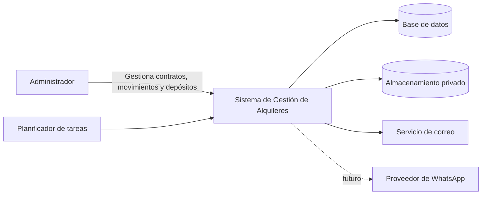
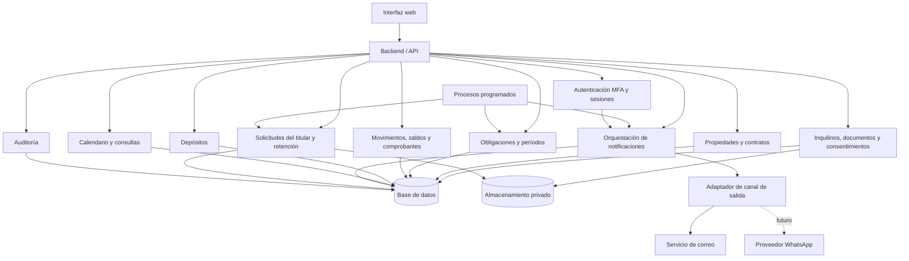

# Documento de Arquitectura de Software (DAS)

## Sistema de Gestión de Alquileres

**Identificador:** DAS-SGA-001
**Versión:** 0.14
**Estado:** Borrador para revisión; no aprobado
**Fecha:** 23 de octubre de 2026
**ERS de referencia:** ERS-SGA-001 v1.16 (borrador no aprobado)
**Valores regionales por defecto:** monedas CRC y USD; zona horaria `America/Costa_Rica`

Este borrador incorpora el impacto arquitectónico de ERS-SGA-001 v1.16 y las decisiones del solicitante hasta el 23-oct-2026, entre ellas el endurecimiento del servidor (ADR-032). **La v0.14 consolida las decisiones de seguridad posteriores a la v0.13** (PostgreSQL, Gunicorn y Nginx, salida de los firewalls, hora y aviso del respaldo, cifrados TLS, CAA, CSP y reinicio, todas del 23-oct-2026) en el ADR-032 y en los ADR-013, 024 y 029; la v0.13 había consolidado las decisiones sobre cuentas, correo del dominio, respaldos, dependencias y límite de solicitudes, y la v0.12 los ajustes apilados de la v0.11. El detalle, las fuentes y la trazabilidad de cada decisión siguen en su actualización de `DOC/actualizaciones/`. Cambios de fondo desde la ERS v1.5: período por aniversario, prorrateo solo del último período, reajustes y correcciones, estados derivados, movimientos inmutables con anulación, saldo de apertura, pagos en otra moneda, autenticación multifactor y las obligaciones legales de la Ley 7527 y la Ley 8968 (derechos del titular, consentimiento y retención). Desde la ERS v1.9: notificaciones por web y correo con WhatsApp como canal futuro, recibo de papel antes del comprobante del sistema y cambio y restablecimiento de contraseña. Desde la ERS v1.10 a la v1.14: reducción de la fotografía en el navegador, cédula y fotografía del contrato desde el perfil de la propiedad, registro del inquilino sin zona temporal de archivos, tope de subida de 5 MiB y máximo de 10 fotografías por contrato. El lenguaje, el framework, el motor de base de datos, el alojamiento, los respaldos, los roles de la base y el endurecimiento quedan fijados en los ADR-002 y ADR-022 a ADR-032. **Este documento no es asesoría legal ni autoriza iniciar la implementación.**

## Control e historial

| Campo | Valor |
|---|---|
| Propósito | Describir la estructura propuesta, responsabilidades, interacciones, riesgos y decisiones arquitectónicas. |
| Estado | Borrador sujeto a validación y aprobación. |
| Historial | **v0.14 (23-oct-2026)** incorpora al ADR-032 las decisiones sobre PostgreSQL, Gunicorn y Nginx, la salida de los firewalls, los cifrados TLS, el CAA, la CSP y el reinicio con sesiones abiertas, la hora del respaldo (05:00) y su aviso de fallo (RF-53 de la ERS v1.15), y cierra los pendientes de los ADR-013, 024 y 029 que dependían de ellas. **v0.13 (23-oct-2026)** incorpora al ADR-032 las decisiones sobre las cuentas de proveedores y de correo, el correo del dominio, los respaldos, las dependencias de Python y el límite de solicitudes, y cierra los pendientes de los ADR-022, 024, 025 y 026 que dependían de ellas; añade el modelo de amenazas v0.2 como referencia. **v0.12 (23-oct-2026) consolida la v0.11:** integra los ajustes apilados de los ADR y los anexos, alinea con la ERS v1.14, añade el ADR-032 (endurecimiento del servidor), la entidad Documento del contrato, el flujo de subida de fotografías (10.7) y la lista de decisiones de endurecimiento aún pendientes. **v0.11** alinea el DAS con la ERS v1.9 (ADR-008, ADR-026, ADR-010, ADR-018, ADR-013, RE-05). **v0.10** añade el ADR-026 (avisos de seguridad de la cuenta por correo) y ajusta ADR-013 y ADR-023. **v0.9** incorpora el stack del 20-oct-2026 (ADR-002, ADR-003, ADR-013, ADR-023 a ADR-025). **v0.8** fija Python y Django con interfaz renderizada por el servidor (ADR-022). **v0.7** cierra DP-26, fija la serie global de comprobantes como decisión provisional (ADR-018) y añade el ADR-021. **v0.6** cierra DP-07 y DP-08, difiere DP-04, añade restricciones, árbol de calidad, glosario y los ADR-014 a ADR-020. **v0.5** cierra DP-22, DP-24 y DP-25. **v0.4** introduce movimientos con saldos derivados, estados derivados, procesos idempotentes, comprobantes, protección de datos personales y autenticación multifactor. **v0.1 a v0.3** primera propuesta, depósitos, prorrateo, privacidad, internacionalización, abonos, períodos y fechas retroactivas. Correcciones de QA del 17-oct-2026 (actualización 2026-10-17e). |

## 1. Propósito y alcance

La arquitectura debe soportar inquilinos, propiedades, contratos, obligaciones por período de alquiler, movimientos de alquiler y de depósito con saldos derivados, recibos de pago (de papel en la v1; comprobantes generados por el sistema en una fase posterior), calendario, notificaciones web y por correo, auditoría, y almacenamiento privado de fotografías de documentos de identidad, cumpliendo los controles que derivan de las obligaciones legales de la ERS (sección 3).

La primera versión no procesa dinero automáticamente, no calcula intereses ni multas, no consulta tipos de cambio, no gestiona devoluciones ni deducciones del depósito y no prorratea períodos completos.

### 1.1 Restricciones

Origen: la evaluación de la metodología encontró que el DAS v0.5 no tenía sección de restricciones frente a la plantilla arc42 (fuente: [arc42](https://docs.arc42.org/home/), leída por resumen). Los identificadores RE-nn son propios de esta sección.

**Técnicas**

| ID | Restricción | Origen |
|---|---|---|
| RE-01 | Se usan herramientas de software libre o sin costo de licencia. | Solicitante, 17-oct-2026 |
| RE-02 | El costo mensual de operación debe ser mínimo; no hay tope numérico definido. | Solicitante, 17-oct-2026 |
| RE-03 | El sistema se aloja en un servidor virtual (VPS) administrado por el solicitante, accesible por internet con HTTPS. Desde la v0.9, el proveedor es DigitalOcean (ADR-023). | DP-08; solicitante, 20-oct-2026 |
| RE-04 | Lenguaje, framework y motor de base de datos: Python, Django y PostgreSQL 18 (ADR-022 y ADR-002, decisiones del solicitante del 20-oct-2026). Hasta la v0.7 esta restricción decía que no se fijaba ninguno de los tres porque el solicitante no indicó preferencia (17-oct-2026). | Solicitante, 17-oct-2026 y 20-oct-2026 |
| RE-05 | WhatsApp queda fuera de la v1. Cuando exista, no dependerá de un proveedor comercial concreto: se integrará mediante una interfaz con un proyecto aparte, aún inexistente. En la v1 las notificaciones salen por la web y por correo (ADR-008, ADR-026). | DP-04; solicitante, 21-oct-2026 |
| RE-06 | La interfaz funciona en las dos últimas versiones mayores de Chrome, Edge, Firefox y Safari, en escritorio y móvil. | ERS RNF-10 |

**De recursos y organización**

| ID | Restricción | Origen |
|---|---|---|
| RE-07 | Hay una única cuenta administradora y un único usuario humano. | ERS RN-25 |
| RE-08 | Volumen de diseño: hasta 50 propiedades. | ERS RNF-08 |
| RE-09 | La administración del servidor (actualizaciones, firewall, HTTPS, respaldos) recae en el propio solicitante. | DP-08 |

**Legales y de cumplimiento**

| ID | Restricción | Origen |
|---|---|---|
| RE-10 | Las reglas de la Ley 7527 y de la Ley 8968 son obligatorias, sujetas a validación por un abogado. | ERS sección 3; DP-17 |
| RE-11 | Los respaldos deben respetar la eliminación de datos personales por retención (35 días de respaldos). | DP-07; DP-18 |

**Efecto sobre la arquitectura.** RE-01, RE-02 y RE-09 empujan hacia pocas piezas y software con comunidad amplia. El monolito modular (ADR-001) encaja con ellas, pero no se justifica por ellas: lo justifica el volumen. RE-09 es un riesgo operativo: el solicitante, y no una plataforma, asume la seguridad del servidor.

## 2. Principios y referencias

Se toma como orientación SEI *Views and Beyond*, arc42, el modelo C4 y las guías de OWASP y NIST. Estas referencias guían el diseño, pero no certifican el sistema.

Principios:
- Separar interfaz, casos de uso, reglas de negocio y adaptadores de infraestructura.
- Mantener la lógica de contratos, obligaciones, movimientos y depósitos en servicios de dominio, no en la interfaz.
- **Los movimientos y los ajustes de importe son inmutables**: se anulan con una reversión o se corrigen con otro ajuste; nunca se editan ni se borran.
- **Los saldos y los estados se derivan** de los movimientos y de las fechas; no se almacenan como fuente de verdad.
- Procesos programados idempotentes.
- Autorización en el backend para cada operación sensible y cada descarga de documento.
- Conservar la moneda original por contrato y registrar toda conversión como dato ingresado, no calculado.
- Minimizar los datos personales almacenados, enviados y registrados.
- Hacer explícitas las decisiones pendientes mediante ADR.

## 3. Contexto del sistema

| Elemento | Responsabilidad |
|---|---|
| Administrador | Gestiona inquilinos, propiedades, contratos, movimientos, depósitos, configuración y solicitudes de titulares. |
| Aplicación SGA | Coordina reglas de negocio, consultas, auditoría y acceso a documentos. |
| Base de datos | Persiste registros, relaciones, movimientos, y el historial. |
| Almacenamiento privado | Conserva fotografías de cédula sin acceso público directo. |
| Planificador de procesos | Genera obligaciones, avisos y alertas, y ejecuta la retención. |
| Servicio de correo (Resend) | Recibe por API HTTPS los correos del sistema: notificaciones al administrador, avisos de seguridad y enlace de restablecimiento (ADR-026). Informa la aceptación; la v1 no recibe estados posteriores. |
| Proveedor de WhatsApp (futuro, fuera de la v1) | Enviaría mensajes mediante una interfaz de canal de salida; el proveedor es un proyecto aparte del solicitante, aún inexistente (DP-04). |

## 4. Drivers arquitectónicos y atributos de calidad

| Driver | Implicación arquitectónica |
|---|---|
| Una cuenta administradora | Autenticación multifactor obligatoria, códigos de recuperación de un solo uso, sesión corta y avisos de seguridad por correo a dos direcciones. Cambio y restablecimiento de contraseña con enlace de correo de un solo uso (ADR-026). No hay otro administrador que recupere el acceso. |
| Historia financiera | Movimientos inmutables; correcciones por anulación y nuevo registro; fecha real y fecha/hora de registro por separado. |
| Saldos y estados derivados | Evitar valores almacenados que puedan divergir; calcular desde movimientos y fechas. |
| Período por aniversario y vencimiento dentro del período | Servicio de cálculo de períodos y vencimientos con reglas de fin de mes. |
| Prorrateo solo del último período | Servicio de dominio con aritmética decimal exacta y redondeo registrado. |
| Reajuste frente a corrección | Dos operaciones distintas con efectos distintos sobre las obligaciones. |
| Obligaciones legales | Parámetros por contrato (destino, días de gracia), advertencias, recibos (número de recibo físico en la v1; comprobantes en una fase posterior) y registro de consentimiento. |
| Datos personales | Consentimiento, atención del titular en cinco días hábiles, retención, eliminación y desasociación. |
| Evitar duplicados | Restricciones de unicidad e idempotencia en procesos programados. |
| Plataforma configurable | CRC y USD por contrato; zona horaria solo a nivel de organización. |
| Web + correo (WhatsApp futuro) | Adaptador desacoplado del dominio financiero; mensajes con datos mínimos; un canal nuevo (WhatsApp) debe poder añadirse sin tocar las reglas financieras. |

Prioridades de calidad: seguridad y privacidad, integridad financiera, trazabilidad, confiabilidad, mantenibilidad, recuperación y usabilidad. Volumen de diseño: hasta 50 propiedades y un administrador; consultas habituales en menos de 2 s en el percentil 95 (objetivo a validar). RPO y RTO de 24 horas y retención de respaldos de 35 días (DP-07, ERS RNF-09); la disponibilidad no tiene objetivo numérico.

### 4.1 Árbol de requisitos de calidad

Escenarios medibles por atributo. No introduce requisitos nuevos: remite a los de la ERS.

| Atributo | Escenario | Medida | Referencia |
|---|---|---|---|
| **Seguridad** | Una persona sin sesión válida pide una foto de cédula | Se deniega; ninguna URL pública sirve el archivo | RF-26, RNF-14, CA-11 |
| | El administrador inicia sesión | Contraseña de 15 caracteres o más y segundo factor; sesión de 24 h máximo y 1 h de inactividad | RF-27, CA-48 |
| | Se pierde el segundo factor | Acceso solo con código de recuperación de un solo uso, con aviso por correo a dos direcciones | CA-47, CA-60 |
| | Se olvida la contraseña | Enlace por correo de un solo uso y 15 minutos; el acceso sigue exigiendo el segundo factor | RF-27, CA-59 |
| **Integridad financiera** | Se ejecuta dos veces el proceso de generación | No se crean obligaciones duplicadas | RNF-04, CA-03 |
| | Se anula un movimiento | El original se conserva; saldo y estado se recalculan | RF-16, CA-34 |
| | Se repite el mismo envío de un abono | No se crea un segundo movimiento | RF-34, CA-52 |
| | Se registran tres movimientos seguidos, y uno falla a medias | Fase posterior del comprobante: consecutivos y sin huecos; no se renumeran al anular. En la v1, el número de recibo físico es único | RF-37 (fase posterior), CA-37, CA-54, RF-47, CA-61 |
| | Se corrige una obligación | El importe inicial y la corrección se conservan | RF-10, CA-55 |
| **Disponibilidad y recuperación** | Falla el servidor | Recuperación en 24 h máximo (RTO) con pérdida de datos de 24 h máximo (RPO) | RNF-09 |
| | Prueba de restauración | Antes de producir y cada 3 meses | RNF-09 |
| **Rendimiento** | El administrador abre el calendario con 50 propiedades | Menos de 2 s en el percentil 95 (objetivo a validar) | RNF-08 |
| **Cumplimiento y privacidad** | Un inquilino pide acceso a sus datos | Se resuelve en 5 días hábiles y sin costo | RF-40, CA-27 |
| | Un contrato terminó hace más de 5 años | Se elimina la foto y se desasocian los datos | RF-41, CA-28 |
| | Se modifica un dato personal | La auditoría registra que cambió, no su valor | RF-28, CA-53 |
| **Confiabilidad de notificaciones** | Falla un envío de correo | Hasta 5 intentos con espera creciente; el estado financiero no cambia | RF-24, CA-09 |
| | El proceso diario no corrió dos días | Solo se emite la alerta del día actual | CA-42 |
| **Usabilidad y compatibilidad** | Uso desde el celular | Funciona en las dos últimas versiones mayores de los cuatro navegadores | RNF-10 |
| **Mantenibilidad** | Se cambia una regla de reajuste | El cambio queda confinado al módulo de obligaciones | RNF-11 |

## 5. Estrategia de solución propuesta

Se mantiene como candidato un **monolito modular**: una aplicación backend organizada por módulos de negocio, base de datos relacional, almacenamiento privado de archivos y procesos programados. Es una propuesta proporcional al volumen esperado, no una decisión tecnológica definitiva, salvo las tecnologías fijadas en los ADR-002 y ADR-022 a ADR-032. No se recomienda introducir microservicios sin necesidad comprobada.

Módulos lógicos:
1. Inquilinos, documentos y consentimientos.
2. Propiedades y contratos.
3. Obligaciones, períodos, vencimientos y prorrateo del último período.
4. Movimientos, saldos y comprobantes.
5. Depósitos de garantía.
6. Calendario y consultas.
7. Notificaciones y configuración regional.
8. Protección de datos: solicitudes del titular, retención e incidentes de seguridad.
9. Autenticación y sesiones.
10. Auditoría y operación.

El reparto de estos módulos en aplicaciones de Django consta en el ADR-030 (propuesta del asistente).

## 6. Bloques lógicos (C4 nivel 2)

| Bloque | Responsabilidad y límites |
|---|---|
| Backend/API | Valida solicitudes, autoriza operaciones y coordina casos de uso. |
| Contratos | Mantiene fechas, destino, monto, moneda, día de vencimiento, días de gracia y el historial de condiciones con fecha efectiva. |
| Obligaciones y períodos | Calcula períodos por aniversario, vencimientos, fecha límite y el prorrateo del último período; genera obligaciones 30 días antes; aplica reajustes y correcciones. |
| Movimientos y comprobantes | Registra abonos, pagos completos, saldo de apertura y anulaciones; deriva saldos; anota el número del recibo físico (RF-47); en la fase posterior, emite comprobantes con numeración consecutiva (RF-37). |
| Depósitos | Administra importe total, abonos, saldo y estado, independiente del alquiler. |
| Persistencia | Impone relaciones, unicidad y consistencia transaccional. |
| Documentos | Verifica autorización y registra acceso antes de entregar un archivo; evita URL pública permanente. |
| Notificaciones | Programa avisos al administrador por la web y por correo, registra intentos y resultados; no cambia estados financieros. También envía los avisos de seguridad y el enlace de restablecimiento que le pide Autenticación (ADR-026). |
| Protección de datos | Registra consentimientos y solicitudes del titular con su plazo; ejecuta retención y desasociación; registra incidentes de seguridad con su fecha límite de aviso (ADR-021). |
| Autenticación | Segundo factor, códigos de recuperación, sesión corta, cambio y restablecimiento de contraseña, avisos de seguridad (ADR-026). |
| Auditoría | Registra actor (administrador o sistema), fecha, operación y cambios relevantes sin almacenar secretos ni imágenes. Las operaciones del proceso diario llevan actor = sistema y la ejecución que las originó (ERS RF-28). |

## 7. Reglas arquitectónicas de dominio

### 7.1 Períodos, vencimientos y estados

- El **período** parte del día de `fecha_inicio` y dura hasta el día anterior al mismo día del mes siguiente. Si el mes no tiene ese día, el período inicia el último día de ese mes (ERS RN-03).
- El **vencimiento** es la fecha del día de vencimiento en el mes de inicio del período (o el último día de ese mes); si queda antes del inicio del período, se usa el mes siguiente; si excede el último día del período, se usa ese último día. Así siempre cae dentro del período (ERS RN-05, confirmada en DP-24). El día de vencimiento por defecto es el día de inicio del período.
- La **fecha límite** es el vencimiento más los días de gracia (ERS RN-06).
- El **estado** de una obligación se calcula en cada consulta: *pagada* (saldo cero), *vencida* (saldo mayor que cero y fecha local posterior a la fecha límite), *pendiente* (saldo mayor que cero y no vencida), *anulada* (marca explícita con motivo). El proceso diario **no** cambia estados; solo genera avisos.
- La **fecha local** se obtiene con la zona de la organización. Los vencimientos son fechas de calendario sin hora; las marcas de registro se guardan en UTC.

### 7.2 Movimientos, saldos y comprobantes

- Un **movimiento** es inmutable: importe, moneda recibida, tipo de cambio ingresado y equivalente (si aplica), fecha real, fecha/hora de registro, medio de pago, observación y una **clave de solicitud** única generada por el formulario; un envío repetido con la misma clave no crea otro movimiento (ADR-020).
- La **anulación** agrega un movimiento de reversión que referencia al original y registra el motivo. Una corrección de importe o fecha es anulación más nuevo movimiento.
- El **importe exigible vigente** es el importe inicial de la obligación más la suma de sus ajustes (ADR-016). El **saldo** es ese importe menos la suma de movimientos válidos (no anulados), siempre en la moneda del contrato; nunca negativo. Se valida dentro de la misma transacción que registra el movimiento.
- En la v1, el recibo es de papel fuera del sistema y el movimiento puede llevar un **número de recibo físico** opcional y único (RF-47). Lo que sigue describe el comprobante del sistema, de una fase posterior (RF-37; decisión del solicitante del 21-oct-2026).
- El **comprobante** (fase posterior) se numera con un contador en tabla, con bloqueo de fila, consecutivo, único y **sin huecos**, sin reutilizar números; los de movimientos anulados quedan marcados. La asignación del número ocurre en la misma transacción del movimiento. No se usa una secuencia de base de datos: no es transaccional y deja huecos si la operación falla (ADR-010).
- El **saldo de apertura** es una obligación de tipo apertura, no un movimiento (ADR-015).
- Para cheques y títulos, la fecha real es la de recepción del efectivo.
- Un abono en moneda distinta usa el tipo de cambio ingresado por el administrador (colones por dólar); el sistema no consulta fuentes externas. El equivalente en la moneda del contrato lo calcula el sistema con aritmética decimal exacta, a dos decimales con empate hacia arriba, y se conserva el cálculo (ERS RF-38; revisión del 21-oct-2026).
- Presentación de números: punto de miles y coma decimal, con el símbolo de la moneda delante (₡180.000,50) y porcentajes con coma, mediante un formato propio de Django y no el del idioma `es` por defecto, que usa un espacio no separable de miles (ERS RNF-12; revisión del 21-oct-2026).
- Dinero: aritmética decimal exacta (nunca flotantes), un tipo monetario con moneda explícita y redondeo registrado.

### 7.3 Prorrateo del último período

Solo cuando `fecha_fin` cae dentro de un período:

`importe = importe mensual × días cobrables / días del período`

con ambos extremos inclusivos, redondeo único al final a la unidad entera (CRC) o a dos decimales (USD) con empate hacia arriba, y registro del cálculo (días, importe previo al redondeo, importe final). Puede ajustarse manualmente con motivo y auditoría. La fórmula y el redondeo requieren validación legal (DP-01). Los períodos completos no se prorratean.

### 7.4 Reajuste y corrección

- **Reajuste:** registra fecha de notificación, nuevo monto, porcentaje, y el tope máximo vigente digitado por el administrador con su fuente (certificación del INEC o publicación del MIVAH); el sistema no consulta esas fuentes; la fecha efectiva se normaliza al inicio del período siguiente a la notificación; afecta solo a obligaciones cuyo período inicia en o después de esa fecha; para vivienda advierte si supera el tope informado y se rechaza si el precio está en moneda extranjera.
- **Corrección:** retroactiva, con motivo; ajusta obligaciones no pagadas afectadas, incluidas las vencidas.
- Ambos se registran como una nueva condición del contrato (ADR-014) y como un ajuste inmutable por obligación afectada (ADR-016); el importe de la obligación no se sobrescribe. Conservan el valor anterior, el nuevo y la fecha efectiva; no modifican obligaciones pagadas; se **bloquean** si dejan el importe exigible por debajo de lo abonado. La operación es transaccional.

### 7.5 Depósito de garantía

- Entidad separada de las obligaciones de alquiler; un depósito por contrato.
- Abonos como movimientos independientes con importe positivo, fecha real, fecha/hora de registro y observación.
- Hasta tres abonos no anulados en el flujo ordinario; más abonos exigen confirmación con motivo obligatorio, auditada.
- Saldo derivado; bloqueo de abonos que lo excedan; advertencia legal si el importe supera una mensualidad de renta.
- Sin alertas de depósito; contrato cerrado muestra "liquidación manual". Sin calendarios de cuotas. Devoluciones y deducciones fuera de alcance.
- Un abono al depósito no modifica saldo ni estado de ninguna obligación.

### 7.6 Moneda y zona horaria

- Monedas admitidas: CRC y USD, por contrato. No se mezclan importes de monedas distintas en sumas.
- Zona horaria solo a nivel de organización, con identificador IANA (nunca solo un desfase); los procesos programados la usan.
- Cambiar la configuración no altera registros históricos.

### 7.7 Datos personales

- **Consentimiento:** se registra por inquilino con fecha, versión del texto informativo (cada versión se conserva completa) y medio; admite revocación sin efecto retroactivo, que avisa en la ficha, impide contratos nuevos con ese inquilino y abre de oficio una solicitud de supresión. La supresión a petición ("desasociar a petición") elimina las fotografías y anula los datos personales, con los mismos bloqueos que desactivar a un inquilino, o se resuelve como denegada con motivo escrito (decisiones del solicitante del 21-oct-2026; interpretación del proyecto).
- **Solicitudes del titular:** se registran con fecha de recepción y fecha límite de cinco días hábiles; se atienden sin costo; se exporta todo el registro del titular, con la fotografía de su cédula y sin datos de terceros, como un informe web imprimible que el administrador imprime o guarda como PDF desde el navegador, sin biblioteca de PDF en el servidor (ERS RF-40; decisión del solicitante del 21-oct-2026).
- **Retención:** la fotografía se conserva hasta cinco años después del fin del contrato (configurable, tope de diez años desde los hechos); luego se elimina del almacenamiento y se desasocian los datos personales del inquilino, conservando los movimientos sin datos de identificación. El sistema avisa antes de ejecutar la eliminación. La conciliación con obligaciones contables o tributarias de conservación está pendiente (DP-18). Un inquilino sin contrato o con todos anulados se elimina tras un plazo corto configurable (propuesta de 1 año), desde su registro o su última anulación (revisión del 21-oct-2026).
- **Inquilinos sin frente (ERS v1.13, DP-30):** un inquilino puede guardarse sin fotografías, pero no se le crea un contrato hasta cargar el frente; la ficha lo indica y la lista permite filtrarlos; los que nunca se completan siguen la retención sin contrato de arriba, sin plazo nuevo.
- **Acceso a cédulas y exportaciones:** cada consulta o descarga de una cédula y cada exportación de los datos de un titular se registra (actor, fecha/hora, inquilino) sin guardar la imagen ni el contenido. Las lecturas ordinarias (fichas, saldos, calendario) no se auditan (decisión del solicitante del 21-oct-2026; OWASP, Logging Cheat Sheet, leída por resumen).
- **Transferencia:** los mensajes por correo (y, en el futuro, por WhatsApp) no incluyen número de documento ni imágenes y limitan los datos del inquilino al mínimo; la aplicabilidad de las reglas de transferencia al uso de un servicio externo de correo o de un proveedor de WhatsApp se valida legalmente (DP-19).

## 8. Modelo conceptual de datos

| Entidad | Datos principales |
|---|---|
| Inquilino | Identificador, tipo y número de documento, contacto, estado y referencia privada a los documentos. |
| Texto de consentimiento | Versión, contenido completo mostrado y fecha de vigencia; cada versión se conserva. |
| Consentimiento | Inquilino, fecha, versión del texto mostrado, medio, estado de revocación. |
| Token de restablecimiento | Administrador, hash del token, creación, vencimiento (15 minutos) y uso; un solo uso. |
| Documento de identidad | Identificador interno, referencia al archivo (frente, reverso; a lo sumo uno activo por cara), metadatos mínimos, fechas. Se sube directo a la ficha del inquilino; el frente se exige antes de crear un contrato. |
| Documento del contrato (RF-52) | Contrato, número de orden (1 a 10), referencia al archivo, tipo real y tamaño, fecha. Asociado al contrato, no al inquilino; su conservación está pendiente (DP-28). |
| Propiedad | Identificador, alias (obligatorio y único), descripción, dirección y marca de inactiva. |
| Contrato | Inquilino, propiedad, destino, vigencia, moneda y anulación (fecha y motivo). |
| Condición del contrato | Contrato, monto mensual, día de vencimiento, días de gracia, fecha efectiva, tipo (inicial, reajuste, corrección), datos del reajuste (notificación, porcentaje, tope digitado y fuente) y motivo. |
| Obligación | Contrato, período, vencimiento, fecha límite, importe inicial, moneda, condición aplicada, datos del cálculo, tipo (regular o apertura) y anulación (motivo, fecha). |
| Ajuste de obligación | Obligación, tipo (reajuste, corrección, prorrateo del último período, ajuste manual), importe con signo, condición de origen, motivo. Inmutable. |
| Movimiento | Tipo (abono o reversión), obligación o depósito asociado, importe, moneda recibida, tipo de cambio, equivalente, fecha real, fecha/hora de registro, medio de pago, observación, clave de solicitud, número de recibo físico (opcional, único), anulación y referencia al original. |
| Organización | Responsable de la base de datos, zona horaria, hora del proceso diario, correo del administrador y segunda dirección de avisos de seguridad, teléfono de avisos (futuro), anticipaciones, retención y días de gracia por defecto. Una sola fila en v1. |
| Comprobante (fase posterior, RF-37) | Número consecutivo, movimiento, estado. No existe en la v1. |
| Depósito de garantía | Contrato, importe total, fecha límite acordada opcional, notas. La moneda es la del contrato. |
| Notificación | Obligación o contrato, canal (web o correo; WhatsApp futuro), tipo, destinatario, intentos, resultado y estado web. Los avisos de seguridad de la cuenta usan la misma entidad, sin obligación asociada. |
| Solicitud del titular | Inquilino, tipo, recepción, fecha límite, resolución. |
| Auditoría | Actor y tipo de actor (administrador o proceso), ejecución (si la hizo el proceso diario), dirección IP de origen (solo en eventos de autenticación), entidad, acción, fecha, campos modificados y valores anteriores y nuevos solo de campos no personales. |
| Ejecución de proceso | Fecha local, inicio, fin, resultado y detalle; permite saber qué días corrió el proceso diario. |
| Incidente de seguridad | Fechas de ocurrencia y conocimiento, naturaleza, datos comprometidos (descripción), acciones, fecha límite de aviso, estado y avisos emitidos (destinatario, fecha, contenido mínimo). |
| Registro de acceso a documentos | Actor, documento de identidad o documento del contrato, fecha/hora, tipo de acceso. |

Invariantes propuestos:
- Una obligación por contrato y período.
- Los movimientos no se editan ni se borran.
- Ningún saldo ni estado es fuente de verdad almacenada.
- Un movimiento pertenece a una única obligación o a un único depósito.
- La numeración de comprobantes (fase posterior) es única, consecutiva y sin huecos. El número de recibo físico, si se anota, es único.
- Los ajustes de obligación son inmutables y nunca dejan el importe vigente por debajo de lo abonado.
- La clave de solicitud de un movimiento es única.
- La auditoría no contiene valores de campos personales.
- No hay días compartidos entre contratos de una propiedad.
- No se permite acceso a una fotografía sin autorización comprobada en el servidor.
- Los importes históricos conservan moneda y condiciones de cálculo.

## 9. Seguridad, privacidad y documentos

Controles mínimos:
- HTTPS en todos los accesos autenticados.
- Contraseña de al menos 15 caracteres, sin reglas de composición ni cambio periódico obligatorio; almacenamiento con Argon2id y los parámetros mínimos de OWASP (ADR-019).
- Segundo factor TOTP obligatorio; códigos de recuperación de un solo uso; aviso por correo a dos direcciones ante cada recuperación, emisión de códigos, cambio del segundo factor y cambio o restablecimiento de la contraseña (ADR-026).
- Límite de intentos fallidos por cuenta con espera creciente (5 fallos, 1 minuto, duplicándose hasta 1 hora; sin bloqueo permanente), 10 códigos de recuperación, TOTP sin reutilización y tolerancia de un intervalo de 30 s; la cuenta se crea y se rescata con comandos de gestión en el servidor (ERS RF-27; decisiones del solicitante del 21-oct-2026, cifras propuestas por el asistente).
- Cambio de contraseña y reemplazo del segundo factor con la contraseña actual; restablecimiento con un enlace de correo de un solo uso y 15 minutos que no inicia sesión (decisiones del solicitante del 21-oct-2026, contra la recomendación; riesgos en ADR-026). Protecciones adoptadas: respuesta idéntica, invalidar enlaces y sesiones al fijar la contraseña, y máximo de 3 solicitudes por hora.
- Sesión: cierre total a las 24 horas e inactividad de 1 hora (valores recomendados por NIST para el nivel de aseguramiento AAL2).
- Archivos fuera de rutas públicas y sin enlaces públicos permanentes.
- Lista blanca de formatos (JPEG y PNG), verificación del tipo real del archivo, límite de 5 MiB (5 242 880 bytes), nombres internos aleatorios; no usar el número de documento en rutas.
- La fotografía del documento se reduce en el navegador antes de enviarla (RF-50: lado mayor de 2048 px, JPEG con calidad 0,85, tope de 5 MiB) con un JavaScript mínimo sobre las plantillas de Django; **no es un control de seguridad**: el servidor aplica siempre la lista blanca, el tipo real y los 5 MiB (RF-02), y cada archivo (frente y reverso) llega en su propia petición. Los valores son de diseño y no se han medido (ERS v1.10, S-03 y DP-27). **Desde el 23-oct-2026 no hay zona temporal de archivos** (decisión del solicitante, actualización 2026-10-23d): el inquilino se registra primero y cada archivo se sube directo a su ficha o al contrato (diseño técnico, F-01, F-10 y F-11); el modelo de datos v0.6 ya no tiene `ARCHIVO_TEMPORAL`. La fotografía del contrato (RF-52) sigue las mismas reglas de archivos privados y reducción, queda asociada al contrato y su consulta se audita (propuesta); su conservación está pendiente (DP-28) y el máximo es de 10 fotografías por contrato y las cifras de reducción parten de 3508 px y calidad 0,85 y se miden en la entrega E2 (DP-29, ERS v1.14).
- Cifrado en tránsito y, cuando la infraestructura lo permita, en reposo.
- Auditoría proporcional al riesgo; sin datos de identidad completos, tokens ni documentos en registros técnicos, y sin valores de campos personales (ADR-017).
- Endurecimiento del servidor y de las cuentas que lo rodean (acceso remoto, firewall, actualizaciones, servicios, HTTPS, cabeceras, secretos, cuentas de proveedores y de correo, correo del dominio, respaldos, dependencias de Python y límite de solicitudes): decidido en el ADR-032 (23-oct-2026); quedan pendientes la revisión con otra persona y la auditoría con Lynis. Se aplica y audita en la fase 6 (RE-09). Las amenazas y sus brechas constan en el [modelo de amenazas](../fase-3-diseno-tecnico/MODELO_AMENAZAS_SGA_001_v0.2_borrador.md).
- Registro de incidentes de seguridad con plazo de aviso (ADR-021) y documento de seguridad con análisis de riesgos (Reglamento 37554-JP, arts. 36 y 38).
- Confidencialidad de quien intervenga en el tratamiento, aun después de terminada su relación.
- Probar la restauración de base de datos y documentos desde respaldos protegidos.
- La aplicación se conecta con un rol de base de datos sin `UPDATE` ni `DELETE` sobre el historial financiero y la auditoría (R12); las migraciones y los respaldos usan otros roles; todas las conexiones son locales por `peer`, sin contraseñas de base de datos (ADR-027).

## 10. Ejecución y escenarios críticos

### 10.1 Proceso diario (07:00, zona de la organización)

Un único proceso idempotente, reejecutable sin efectos adicionales, que:
1. Genera la obligación de cada contrato cuyo próximo período inicia dentro de 30 días, comprobando la unicidad por contrato y período.
2. Crea recordatorios para obligaciones con saldo según la anticipación configurada, con clave única obligación + tipo + anticipación + fecha.
3. Registra una alerta por obligación vencida y por día, y envía **un resumen** por correo al administrador, que incluye los contratos *por decidir* (se envía si hay obligaciones vencidas o contratos por decidir).
4. Genera el aviso de vencimiento de contrato 120 días antes del fin y marca *por decidir* los contratos cuya fecha de fin venció sin acción, con una notificación web persistente mientras sigan así.
5. Ejecuta la retención: avisa antes de eliminar y aplica la eliminación y desasociación vencidas.
6. Limpia las sesiones expiradas (`clearsessions`, propuesta; ADR-031).
7. Registra el resultado de la ejecución. Si faltaron días, pone al día obligaciones y contratos, pero emite solo la alerta del día actual.

### 10.2 Registro de un abono de alquiler

1. El administrador selecciona la obligación y registra el abono con medio de pago y fecha real.
2. El backend valida importe positivo, fecha real (no futura, no anterior al inicio del contrato) y que el saldo no resulte negativo. Si ya existe un movimiento con la misma clave de solicitud, devuelve ese y termina.
3. En una transacción (`transaction.atomic()`): bloquea la fila de la obligación con `select_for_update()` de Django, que en PostgreSQL ejecuta `SELECT ... FOR UPDATE` y mantiene el bloqueo hasta el fin de la transacción; una segunda operación sobre la misma fila espera y luego ve el saldo actualizado (decisión del solicitante del 21-oct-2026; sin `nowait`). Persiste el movimiento (con el número de recibo físico, si se anotó y es único) y registra la auditoría. En la fase posterior del comprobante, la misma transacción toma el número del contador.
4. El saldo y el estado se derivan; si el saldo es cero, la obligación aparece como pagada.
5. No se genera notificación individual; los avisos futuros de la obligación se cancelan solo si pasó a pagada.

### 10.3 Anulación de un movimiento

1. El administrador indica el motivo.
2. En una transacción: se agrega la reversión y se registra la auditoría; en la fase posterior del comprobante, también se marca el comprobante como anulado. El número de recibo físico anotado se conserva.
3. El saldo y el estado se recalculan; si vuelve a vencida, las alertas se reanudan el día siguiente.

### 10.4 Reajuste

1. El administrador registra la fecha de notificación y el nuevo monto.
2. El backend normaliza la fecha efectiva, calcula el porcentaje, aplica las advertencias y rechazos legales, y verifica que ninguna obligación afectada quede por debajo de lo abonado.
3. En una transacción: registra la condición con fecha efectiva, inserta un ajuste solo para las obligaciones que inician en o después de la fecha (sin sobrescribir su importe inicial) y registra la auditoría. Si algún ajuste dejara una obligación bajo lo abonado, se revierte toda la operación.

### 10.5 Registro de abono al depósito

1. El administrador selecciona el depósito y registra el abono.
2. El backend valida importe positivo, moneda y saldo disponible, y que no se supere el máximo ordinario sin confirmación con motivo.
3. Se persiste el movimiento y la auditoría; saldo y estado se derivan.

### 10.6 Notificaciones

El proceso consulta obligaciones y configuración, registra la notificación, crea la notificación web y, si el canal está configurado, incluye el aviso en el resumen diario por correo al administrador (un solo correo diario con tres secciones: recordatorios del día, obligaciones vencidas y contratos por decidir). Ante un fallo de envío reintenta hasta cinco veces con espera exponencial y aleatoria, con el mismo reintentador de intervalo corto de los avisos de seguridad (ADR-013, ADR-026); después marca *fallido*. Los mensajes llevan datos mínimos. Los fallos no modifican estados financieros. La API de envío solo informa la aceptación: no se declara entregado un correo solo aceptado y la v1 no recibe estados posteriores, por lo que no hay punto de entrada desde el exterior (diseño técnico, HT-01). Si WhatsApp vuelve, sus estados llegarían con retraso y su recepción se decide con el proveedor (DP-04).

### 10.7 Registro del inquilino y subida de fotografías

1. Se registra el inquilino con sus datos obligatorios y el consentimiento, **sin archivos**; en una transacción se guarda y se audita (ERS RF-01).
2. Desde su ficha, o desde el perfil de la propiedad si hay contrato vigente (RF-03, RF-51), el administrador elige la cara del documento; el navegador reduce la fotografía (RF-50) y la envía en su propia petición.
3. El servidor valida el consentimiento, el tipo real y el tope de 5 MiB (RF-02), guarda el archivo con nombre aleatorio fuera de la raíz web y, en una transacción, inserta el documento (si reemplaza una cara, marca la anterior como eliminada) y audita. Si falla la base, borra el archivo recién escrito en la misma petición (propuesta). No hay zona temporal de archivos.
4. No se crea un contrato con un inquilino que no tenga el frente cargado (RF-07, CA-78). La fotografía del contrato (RF-52) se sube directo al contrato, hasta 10 por contrato, con la fila del contrato bloqueada al calcular el orden (modelo de datos, H18).
5. Detalle: diseño técnico (F-01, F-02, F-10 y F-11) y modelo de datos v0.7 (R22 a R28).

## 11. Respaldo, recuperación y operación

La política de respaldo cubre base de datos y archivos privados de forma coordinada, con los valores de DP-07 (ERS RNF-09, decisión del solicitante del 17-oct-2026; sin fuente externa):

| Parámetro | Valor |
|---|---|
| RPO (pérdida tolerable de datos) | Hasta 24 horas |
| RTO (tiempo tolerable sin el sistema) | Hasta 24 horas |
| Frecuencia | Un respaldo completo al día |
| Retención | 35 días |
| Hora del respaldo | 05:00 hora de Costa Rica, después del reinicio de las 04:00 (ADR-032, decisión 15) |
| Aviso de fallo | Alerta si el último respaldo correcto tiene más de 26 horas (ADR-013; RF-53 y CA-79 de la ERS v1.15) |
| Prueba de restauración | Antes de producción y cada 3 meses: base de datos, archivos, contratos, movimientos, comprobantes y fotografías |

Con un VPS administrado por el solicitante (DP-08), el respaldo diario debe salir **a otro lugar**, cifrado. Según la documentación de DigitalOcean, sus respaldos no se pueden descargar, y por defecto guardan 7 copias diarias o 4 semanales (esto último solo por resultados de búsqueda), por lo que no cubren los 35 días de retención. Se programan copias propias, cifradas con `age` a clave pública, con la clave privada fuera del servidor y una copia mensual descargada al equipo del solicitante (ADR-024, ADR-032). Una copia no se considera suficiente hasta verificar que puede restaurarse. Los respaldos deben respetar la eliminación y desasociación por retención (DP-18).

**Condiciones recomendadas antes de cargar datos reales** (recomendación, no bloqueo): servidor endurecido según el ADR-032 y auditado con Lynis, prueba de restauración superada y revisión legal cerrada (DP-17 a DP-19). Tareas operativas del solicitante: actualizaciones del sistema, firewall, renovación de HTTPS, monitoreo y copia externa. Si el VPS está fuera de Costa Rica, aplica la revisión de transferencia de datos (DP-19).

## 12. Riesgos y mitigaciones

| Riesgo | Mitigación propuesta |
|---|---|
| Prorrateo incorrecto del último período | Fórmula explícita, cálculo registrado y casos de prueba de meses de distinta duración. |
| Saldos o estados divergentes | Derivarlos siempre de movimientos y fechas; pruebas de invariantes. |
| Numeración de comprobantes con huecos o duplicados (fase posterior; en la v1, recibos de papel con numeración a mano y número único anotado, RF-47) | Contador en tabla con bloqueo de fila en la misma transacción del movimiento; una secuencia de base de datos deja huecos (comprobado en prueba, 17-oct-2026). |
| Abono duplicado por doble envío | Clave de solicitud única por movimiento (ADR-020). |
| Operar el servidor con cédulas de inquilinos reales | Endurecimiento decidido en parte (ADR-032), respaldo externo cifrado, prueba de restauración y acceso con segundo factor. |
| Vulneración de seguridad sin aviso a tiempo | Registro de incidentes con fecha límite de cinco días hábiles (RF-46, ADR-021); procedimiento de respuesta en la fase 6; validación legal (DP-17, DP-19). |
| Auditoría que retiene datos personales | Auditar solo valores no personales (ADR-017); validar con abogado (DP-18). |
| Reajuste aplicado fuera de la regla legal | Normalización de fecha efectiva, advertencias, pruebas y validación legal. |
| Abonos del depósito mezclados con alquiler | Entidades separadas, validaciones y pruebas de invariantes. |
| Exposición de cédulas | Repositorio privado, autorización en backend, auditoría de acceso y pruebas de acceso denegado. |
| Conservación o eliminación indebida de datos | Retención configurable con aviso, desasociación y revisión contable (DP-18). |
| Pérdida de acceso a la cuenta única | Códigos de recuperación de un solo uso, aviso a dos direcciones y restablecimiento de contraseña por enlace de correo; este último hace del correo y del dominio una dependencia de acceso (ADR-026). |
| Cambios regionales alteran historia | Persistir moneda y condiciones aplicadas; fechas de calendario separadas de marcas UTC. |
| Proceso diario omitido | Monitoreo, historial de ejecuciones y reproceso idempotente. |
| Pérdida de información | Respaldos protegidos y restauración probada. |
| Toma de control de la cuenta de un proveedor (dominio, servidor, correo, repositorio) o del correo del administrador | Mejor segundo factor disponible, correo dedicado, registro de cuentas y bloqueo del dominio (ADR-032, decisión 7); el TOTP de DigitalOcean y de Resend sigue siendo vulnerable al phishing en tiempo real. |
| Falla conocida sin parchear en las dependencias de Python | `pip` con versiones fijadas, plazos de 3 y 14 días, django-announce, `pip-audit` y Dependabot (ADR-032, decisión 10); con una sola persona, una ausencia deja el parche sin aplicar. |
| Correo falsificado con el dominio del sistema | Subdominio de envío, SPF, DKIM y DMARC con `p=reject` al verificar (ADR-032, decisión 8). |
| Alguien deja la cuenta única en espera (AM-04) | Contador por cuenta con tope de una hora y restablecimiento siempre disponible (RF-27); riesgo residual **aceptado por el solicitante** (ADR-032, decisión 11). |
| Respaldo que falla en silencio | Marca del último respaldo correcto vigilada por el temporizador de intervalo corto, con alerta si pasan 26 horas (ADR-032, decisión 15); prueba trimestral de restauración con la copia de la clave (RNF-09). No cubre un servidor caído. |
| Datos personales en los registros técnicos de PostgreSQL | `log_statement = none`, parámetros fuera del registro y consultas lentas sin parámetros (ADR-032, decisión 12). |
| Una política de contenido (CSP) que rompa la interfaz | Primero `Report-Only` en la etapa A, sin scripts ni estilos en línea (ADR-032, decisión 16); es defensa en profundidad y no reemplaza el escape de las plantillas. |
| Amenazas de seguridad no recogidas en las filas anteriores | [Modelo de amenazas v0.2](../fase-3-diseno-tecnico/MODELO_AMENAZAS_SGA_001_v0.2_borrador.md) (23-oct-2026): 28 amenazas con sus controles, riesgo y brechas; autoverificación, sin revisar. |

## 13. Registros de decisiones de arquitectura (ADR)

### ADR-001 — Estilo arquitectónico
- **Estado:** Propuesto. **Candidato:** monolito modular, proporcional al volumen (hasta 50 propiedades).
- **Pendiente:** validar capacidades, despliegue y necesidades operativas.

### ADR-002 — Persistencia relacional
- **Estado:** Decisión del solicitante (20-oct-2026): PostgreSQL 18, recomendación del asistente.
- **Decisión:** motor PostgreSQL 18. Fuente: [política de versiones de PostgreSQL](https://www.postgresql.org/support/versioning/), leída por resumen el 20-oct-2026: cada versión mayor recibe cinco años de soporte; la 18 llega hasta el 14-nov-2030 (la 14 termina el 12-nov-2026).
- **Justificación:** relaciones, transacciones, unicidad contrato-período, contador de comprobantes e integridad de movimientos.
- **Evidencia:** una prueba desechable en PostgreSQL 18.4 (17-oct-2026, 32 de 32 comprobaciones) mostró que las restricciones del modelo MDD-SGA-001 v0.2 (vigente en ese momento; la v0.3 solo cambia la hora de las notificaciones y añade incidentes) son expresables, incluida la exclusión de contratos solapados ([documentación de PostgreSQL](https://www.postgresql.org/docs/current/rangetypes.html)). No es una elección de motor ni cubre concurrencia real.
- **Pendiente:** migraciones (se gestionan con Django, ADR-022), versión menor exacta, parámetros del servidor y la extensión `btree_gist` para la exclusión de contratos solapados. Los respaldos están en el ADR-024.

### ADR-003 — Documentos privados
- **Estado:** Decisión de diseño adoptada como requisito. Decisión del solicitante (20-oct-2026): disco del servidor, fuera de la raíz web, servido por Django tras comprobar permisos (opción recomendada por el asistente).
- **Fundamento (con fuente):** [OWASP, File Upload Cheat Sheet](https://cheatsheetseries.owasp.org/cheatsheets/File_Upload_Cheat_Sheet.html) recomienda guardar fuera de la raíz web, con nombre aleatorio (UUID) y mínimos permisos, comprobar la autorización en la descarga y no confiar en el Content-Type. La documentación de Django recomienda limitar el tamaño de las subidas en el servidor web y usar lista blanca de extensiones; los archivos se entregan con `FileResponse`. Ambas leídas por resumen el 20-oct-2026. Django aconseja servir los archivos subidos desde un dominio distinto, pero eso aplica a archivos públicos; aquí se entregan solo por una vista con autorización.
- **Decisión:** archivos en almacenamiento privado fuera de rutas públicas; la base guarda referencias y metadatos mínimos; todo acceso se registra. Desde el 23-oct-2026 cada archivo se sube directo a la ficha del inquilino o al contrato, sin zona temporal intermedia (ERS v1.12; sección 10.7).
- **Pendiente:** cifrado en reposo, análisis antivirus, y proceso de descarga autorizada. Límite de tamaño en Nginx decidido el 22-oct-2026: `client_max_body_size` de 6m solo en la ruta de subida de un archivo y 1m (el valor por defecto) en el resto; falta aplicarlo y probarlo. La carpeta entra en el respaldo coordinado (ADR-024).

### ADR-004 — Depósito de garantía
- **Estado:** Propuesto.
- **Decisión:** un depósito por contrato, con movimientos separados del alquiler y saldo derivado. Hasta tres abonos ordinarios y excepción con motivo. Sin calendarios en v1.

### ADR-005 — Configuración regional
- **Estado:** Propuesto.
- **Decisión:** CRC y USD por contrato; zona horaria solo a nivel de organización con identificador IANA; marcas de registro en UTC.

### ADR-006 — Movimientos inmutables con saldo derivado
- **Estado:** Propuesto; reemplaza el ADR-006 de v0.3.
- **Decisión:** una sola entidad de movimiento para alquiler y depósito; correcciones por anulación (reversión) y nuevo registro; saldos y estados derivados. El pago completo es un abono por el saldo restante.
- **Referencia:** patrón de ajuste por reversión (Fowler, *Reversal Adjustment*, borrador de 2006).

### ADR-007 — Reajuste y corrección
- **Estado:** Propuesto; reemplaza el ADR-007 de v0.3.
- **Decisión:** operaciones separadas; el reajuste es prospectivo con fecha efectiva normalizada; la corrección es retroactiva con motivo; ambas se bloquean si dejan el importe por debajo de lo abonado y se registran como ajustes (ADR-016).

### ADR-008 — Canal de salida: WhatsApp (futuro) y correo (v1)
- **Estado:** **Cambio de alcance, decisión del solicitante del 21-oct-2026:** WhatsApp queda fuera de la v1 y las notificaciones al administrador salen por la web y por correo (ERS RF-23; ADR-026). El proveedor de WhatsApp sigue **diferido** (DP-04); depende de un proyecto aparte del solicitante. Lo que sigue describe el canal futuro; no forma parte de la v1.
- **Interfaz de canal de salida:** la interfaz de canal de salida es la misma para correo y, cuando exista, WhatsApp, de modo que añadir el segundo canal no toque las reglas financieras. En la v1 solo hay estados *aceptado* y *fallido* (la API de correo informa la aceptación); no hay punto de recepción de estados y, por tanto, ningún punto de entrada desde el exterior (diseño técnico, HT-01).
- **Decisión de diseño:** interfaz de canal de salida (destinatario, contenido, clave de idempotencia) que devuelve estados aceptado, entregado y fallido; mensajes con datos mínimos; resumen diario. Mientras no exista el canal, basta la notificación web (ERS RNF-05).
- **Riesgo:** los términos de servicio de WhatsApp para consumidores (vigentes desde el 4-ene-2021) prohíben mensajería masiva o automática; los términos de la plataforma empresarial no se leyeron. El proyecto aparte requiere revisión legal.
- **Pendiente (si WhatsApp vuelve):** punto de recepción de estados de entrega; Meta los entrega por webhook con reintentos de hasta 7 días y duplicados posibles (leído por resumen el 21-oct-2026), y no se confirmó si pueden consultarse sin webhook; costos y límites si se usa la API oficial.

### ADR-009 — Estados derivados
- **Estado:** Propuesto.
- **Decisión:** el estado de obligación, contrato y propiedad se calcula desde saldos y fechas; el proceso diario solo genera avisos.

### ADR-010 — Comprobantes numerados
- **Estado:** Propuesto. **Fase posterior:** por decisión del solicitante del 21-oct-2026, la v1 usa recibos de papel fuera del sistema y el movimiento solo anota un número de recibo físico opcional y único (ERS RF-47); lo que sigue se aplica cuando se integre el comprobante del sistema (RF-37).
- **Decisión:** numeración consecutiva, única y **sin huecos**, tomada de un contador en tabla con bloqueo de fila dentro de la transacción del movimiento; los anulados se marcan y no se renumeran. No se usa una secuencia de base de datos.
- **Evidencia:** la [documentación de PostgreSQL](https://www.postgresql.org/docs/current/functions-sequence.html) establece que las secuencias "cannot be used to obtain gapless sequences"; la prueba del 17-oct-2026 lo reprodujo (último comprobante real 2, secuencia en 4). Corrige el texto de la v0.5, que decía "secuencia".
- **Pendiente:** formato y alcance legal (DP-20).

### ADR-011 — Protección de datos y retención
- **Estado:** Propuesto.
- **Decisión:** consentimiento registrado, solicitudes del titular con plazo, retención de cinco años configurable con aviso previo, eliminación de archivo y desasociación de datos personales, y registro de acceso a documentos.
- **Pendiente:** DP-17 a DP-21.

### ADR-012 — Autenticación
- **Estado:** Propuesto.
- **Decisión:** TOTP obligatorio, códigos de recuperación de un solo uso, sesión de 24 h con inactividad de 1 h, avisos de seguridad por correo a dos direcciones (ADR-026).

### ADR-013 — Procesos programados
- **Estado:** Propuesto.
- **Reintento de avisos de seguridad (20-oct-2026):** además del proceso diario, un segundo temporizador de systemd, de intervalo corto, reintenta los avisos de seguridad pendientes (ADR-026). El proceso diario y su idempotencia no cambian.
- **Vigilancia del proceso diario (21-oct-2026):** el mismo temporizador de intervalo corto vigila también el proceso diario: si una hora después de la hora programada no hay una ejecución correcta del día, o la última falló, registra un aviso, lo muestra como alerta web persistente y lo envía por correo (ERS RF-49; no cubre un servidor caído).
- **Reintento de notificaciones por correo (21-oct-2026):** el mismo temporizador de intervalo corto reintenta también las notificaciones al administrador por correo (RF-24); el temporizador corre **cada 1 minuto** (decisión del solicitante del 21-oct-2026, opción recomendada). Solo revisa qué envíos toca reintentar; la espera entre intentos la fija cada envío (propuesta: primera espera de 1 minuto, duplicándose con aleatoriedad, hasta 5 intentos) y no cambia por el intervalo.
- **Decisión del solicitante (20-oct-2026):** el proceso se ejecuta con un temporizador de systemd (`Persistent=yes`, hora en zona IANA) que invoca un comando de gestión de Django; no se usa Celery. Fuentes leídas por resumen: documentación de systemd (`Persistent=` recupera la ejecución perdida; la hora admite zona IANA) y de Django (los comandos de gestión están pensados para ejecutarse desde cron o un programador); Celery exige un intermediario de mensajes (Redis o RabbitMQ). No se verificó la versión mínima de systemd con zona en la hora ni el manejo de zonas en el temporizador, por lo que la aplicación calcula la hora local (DP-26).
- **Decisión:** un proceso diario idempotente a las 07:00 locales; ante una omisión solo se emite la alerta del día; claves únicas por aviso.
- **Decisión (DP-26, 17-oct-2026):** la hora programada se guarda como fecha local, hora local y zona de la organización, y el instante se calcula al ejecutar. Fundamento: [W3C, Working with Time Zones](https://www.w3.org/TR/timezone/), leída por resumen; UTC solo no basta para eventos futuros en hora local.
- **Vigilancia del respaldo (23-oct-2026, decisión del solicitante):** el mismo temporizador de intervalo corto comprueba también una marca del último respaldo correcto, escrita solo cuando la subida a Spaces terminó bien; si tiene más de 26 horas registra un aviso, lo muestra como alerta web persistente y lo envía por correo (ADR-032, decisión 15). Requisito RF-53 y CA-79 de la ERS v1.15; no cubre un servidor caído ni comprueba que el respaldo se pueda restaurar.

### ADR-014 — Historial de condiciones del contrato
- **Estado:** Propuesto (hallazgo H2 del modelo de datos).
- **Decisión:** monto, día de vencimiento y días de gracia viven en una entidad Condición del contrato con fecha efectiva; la condición de un período es la de mayor fecha efectiva que no supere su inicio.
- **Alternativa descartada:** guardarlos en el contrato (perdería el historial que exige ERS RF-10).

### ADR-015 — Saldo de apertura como obligación
- **Estado:** Propuesto (hallazgo H1).
- **Decisión:** el saldo de apertura es una obligación de tipo apertura, una por contrato, sin período. Corrige los glosarios de la ERS v1.6 y del borrador del DAS, que lo llamaban movimiento.
- **Alternativa descartada:** tratarlo como movimiento (contradice ERS 7.1 y CA-49).

### ADR-016 — Ajustes de importe inmutables
- **Estado:** Propuesto; decisión del solicitante del 17-oct-2026 (hallazgo H9).
- **Decisión:** la obligación guarda su importe inicial sin modificarlo; reajustes, correcciones, prorrateo del último período y ajustes manuales son filas inmutables; el importe vigente se deriva.
- **Alternativa descartada:** sobrescribir el importe y dejar el historial solo en la auditoría.

### ADR-017 — Auditoría sin valores personales
- **Estado:** Propuesto; decisión del solicitante del 17-oct-2026, afinada por el analista (hallazgo H10).
- **Decisión:** la auditoría guarda valores anteriores y nuevos solo de campos no personales; de los personales registra únicamente que cambiaron. Requiere reescribir ERS RF-28.
- **Pendiente:** validar con abogado (DP-18).

### ADR-018 — Serie global de comprobantes
- **Estado:** Decisión provisional del solicitante (17-oct-2026), sujeta a DP-20 (hallazgo H4). Aplica a la fase posterior del comprobante del sistema (v0.11, ADR-010).
- **Decisión:** una sola serie global de comprobantes, la más simple.
- **Alternativa:** una serie por año. **Pendiente:** DP-20; un abogado o contador puede exigir otra cosa. No se leyeron normas tributarias de comprobantes.

### ADR-019 — Hash de contraseñas
- **Estado:** Propuesto.
- **Decisión:** Argon2id con al menos los parámetros mínimos de OWASP (19 MiB de memoria, 2 iteraciones, paralelismo 1) y sal única; se ajusta en el servidor real a menos de ~1 s por hash. Fuente: [OWASP Password Storage Cheat Sheet](https://cheatsheetseries.owasp.org/cheatsheets/Password_Storage_Cheat_Sheet.html), leída por resumen.
- **Alternativas:** scrypt, bcrypt o PBKDF2 según disponibilidad de la biblioteca elegida.

### ADR-020 — Idempotencia del registro de movimientos
- **Estado:** Propuesto; aceptado por el solicitante el 17-oct-2026 (hallazgo H13).
- **Decisión:** cada movimiento lleva una clave de solicitud única (UUID v4) generada por el formulario; un envío repetido devuelve el movimiento ya registrado. Patrón de [Stripe](https://docs.stripe.com/api/idempotent_requests) para peticiones (leída por resumen); la clave natural de las notificaciones es un patrón distinto, no respaldado por esa fuente.
- **Evidencia:** probada en PostgreSQL con envíos secuenciales (CA-52); concurrencia real sin probar.

### ADR-021 — Incidentes y documentación de seguridad
- **Estado:** Propuesto; lectura propia del Reglamento 37554-JP, pendiente de abogado (DP-17, DP-19).
- **Decisión:** el sistema registra incidentes de seguridad con la fecha en que ocurrieron y se conocieron, calcula la fecha límite de aviso de cinco días hábiles y guarda constancia de los avisos a titulares y a la Agencia (ERS RF-46). El documento de seguridad (datos, inventario, análisis de riesgos, riesgo residual, plan) y el protocolo mínimo de actuación son entregables de la fase 6, revisados al menos una vez al año (ERS RNF-18).
- **Fuente:** Reglamento 37554-JP, arts. 32 a 39, copia del Archivo Nacional leída parcialmente (17-oct-2026); no se confirmó en el SCIJ.
- **Límites:** el sistema no detecta incidentes; el desde cuándo corre el plazo y el tratamiento de feriados quedan para el abogado.

### ADR-022 — Lenguaje, framework e interfaz
- **Estado:** Decisión del solicitante (20-oct-2026), tras una recomendación propuesta por el asistente. Versión de Django, motor de base de datos y demás piezas siguen pendientes.
- **Decisión:** backend en Python con Django, como monolito modular (ADR-001), con la interfaz renderizada por el servidor mediante las plantillas de Django. No hay aplicación de frontend separada ni API pública en la versión 1.
- **Alternativas consideradas:** Next.js con una API aparte, ASP.NET Core, Spring Boot y Laravel. Next.js se descartó para la versión 1 porque agrega una segunda aplicación y una API entre ambas, frente a RE-01, RE-02 y RE-09 (pocas piezas); se reconsidera si surge una interfaz muy interactiva, una aplicación móvil o una API pública. El solicitante eligió Django; las demás no se investigaron a fondo.
- **Fundamento (con fuente):** Django ofrece `ExclusionConstraint` para impedir contratos solapados en PostgreSQL (requiere la extensión `btree_gist`) y admite Argon2id con `argon2-cffi`, aunque no es el valor por defecto (que es PBKDF2). Tiene una lista de comprobación de despliegue y el comando `check --deploy`. Fuentes leídas por resumen: referencias 17 a 19.
- **Evidencia de apoyo, de baja fiabilidad:** un estudio de la Universidad de Kabul (2026) señala mejores protecciones por defecto en Django que en Laravel; se leyó solo el resumen, compara dos frameworks y su método se basa en documentación y en CVE, no en pruebas. Estudios de rendimiento ubican a ASP.NET Core y Spring Boot por encima de Django, pero el rendimiento no pesa con el volumen de diseño (RE-08, RNF-08). Ninguno comparó un sistema como el SGA. La Stack Overflow Developer Survey 2025 mide uso, no calidad.
- **Soporte de versiones (consultado el 20-oct-2026):** Django 5.2 LTS con soporte extendido hasta abril de 2028; la 6.2 LTS está prevista para abril de 2027, con soporte hasta abril de 2030. En la v0.10 se proponía elegir la versión al empezar la implementación, de preferencia la 6.2 LTS.
- **Versiones decididas (21-oct-2026), opción recomendada por el asistente:** **Django 5.2 LTS con el Python 3.14 del sistema** (Ubuntu 26.04), que reemplaza la preferencia por la 6.2 LTS porque esta no estará publicada hasta abril de 2027. Fuentes (por resumen, 21-oct-2026): [Django, descargas](https://www.djangoproject.com/download/) (5.2 LTS, última 5.2.18, soporte ampliado hasta abril de 2028; 6.1 hasta diciembre de 2027; 6.2 LTS prevista para abril de 2027, hasta abril de 2030); [Django, FAQ de instalación](https://docs.djangoproject.com/en/stable/faq/install/) (la 5.2 admite Python 3.10 a 3.14, la 3.14 desde la 5.2.8; recomienda la última versión de Python 3); [Python, versiones](https://devguide.python.org/versions/) (la 3.14 con fin de vida programado en octubre de 2030); [notas de Ubuntu 26.04, resumen para usuarios LTS](https://documentation.ubuntu.com/release-notes/26.04/summary-for-lts-users/) (Python actualizado de 3.12 a 3.14, PostgreSQL 18 y Django 5.2 LTS; no dice cuál es el `python3` por defecto). La etapa local (WSL con `Ubuntu-26.04`) y el Droplet tienen así las mismas versiones. Se fijan las versiones exactas (micro) y se vuelve a evaluar el salto a la 6.2 LTS después de abril de 2027, antes de abril de 2028.
- **Forma de instalación decidida (23-oct-2026, opción recomendada por el asistente):** Django y las demás dependencias se instalan con `pip` en un **entorno virtual con versiones exactas fijadas** en un archivo del repositorio, con las mismas versiones en la etapa A y en el Droplet; no se usan los paquetes de Ubuntu para Django (ADR-032, decisión 10). Los plazos y los avisos de actualización constan ahí.
- **No verificado:** qué versión de Django trae el paquete de Ubuntu 26.04 y su retraso respecto de Django (no se instala); que el salto de la 5.2 a la 6.2 sea sencillo (de memoria del asistente); `packages.ubuntu.com` no se pudo abrir.
- **Pendiente:** versiones exactas (micro) de Django y Python al crear el entorno y estilo de las interfaces internas. Los "contratos de API" de la fase 3 se reducen a interfaces internas mientras no exista API pública.
- **Límite:** no se evaluó la experiencia previa del solicitante con Python ni con Django.

### ADR-023 — Alojamiento y servidor
- **Estado:** Decisión del solicitante (20-oct-2026): DigitalOcean y el montaje siguiente, que confirmó entre las opciones recomendadas por el asistente.
- **Decisión:** un Droplet de DigitalOcean con Ubuntu 26.04 LTS; Nginx como proxy inverso; Certbot para el HTTPS; Gunicorn gestionado por systemd; sin contenedores. Se mantienen el firewall del servidor y el Cloud Firewall de DigitalOcean con las mismas reglas (ADR-032).
- **Fundamento (con fuente, leída por resumen el 20-oct-2026):** DigitalOcean lista Ubuntu 26.04 LTS entre sus imágenes (su nota de lanzamiento solo por resultados de búsqueda); Ubuntu 26.04 recibe mantenimiento de seguridad estándar hasta mayo de 2031; la guía de despliegue de Gunicorn recomienda un proxy que amortigüe clientes lentos y sugiere Nginx; Certbot automatiza la renovación y se prueba con `--dry-run`; Caddy no amortigua las peticiones por defecto, y su documentación califica esa opción de ineficiente; los Cloud Firewalls de DigitalOcean no tienen costo adicional.
- **Costos de referencia (consultados el 20-oct-2026, sin fecha de publicación en la fuente; volver a verificar al contratar):** Droplet de 2 GiB, 1 vCPU y 50 GiB, $12 al mes; Spaces, $5 al mes con 250 GiB incluidos; respaldo semanal del Droplet, 20 % de su precio.
- **Alternativas consideradas:** Docker Compose y Caddy; descartadas por el solicitante al confirmar la opción recomendada.
- **No verificado:** versión de Python de Ubuntu 26.04 y su compatibilidad con Django; cómo se combinan los dos firewalls con IPv6 (se evita no activando IPv6, ADR-032); los comandos de las guías de DigitalOcean para la 26.04 (las guías encontradas son de Ubuntu 18.04 a 22.04).
- **Aviso legal:** los centros de datos de DigitalOcean están en Estados Unidos, Canadá, Europa y Asia-Pacífico, no en Latinoamérica ni Centroamérica; aplica la revisión de transferencia de datos (DP-19), pendiente de abogado.
- **Región, tamaño y costo (21-oct-2026), decisiones del solicitante, opciones recomendadas:** región **NYC3 (Nueva York)** para el Droplet y para Spaces (en NYC3 hay Droplets sin limitación, Spaces estándar y frío y respaldos; no hay centro en Latinoamérica, así que DP-19 aplica igual; Atlanta, más cercana por geografía, tiene Droplets "limitados" y no se verificaron sus planes); **Droplet de producción de 2 GiB y 1 vCPU** (US$12 al mes, precio de la página de DigitalOcean consultada el 21-oct-2026, sin moneda ni fecha de publicación) y **Droplet de pruebas temporal** del mismo tamaño que se crea para cada entrega y se destruye; con respaldo semanal (20 %) y Spaces (US$5), unos **US$19,40 al mes** en producción, más el dominio y las horas de pruebas. Si la prueba de carga (RNF-08) no cumple, se pasa al plan de 2 vCPU (US$18). Que 1 GiB sea insuficiente y que el volumen no exija más de 2 GiB son criterio del asistente, sin medir; que el Droplet se pueda redimensionar sin perder datos no se verificó.
- **Etapas de despliegue (21-oct-2026):** por planteamiento del solicitante, el despliegue se hace primero **en local y gratis** (etapa A: WSL 2 con `Ubuntu-26.04`, sin contenedores, con los mismos servicios, roles y temporizadores) y solo después se contratan DigitalOcean, el dominio y Resend (etapa B). Se descartó Docker porque el criterio de buenas prácticas es la paridad entre desarrollo y producción (The Twelve-Factor App, factor X, por resumen) y producción es sin contenedores, con temporizadores de systemd (ADR-013) y `peer` (ADR-027). En la etapa A el correo va a un buzón local, los respaldos a una carpeta local y el HTTPS usa un certificado autofirmado; lo que no se prueba en local consta en el plan de implementación (sección 5.1). No se verificó que `Ubuntu-26.04` en WSL traiga systemd activo ni los paquetes de PostgreSQL 18 en esa versión.
- **Pendiente:** nombre exacto del dominio (será un `.com` en Cloudflare Registrar; lo exige también el servicio de correo del ADR-026), monitoreo; el endurecimiento y las actualizaciones constan en el ADR-032.

### ADR-024 — Respaldos
- **Estado:** Decisión del solicitante (20-oct-2026), opción recomendada por el asistente.
- **Decisión:** cada día, `pg_dump` en formato personalizado, `pg_dumpall --globals-only` y la carpeta de documentos privados, cifrados antes de subirlos a Spaces; regla de ciclo de vida de 35 días (DP-07); más un respaldo semanal del Droplet de DigitalOcean como segundo punto de restauración. Prueba de restauración antes de producción y cada 3 meses (RNF-09).
- **Fundamento (con fuente):** la documentación de PostgreSQL indica que `pg_dump` hace copias consistentes con la base en uso, que no incluye roles (se requiere `pg_dumpall`) y que, salvo casos simples, no es lo indicado para respaldos regulares de producción; con RPO de 24 h y una base pequeña se considera un caso simple (juicio del asistente). Leída por resumen. Las reglas de ciclo de vida de Spaces borran objetos tras N días (solo resultados de búsqueda).
- **Alternativa no elegida:** archivado continuo con recuperación a un punto en el tiempo (capítulo de respaldos de PostgreSQL), con menor pérdida de datos pero más complejo de operar.
- **Cifrado, custodia y llaves (23-oct-2026, decisiones del solicitante, opciones recomendadas por el asistente):** los respaldos se cifran con **`age` a clave pública**, un archivo independiente por día (`pg_dump`, `pg_dumpall --globals-only` y los documentos); el servidor solo tiene la clave pública. La clave privada se genera fuera del servidor y se guarda en **dos lugares independientes y fuera de línea**; cada restauración trimestral se hace con esa copia. No se usa restic: su repositorio no tolera que el ciclo de vida de Spaces borre objetos. La llave de Spaces del servidor está limitada a un bucket (Read/Write/Delete: Spaces no ofrece "escribir sin borrar"), se activa el **versionado** y se descarga **una vez al mes** una copia cifrada con otra llave de solo lectura; se mantiene el respaldo semanal del Droplet. La llave del servidor puede borrar los respaldos aun con versionado: la copia mensual y el respaldo semanal limitan el daño. Detalle y fuentes en la [actualización 2026-10-23 (za)](../actualizaciones/2026-10-23za_br-03-respaldos-clave-spaces/CAMBIOS.md).
- **No verificado:** cifrado en reposo de Spaces (la página dio 404); que la regla de ciclo de vida borre efectivamente (hay reportes antiguos de usuarios de que no siempre lo hacía; se prueba antes de producción); cómo interactúa el versionado con esa regla; el costo de una copia completa por día; `age` no se probó ni se leyó su especificación y no consta una auditoría; precio real del respaldo de DigitalOcean. El respaldo semanal del Droplet no cubre por sí solo los 35 días.
- **Pendiente:** hora del respaldo decidida el 23-oct-2026: 05:00 hora de Costa Rica, después del reinicio de las 04:00, con aviso si el último respaldo correcto tiene más de 26 horas (ADR-032, decisión 15); queda pendiente que nadie más sabe dónde están las copias de la clave (DP-23) y que la retención de 35 días respete la desasociación de datos (DP-18, RE-11).
- **Rol de respaldos (21-oct-2026):** el respaldo usa el rol de solo lectura del ADR-027 y `pg_dumpall --globals-only --no-role-passwords`; ver ese ADR.

### ADR-025 — Integración continua
- **Estado:** Decisión del solicitante (20-oct-2026), opción recomendada por el asistente; se activa al empezar la implementación.
- **Decisión:** GitHub Actions ejecuta en cada cambio las pruebas de Django, `manage.py check --deploy` y la verificación de migraciones contra un PostgreSQL 18.
- **Fundamento:** el plan gratis de GitHub incluye 2.000 minutos al mes en repositorios privados (solo resultados de búsqueda, con un comentario de foro que lo contradice y que se trata como no oficial). La lista de despliegue de Django (leída por resumen) documenta `check --deploy`.
- **No verificado:** visibilidad del repositorio de GitHub y costo si se excede el límite.
- **Vigilancia de dependencias (23-oct-2026, decisión del solicitante):** la integración continua ejecuta también `pip-audit` contra las dependencias fijadas (falla si hay una vulnerabilidad conocida) y el repositorio activa las alertas de Dependabot de GitHub (que no se confirmó que sean gratuitas para un repositorio privado). Detalle en el ADR-032 (decisión 10).

### ADR-026 — Avisos de seguridad de la cuenta
- **Estado:** Decisión del solicitante (20-oct-2026), opciones recomendadas por el asistente, tras revisar HT-05 del diseño técnico. **21-oct-2026:** la ERS v1.9 ya recoge sus cambios; el servicio de correo pasa a enviar también las notificaciones al administrador (HT-01) y el enlace de restablecimiento de contraseña (HT-08).
- **Notificaciones al administrador:** los recordatorios y el resumen diario de alertas de atraso (RF-21, RF-22, RF-23) salen por este mismo servicio al correo del administrador, con el límite de datos de RF-44 (propuesta; aplicabilidad al correo por validar con el abogado, DP-17). No se usa Resend para ningún correo a inquilinos.
- **Restablecimiento de contraseña (decisión del solicitante del 21-oct-2026, contra la recomendación de usar código de recuperación y TOTP en la web):** el sistema envía a la dirección del administrador, y solo a ella, un **enlace de un solo uso válido 15 minutos** (valor propuesto por el asistente, aceptado) que permite fijar una contraseña nueva y no inicia sesión; el acceso sigue exigiendo el TOTP. Cambiar la contraseña o reemplazar el segundo factor con la sesión iniciada exige la contraseña actual (decisión contra la recomendación de exigir además un factor ya registrado). La regla "sin enlaces de acceso" de los avisos de seguridad no cambia: el correo con enlace es de otro tipo. Riesgos asumidos: una sesión secuestrada con la contraseña puede reemplazar el segundo factor, y el correo y el dominio pasan a ser dependencias de acceso. Protecciones adoptadas el 21-oct-2026 (opciones recomendadas): respuesta y tiempo idénticos exista o no la cuenta; invalidar los demás enlaces y cerrar las sesiones abiertas al fijar la contraseña nueva (cierre automático, propuesta del asistente); máximo de 3 solicitudes por hora para la cuenta (número propuesto por el asistente). OWASP, Forgot Password Cheat Sheet, leída por resumen el 21-oct-2026; no fija el límite numérico. Fuentes: OWASP, Authentication Cheat Sheet y Multifactor Authentication Cheat Sheet (leídas por resumen el 21-oct-2026).
- **Decisión:** el sistema avisa por **correo electrónico a dos direcciones** (las dos del propio solicitante, en proveedores distintos; decisión del 21-oct-2026) siete eventos de la cuenta (los dos últimos, llegar a cinco intentos fallidos seguidos y el rescate por el servidor, añadidos el 21-oct-2026 en la revisión por módulos): uso de un código de recuperación, emisión de nuevos códigos, registro o cambio del segundo factor, cambio o restablecimiento de la contraseña y cambio de una dirección de correo (confirmado en la dirección nueva, con la contraseña actual; decisión del solicitante del 21-oct-2026, revisión por módulos). WhatsApp será un segundo canal cuando exista (DP-04). El aviso dice qué ocurrió, la fecha y hora local y qué hacer si no fue el administrador; **no lleva códigos, contraseñas ni enlaces de acceso**.
- **Envío:** servicio de correo Resend por su API HTTPS, con django-anymail; DigitalOcean bloquea los puertos 25, 465 y 587 de los Droplets. Requiere un dominio propio verificado: un `.com` en Cloudflare Registrar, con el DNS de Cloudflare (decisión del solicitante del 21-oct-2026; precio de unos US$10 al año según una reseña de terceros, por confirmar al comprarlo).
- **Correo del dominio (23-oct-2026, decisión del solicitante):** el sistema envía desde un **subdominio dedicado** verificado en Resend y el dominio raíz no envía correo; DMARC se publica en la raíz con `p=none` y reportes durante las pruebas de la etapa B, y pasa a `p=reject` cuando los tres tipos de correo lleguen con `dmarc=pass` (el subdominio hereda la política). Los reportes llegan a la dirección dedicada a las cuentas de los proveedores (ADR-032, decisión 8). Los avisos de errores de las actualizaciones del servidor usan el SMTP de Resend en el puerto 2465 o 2587 y una clave propia del servidor (ADR-032, decisión 3).
- **Fallo del envío:** la recuperación procede (no se bloquea la única cuenta). El aviso se guarda en la misma transacción que el evento; se envía de inmediato y se reintenta hasta cinco veces con espera creciente y aleatoria, mediante un temporizador de intervalo corto. Si sigue fallando, queda en estado *fallido*, se muestra una alerta persistente en cada inicio de sesión y se registra en la auditoría.
- **Fundamento (con fuente, leída por resumen el 20-oct-2026):** NIST SP 800-63B-4, sec. 4.6 (la recuperación de cuenta y el reemplazo de un código de recuperación deben notificarse; añadir un autenticador debe notificarse por un mecanismo independiente; al menos dos direcciones; instrucciones y contacto si no se reconoce el evento; cambio de contraseña no figura en su lista); OWASP, Multifactor Authentication Cheat Sheet (notificar fuera de la sesión; el correo depende de la seguridad de esa cuenta) y Forgot Password Cheat Sheet (aviso por correo tras restablecer la contraseña, sin la contraseña); DigitalOcean (SMTP bloqueado); precios y documentación de Resend; django-anymail. Los reintentos reutilizan el patrón de RF-24 (AWS Architecture Blog, referencia 9).
- **Propuesta del asistente, aceptada por el solicitante:** los eventos 3 y 4, la regla de no incluir códigos ni enlaces, el reintentador de intervalo corto y recuperar sin bloquear ante fallo del correo. Ninguna fuente decide el equilibrio entre bloquear y dejar pasar la recuperación.
- **Cambios en la ERS:** hechos en la v1.9 (sección 2.4, RF-23, RF-24, RF-27, RF-44, CA-47, CA-59 y CA-60). Hasta la v0.10 constaban como pendientes.
- **No verificado:** entregabilidad y reputación de Resend; sus términos de servicio sobre datos personales; registros DNS exactos; estabilidad del plan gratis; intervalo del temporizador de reintentos.
- **Pendiente:** el nombre exacto del dominio y su precio al comprarlo; configurar las dos direcciones en el servidor (no constan en los documentos); procedimiento de reacción ante un aviso inesperado (fase 6). Las dos direcciones son del solicitante, por lo que ya no hay dato de un tercero en este punto.

### ADR-027 — Roles de la base de datos y aplicación de R12
- **Estado:** Decisión del solicitante (21-oct-2026), opción recomendada por el asistente. Origen: punto 2 de la revisión de la conexión entre las páginas y la base de datos.
- **Decisión:** la aplicación **no se conecta como dueña** de las tablas. Hay tres roles de PostgreSQL (el tercero, de respaldos, consta más abajo); los dos principales son un **rol dueño**, que solo ejecuta las migraciones al desplegar, y un **rol de la aplicación**, que usan Gunicorn y el comando diario. En las tablas de la restricción R12 del modelo de datos (movimientos, ajustes de obligación, auditoría y accesos a documentos) el rol de la aplicación tiene solo `SELECT` e `INSERT`: sin `UPDATE` ni `DELETE`. Django añade guardas en los modelos de esas tablas (error claro al intentar editar o borrar una fila existente, y bloqueo de `update()` y `delete()` masivos); no se usa el sitio de administración de Django sobre ellas.
- **Fundamento (con fuente, leída por resumen el 21-oct-2026):** [PostgreSQL, privilegios](https://www.postgresql.org/docs/current/ddl-priv.html): los privilegios `SELECT`, `INSERT`, `UPDATE` y `DELETE` se conceden por tabla (y por columna con `GRANT`), "the right to modify or destroy an object is inherent in being the object's owner, and cannot be granted or revoked in itself", y por defecto no hay privilegios para `PUBLIC` sobre las tablas; [Django, bases de datos](https://docs.djangoproject.com/en/stable/ref/databases/): permite usar un rol distinto del de la conexión (`assume_role`). La página de Django no lista los permisos que PostgreSQL exige a Django.
- **Propuesta del asistente, no decidida:** nombres de los roles y de los usuarios del sistema; privilegios por columna para las excepciones de R12 (`OBLIGACION.importe_inicial` sin `UPDATE`, `anulada_en` que se completa una vez, `CODIGO_RECUPERACION.usado_en` y `TOKEN_RESTABLECIMIENTO.usado_en` solo `UPDATE` de esa columna, y el estado del comprobante en la fase posterior); ningún `DELETE` en las tablas del negocio (la retención desasocia datos con `UPDATE` de `INQUILINO` y marca `eliminado_en` en `DOCUMENTO_IDENTIDAD`); **corrección del 21-oct-2026:** `DELETE` sí en `django_session`, por la limpieza de sesiones expiradas y el cierre de sesiones al cambiar la contraseña (ADR-031); un paso explícito que concede los privilegios de cada tabla y secuencia nueva tras cada migración.
- **Límites:** el rol dueño sigue pudiendo modificar todo; protege contra un fallo del código, no contra quien tenga ese rol. Un disparador (`trigger`) no se adoptó. No se verificó qué privilegios exige Django a un rol de aplicación en PostgreSQL ni el manejo de las secuencias de identificadores (`USAGE`); el formato de los identificadores ya está decidido en el ADR-028.
- **Pendiente:** la prueba de integración que demuestre que el rol de la aplicación es rechazado al hacer `UPDATE` o `DELETE` sobre un movimiento (estrategia de pruebas); cómo el administrador ejecuta las migraciones como usuario dueño del sistema (por ejemplo `sudo -u`, sin verificar) y su procedimiento en la fase 6.
- **Tres roles y autenticación `peer` (21-oct-2026), decisión del solicitante, opción recomendada:** son **tres roles** y las conexiones usan **autenticación `peer` por el socket Unix local**, sin contraseñas de base de datos: (1) rol dueño, usado a mano por el administrador solo para las migraciones; (2) rol de la aplicación, usado por Gunicorn y por el comando diario; (3) rol de respaldos, de solo lectura mediante el rol predefinido `pg_read_all_data`. Cada servicio corre con su propio usuario del sistema y entra a la base con el rol que le corresponde (con un mapa de nombres si difieren). No hay secretos de base de datos en el servidor, en la integración continua ni en el repositorio. Solo vale mientras la base esté en el mismo Droplet que la aplicación (ADR-023); si se separa o se usa una base gestionada, hay que revisar esta decisión.
- **Fuentes (por resumen, 21-oct-2026):** [PostgreSQL, roles predefinidos](https://www.postgresql.org/docs/current/predefined-roles.html) (`pg_read_all_data` lee todas las tablas, vistas y secuencias, y no omite la seguridad por filas; la página no dice en qué versión apareció, y de memoria fue la 14, sin verificar); [PostgreSQL, autenticación peer](https://www.postgresql.org/docs/current/auth-peer.html) (toma el usuario del sistema desde el núcleo, sin pedir contraseña, solo en conexiones locales); [PostgreSQL, `pg_dumpall`](https://www.postgresql.org/docs/current/app-pg-dumpall.html) (un volcado completo normalmente exige superusuario; `--no-role-passwords` lee `pg_roles` y no `pg_authid`).
- **Efecto en ADR-024:** el respaldo corre con el rol de respaldos. Con `peer` los roles no tienen contraseña, así que `pg_dumpall --globals-only --no-role-passwords` no pierde nada; que ese comando funcione sin superusuario no está confirmado por la página y se prueba antes de producción. Si no funciona, se vuelve a ejecutar solo ese paso con el usuario `postgres` del sistema, también por `peer`.
### ADR-028 — Identificadores internos
- **Estado:** Decisión del solicitante (21-oct-2026), opción recomendada por el asistente (hallazgo H7 del modelo de datos).
- **Decisión:** todas las entidades usan como identificador un **entero de 64 bits autoincremental** (`BigAutoField` de Django). Los UUID se mantienen donde ya existen: la clave de solicitud de los movimientos (UUID v4, ADR-020) y los nombres de archivo de las cédulas. El número de comprobante de la fase posterior no usa estas secuencias (ADR-010).
- **Fundamento (con fuente, leída por resumen el 21-oct-2026):** [Django, campos de modelo](https://docs.djangoproject.com/en/stable/ref/models/fields/) (primera mitad de la página): `BigAutoField` es un entero de 64 bits y es lo que Django crea por defecto; `UUIDField` es una alternativa que se guarda como `uuid` en PostgreSQL, pero la base de datos no genera el UUID y la aplicación debe hacerlo; [PostgreSQL 18, funciones de UUID](https://www.postgresql.org/docs/current/functions-uuid.html): ofrece `uuidv4()` y `uuidv7()` (ordenado por tiempo), sin explicar su efecto en índices. El volumen (hasta 50 propiedades y un administrador) hace irrelevante la diferencia de rendimiento; esa afirmación es del asistente, no de una fuente.
- **Consecuencias:** el rol de la aplicación necesita permisos sobre las secuencias (`USAGE`; ADR-027), que se conceden junto con los de cada tabla (propuesta). Los identificadores se pueden adivinar: la protección es la autorización en el servidor de cada vista (ADR-003), con sesión y segundo factor; no se verificó en esta sesión la guía de OWASP sobre referencias directas a objetos.
- **No verificado:** cómo concede Django los permisos de secuencia a un rol de aplicación en PostgreSQL 18; si Django usa columnas de identidad o secuencias tradicionales en esa versión.
### ADR-029 — Gestión de las conexiones a la base de datos
- **Estado:** Decisión del solicitante (21-oct-2026), opción recomendada por el asistente (punto 4 de la revisión de la conexión entre las páginas y la base de datos).
- **Decisión:** Django conserva su valor por defecto: **una conexión por petición** (`CONN_MAX_AGE = 0`), sin pool de conexiones ni conexiones persistentes. Las conexiones son locales por el socket Unix (ADR-027), sin red. El número de procesos de Gunicorn quedó en 3 workers `sync` (23-oct-2026, ADR-032, decisión 13).
- **Fundamento (con fuente, leída por resumen el 21-oct-2026):** [Django, bases de datos](https://docs.djangoproject.com/en/stable/ref/databases/): `CONN_MAX_AGE` vale 0 por defecto y cierra la conexión al terminar cada petición; cada hilo mantiene su propia conexión si es persistente y la base debe admitir al menos tantas conexiones como hilos; el pool de PostgreSQL exige `psycopg[pool]` y `CONN_MAX_AGE = 0`. Las conexiones previstas son pocas: los procesos de Gunicorn, más una conexión breve del comando diario, del reintentador de cada minuto, de las migraciones y del respaldo.
- **Propuesta del asistente, sin medir:** que abrir una conexión local sea barato a este volumen, y que el límite por defecto de PostgreSQL (100 conexiones, de memoria del asistente, no verificado) sobre de sobra.
- **Condición de revisión:** si la prueba de carga con Locust (RNF-08, menos de 2 s en el percentil 95) muestra que la apertura de conexiones pesa, se pasa a conexiones persistentes con `CONN_HEALTH_CHECKS` o al pool de psycopg 3. La versión de Django desde la que existe la opción `pool` no se confirmó.
- **No verificado:** que tres workers quepan en 2 GiB y el costo real de la conexión.
### ADR-030 — Aplicaciones de Django y estructura del código
- **Estado:** **Propuesta del asistente**; el solicitante delegó la elección en el asistente según buenas prácticas (21-oct-2026) y no revisó el reparto concreto. Origen: punto 6 de la revisión de la conexión entre las páginas y la base de datos. Los nombres y el reparto son criterio del asistente; ninguna fuente fija cuántas aplicaciones crear.
- **Decisión:** seis aplicaciones de Django, con las claves foráneas de los modelos apuntando solo hacia abajo:

| Aplicación | Contiene (módulos del DAS, sección 5) | Modelos con clave foránea hacia |
|---|---|---|
| `nucleo` | Organización y configuración regional, auditoría, ejecución del proceso (módulo 10 y parte del 7); el comando diario | ninguna |
| `cuentas` | Administrador, códigos de recuperación, token de restablecimiento, autenticación y sesiones (módulo 9) | `nucleo` |
| `inquilinos` | Inquilinos, documentos, consentimientos y accesos a documentos (módulo 1) | `nucleo` |
| `alquileres` | Propiedades, contratos y condiciones, obligaciones y ajustes, movimientos, depósitos y calendario (módulos 2 a 6); el comprobante de la fase posterior | `nucleo`, `inquilinos` |
| `notificaciones` | Notificaciones web y por correo, avisos de seguridad, reintentos (parte del módulo 7) | `nucleo`, `alquileres` |
| `privacidad` | Solicitudes del titular, retención, incidentes de seguridad y exportación del titular (módulo 8) | `nucleo`, `inquilinos` |

- **Reglas de estructura (propuesta, siguiendo el Django Styleguide de HackSoft):** en cada aplicación, los modelos solo describen los datos; la lógica que escribe va en `services.py` y la que lee en `selectors.py`; las vistas son delgadas y llaman a los servicios; las URL se separan por aplicación; las pruebas replican la estructura de la aplicación. Las transacciones y los bloqueos de fila (ADR-027 y sección 10.2) viven en los servicios, que bloquean varias filas siempre en el mismo orden.
- **Relaciones entre aplicaciones:** las llamadas hacia "arriba" (por ejemplo, `alquileres` cancela notificaciones al pagar una obligación, o `cuentas` envía un aviso de seguridad) se hacen por funciones de servicio de `notificaciones` y no por claves foráneas, para no crear ciclos de migraciones. El comando diario importa los servicios de las demás aplicaciones dentro de la función, no al cargar el módulo.
- **Fundamento (con fuente, por resumen, 21-oct-2026):** [Django, migraciones](https://docs.djangoproject.com/en/stable/topics/migrations/) (una clave foránea entre aplicaciones crea una dependencia de migraciones; los ciclos dan `CircularDependencyError`); [Django, aplicaciones](https://docs.djangoproject.com/en/stable/ref/applications/) (una aplicación es un paquete con un conjunto de funciones; no indica cuántas crear); [HackSoft, Django Styleguide](https://github.com/HackSoftware/Django-Styleguide) (tercero; servicios y selectores; modelos delgados; estructura de pruebas; no trata dependencias entre aplicaciones); una guía comercial de Hostinger (solo resultados de búsqueda: una aplicación por propósito).
- **Tensión señalada:** el Styleguide desaconseja lógica en `save()`; las guardas de inmutabilidad de ADR-027 son restricciones de integridad mínimas (error al editar o borrar), no lógica de negocio, y la protección real es el rol de la base de datos.
- **No verificado:** que Django admita este reparto sin ciclos de migraciones en la práctica (se comprueba al escribir los modelos); el costo de mantener seis aplicaciones frente a menos.
- **Pendiente:** confirmar o ajustar el reparto al empezar la implementación (fase 5); cómo se organiza el esquema físico y las migraciones por aplicación (punto 1).
### ADR-031 — Esquema físico y migraciones
- **Estado:** Decisiones del solicitante (21-oct-2026), opciones recomendadas por el asistente, del punto 1 de la revisión de la conexión entre las páginas y la base de datos. Quedan partes del esquema físico sin decidir (ver Pendiente).
- **Decisión 1, solape de contratos (R2):** una **restricción de exclusión** de PostgreSQL (`ExclusionConstraint` de Django) sobre la propiedad (igualdad) y el rango de fechas del contrato (solapamiento), con la operación `BtreeGistExtension` en una migración. El rango tiene límite inferior inclusivo y, si no hay fecha de fin, sin límite superior (contrato abierto). Django la comprueba también al validar el modelo, para dar un mensaje claro.
- **Decisión 2, tipos:** importes en `DecimalField` de 14 dígitos y 2 decimales (todas las monedas; el redondeo de colones a unidad entera lo hace el servicio); tipo de cambio de 12 dígitos y 4 decimales; moneda de 3 letras con `CHECK` a `CRC` o `USD`; fechas de calendario en `DateField`; instantes en `DateTimeField` con `USE_TZ = True`. Los tamaños son propuesta del asistente.
- **Decisión 3, privilegios tras cada migración:** un **archivo de privilegios idempotente** que el rol dueño ejecuta después de cada `migrate` y concede al rol de la aplicación y al de respaldos lo que corresponde a cada tabla y secuencia (ADR-027). Una tabla nueva no da ningún privilegio hasta aparecer en el archivo (falla visible, no abierta). Una prueba de integración compara las tablas reales con el archivo y exige una entrada por tabla.
- **Corrección a ADR-027 (sesiones):** Django guarda las sesiones en la base por defecto y no purga las expiradas (hay que ejecutar `clearsessions`, que la documentación sugiere a diario); además se cierran las sesiones abiertas al restablecer la contraseña (ERS RF-27). Por eso el rol de la aplicación necesita `DELETE` en `django_session`. La limpieza de sesiones expiradas se incluye en el proceso diario (propuesta del asistente). Cerrar las sesiones de un usuario exige decodificar cada sesión, porque la tabla no tiene clave foránea al usuario (ejemplo de la documentación, no implementado); con una sola cuenta, es viable.
- **Fundamento (con fuente, por resumen, 21-oct-2026):** [Django, restricciones de PostgreSQL](https://docs.djangoproject.com/en/stable/ref/contrib/postgres/constraints/) (`ExclusionConstraint`, igualdad con rangos, `BtreeGistExtension`, `condition`); [PostgreSQL, `btree_gist`](https://www.postgresql.org/docs/current/btree-gist.html) (extensión "trusted": la puede instalar un rol sin superusuario con `CREATE` sobre la base, por eso el rol dueño puede crearla); [Django, campos de modelo](https://docs.djangoproject.com/en/stable/ref/models/fields/) (`DecimalField`, primera mitad); [Django, sesiones](https://docs.djangoproject.com/en/stable/topics/http/sessions/) (almacenamiento en la base por defecto, `clearsessions`).
- **Regla de negocio decidida (21-oct-2026):** un contrato **anulado no cuenta** para el solape; la restricción lleva `condition` para ignorar los contratos con la marca de anulado, y la ERS lo recoge en RN-02.
- **No verificado:** la forma exacta de la expresión del rango con límite superior inclusivo (la página solo muestra límites `[)`); que `DecimalField` use `numeric(14,2)` y `DateTimeField` use `timestamp with time zone` (de memoria; se confirma con `sqlmigrate`); el orden de las migraciones entre las seis aplicaciones (ADR-030).
- **Pendiente:** índices concretos adicionales a los que Django crea; nombres de tablas (valores por defecto de Django salvo decisión contraria); orden de las migraciones entre aplicaciones; formato del archivo de privilegios; ninguna regla de negocio pendiente (los contratos anulados no cuentan para el solape).
### ADR-032 — Endurecimiento del servidor y de las cuentas que lo rodean
- **Estado:** Decisiones del solicitante (23-oct-2026), opciones recomendadas por el asistente, en dos tandas: seis medidas del servidor (actualizaciones [2026-10-23 (o)](../actualizaciones/2026-10-23o_endurecimiento-01-acceso-ssh/CAMBIOS.md) a [(t)](../actualizaciones/2026-10-23t_endurecimiento-06-django/CAMBIOS.md)) y las brechas del [modelo de amenazas](../fase-3-diseno-tecnico/MODELO_AMENAZAS_SGA_001_v0.2_borrador.md) BR-01, BR-02, BR-03, BR-04, BR-08 y BR-12 (actualizaciones [(y)](../actualizaciones/2026-10-23y_br-01-cuentas-proveedores/CAMBIOS.md) a [(ze)](../actualizaciones/2026-10-23ze_br-12-correo-del-administrador/CAMBIOS.md)) y las decisiones posteriores sobre PostgreSQL, Gunicorn y Nginx, salida de los firewalls, respaldo, TLS, CAA y CSP (actualizaciones [(zg)](../actualizaciones/2026-10-23zg_endurecimiento-07-postgresql/CAMBIOS.md) a [(zj)](../actualizaciones/2026-10-23zj_tls-caa-csp-reinicio/CAMBIOS.md)). Base: documentación oficial (Ubuntu, Nginx, Gunicorn, PostgreSQL, Django, systemd), OWASP y NIST SP 800-123, y Lynis (GPL) para auditar; **no se afirma conformidad con CIS** (actualización 2026-10-22 (c)). Ninguna medida se ha aplicado: aún no hay servidor ni cuentas. Responde a RE-09.
- **Decisión 1, acceso remoto:** SSH solo con llave ed25519 protegida con passphrase; sin contraseña de cuenta; sin acceso directo de `root`; un usuario administrador distinto del usuario de la aplicación; `sshd -t` antes de reiniciar el servicio. El segundo factor del SSH queda como mejora futura, no decidida.
- **Decisión 2, firewall:** se mantienen el Cloud Firewall (denegación por defecto) y UFW con las mismas reglas, con una excepción: el Cloud Firewall limita el puerto 22 a la IP del solicitante (se corrige desde el panel de DigitalOcean sin entrar por SSH) y UFW lo deja abierto con `ufw limit`. Los puertos 80 y 443 quedan abiertos al mundo. **IPv6 no se activa** en el Droplet. Una tabla única de reglas en la fase 6; todo cambio se hace en las dos capas. Salida denegada por defecto con puertos permitidos (decisión 14).
- **Decisión 3, actualizaciones del sistema:** `unattended-upgrades` aplica las actualizaciones de seguridad; el servidor se reinicia solo, cuando una actualización lo requiera, a las 04:00 hora de Costa Rica (10:00 UTC); un correo solo si hay error (`MailReport` en `only-on-error`), por el SMTP de Resend en el puerto **2465 o 2587** (DigitalOcean bloquea 25, 465 y 587; no se verificó que esos dos pasen) y con una clave de Resend propia del servidor. `Automatic-Reboot-WithUsers` en `false`: con una sesión de SSH abierta a las 04:00 el reinicio se aplaza a la noche siguiente.
- **Decisión 4, servicios y systemd:** un usuario de sistema **estático** y sin privilegios, con el nombre del rol de la aplicación (autenticación `peer`, ADR-027), ejecuta Gunicorn y el proceso diario; un tercer usuario estático, con el nombre del rol de respaldos, ejecuta el respaldo. No se usa `DynamicUser=true`. Cada unidad lleva `NoNewPrivileges=true`, `ProtectSystem=strict`, `ReadWritePaths=` solo con el directorio de documentos privados y el de registros, `ProtectHome=true`, `PrivateTmp=true`, `PrivateDevices=true`, `CapabilityBoundingSet=` vacío y `RuntimeDirectory=` para el socket de Gunicorn; el respaldo solo lee los documentos. Se miden con `systemd-analyze security` en la etapa A.
- **Decisión 5, HTTPS y cabeceras:** el sitio va en **DNS only** (sin el proxy de Cloudflare; con el proxy, Cloudflare vería las fotos de documentos, lo que toca a DP-19) y Certbot emite el certificado en el servidor; TLS 1.3 y 1.2, sin 1.0, 1.1 ni compresión; HSTS en etapas (`max-age` corto al empezar, propuesta de 300 s, y un año cuando funcione), sin `includeSubDomains` ni `preload`. **Nginx:** redirección de HTTP a HTTPS, bloque por defecto con `return 444` para un `Host` desconocido y `X-Forwarded-Proto` sobrescrito. **Django:** HSTS, `nosniff`, `Referrer-Policy`, `X-Frame-Options`, cookies de sesión y de CSRF con `Secure` y `SECURE_PROXY_SSL_HEADER`, solo porque Nginx sobrescribe la cabecera. Cifrados, CAA y CSP: decisión 16.
- **Decisión 6, secretos y Django:** los secretos (`SECRET_KEY`, clave de Resend de la aplicación, clave de Resend del servidor) van en un archivo en `/etc/sga/` con permisos `0640`, dueño `root` y grupo del usuario de la aplicación, fuera del repositorio y de la raíz web; la clave de cifrado del respaldo no vive en el servidor (decisión 9). Rotación inmediata ante sospecha de exposición y una vez al año, con `SECRET_KEY_FALLBACKS` durante la transición. No se añade `django-axes` ni `django-ratelimit`: el límite de intentos es el de RF-27 (por cuenta) más el límite por IP de la decisión 11. `check --deploy` en la integración continua (ADR-025) y archivos subidos privados (ADR-003) ya estaban decididos.
- **Decisión 7, cuentas de proveedores y de correo (BR-01 y BR-12):** en Cloudflare, DigitalOcean, Resend y GitHub se exige el **mejor segundo factor disponible** (llave de seguridad o passkey en Cloudflare y GitHub; app autenticadora en DigitalOcean y Resend; nunca SMS), con dos factores registrados y códigos de respaldo guardados fuera del dispositivo. Las cuentas se registran con una **dirección dedicada**, distinta de las dos de avisos de seguridad. En las dos direcciones de avisos (una de las cuales recibe el enlace de restablecimiento) se exige lo mismo. En la fase 6: registro de las cuentas (correo de recuperación, factores y dónde están los códigos, sin secretos), bloqueo de transferencia del dominio en Cloudflare Registrar, un solo usuario administrador por cuenta y revisión una vez al año con la rotación de secretos.
- **Decisión 8, autenticación del correo del dominio (BR-02):** envío desde un subdominio dedicado (nombre propuesto `avisos.<dominio>`) y la raíz sin enviar; DMARC en la raíz con `p=none` y reportes en las pruebas de la etapa B y `p=reject` cuando los tres tipos de correo (aviso de seguridad, resumen diario y enlace de restablecimiento) lleguen con `dmarc=pass`; se omite `quarantine` (criterio del asistente); los reportes llegan a la dirección dedicada de proveedores y se revisan a mano.
- **Decisión 9, respaldos (BR-03):** los del ADR-024: `age` a clave pública, un archivo por día, clave privada en dos copias fuera de línea con prueba trimestral, llave de Spaces limitada a un bucket, versionado y copia mensual con llave de solo lectura, más el respaldo semanal del Droplet; hora y aviso de fallo: decisión 15.
- **Decisión 10, dependencias de Python (BR-04):** `pip` en un entorno virtual con versiones fijadas; las correcciones de seguridad alta se aplican en cuanto salgan y dentro de 3 días, las moderadas o bajas dentro de 14 y las demás dependencias se revisan cada mes, siempre con pruebas y `check --deploy`; avisos por django-announce (suscrito con la dirección dedicada), `pip-audit` en la integración continua y alertas de Dependabot.
- **Decisión 11, límite de solicitudes (BR-08) y riesgo aceptado:** en Nginx, una zona de autenticación (inicio de sesión, segundo factor, código de recuperación, solicitud y confirmación del restablecimiento) con `rate=6r/m`, `burst=6`, `nodelay`, y una zona general con `rate=10r/s`, `burst=30`, `nodelay`; respuesta 429, registro en `warn` y `limit_req_dry_run` durante las pruebas de la etapa B hasta comprobar los números. Este límite **no evita** que alguien deje la cuenta en espera con el contador por cuenta de RF-27; el solicitante **aceptó ese riesgo (AM-04)** el 23-oct-2026, con RF-27 y CA-68 sin cambios.
- **Decisión 12, PostgreSQL (propuestas 15 a 18):** solo por socket Unix: `listen_addresses = ''` y `unix_socket_permissions = 0770` con un `unix_socket_group` dedicado que contiene solo los usuarios del sistema que usan la base; `pg_hba.conf` con solo registros `local` con `peer` (los tres roles y `postgres`), sin `host` ni `trust`, comprobado con `pg_hba_file_rules` antes de recargar; `CONNECT` y `TEMPORARY` revocados a `PUBLIC` y concedidos a los tres roles en el archivo de privilegios idempotente (ADR-031); registro con `log_statement = none`, `log_parameter_max_length = 0`, `log_min_duration_statement = 1000` ms y `log_lock_waits = on`, sin registrar las conexiones exitosas (los fallos de autenticación salen siempre; con una conexión por petición y el temporizador de cada minuto serían miles de líneas al día); ningún rol de producción tiene contraseña (si hiciera falta, `scram-sha-256`, nunca `md5`) y la integración continua usa su propia base con credenciales efímeras.
- **Decisión 13, Gunicorn y Nginx (propuestas 11 y 13):** un `gunicorn.socket` de systemd crea el socket con el usuario de la aplicación, el grupo de Nginx y `SocketMode=0660`, y Gunicorn escucha solo ahí; `forwarded_allow_ips` por defecto, a probar en la etapa A (si Django no detecta la conexión segura, `'*'` solo porque el socket es la única entrada); 3 workers `sync`, `timeout` de 30 s, `max_requests` de 1 000 con jitter de 100 y límites de petición por defecto; Nginx con `server_tokens off`, `Host $host`, `X-Forwarded-For $remote_addr` y `X-Forwarded-Proto $scheme` sustituidos (la IP de auditoría sale de `X-Forwarded-For`), `proxy_buffering on` y tiempos de 10 s para conectar y 30 s para leer.
- **Decisión 14, salida de los firewalls:** denegada por defecto y permitida solo por puerto en el Cloud Firewall y en UFW: DNS (53), HTTP (80), HTTPS (443), NTP (123/UDP), SMTP de Resend (2465 o 2587) e ICMP; sin limitar por dirección. Un Cloud Firewall sin reglas de salida no permite ningún tráfico saliente (DigitalOcean), así que esta decisión es obligatoria. Freno parcial: no impide salir por el 443.
- **Decisión 15, respaldo: hora y aviso:** el respaldo diario corre a las 05:00 hora de Costa Rica (11:00 UTC), después del reinicio de las 04:00 y antes del proceso diario de las 07:00, con un temporizador `Persistent=yes`. El temporizador de intervalo corto que vigila el proceso diario (ADR-013) comprueba también una marca del último respaldo correcto, escrita solo cuando la subida a Spaces terminó bien; si tiene más de 26 horas registra un aviso, lo muestra como alerta web persistente y lo envía por correo. **Es el requisito RF-53 (CA-79) de la ERS v1.15.**
- **Decisión 16, cifrados TLS, CAA y CSP:** TLS 1.3 y 1.2; en 1.2 solo ECDHE con cifrado autenticado (AES-GCM o ChaCha20-Poly1305), sin CBC, transporte de clave RSA ni DH estático; la lista literal de `ssl_ciphers` se toma del generador vigente (configurator.tlsref.org) en la etapa B, se comprueba y se registra en la fase 6, y se verifica con un escáner externo. CAA en la raíz: `issue "letsencrypt.org"` con el `accounturi` de la cuenta ACME y `validationmethods=http-01`, sin `issuewild`, creado tras la primera emisión (si se pierde la cuenta ACME hay que actualizarlo para renovar). CSP estricta y fija enviada por un middleware propio de Django, sin biblioteca: `default-src 'none'; script-src 'self'; style-src 'self'; img-src 'self' blob:; connect-src 'self'; form-action 'self'; base-uri 'none'; frame-ancestors 'none'; object-src 'none'`, sin scripts ni estilos en línea, primero como `Content-Security-Policy-Report-Only` en la etapa A. `Automatic-Reboot-WithUsers` en `false` (decisión 3).
- **Fundamento (con fuente, casi toda leída por resumen; referencias 36, 38 y 39):** manual de `sshd_config` de OpenBSD y guía de OpenSSH de Mozilla (de 2017, sin versión); documentación de Cloud Firewalls, reglas, IPv6, respaldos y llaves y versionado de Spaces de DigitalOcean y manual de UFW de Ubuntu; actualizaciones automáticas de Canonical; SMTP y dominios de Resend; `systemd.exec` (leída solo en parte) y `systemd-analyze`; estado del proxy y modos SSL de Cloudflare; OWASP (TLS, HSTS, gestión de secretos, autenticación, MFA, restablecimiento de contraseña, Django, CSP y modelado de amenazas); RFC 7489; requisitos de remitentes de Google; `age` y `restic`; `pip-audit`, Dependabot y la política de seguridad de Django; documentación de Django (lista de despliegue y middleware); módulo `limit_req` de Nginx; Certbot; la documentación de PostgreSQL 18 (conexión, registro y contraseñas) y la guía de instalación de Ubuntu; la documentación de despliegue y ajustes de Gunicorn; los módulos `ssl`, `proxy` y `server_tokens` de Nginx; NIST SP 800-41 Rev. 1 (leída en local, secciones 2 y 4); Let's Encrypt (CAA) y MDN (CSP). Cada decisión consta con su validación en su actualización.
- **Propuesta del asistente, no decidida:** la ruta `/etc/sga/`, la separación entre usuario administrador y de la aplicación, los 300 s de HSTS, los plazos de 3 y 14 días, un año de rotación y de revisión de cuentas, las tasas de `limit_req`, omitir `quarantine`, el nombre del subdominio de envío, el descarte de `DynamicUser` (sin verificar que `peer` reconozca a un usuario dinámico), que la segunda capa de firewall sirva de respaldo si el servidor quedara fuera del Cloud Firewall, que dos copias fuera de línea sea la custodia adecuada, el umbral de 1 000 ms de las consultas lentas, los valores numéricos de Gunicorn y de los tiempos del proxy, limitar la salida por puerto y no por dirección, las 05:00 y las 26 horas del respaldo, `http-01` en el CAA y la política CSP concreta (sin verificar con la interfaz real).
- **No verificado:** valores por defecto de los paquetes de Ubuntu 26.04 (incluidas las versiones de Nginx y Gunicorn, y el socket y el `pg_hba.conf` de PostgreSQL); si DigitalOcean ofrece una consola de recuperación o llaves de seguridad y si Resend ofrece códigos de respaldo; que los puertos 2465 y 2587 pasen; cómo se combinan los dos firewalls con IPv6 (se evita no activando IPv6); que una conexión por socket Unix a PostgreSQL funcione con `ProtectSystem=strict`; que el grupo del socket de PostgreSQL deje conectar a todos los servicios; que Gunicorn confíe en las cabeceras `X-Forwarded-*` por un socket Unix y que Django lea la IP de `X-Forwarded-For`; que la salida denegada en UFW deje alcanzables los servicios necesarios; la duración y el peso del respaldo diario y la hora del respaldo semanal del Droplet; que los proveedores de las dos direcciones de avisos respeten DMARC y ofrezcan un segundo factor razonable; que Dependabot sea gratuito en un repositorio privado; las directivas de red y de llamadas al sistema de `systemd.exec`, los perfiles TLS del generador comunitario y la especificación de `age`; el código 429 (de memoria); y que la política CSP no rompa la interfaz.
- **Pendiente:** la revisión crítica con otra persona (propuesta 9) y la auditoría con Lynis en la etapa B; OCSP stapling (no tratado); las brechas BR-05 (metadatos de imágenes), BR-06 (antivirus), BR-07 (qué registran Nginx y Gunicorn), BR-09 (dispositivo y llave SSH) y BR-10 (transferencia a Resend y DigitalOcean, con el abogado) del modelo de amenazas; los requisitos de la ERS v1.15 (RF-53, RNF-19 y RNF-20) aún sin propagar al modelo de amenazas; y la rotación y la retención de los registros. Riesgos conocidos sin resolver: con una sola persona (DP-23), una ausencia deja sin aplicar un parche y nadie más sabe dónde están las copias de la clave del respaldo.

## 14. Decisiones pendientes

Los identificadores son comunes con la ERS-SGA-001 v1.16 (sección 12). Se enumeran las que afectan a la arquitectura:

| ID | Decisión pendiente | Responsable sugerido |
|---|---|---|
| DP-01 | Validar legalmente la fórmula de prorrateo del último período. | Propietario y abogado |
| DP-04 | Proveedor de WhatsApp: diferida y fuera de la v1 (canal futuro); depende de un proyecto aparte del solicitante. | Propietario |
| DP-17 | Validación legal de las obligaciones OL-01 a OL-21. | Abogado |
| DP-18 | Conservación contable o tributaria frente a la eliminación de datos. | Abogado y contador |
| DP-19 | Aplicabilidad de la Ley 8968 y su reglamento (base "interna" sin inscripción, datos sensibles, aviso de incidentes a la Agencia); transferencia al servicio de correo (y, en el futuro, a WhatsApp); alcance de la exportación del titular y lo que conserva su auditoría. | Abogado |
| DP-20 | Contenido del comprobante, procedimientos fehacientes alternativos (incluido el recibo de papel) y si Hacienda exige factura electrónica. | Abogado y contador |
| DP-21 | Texto informativo y formato del consentimiento. | Abogado |
| DP-27 | Metadatos de la fotografía (por ejemplo, la ubicación) y si volver a codificar la imagen en el navegador los elimina; se decide tras la prueba en teléfonos reales. | Propietario |
| DP-28 | Conservación, eliminación y desasociación de la fotografía del contrato (datos personales del inquilino y del arrendador). | Abogado y contador |
| DP-29 | Cifras definitivas de reducción de la fotografía del contrato (parten de 3508 px y calidad 0,85), a medir en la entrega E2; el máximo de 10 por contrato está resuelto. | Propietario |

Resueltas y ya incorporadas: DP-30 (inquilinos sin frente, sección 7.7), DP-07 (respaldo, sección 11), DP-08 (VPS administrado por el solicitante, RE-03 y RE-09), DP-14 (P11 cerrada sin enunciado), DP-23 (el solicitante ocupa los tres roles; asesor legal sin designar) y DP-26 (ADR-013).

## 15. Trazabilidad inicial

| Requisito | Elemento arquitectónico | Evidencia futura |
|---|---|---|
| RF-06–RF-12, RN-02–RN-05 | Contratos y servicio de obligaciones | Pruebas de períodos, vencimientos y generación. |
| RF-09, RN-12 | Servicio de prorrateo del último período | Pruebas de meses de 28, 29, 30 y 31 días y redondeo. |
| RF-10, RN-14 | Reajuste y corrección | Pruebas de fecha efectiva, tope y bloqueo por abonos. |
| RF-13–RF-16, RF-34, RF-35, RF-38, RN-22 | Movimientos y saldos derivados | Pruebas de saldo, anulación y moneda. |
| RF-37 (fase posterior) | Comprobantes numerados | Pruebas de consecutividad, ausencia de huecos y anulación (CA-37, CA-54), cuando se integre el comprobante del sistema. |
| RF-47 | Número de recibo físico | Prueba de unicidad y de movimiento sin número (CA-61). |
| RN-15 | Rechazo de movimientos sobre períodos futuros | Prueba de período inmediato siguiente y posterior (CA-58). |
| RF-34, RNF-16 | Idempotencia del registro de movimientos | Prueba de envío repetido (CA-52). |
| RF-28 | Auditoría sin valores personales | Prueba de auditoría de un campo personal (CA-53). |
| RF-10 | Ajustes inmutables | Prueba de importe inicial y vigente (CA-55). |
| RF-46, RNF-18 | Incidentes y documentación de seguridad | Pruebas de plazo de aviso y constancia (CA-56, CA-57); documento de seguridad revisado cada año. |
| RF-14, RN-06, RN-07 | Estados derivados | Pruebas de gracia y vencimiento. |
| RF-29–RF-32, RN-19, RN-20, RN-27 | Módulo de depósitos | Pruebas de saldo, tres abonos y excepción. |
| RF-33, RN-23, RNF-12, RNF-17 | Configuración regional | Pruebas de valores por defecto y persistencia histórica. |
| RF-21–RF-25, RF-44, RNF-16 | Orquestador y proceso diario | Pruebas de idempotencia, resumen, reintentos y cancelación. |
| RF-26–RF-28, RF-45, RNF-01, RNF-14 | Autenticación, documentos y seguridad | Pruebas de MFA, recuperación, sesión, acceso denegado y bitácora; restablecimiento de contraseña y fallo del aviso (CA-59, CA-60). |
| RF-39–RF-41, RN-24, RNF-13, RNF-15 | Protección de datos | Pruebas de consentimiento, plazo de cinco días y retención. |

## 16. Condiciones para aprobar la arquitectura

- Aprobar la ERS v1.16 y validar su sección 3 con un abogado.
- Validar el prorrateo del último período y el redondeo (DP-01).
- Aprobar almacenamiento privado, retención, eliminación y recuperación de documentos (DP-18, DP-19).
- Superar la prueba de restauración (valores de DP-07 ya definidos, con la clave de custodia), aplicar y auditar con Lynis el endurecimiento decidido (ADR-032), probar lo que quedó sin verificar y revisar el modelo de amenazas con otra persona antes de cargar datos reales.
- Resolver el proyecto de WhatsApp (DP-04) solo si se quiere ese canal; la v1 opera con la web y el correo.
- Validar el recibo de papel, la factura electrónica y el consentimiento (DP-20, DP-21).
- Comprar el dominio y verificar el servicio de correo (entregabilidad, términos de servicio y registros DNS), de los que dependen el restablecimiento de contraseña y las notificaciones.
- Completar la trazabilidad entre la ERS aprobada, las decisiones arquitectónicas y las pruebas.

## 17. Referencias

1. ISO/IEC/IEEE 29148:2018. https://www.iso.org/standard/72089.html
2. SEI — Documenting Software Architectures: Views and Beyond. https://www.sei.cmu.edu/library/documenting-software-architectures-views-and-beyond-second-edition/
3. arc42. https://arc42.org/overview/
4. C4 Model. https://c4model.com/diagrams
5. OWASP — File Upload Cheat Sheet. https://cheatsheetseries.owasp.org/cheatsheets/File_Upload_Cheat_Sheet.html
6. NIST SP 800-63B-4. https://pages.nist.gov/800-63-4/sp800-63b/aal/
7. W3C — Working with Time and Timezones. https://www.w3.org/TR/timezone/
8. Fowler — Reversal Adjustment. https://martinfowler.com/eaaDev/ReversalAdjustment.html
9. AWS Architecture Blog — Exponential Backoff And Jitter. https://aws.amazon.com/blogs/architecture/exponential-backoff-and-jitter/
10. Stripe — Idempotent requests. https://docs.stripe.com/api/idempotent_requests
11. Meta — WhatsApp Business Platform, mensajes (canal futuro). https://developers.facebook.com/documentation/business-messaging/whatsapp/messages/send-messages; webhooks (por resumen, 21-oct-2026). https://developers.facebook.com/docs/whatsapp/cloud-api/guides/set-up-webhooks
12. PostgreSQL — tipos de rango y restricciones de exclusión. https://www.postgresql.org/docs/current/rangetypes.html; funciones de secuencia. https://www.postgresql.org/docs/current/functions-sequence.html
13. OWASP — Password Storage Cheat Sheet. https://cheatsheetseries.owasp.org/cheatsheets/Password_Storage_Cheat_Sheet.html
14. Python — módulo decimal. https://docs.python.org/3/library/decimal.html; PostgreSQL — tipos numéricos. https://www.postgresql.org/docs/current/datatype-numeric.html
15. Reglamento a la Ley 8968, Decreto 37554-JP (copia del Archivo Nacional, con reformas del decreto 40008 de 2016), arts. 3, 32, 34 a 39 y 44. https://www.archivonacional.go.cr/web/normativa/reglamento37554.docx
16. Ley 7527 y Ley 8968 (ver ERS-SGA-001 v1.16, sección 3 y referencias).
17. Django — ExclusionConstraint (leída por resumen, 20-oct-2026). https://docs.djangoproject.com/en/stable/ref/contrib/postgres/constraints/; Django — almacenamiento de contraseñas y Argon2 (por resumen). https://docs.djangoproject.com/en/stable/topics/auth/passwords/
18. Django — lista de comprobación de despliegue (por resumen). https://docs.djangoproject.com/en/stable/howto/deployment/checklist/; Django — versiones con soporte (por resumen). https://www.djangoproject.com/download/
19. Fowler — MonolithFirst, 2015 (por resumen; el autor la presenta como tentativa). https://martinfowler.com/bliki/MonolithFirst.html; Khaliqyar, Sadat y Shafaq, Universidad de Kabul, 2026 (solo el resumen). https://rsisinternational.org/journals/ijrias/view/comparative-security-analysis-of-django-and-laravel-web-development-frameworks-a-documented-feature-evaluation
20. PostgreSQL — política de versiones (por resumen, 20-oct-2026). https://www.postgresql.org/support/versioning/; PostgreSQL — pg_dump (por resumen). https://www.postgresql.org/docs/current/app-pgdump.html; PostgreSQL — capítulo de respaldos (por resumen). https://www.postgresql.org/docs/current/backup.html
21. systemd — systemd.timer (por resumen). https://www.freedesktop.org/software/systemd/man/latest/systemd.timer.html; systemd.time (por resumen). https://www.freedesktop.org/software/systemd/man/latest/systemd.time.html; Django — comandos de gestión (por resumen). https://docs.djangoproject.com/en/stable/howto/custom-management-commands/; Celery — intermediarios (por resumen). https://docs.celeryq.dev/en/stable/getting-started/backends-and-brokers/index.html
22. OWASP — File Upload Cheat Sheet (por resumen). https://cheatsheetseries.owasp.org/cheatsheets/File_Upload_Cheat_Sheet.html; Django — FileResponse (por resumen). https://docs.djangoproject.com/en/stable/ref/request-response/#fileresponse-objects; Django — seguridad, contenido subido por usuarios (por resumen). https://docs.djangoproject.com/en/stable/topics/security/
23. DigitalOcean — imágenes de Droplets (por resumen). https://docs.digitalocean.com/products/droplets/details/images/; Cloud Firewalls (por resumen). https://docs.digitalocean.com/products/networking/firewalls/; precios de Droplets (por resumen). https://www.digitalocean.com/pricing/droplets; Spaces (por resumen). https://www.digitalocean.com/pricing/spaces-object-storage; regiones (por resumen). https://docs.digitalocean.com/platform/regional-availability/; VPC (por resumen). https://docs.digitalocean.com/products/networking/vpc/; reglas de ciclo de vida de Spaces (solo resultados de búsqueda). https://docs.digitalocean.com/products/spaces/how-to/configure-lifecycle-rules/
24. Gunicorn — despliegue (por resumen). https://gunicorn.org/deploy/; Certbot — renovación automática (por resumen). https://eff-certbot.readthedocs.io/en/stable/using.html#automated-renewals; Caddy — HTTPS automático y reverse_proxy (por resumen). https://caddyserver.com/docs/automatic-https; Ubuntu — ciclo de vida (por resumen). https://ubuntu.com/about/release-cycle
25. GitHub — facturación de Actions (solo resultados de búsqueda). https://docs.github.com/en/billing/concepts/product-billing/github-actions
26. NIST SP 800-63B-4, sec. 4.6, notificaciones de cuenta (por resumen, 20-oct-2026). https://pages.nist.gov/800-63-4/sp800-63b/events/; OWASP — Multifactor Authentication Cheat Sheet (por resumen). https://cheatsheetseries.owasp.org/cheatsheets/Multifactor_Authentication_Cheat_Sheet.html; OWASP — Forgot Password Cheat Sheet (por resumen). https://cheatsheetseries.owasp.org/cheatsheets/Forgot_Password_Cheat_Sheet.html; DigitalOcean — SMTP bloqueado (por resumen). https://docs.digitalocean.com/support/why-is-smtp-blocked/; Resend — precios y dominios (por resumen). https://resend.com/pricing; django-anymail (por resumen). https://anymail.dev/en/stable/
29. Django — campos de modelo, `UUIDField` y `BigAutoField` (por resumen, primera mitad). https://docs.djangoproject.com/en/stable/ref/models/fields/; PostgreSQL 18 — funciones de UUID (por resumen). https://www.postgresql.org/docs/current/functions-uuid.html
35. Django — descargas, versiones y soporte (por resumen, 21-oct-2026). https://www.djangoproject.com/download/; Django — FAQ de instalación, versiones de Python (por resumen). https://docs.djangoproject.com/en/stable/faq/install/; Python — versiones y fin de vida (por resumen). https://devguide.python.org/versions/; Ubuntu 26.04 LTS — resumen para usuarios LTS (por resumen). https://documentation.ubuntu.com/release-notes/26.04/summary-for-lts-users/
34. The Twelve-Factor App, factor X, paridad entre desarrollo y producción (por resumen, 21-oct-2026). https://12factor.net/dev-prod-parity; Docker, visión general (por resumen). https://docs.docker.com/get-started/docker-overview/; Microsoft, systemd en WSL (por resumen). https://learn.microsoft.com/en-us/windows/wsl/systemd; Microsoft, instalar WSL (por resumen). https://learn.microsoft.com/en-us/windows/wsl/install
33. Django — restricciones de PostgreSQL, `ExclusionConstraint` (por resumen, 21-oct-2026). https://docs.djangoproject.com/en/stable/ref/contrib/postgres/constraints/; PostgreSQL — `btree_gist` (por resumen). https://www.postgresql.org/docs/current/btree-gist.html; Django — sesiones (por resumen). https://docs.djangoproject.com/en/stable/topics/http/sessions/
32. Django — migraciones, dependencias entre aplicaciones (por resumen, 21-oct-2026). https://docs.djangoproject.com/en/stable/topics/migrations/; Django — aplicaciones (por resumen). https://docs.djangoproject.com/en/stable/ref/applications/; HackSoft — Django Styleguide (por resumen; tercero). https://github.com/HackSoftware/Django-Styleguide; Hostinger — buenas prácticas de Django (solo resultados de búsqueda; tercero comercial)
31. Django — bases de datos, `CONN_MAX_AGE`, `CONN_HEALTH_CHECKS` y pool de PostgreSQL (por resumen, 21-oct-2026). https://docs.djangoproject.com/en/stable/ref/databases/
30. PostgreSQL — roles predefinidos (por resumen, 21-oct-2026). https://www.postgresql.org/docs/current/predefined-roles.html; autenticación peer (por resumen). https://www.postgresql.org/docs/current/auth-peer.html; pg_dumpall (por resumen). https://www.postgresql.org/docs/current/app-pg-dumpall.html
28. PostgreSQL — privilegios (por resumen, 21-oct-2026). https://www.postgresql.org/docs/current/ddl-priv.html; Django — bases de datos, rol de conexión (por resumen). https://docs.djangoproject.com/en/stable/ref/databases/
27. OWASP — Authentication Cheat Sheet (por resumen, 21-oct-2026): contraseña actual para cambiarla. https://cheatsheetseries.owasp.org/cheatsheets/Authentication_Cheat_Sheet.html; Multifactor Authentication Cheat Sheet, "Changing MFA Factors" (por resumen, 21-oct-2026). Ley 8968, art. 7, y Reglamento 37554-JP, arts. 21 y 22 (copias .docx del Archivo Nacional, leídas en esos artículos). Notas de prensa sobre factura electrónica para arrendadores (solo resultados de búsqueda; no se citan como respaldo).
36. Endurecimiento del servidor (ADR-032), todas por resumen y consultadas el 22 y 23-oct-2026 salvo indicación: OpenBSD, `sshd_config`. https://man.openbsd.org/sshd_config; Mozilla, guía de OpenSSH (de 2017, sin versión). https://infosec.mozilla.org/guidelines/openssh; DigitalOcean, Cloud Firewalls (características, reglas, depuración) e IPv6. https://docs.digitalocean.com/products/networking/firewalls/ y https://docs.digitalocean.com/products/networking/ipv6/; Ubuntu, manual de UFW. https://manpages.ubuntu.com/manpages/noble/en/man8/ufw.8.html; Canonical, actualizaciones automáticas. https://ubuntu.com/server/docs/how-to/software/automatic-updates/; Resend, SMTP. https://resend.com/docs/send-with-smtp; systemd.exec (leída solo en parte, 100 000 de 244 377 caracteres). https://www.freedesktop.org/software/systemd/man/latest/systemd.exec.html; systemd-analyze. https://www.freedesktop.org/software/systemd/man/latest/systemd-analyze.html; Cloudflare, estado del proxy y modos SSL/TLS. https://developers.cloudflare.com/dns/proxy-status/ y https://developers.cloudflare.com/ssl/origin-configuration/ssl-modes/; OWASP, TLS Cheat Sheet, HSTS Cheat Sheet, Secrets Management Cheat Sheet y Django Security Cheat Sheet. https://cheatsheetseries.owasp.org/; Django, lista de despliegue y middleware (SecurityMiddleware). https://docs.djangoproject.com/en/5.2/howto/deployment/checklist/ y https://docs.djangoproject.com/en/5.2/ref/middleware/; Certbot, uso. https://eff-certbot.readthedocs.io/en/stable/using.html; Mozilla, Server Side TLS (el contenido se trasladó a docs.tlsref.org y no se pudo leer). https://wiki.mozilla.org/Security/Server_Side_TLS; Lynis (CISOfy; página abierta, no se instaló ni ejecutó). https://cisofy.com/lynis/
37. Documentación núcleo del proyecto: arc42 (secciones). https://arc42.org/overview; Manifiesto Ágil. https://agilemanifesto.org/; OWASP, Threat Modeling Cheat Sheet. https://cheatsheetseries.owasp.org/cheatsheets/Threat_Modeling_Cheat_Sheet.html (actualización 2026-10-23 (u)).
38. Decisiones de seguridad del 23-oct-2026 posteriores al ADR-032 inicial (BR-01, BR-02, BR-03, BR-04, BR-08 y BR-12); todas por resumen y consultadas el 23-oct-2026 salvo indicación, con su validación en las actualizaciones (y) a (ze) de `DOC/actualizaciones/`: Cloudflare, 2FA. https://developers.cloudflare.com/fundamentals/user-profiles/2fa/; GitHub, 2FA. https://docs.github.com/en/authentication/securing-your-account-with-two-factor-authentication-2fa/about-two-factor-authentication; DigitalOcean, 2FA. https://docs.digitalocean.com/products/accounts/security/2fa/; Resend, MFA (solo resultados de búsqueda). https://resend.com/docs/knowledge-base/how-can-i-add-mfa; OWASP, Multifactor Authentication, Forgot Password y Authentication Cheat Sheets. https://cheatsheetseries.owasp.org/; Resend, dominios y DMARC. https://resend.com/docs/dashboard/domains/introduction y https://resend.com/docs/dashboard/domains/dmarc; RFC 7489, DMARC (hasta el carácter 100 000; Informational). https://www.rfc-editor.org/rfc/rfc7489.html; Google, requisitos de remitentes. https://support.google.com/a/answer/81126; age. https://github.com/FiloSottile/age; restic, referencia. https://restic.readthedocs.io/en/stable/100_references.html; DigitalOcean, llaves y versionado de Spaces. https://docs.digitalocean.com/products/spaces/how-to/manage-access/ y https://docs.digitalocean.com/products/spaces/how-to/enable-versioning/; Django, política de seguridad. https://docs.djangoproject.com/en/5.2/internals/security/; pip-audit. https://github.com/pypa/pip-audit; GitHub, alertas de Dependabot. https://docs.github.com/en/code-security/dependabot/dependabot-alerts/about-dependabot-alerts; Ubuntu, ESM (solo resultados de búsqueda). https://ubuntu.com/security/esm; Nginx, módulo limit_req. https://nginx.org/en/docs/http/ngx_http_limit_req_module.html; dmarc.org y la guía de CISA sobre MFA resistente al phishing no se pudieron abrir y no se citan.
39. Decisiones de seguridad del 23-oct-2026 sobre PostgreSQL, Gunicorn, Nginx, salida de los firewalls, respaldo, TLS, CAA y CSP; todas por resumen y consultadas el 23-oct-2026 salvo indicación, con su validación en las actualizaciones (zg) a (zj) de `DOC/actualizaciones/`: PostgreSQL 18, conexión, registro y autenticación por contraseña. https://www.postgresql.org/docs/18/runtime-config-connection.html, https://www.postgresql.org/docs/18/runtime-config-logging.html y https://www.postgresql.org/docs/18/auth-password.html; Ubuntu, instalación de PostgreSQL. https://ubuntu.com/server/docs/how-to/databases/install-postgresql/; Gunicorn, despliegue y ajustes. https://gunicorn.org/deploy/ y https://gunicorn.org/reference/settings/; Nginx, módulos `core` (server_tokens), `proxy` y `ssl`. https://nginx.org/en/docs/http/ngx_http_core_module.html#server_tokens, https://nginx.org/en/docs/http/ngx_http_proxy_module.html y https://nginx.org/en/docs/http/ngx_http_ssl_module.html; DigitalOcean, reglas de Cloud Firewalls (reglas de salida) y respaldos de Droplets. https://docs.digitalocean.com/products/networking/firewalls/how-to/configure-rules/ y https://docs.digitalocean.com/products/backups/; NIST SP 800-41 Rev. 1, *Guidelines on Firewalls and Firewall Policy* (2009; PDF leído en local con `pdftotext`, secciones 2 y 4). https://csrc.nist.gov/pubs/sp/800/41/r1/final; OWASP, TLS y CSP Cheat Sheets. https://cheatsheetseries.owasp.org/; Mozilla, `ssl-config-generator` (archivado el 28-may-2026; sucesor en configurator.tlsref.org, no abierto). https://github.com/mozilla/ssl-config-generator; Let's Encrypt, CAA. https://letsencrypt.org/docs/caa/; Cloudflare, tipos de registro DNS. https://developers.cloudflare.com/dns/manage-dns-records/reference/dns-record-types/; MDN, CSP. https://developer.mozilla.org/en-US/docs/Web/HTTP/Guides/CSP

## Registro de aprobación

| Rol | Nombre | Resultado | Fecha |
|---|---|---|---|
| Responsable del negocio | Pendiente | Pendiente | Pendiente |
| Responsable técnico | Pendiente | Pendiente | Pendiente |
| Responsable de pruebas | Pendiente | Pendiente | Pendiente |
| Asesor legal | Pendiente | Pendiente | Pendiente |

**Fin del documento — DAS-SGA-001, versión 0.14 (borrador no aprobado).**

## Anexo A. Trazabilidad de las decisiones incorporadas

| Decisión | Impacto arquitectónico | Estado |
|---|---|---|
| Período por aniversario; prorrateo solo del último período | Servicio de períodos; servicio de prorrateo acotado | Incorporado; DP-01 pendiente |
| Reajuste prospectivo y corrección retroactiva | Dos operaciones; fecha efectiva normalizada | Incorporado; validación legal pendiente |
| Gracia de 7 días | Fecha límite derivada; estado derivado | Incorporado; validación legal pendiente |
| Pago automático a saldo cero; anulación con motivo; estado anulada | Movimientos inmutables; estados derivados | Incorporado |
| CRC y USD; tipo de cambio manual | Movimiento con moneda recibida, tipo de cambio y equivalente | Incorporado |
| Retención de cinco años de la fotografía | Proceso de retención con aviso y desasociación | Incorporado; DP-17 y DP-18 pendientes |
| Un depósito por contrato; tres abonos; excepción con motivo; sin calendarios | Restricción de dominio y validación | Incorporado |
| No notificar cada abono | No se emite evento de notificación por abono | Incorporado |
| Generación 30 días antes; avisos a 120 días; estado por decidir | Proceso diario | Incorporado |
| Ningún día compartido entre contratos | Restricción de solapamiento | Incorporado |
| Zona horaria solo de la organización | Configuración centralizada; elimina zona por propiedad | Incorporado |
| MFA con códigos de recuperación | Módulo de autenticación | Incorporado |
| Comprobante de pago | Numeración consecutiva transaccional | Incorporado como obligación legal; **desde la v0.11, fase posterior** (recibo de papel con número anotado en la v1); DP-20 pendiente |
| Proveedor de WhatsApp | Interfaz de canal de salida; proveedor diferido | **Desde la v0.11, canal futuro, fuera de la v1** (DP-04) |
| Respaldo: RPO y RTO de 24 h, 35 días | Sección 11; RNF-09 | Incorporado (DP-07) |
| VPS administrado por el solicitante, acceso por internet | RE-03, RE-09; sección 11 | Incorporado (DP-08); endurecimiento decidido en parte (ADR-032) |
| Ajustes de importe inmutables; auditoría sin valores personales; clave de solicitud; comprobantes sin huecos | ADR-016, ADR-017, ADR-020, ADR-010 | Incorporado desde el modelo de datos v0.2 |
| P11 | Sin diseño hasta recuperar el enunciado | Pendiente (DP-14) |
| Python y Django; interfaz renderizada por el servidor, sin API pública en la v1 | ADR-022, RE-04 | Decisión del solicitante (20-oct-2026) |
| PostgreSQL 18 | ADR-002 | Decisión del solicitante (20-oct-2026); versión menor y migraciones pendientes |
| Temporizador de systemd con comando de Django | ADR-013 | Decisión del solicitante (20-oct-2026) |
| Documentos privados en disco, fuera de la raíz web, servidos por Django | ADR-003 | Decisión del solicitante (20-oct-2026); cifrado y antivirus pendientes |
| DigitalOcean con Ubuntu 26.04, Nginx, Certbot y Gunicorn, sin contenedores | ADR-023, RE-03 | Decisión del solicitante (20-oct-2026); tamaño, región y dominio pendientes; DP-19 abierta |
| Respaldo diario cifrado a Spaces más respaldo semanal del Droplet | ADR-024, sección 11 | Decisión del solicitante (20-oct-2026); herramienta de cifrado y prueba de borrado pendientes |
| GitHub Actions como integración continua | ADR-025 | Decisión del solicitante (20-oct-2026); se activa al empezar la implementación |
| Avisos de seguridad de la cuenta por correo, dos direcciones, Resend por API, reintentador | ADR-026, ADR-013 | Decisión del solicitante (20-oct-2026); cambios de la ERS hechos en la v1.9; dominio pendiente |
| Notificaciones al administrador por web y correo; WhatsApp futuro; sin punto de recepción de estados | ADR-008, ADR-026, ADR-013, RE-05, secciones 3, 6 y 10.6 | Decisión del solicitante (21-oct-2026, HT-01); cambio de alcance |
| Reducción de la fotografía en el navegador, un archivo por petición y límite de 6m en Nginx para la subida | RF-50, RF-02, ADR-022, ADR-003 | Decisión del solicitante (22-oct-2026); valores de diseño sin medir; JavaScript mínimo, sin aplicación de una sola página; la zona temporal de archivos que se adoptó ese día se descartó el 23-oct-2026; DP-27 abierta |
| Cédula desde el perfil de la propiedad y fotografía del contrato asociada al contrato | RF-51, RF-52, ADR-003, ADR-022 | Decisión del solicitante (22-oct-2026); DP-28 y DP-29 abiertas; el perfil de la propiedad es propuesta |
| Cambio y restablecimiento de contraseña y de segundo factor; enlace de correo de 15 minutos | ADR-026, sección 9 | Decisión del solicitante (21-oct-2026, HT-08), contra la recomendación; riesgos en ADR-026 |
| Exportación del titular: todo el registro con la foto de la cédula, informe web imprimible | Sección 7.7, ERS RF-40 | Decisión del solicitante (21-oct-2026, HT-03); validación legal pendiente |
| Alojamiento: región NYC3, Droplet de producción de 2 GiB y 1 vCPU y Droplet de pruebas temporal | ADR-023 | Decisión del solicitante (21-oct-2026); precios a reconfirmar al contratar; tamaño por validar con la prueba de carga |
| Esquema físico: restricción de exclusión con btree_gist para el solape de contratos; importes en `DecimalField(14, 2)`; archivo de privilegios idempotente tras cada migración; `DELETE` en `django_session` | ADR-031, ADR-027 | Decisiones del solicitante (21-oct-2026); índices, nombres de tablas y orden de migraciones pendientes |
| Seis aplicaciones de Django (nucleo, cuentas, inquilinos, alquileres, notificaciones, privacidad), servicios y selectores, claves foráneas solo hacia abajo | ADR-030 | **Propuesta del asistente**, elección delegada por el solicitante (21-oct-2026); se confirma en la fase 5 |
| Gestión de conexiones: una por petición (`CONN_MAX_AGE = 0`), sin pool, por socket local | ADR-029 | Decisión del solicitante (21-oct-2026); se revisa con la prueba de carga (Locust) |
| Identificadores internos: entero de 64 bits autoincremental (`BigAutoField`); UUID solo en la clave de solicitud y los nombres de archivo | ADR-028 | Decisión del solicitante (21-oct-2026); permisos de secuencia y columnas de identidad sin verificar |
| Roles de la base de datos: dueño solo para migraciones, aplicación sin UPDATE ni DELETE sobre el historial (R12) y respaldos de solo lectura, con autenticación `peer` por socket local y sin contraseñas | ADR-027, ADR-024, sección 9 | Decisión del solicitante (21-oct-2026); privilegios por columna, migraciones con `sudo -u` y `pg_dumpall` sin superusuario sin verificar |
| Recibo de papel fuera del sistema primero; comprobante del sistema después | ADR-010, ADR-018, secciones 7.2, 8 y 10.2 | Decisión del solicitante (21-oct-2026, HT-02); cambio de alcance; difiere RF-37 (Alta) |
| Sin zona temporal: el inquilino se registra sin archivos y las fotografías se suben después a su ficha; el frente se exige antes de crear un contrato; tope de 5 MiB | Sección 10.7, ADR-003, RF-01, RF-03, RF-07 | Decisiones del solicitante (23-oct-2026, ERS v1.12); la regla del contrato sin frente es propuesta del asistente aceptada; DP-30 resuelta (ERS v1.13) |
| Máximo de 10 fotografías por contrato; cifras de reducción del contrato parten de 3508 px y calidad 0,85 | RF-52, ADR-003 | Decisión del solicitante (23-oct-2026, ERS v1.14); el 10 no tiene fuente; cifras a medir en la E2 (DP-29) |
| Perfil de la propiedad con acciones desactivadas sin contrato vigente y «Reemplazar» para la cédula | RF-51, RF-52 | Decisión del solicitante (23-oct-2026, HT-11); textos y maquetación propuestos |
| Endurecimiento del servidor (primeras seis medidas, 23-oct-2026): SSH por llave, firewall de dos capas sin IPv6, actualizaciones con reinicio a las 04:00, usuarios estáticos y sandboxing de systemd, HTTPS sin proxy de Cloudflare y secretos en archivo | ADR-032, ADR-023, ADR-024, ADR-026, ADR-027, RE-09 | Decisiones del solicitante (23-oct-2026); nada aplicado; Gunicorn, Nginx y PostgreSQL pendientes |
| Cuentas de proveedores y de correo: mejor segundo factor disponible (nunca SMS), dirección dedicada, registro de cuentas, bloqueo del dominio, un solo usuario y revisión anual | ADR-032 (decisión 7) | Decisión del solicitante (23-oct-2026, BR-01 y BR-12); factores de DigitalOcean y Resend y proveedores de las dos direcciones sin verificar; nada aplicado |
| Correo del dominio: subdominio de envío, DMARC con `p=none` y luego `p=reject`, reportes a la dirección dedicada | ADR-032 (decisión 8), ADR-026 | Decisión del solicitante (23-oct-2026, BR-02); registros exactos y respeto de DMARC por los receptores sin verificar |
| Respaldos cifrados con `age` a clave pública, clave privada en dos copias fuera de línea, llave de Spaces limitada, versionado y copia mensual con llave de solo lectura | ADR-024, ADR-032 (decisión 9) | Decisión del solicitante (23-oct-2026, BR-03); la llave del servidor puede borrar aun con versionado; costo y ciclo de vida con versionado sin verificar |
| Dependencias de Python con `pip` y versiones fijadas; correcciones en 3 y 14 días; django-announce, `pip-audit` y Dependabot | ADR-022, ADR-025, ADR-032 (decisión 10) | Decisión del solicitante (23-oct-2026, BR-04); plazos del asistente; Dependabot en repositorio privado sin confirmar |
| Límite de solicitudes por IP en Nginx (autenticación y general), respuesta 429 y modo de prueba; AM-04 aceptado | ADR-032 (decisión 11), RF-27 | Decisión del solicitante (23-oct-2026, BR-08); no mitiga AM-04, aceptado; tasas del asistente |
| PostgreSQL solo por socket Unix con permisos 0770 y grupo dedicado; `pg_hba.conf` solo local con `peer`; `PUBLIC` sin `CONNECT` ni `TEMPORARY`; registro sin sentencias ni parámetros, con consultas lentas y esperas de bloqueo; roles sin contraseña | ADR-032 (decisión 12), ADR-027, ADR-031 | Decisión del solicitante (23-oct-2026); valores por defecto de Ubuntu 26.04 y grupo del socket sin verificar; el registro de conexiones exitosas se descartó por el ruido de ADR-029 |
| Gunicorn por socket de systemd con 0660 y grupo de Nginx, 3 workers `sync`; Nginx con `server_tokens off` y cabeceras `X-Forwarded-*` sustituidas | ADR-032 (decisión 13), ADR-029 | Decisión del solicitante (23-oct-2026); confianza de Gunicorn en las cabeceras por socket Unix sin verificar; valores del asistente |
| Salida de los firewalls denegada por defecto con DNS, 80, 443, NTP, 2465/2587 e ICMP | ADR-032 (decisión 14) | Decisión del solicitante (23-oct-2026); un Cloud Firewall sin reglas de salida no permite ningún tráfico saliente; salida denegada en UFW sin probar |
| Respaldo a las 05:00 hora de Costa Rica y aviso si el último respaldo correcto pasa de 26 horas | ADR-032 (decisión 15), ADR-013, ADR-024 | Decisión del solicitante (23-oct-2026); **RF-53 y CA-79 de la ERS v1.15**; duración sin medir |
| Cifrados TLS (política OWASP, lista literal del generador al montar), CAA con `accounturi` y `http-01`, CSP estricta fija con middleware propio, `Automatic-Reboot-WithUsers` en `false` | ADR-032 (decisiones 3 y 16) | Decisión del solicitante (23-oct-2026); el generador de Mozilla está archivado y no se pudo abrir su sucesor; CSP sin verificar con la interfaz real |

**Estado:** el DAS v0.14 es un borrador alineado con ERS-SGA-001 v1.16, también no aprobada. La arquitectura sigue siendo una propuesta de monolito modular; se han fijado el lenguaje, el framework, el motor de base de datos, el alojamiento, la forma de respaldar, los roles de la base, los identificadores, las conexiones y el reparto en aplicaciones (ADR-002 y ADR-022 a ADR-032), y no se ha autorizado la implementación.

## Anexo B. Glosario

Definiciones alineadas con el glosario de la ERS v1.16 (sección 1.3). Corrige el borrador anterior, que definía el saldo de apertura como movimiento.

| Término | Significado |
|---|---|
| Abono | Movimiento parcial de dinero recibido, asociado a una obligación o a un depósito. |
| Ajuste de obligación | Registro inmutable que suma o resta importe a una obligación (reajuste, corrección, prorrateo del último período, ajuste manual). |
| Anulación | Reversión de un movimiento con motivo; el original se conserva. |
| Anulada | Estado de una obligación cancelada con motivo. |
| Clave de solicitud | Identificador único que genera el formulario para que un envío repetido no cree otro movimiento. |
| Comprobante | Documento numerado de forma consecutiva y sin huecos que respalda un movimiento (fase posterior; en la v1 hay un recibo físico de papel fuera del sistema). |
| Recibo físico | Recibo de papel hecho fuera del sistema; el movimiento solo anota su número, opcional y único. |
| Condición del contrato | Monto, día de vencimiento y días de gracia con su fecha efectiva; conserva el historial. |
| Contrato | Acuerdo entre un inquilino y una propiedad con vigencia, moneda y destino. |
| Corrección | Cambio retroactivo de monto, vencimiento o período, con motivo. |
| Depósito de garantía | Importe pagado en garantía del contrato; se gestiona aparte del alquiler. |
| Fecha límite de pago | Vencimiento más los días de gracia. |
| Fecha real de recepción | Fecha en que se recibió el dinero; distinta de la fecha/hora de registro. |
| Gracia | Días posteriores al vencimiento en que el pago aún es tolerado (7 por defecto). |
| Importe exigible vigente | Importe inicial de la obligación más sus ajustes. |
| Movimiento | Registro inmutable de un abono o de una reversión. |
| Obligación | Importe exigible de un contrato para un período de alquiler (o un saldo de apertura). |
| Pagada | Estado de una obligación con saldo cero. |
| Perfil de la propiedad | Pantalla del administrador con los datos de una propiedad, el inquilino y el contrato vigente, y las acciones de agregar la cédula (RF-51) y la fotografía del contrato (RF-52). |
| Fotografía del contrato | Imagen de una página del contrato firmado, asociada al contrato; hasta 10 por contrato (RF-52). |
| Pendiente | Estado de una obligación con saldo mayor que cero y fecha límite no superada. No confundir con el saldo pendiente. |
| Período de alquiler | Mes que va de un día X al día anterior al mismo día X del mes siguiente. |
| Por decidir | Estado de un contrato cuya fecha de fin venció sin cierre ni renovación. |
| Reajuste | Cambio prospectivo del precio, con tope legal, a partir del período siguiente a la notificación. |
| RPO | Pérdida máxima tolerable de datos (24 h). |
| RTO | Tiempo máximo tolerable sin el sistema (24 h). |
| Saldo de apertura | Deuda previa cargada al registrar un contrato antiguo; es una obligación de tipo apertura. |
| Saldo pendiente | Importe exigible vigente menos movimientos válidos. |
| Titular de datos | Persona física cuyos datos personales se tratan (el inquilino). |
| Vencida | Estado de una obligación con saldo mayor que cero y fecha límite superada. |
| Vencimiento | Fecha pactada de pago de una obligación. |
