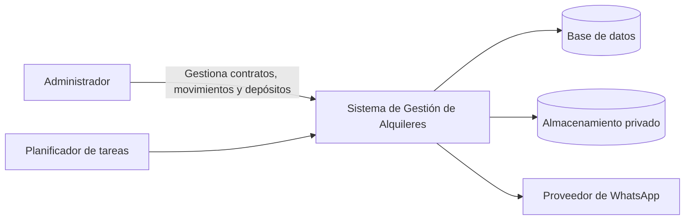
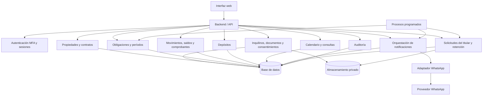

# Documento de Arquitectura de Software (DAS)

## Sistema de Gestión de Alquileres

**Identificador:** DAS-SGA-001
**Versión:** 0.4
**Estado:** Borrador para revisión; no aprobado
**Fecha:** 17 de octubre de 2026
**ERS de referencia:** ERS-SGA-001 v1.5 (borrador no aprobado)
**Valores regionales por defecto:** monedas CRC y USD; zona horaria `America/Costa_Rica`

Este borrador incorpora el impacto arquitectónico de ERS-SGA-001 v1.5: período por aniversario, prorrateo del último período, reajustes y correcciones, estados derivados, movimientos inmutables con anulación, comprobantes numerados, pagos en otra moneda, saldo de apertura, autenticación multifactor, y las obligaciones legales de la Ley 7527 y la Ley 8968 (derechos del titular, consentimiento y retención). No se selecciona todavía proveedor de nube, framework, motor de base de datos ni proveedor de WhatsApp. **Este documento no es asesoría legal ni autoriza iniciar la implementación.**

## Control e historial

| Campo | Valor |
|---|---|
| Propósito | Describir la estructura propuesta, responsabilidades, interacciones, riesgos y decisiones arquitectónicas. |
| Estado | Borrador sujeto a validación y aprobación. |
| Historial | v0.1 primera propuesta; v0.2 depósitos, prorrateo, privacidad e internacionalización; v0.3 abonos de alquiler, períodos contractuales, fechas retroactivas y reglas de actualización; **v0.4 modelo de movimientos con saldos derivados, estados derivados, procesos programados idempotentes, comprobantes, protección de datos personales (consentimiento, derechos del titular, retención), autenticación multifactor, zona horaria única y decisiones pendientes unificadas con la ERS.** |

## 1. Propósito y alcance

La arquitectura debe soportar inquilinos, propiedades, contratos, obligaciones por período de alquiler, movimientos de alquiler y de depósito con saldos derivados, comprobantes de pago, calendario, notificaciones web y WhatsApp, auditoría, y almacenamiento privado de fotografías de documentos de identidad, cumpliendo los controles que derivan de las obligaciones legales de la ERS (sección 3).

La primera versión no procesa dinero automáticamente, no calcula intereses ni multas, no consulta tipos de cambio, no gestiona devoluciones ni deducciones del depósito y no prorratea períodos completos.

## 2. Principios y referencias

Se toma como orientación SEI *Views and Beyond*, arc42, el modelo C4 y las guías de OWASP y NIST. Estas referencias guían el diseño, pero no certifican el sistema.

Principios:
- Separar interfaz, casos de uso, reglas de negocio y adaptadores de infraestructura.
- Mantener la lógica de contratos, obligaciones, movimientos y depósitos en servicios de dominio, no en la interfaz.
- **Los movimientos son inmutables**: se anulan con una reversión; nunca se editan ni se borran.
- **Los saldos y los estados se derivan** de los movimientos y de las fechas; no se almacenan como fuente de verdad.
- Procesos programados idempotentes.
- Autorización en el backend para cada operación sensible y cada descarga de documento.
- Conservar la moneda original por contrato y registrar toda conversión como dato ingresado, no calculado.
- Minimizar los datos personales almacenados, enviados y registrados.
- Hacer explícitas las decisiones pendientes mediante ADR.

## 3. Contexto del sistema

| Elemento | Responsabilidad |
|---|---|
| Administrador | Gestiona inquilinos, propiedades, contratos, movimientos, depósitos, configuración y solicitudes de titulares. |
| Aplicación SGA | Coordina reglas de negocio, consultas, auditoría y acceso a documentos. |
| Base de datos | Persiste registros, relaciones, movimientos, y el historial. |
| Almacenamiento privado | Conserva fotografías de cédula sin acceso público directo. |
| Planificador de procesos | Genera obligaciones, avisos y alertas, y ejecuta la retención. |
| Proveedor de WhatsApp | Envía mensajes mediante una integración aún por seleccionar. |

## 4. Drivers arquitectónicos y atributos de calidad

| Driver | Implicación arquitectónica |
|---|---|
| Una cuenta administradora | Autenticación multifactor obligatoria, códigos de recuperación de un solo uso, sesión corta y notificación de recuperación. No hay otro administrador que recupere el acceso. |
| Historia financiera | Movimientos inmutables; correcciones por anulación y nuevo registro; fecha real y fecha/hora de registro por separado. |
| Saldos y estados derivados | Evitar valores almacenados que puedan divergir; calcular desde movimientos y fechas. |
| Período por aniversario y vencimiento dentro del período | Servicio de cálculo de períodos y vencimientos con reglas de fin de mes. |
| Prorrateo solo del último período | Servicio de dominio con aritmética decimal exacta y redondeo registrado. |
| Reajuste frente a corrección | Dos operaciones distintas con efectos distintos sobre las obligaciones. |
| Obligaciones legales | Parámetros por contrato (destino, días de gracia), advertencias, comprobantes, y registro de consentimiento. |
| Datos personales | Consentimiento, atención del titular en cinco días hábiles, retención, eliminación y desasociación. |
| Evitar duplicados | Restricciones de unicidad e idempotencia en procesos programados. |
| Plataforma configurable | CRC y USD por contrato; zona horaria solo a nivel de organización. |
| Web + WhatsApp | Adaptador desacoplado del dominio financiero; plantillas aprobadas; mensajes con datos mínimos. |

Prioridades de calidad: seguridad y privacidad, integridad financiera, trazabilidad, confiabilidad, mantenibilidad, recuperación y usabilidad. Volumen de diseño: hasta 50 propiedades y un administrador; consultas habituales en menos de 2 s en el percentil 95 (objetivo a validar). RPO, RTO, retención de respaldos y disponibilidad se acuerdan antes de producción (DP-07).

## 5. Estrategia de solución propuesta

Se mantiene como candidato un **monolito modular**: una aplicación backend organizada por módulos de negocio, base de datos relacional, almacenamiento privado de archivos y procesos programados. Es una propuesta proporcional al volumen esperado, no una decisión tecnológica definitiva. No se recomienda introducir microservicios sin necesidad comprobada.

Módulos lógicos:
1. Inquilinos, documentos y consentimientos.
2. Propiedades y contratos.
3. Obligaciones, períodos, vencimientos y prorrateo del último período.
4. Movimientos, saldos y comprobantes.
5. Depósitos de garantía.
6. Calendario y consultas.
7. Notificaciones y configuración regional.
8. Protección de datos: solicitudes del titular y retención.
9. Autenticación y sesiones.
10. Auditoría y operación.

## 6. Bloques lógicos (C4 nivel 2)

| Bloque | Responsabilidad y límites |
|---|---|
| Backend/API | Valida solicitudes, autoriza operaciones y coordina casos de uso. |
| Contratos | Mantiene fechas, destino, monto, moneda, día de vencimiento, días de gracia y el historial de condiciones con fecha efectiva. |
| Obligaciones y períodos | Calcula períodos por aniversario, vencimientos, fecha límite y el prorrateo del último período; genera obligaciones 30 días antes; aplica reajustes y correcciones. |
| Movimientos y comprobantes | Registra abonos, pagos completos, saldo de apertura y anulaciones; deriva saldos; emite comprobantes con numeración consecutiva. |
| Depósitos | Administra importe total, abonos, saldo y estado, independiente del alquiler. |
| Persistencia | Impone relaciones, unicidad y consistencia transaccional. |
| Documentos | Verifica autorización y registra acceso antes de entregar un archivo; evita URL pública permanente. |
| Notificaciones | Programa avisos, registra intentos y resultados; no cambia estados financieros. |
| Protección de datos | Registra consentimientos y solicitudes del titular con su plazo; ejecuta retención y desasociación. |
| Autenticación | Segundo factor, códigos de recuperación, sesión corta, notificación de recuperación. |
| Auditoría | Registra actor, fecha, operación y cambios relevantes sin almacenar secretos ni imágenes. |

## 7. Reglas arquitectónicas de dominio

### 7.1 Períodos, vencimientos y estados

- El **período** parte del día de `fecha_inicio` y dura hasta el día anterior al mismo día del mes siguiente. Si el mes no tiene ese día, el período inicia el último día de ese mes (ERS RN-03).
- El **vencimiento** es la fecha del día de vencimiento en el mes de inicio del período (o el último día de ese mes); si queda antes del inicio del período, se usa el mes siguiente; si excede el último día del período, se usa ese último día. Así siempre cae dentro del período (ERS RN-05; DP-24).
- La **fecha límite** es el vencimiento más los días de gracia (ERS RN-06).
- El **estado** de una obligación se calcula en cada consulta: *pagada* (saldo cero), *vencida* (saldo mayor que cero y fecha local posterior a la fecha límite), *pendiente* (saldo mayor que cero y no vencida), *anulada* (marca explícita con motivo). El proceso diario **no** cambia estados; solo genera avisos.
- La **fecha local** se obtiene con la zona de la organización. Los vencimientos son fechas de calendario sin hora; las marcas de registro se guardan en UTC.

### 7.2 Movimientos, saldos y comprobantes

- Un **movimiento** es inmutable: importe, moneda recibida, tipo de cambio ingresado y equivalente (si aplica), fecha real, fecha/hora de registro, medio de pago, observación.
- La **anulación** agrega un movimiento de reversión que referencia al original y registra el motivo. Una corrección de importe o fecha es anulación más nuevo movimiento.
- El **saldo** es importe exigible menos la suma de movimientos válidos (no anulados), siempre en la moneda del contrato; nunca negativo. Se valida dentro de la misma transacción que registra el movimiento.
- El **comprobante** se numera con una secuencia consecutiva única, sin reutilizar números; los de movimientos anulados quedan marcados. La asignación del número ocurre en la misma transacción del movimiento.
- Para cheques y títulos, la fecha real es la de recepción del efectivo.
- Un abono en moneda distinta usa el tipo de cambio ingresado por el administrador; el sistema no consulta fuentes externas.
- Dinero: aritmética decimal exacta (nunca flotantes), un tipo monetario con moneda explícita y redondeo registrado.

### 7.3 Prorrateo del último período

Solo cuando `fecha_fin` cae dentro de un período:

`importe = importe mensual × días cobrables / días del período`

con ambos extremos inclusivos, redondeo único al final a la unidad entera (CRC) o a dos decimales (USD) con empate hacia arriba, y registro del cálculo (días, importe previo al redondeo, importe final). Puede ajustarse manualmente con motivo y auditoría. La fórmula y el redondeo requieren validación legal (DP-01). Los períodos completos no se prorratean.

### 7.4 Reajuste y corrección

- **Reajuste:** registra fecha de notificación, nuevo monto y porcentaje; la fecha efectiva se normaliza al inicio del período siguiente a la notificación; afecta solo a obligaciones cuyo período inicia en o después de esa fecha; para vivienda advierte si supera el tope informado y se rechaza si el precio está en moneda extranjera.
- **Corrección:** retroactiva, con motivo; actualiza obligaciones no pagadas afectadas, incluidas las vencidas.
- Ambos: conservan el valor anterior, el nuevo y la fecha efectiva; no modifican obligaciones pagadas; se **bloquean** si dejan el importe exigible por debajo de lo abonado. La operación es transaccional.

### 7.5 Depósito de garantía

- Entidad separada de las obligaciones de alquiler; un depósito por contrato.
- Abonos como movimientos independientes con importe positivo, fecha real, fecha/hora de registro y observación.
- Hasta tres abonos no anulados en el flujo ordinario; más abonos exigen confirmación con motivo obligatorio, auditada.
- Saldo derivado; bloqueo de abonos que lo excedan; advertencia legal si el importe supera una mensualidad de renta.
- Sin alertas de depósito; contrato cerrado muestra "liquidación manual". Sin calendarios de cuotas. Devoluciones y deducciones fuera de alcance.
- Un abono al depósito no modifica saldo ni estado de ninguna obligación.

### 7.6 Moneda y zona horaria

- Monedas admitidas: CRC y USD, por contrato. No se mezclan importes de monedas distintas en sumas.
- Zona horaria solo a nivel de organización, con identificador IANA (nunca solo un desfase); los procesos programados la usan.
- Cambiar la configuración no altera registros históricos.

### 7.7 Datos personales

- **Consentimiento:** se registra por inquilino con fecha, versión del texto informativo y medio; admite revocación sin efecto retroactivo.
- **Solicitudes del titular:** se registran con fecha de recepción y fecha límite de cinco días hábiles; se atienden sin costo; se puede exportar la información del titular.
- **Retención:** la fotografía se conserva hasta cinco años después del fin del contrato (configurable, tope de diez años desde los hechos); luego se elimina del almacenamiento y se desasocian los datos personales del inquilino, conservando los movimientos sin datos de identificación. El sistema avisa antes de ejecutar la eliminación. La conciliación con obligaciones contables o tributarias de conservación está pendiente (DP-18).
- **Acceso a cédulas:** cada consulta o descarga se registra (actor, fecha/hora, inquilino) sin guardar la imagen.
- **Transferencia:** los mensajes a WhatsApp no incluyen número de documento ni imágenes y limitan los datos del inquilino al mínimo; la aplicabilidad de las reglas de transferencia al uso de un proveedor se valida legalmente (DP-19).

## 8. Modelo conceptual de datos

| Entidad | Datos principales |
|---|---|
| Inquilino | Identificador, tipo y número de documento, contacto, estado y referencia privada a los documentos. |
| Consentimiento | Inquilino, fecha, versión del texto, medio, estado de revocación. |
| Documento de identidad | Identificador interno, referencia al archivo (frente, reverso), metadatos mínimos, fechas. |
| Propiedad | Identificador, descripción, dirección y marca de inactiva. |
| Contrato | Inquilino, propiedad, destino, vigencia, monto mensual, moneda, día de vencimiento, días de gracia, y condiciones con fecha efectiva. |
| Obligación | Contrato, período, vencimiento, fecha límite, importe exigible, moneda, datos del cálculo, tipo (regular o apertura) y anulación (motivo, fecha). |
| Movimiento | Tipo, obligación o depósito asociado, importe, moneda recibida, tipo de cambio, equivalente, fecha real, fecha/hora de registro, medio de pago, observación, anulación y referencia al original. |
| Comprobante | Número consecutivo, movimiento, estado. |
| Depósito de garantía | Contrato, importe total, moneda, fecha límite acordada opcional, notas. |
| Notificación | Obligación o contrato, canal, tipo, destinatario, intentos, resultado y estado web. |
| Solicitud del titular | Inquilino, tipo, recepción, fecha límite, resolución. |
| Auditoría | Actor, entidad, acción, fecha y cambios relevantes. |
| Registro de acceso a documentos | Actor, inquilino, fecha/hora, tipo de acceso. |

Invariantes propuestos:
- Una obligación por contrato y período.
- Los movimientos no se editan ni se borran.
- Ningún saldo ni estado es fuente de verdad almacenada.
- Un movimiento pertenece a una única obligación o a un único depósito.
- La numeración de comprobantes es única y consecutiva.
- No hay días compartidos entre contratos de una propiedad.
- No se permite acceso a una fotografía sin autorización comprobada en el servidor.
- Los importes históricos conservan moneda y condiciones de cálculo.

## 9. Seguridad, privacidad y documentos

Controles mínimos:
- HTTPS en todos los accesos autenticados.
- Contraseña de al menos 15 caracteres, sin reglas de composición ni cambio periódico obligatorio; almacenamiento con hash resistente.
- Segundo factor TOTP obligatorio; códigos de recuperación de un solo uso; notificación al administrador ante cada recuperación.
- Sesión: cierre total a las 24 horas e inactividad de 1 hora (valores recomendados por NIST para el nivel de aseguramiento AAL2).
- Archivos fuera de rutas públicas y sin enlaces públicos permanentes.
- Lista blanca de formatos (JPEG y PNG), verificación del tipo real del archivo, límite de 5 MB, nombres internos aleatorios; no usar el número de documento en rutas.
- Cifrado en tránsito y, cuando la infraestructura lo permita, en reposo.
- Auditoría proporcional al riesgo; sin datos de identidad completos, tokens ni documentos en registros técnicos.
- Confidencialidad de quien intervenga en el tratamiento, aun después de terminada su relación.
- Probar la restauración de base de datos y documentos desde respaldos protegidos.

## 10. Ejecución y escenarios críticos

### 10.1 Proceso diario (07:00, zona de la organización)

Un único proceso idempotente, reejecutable sin efectos adicionales, que:
1. Genera la obligación de cada contrato cuyo próximo período inicia dentro de 30 días, comprobando la unicidad por contrato y período.
2. Crea recordatorios para obligaciones con saldo según la anticipación configurada, con clave única obligación + tipo + anticipación + fecha.
3. Registra una alerta por obligación vencida y por día, y envía **un resumen** por WhatsApp.
4. Genera el aviso de vencimiento de contrato 120 días antes del fin y marca *por decidir* los contratos cuya fecha de fin venció sin acción.
5. Ejecuta la retención: avisa antes de eliminar y aplica la eliminación y desasociación vencidas.
6. Registra el resultado de la ejecución. Si faltaron días, pone al día obligaciones y contratos, pero emite solo la alerta del día actual.

### 10.2 Registro de un abono de alquiler

1. El administrador selecciona la obligación y registra el abono con medio de pago y fecha real.
2. El backend valida importe positivo, fecha real (no futura, no anterior al inicio del contrato) y que el saldo no resulte negativo.
3. En una transacción: persiste el movimiento, asigna el número de comprobante y registra la auditoría.
4. El saldo y el estado se derivan; si el saldo es cero, la obligación aparece como pagada.
5. No se genera notificación individual; los avisos futuros de la obligación se cancelan solo si pasó a pagada.

### 10.3 Anulación de un movimiento

1. El administrador indica el motivo.
2. En una transacción: se agrega la reversión, se marca el comprobante como anulado y se registra la auditoría.
3. El saldo y el estado se recalculan; si vuelve a vencida, las alertas se reanudan el día siguiente.

### 10.4 Reajuste

1. El administrador registra la fecha de notificación y el nuevo monto.
2. El backend normaliza la fecha efectiva, calcula el porcentaje, aplica las advertencias y rechazos legales, y verifica que ninguna obligación afectada quede por debajo de lo abonado.
3. En una transacción: registra la condición con fecha efectiva, actualiza solo obligaciones que inician en o después de la fecha y registra la auditoría.

### 10.5 Registro de abono al depósito

1. El administrador selecciona el depósito y registra el abono.
2. El backend valida importe positivo, moneda y saldo disponible, y que no se supere el máximo ordinario sin confirmación con motivo.
3. Se persiste el movimiento y la auditoría; saldo y estado se derivan.

### 10.6 Notificaciones

El proceso consulta obligaciones y configuración, registra la notificación, crea la notificación web y solicita WhatsApp si está configurado. Ante un fallo de envío reintenta hasta cinco veces con espera exponencial y aleatoria; después marca *fallido*. Los mensajes son plantillas aprobadas con datos mínimos. Los fallos no modifican estados financieros. Se distinguen los estados aceptado y entregado, y se deja un margen para el estado de fallo, que puede llegar con retraso.

## 11. Respaldo, recuperación y operación

La política de respaldo cubre base de datos y archivos privados de forma coordinada. Antes de producción se definen frecuencia, retención, cifrado, copia independiente, responsables, RPO y RTO (DP-07). Se prueba la restauración de contratos, obligaciones, movimientos, comprobantes, depósitos y archivos. Una copia no se considera suficiente hasta verificar que puede restaurarse. Los respaldos deben respetar la eliminación y desasociación por retención (DP-18).

## 12. Riesgos y mitigaciones

| Riesgo | Mitigación propuesta |
|---|---|
| Prorrateo incorrecto del último período | Fórmula explícita, cálculo registrado y casos de prueba de meses de distinta duración. |
| Saldos o estados divergentes | Derivarlos siempre de movimientos y fechas; pruebas de invariantes. |
| Numeración de comprobantes con huecos o duplicados | Secuencia única asignada en la misma transacción del movimiento. |
| Reajuste aplicado fuera de la regla legal | Normalización de fecha efectiva, advertencias, pruebas y validación legal. |
| Abonos del depósito mezclados con alquiler | Entidades separadas, validaciones y pruebas de invariantes. |
| Exposición de cédulas | Repositorio privado, autorización en backend, auditoría de acceso y pruebas de acceso denegado. |
| Conservación o eliminación indebida de datos | Retención configurable con aviso, desasociación y revisión contable (DP-18). |
| Pérdida de acceso a la cuenta única | Códigos de recuperación de un solo uso y notificación de recuperación. |
| Cambios regionales alteran historia | Persistir moneda y condiciones aplicadas; fechas de calendario separadas de marcas UTC. |
| Proceso diario omitido | Monitoreo, historial de ejecuciones y reproceso idempotente. |
| Pérdida de información | Respaldos protegidos y restauración probada. |

## 13. Registros de decisiones de arquitectura (ADR)

### ADR-001 — Estilo arquitectónico
- **Estado:** Propuesto. **Candidato:** monolito modular, proporcional al volumen (hasta 50 propiedades).
- **Pendiente:** validar capacidades, despliegue y necesidades operativas.

### ADR-002 — Persistencia relacional
- **Estado:** Propuesto; motor pendiente.
- **Justificación:** relaciones, transacciones, unicidad contrato-período, secuencia de comprobantes e integridad de movimientos.
- **Pendiente:** motor, migraciones y respaldos.

### ADR-003 — Documentos privados
- **Estado:** Decisión de diseño adoptada como requisito; proveedor pendiente.
- **Decisión:** archivos en almacenamiento privado fuera de rutas públicas; la base guarda referencias y metadatos mínimos; todo acceso se registra.
- **Pendiente:** proveedor, cifrado y proceso de descarga autorizada.

### ADR-004 — Depósito de garantía
- **Estado:** Propuesto.
- **Decisión:** un depósito por contrato, con movimientos separados del alquiler y saldo derivado. Hasta tres abonos ordinarios y excepción con motivo. Sin calendarios en v1.

### ADR-005 — Configuración regional
- **Estado:** Propuesto.
- **Decisión:** CRC y USD por contrato; zona horaria solo a nivel de organización con identificador IANA; marcas de registro en UTC.

### ADR-006 — Movimientos inmutables con saldo derivado
- **Estado:** Propuesto; reemplaza el ADR-006 de v0.3.
- **Decisión:** una sola entidad de movimiento para alquiler y depósito; correcciones por anulación (reversión) y nuevo registro; saldos y estados derivados. El pago completo es un abono por el saldo restante.
- **Referencia:** patrón de ajuste por reversión (Fowler, *Reversal Adjustment*, borrador de 2006).

### ADR-007 — Reajuste y corrección
- **Estado:** Propuesto; reemplaza el ADR-007 de v0.3.
- **Decisión:** operaciones separadas; el reajuste es prospectivo con fecha efectiva normalizada; la corrección es retroactiva con motivo; ambas se bloquean si dejan el importe por debajo de lo abonado.

### ADR-008 — WhatsApp
- **Estado:** Proveedor pendiente; se decide en la fase de arquitectura.
- **Decisión de diseño:** adaptador desacoplado; plantillas aprobadas; mensajes con datos mínimos; resumen diario; distinguir aceptación y entrega.
- **Pendiente:** API, costos, plantillas, límites, webhooks.

### ADR-009 — Estados derivados
- **Estado:** Propuesto.
- **Decisión:** el estado de obligación, contrato y propiedad se calcula desde saldos y fechas; el proceso diario solo genera avisos.

### ADR-010 — Comprobantes numerados
- **Estado:** Propuesto.
- **Decisión:** numeración consecutiva única asignada en la transacción del movimiento; los anulados se marcan y no se renumeran.
- **Pendiente:** formato y alcance legal (DP-20).

### ADR-011 — Protección de datos y retención
- **Estado:** Propuesto.
- **Decisión:** consentimiento registrado, solicitudes del titular con plazo, retención de cinco años configurable con aviso previo, eliminación de archivo y desasociación de datos personales, y registro de acceso a documentos.
- **Pendiente:** DP-17 a DP-21.

### ADR-012 — Autenticación
- **Estado:** Propuesto.
- **Decisión:** TOTP obligatorio, códigos de recuperación de un solo uso, sesión de 24 h con inactividad de 1 h, notificación de recuperación.

### ADR-013 — Procesos programados
- **Estado:** Propuesto.
- **Decisión:** un proceso diario idempotente a las 07:00 locales; ante una omisión solo se emite la alerta del día; claves únicas por aviso.

## 14. Decisiones pendientes

Los identificadores son comunes con la ERS-SGA-001 v1.5 (sección 12). Se enumeran las que afectan a la arquitectura:

| ID | Decisión pendiente | Responsable sugerido |
|---|---|---|
| DP-01 | Validar legalmente la fórmula de prorrateo del último período. | Propietario y abogado |
| DP-04 | Proveedor de WhatsApp, costos y condiciones. | Propietario y responsable técnico |
| DP-07 | Respaldo: frecuencia, retención, RPO y RTO. | Propietario y responsable técnico |
| DP-08 | Exposición pública de la aplicación y controles de operación. | Responsable técnico |
| DP-17 | Validación legal de las obligaciones OL-01 a OL-18. | Abogado |
| DP-18 | Conservación contable o tributaria frente a la eliminación de datos. | Abogado y contador |
| DP-19 | Aplicabilidad de la Ley 8968, inscripción y datos sensibles; transferencia al proveedor de WhatsApp. | Abogado |
| DP-20 | Formato del comprobante y procedimientos fehacientes alternativos. | Abogado |
| DP-21 | Texto informativo y formato del consentimiento. | Abogado |
| DP-24 | Regla de vencimiento dentro del período. | Propietario |
| DP-25 | Tratamiento del saldo de apertura. | Propietario |

## 15. Trazabilidad inicial

| Requisito | Elemento arquitectónico | Evidencia futura |
|---|---|---|
| RF-06–RF-12, RN-02–RN-05 | Contratos y servicio de obligaciones | Pruebas de períodos, vencimientos y generación. |
| RF-09, RN-12 | Servicio de prorrateo del último período | Pruebas de meses de 28, 29, 30 y 31 días y redondeo. |
| RF-10, RN-14 | Reajuste y corrección | Pruebas de fecha efectiva, tope y bloqueo por abonos. |
| RF-13–RF-16, RF-34, RF-35, RF-38, RN-22 | Movimientos y saldos derivados | Pruebas de saldo, anulación y moneda. |
| RF-37 | Comprobantes numerados | Pruebas de consecutividad y anulación. |
| RF-14, RN-06, RN-07 | Estados derivados | Pruebas de gracia y vencimiento. |
| RF-29–RF-32, RN-19, RN-20, RN-27 | Módulo de depósitos | Pruebas de saldo, tres abonos y excepción. |
| RF-33, RN-23, RNF-12, RNF-17 | Configuración regional | Pruebas de valores por defecto y persistencia histórica. |
| RF-21–RF-25, RF-44, RNF-16 | Orquestador y proceso diario | Pruebas de idempotencia, resumen, reintentos y cancelación. |
| RF-26–RF-28, RF-45, RNF-01, RNF-14 | Autenticación, documentos y seguridad | Pruebas de MFA, recuperación, sesión, acceso denegado y bitácora. |
| RF-39–RF-41, RN-24, RNF-13, RNF-15 | Protección de datos | Pruebas de consentimiento, plazo de cinco días y retención. |

## 16. Condiciones para aprobar la arquitectura

- Aprobar la ERS v1.5 y validar su sección 3 con un abogado.
- Validar el prorrateo del último período y el redondeo (DP-01).
- Aprobar almacenamiento privado, retención, eliminación y recuperación de documentos (DP-18, DP-19).
- Definir objetivos de respaldo y recuperación (DP-07).
- Seleccionar proveedor de WhatsApp y plataforma de despliegue (DP-04, DP-08).
- Definir formato de comprobante y consentimiento (DP-20, DP-21).
- Confirmar las reglas propuestas de vencimiento y saldo de apertura (DP-24, DP-25).
- Completar la trazabilidad entre la ERS aprobada, las decisiones arquitectónicas y las pruebas.

## 17. Referencias

1. ISO/IEC/IEEE 29148:2018. https://www.iso.org/standard/72089.html
2. SEI — Documenting Software Architectures: Views and Beyond. https://www.sei.cmu.edu/library/documenting-software-architectures-views-and-beyond-second-edition/
3. arc42. https://arc42.org/overview/
4. C4 Model. https://c4model.com/diagrams
5. OWASP — File Upload Cheat Sheet. https://cheatsheetseries.owasp.org/cheatsheets/File_Upload_Cheat_Sheet.html
6. NIST SP 800-63B-4. https://pages.nist.gov/800-63-4/sp800-63b/aal/
7. W3C — Working with Time and Timezones. https://www.w3.org/TR/timezone/
8. Fowler — Reversal Adjustment. https://martinfowler.com/eaaDev/ReversalAdjustment.html
9. AWS Architecture Blog — Exponential Backoff And Jitter. https://aws.amazon.com/blogs/architecture/exponential-backoff-and-jitter/
10. Stripe — Idempotent requests. https://docs.stripe.com/api/idempotent_requests
11. Meta — WhatsApp Business Platform, mensajes. https://developers.facebook.com/documentation/business-messaging/whatsapp/messages/send-messages
12. Ley 7527 y Ley 8968 (ver ERS-SGA-001 v1.5, sección 3 y referencias).

## Registro de aprobación

| Rol | Nombre | Resultado | Fecha |
|---|---|---|---|
| Responsable del negocio | Pendiente | Pendiente | Pendiente |
| Responsable técnico | Pendiente | Pendiente | Pendiente |
| Responsable de pruebas | Pendiente | Pendiente | Pendiente |
| Asesor legal | Pendiente | Pendiente | Pendiente |

**Fin del documento — DAS-SGA-001, versión 0.4 (borrador no aprobado).**

## Anexo A. Trazabilidad de las decisiones incorporadas

| Decisión | Impacto arquitectónico | Estado |
|---|---|---|
| Período por aniversario; prorrateo solo del último período | Servicio de períodos; servicio de prorrateo acotado | Incorporado; DP-01 pendiente |
| Reajuste prospectivo y corrección retroactiva | Dos operaciones; fecha efectiva normalizada | Incorporado; validación legal pendiente |
| Gracia de 7 días | Fecha límite derivada; estado derivado | Incorporado; validación legal pendiente |
| Pago automático a saldo cero; anulación con motivo; estado anulada | Movimientos inmutables; estados derivados | Incorporado |
| CRC y USD; tipo de cambio manual | Movimiento con moneda recibida, tipo de cambio y equivalente | Incorporado |
| Retención de cinco años de la fotografía | Proceso de retención con aviso y desasociación | Incorporado; DP-17 y DP-18 pendientes |
| Un depósito por contrato; tres abonos; excepción con motivo; sin calendarios | Restricción de dominio y validación | Incorporado |
| No notificar cada abono | No se emite evento de notificación por abono | Incorporado |
| Generación 30 días antes; avisos a 120 días; estado por decidir | Proceso diario | Incorporado |
| Ningún día compartido entre contratos | Restricción de solapamiento | Incorporado |
| Zona horaria solo de la organización | Configuración centralizada; elimina zona por propiedad | Incorporado |
| MFA con códigos de recuperación | Módulo de autenticación | Incorporado |
| Comprobante de pago | Numeración consecutiva transaccional | Incorporado como obligación legal; DP-20 pendiente |
| Proveedor de WhatsApp en fase de arquitectura | Adaptador desacoplado | Pendiente (DP-04) |
| P11 | Sin diseño hasta recuperar el enunciado | Pendiente (DP-14) |

**Estado:** el DAS v0.4 es un borrador alineado con ERS-SGA-001 v1.5, también no aprobada. La arquitectura sigue siendo una propuesta de monolito modular; no se han seleccionado tecnologías ni autorizado implementación.
