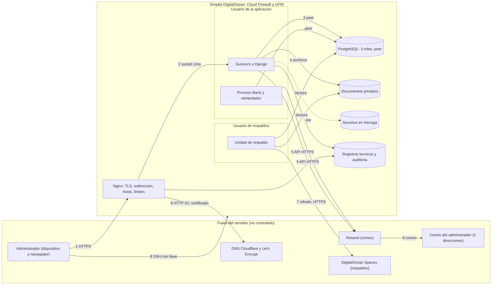

# Modelo de amenazas

**Sistema de Gestión de Alquileres**

**Identificador:** MA-SGA-001
**Versión:** 0.1 — Borrador para revisión
**Fecha:** 23 de octubre de 2026
**Estado:** Borrador; no aprobado. **Autoverificación del asistente: no lo ha revisado otra persona** (DP-23)
**Base:** [ERS-SGA-001 v1.14](../fase-1-ers/ERS_SGA_001_v1.14_borrador.md), [DAS-SGA-001 v0.12](../fase-2-arquitectura/DAS_SGA_001_v0.12_borrador.md) (ADR-032), [MDD-SGA-001 v0.7](MODELO_DATOS_SGA_001_v0.7_borrador.md) y [DISENO_TECNICO_SGA_001 v0.7](DISENO_TECNICO_SGA_001_v0.7_borrador.md)
**Decisiones de método:** [actualización 2026-10-23 (w)](../actualizaciones/2026-10-23w_modelo-amenazas-decisiones/CAMBIOS.md)

> **Control de acceso.** Este documento describe puntos débiles del sistema. No lo publiques fuera del repositorio privado; antes de subirlo a GitHub confirma que el repositorio es privado (no verificado, ADR-025).
>
> **Lo que este documento no es.** No es el documento de seguridad con análisis de riesgos que pide el Reglamento 37554-JP (ADR-021: fase 6, pendiente de abogado, DP-17 y DP-19), aunque puede servirle de insumo. No es asesoría legal. Tampoco certifica que el sistema sea seguro: el sistema no existe todavía y no hay controles aplicados.

Los identificadores `AM-nn` y `BR-nn` son **locales de este documento**, como los HT del diseño técnico o los H del modelo de datos; no forman parte de la lista compartida de la ERS y el DAS (RF, RN, RNF, CA, OL, DP, ADR, RE).

## 1. Alcance y exclusiones

**Dentro del alcance** (decisión del solicitante, 23-oct-2026): el sistema en producción de punta a punta.

| Tipo | Elementos |
|---|---|
| Entidades externas | Administrador (con su dispositivo y navegador); Resend (correo); DigitalOcean (Spaces, para los respaldos); DNS (Cloudflare) y Let's Encrypt |
| Procesos | Nginx; Gunicorn con Django; proceso diario y reintentador (temporizadores de systemd); unidad de respaldo; `unattended-upgrades` |
| Almacenes | PostgreSQL; documentos privados (cédulas y fotografías de contrato); archivo de secretos; respaldos cifrados; registros técnicos y de auditoría |
| Flujos | Inicio de sesión con segundo factor; subida y consulta de fotografías; correos; respaldo y restauración; administración por SSH; emisión del certificado |

**Fuera del alcance, a propósito:** la cadena de construcción (GitHub Actions y las dependencias de Python), el interior de DigitalOcean y de Resend, y la etapa A local (WSL). **Siguiente iteración:** la cadena de construcción, cuando exista código.

## 2. Método

- **Técnica:** STRIDE sobre un solo diagrama de flujo de datos, más una lista corta de preguntas de privacidad tomadas de LINDDUN (sección 7). Es la combinación elegida por el solicitante; usar solo tres categorías de LINDDUN es criterio del asistente, sin fuente.
- **Preguntas guía** (OWASP, Threat Modeling Cheat Sheet): ¿qué estamos construyendo?, ¿qué puede salir mal?, ¿qué vamos a hacer al respecto?, ¿lo hicimos suficientemente bien? La última queda **abierta** hasta que otra persona lo revise.
- **Riesgo** (simplificación del asistente de la metodología de riesgo de OWASP, que propone personalizarla): probabilidad (baja, media, alta) × impacto (bajo, medio, alto), **calculado con los controles ya decididos** y no con el sistema desnudo.

| Probabilidad \ Impacto | Bajo | Medio | Alto |
|---|---|---|---|
| Baja | Bajo | Bajo | Medio |
| Media | Bajo | Medio | Alto |
| Alta | Medio | Alto | Alto |

- **Respuesta a cada amenaza:** mitigar, eliminar, transferir o aceptar. Las respuestas marcadas "aceptar" son una **propuesta**: aceptar un riesgo lo decide el solicitante, y hoy **ninguno está aceptado**.
- **Criterio de impacto:** pesa más lo que la ERS ya define como grave: fuga de fotografías de documentos de identidad (Ley 8968), pérdida del acceso a la cuenta única y pérdida o alteración de los datos financieros.

## 3. Diagrama de flujo de datos

**Fronteras de confianza:** (a) internet / servidor, en Nginx; (b) Nginx / aplicación, por el socket Unix; (c) aplicación / base de datos y archivos, por los roles y los usuarios del sistema (ADR-027, ADR-032); (d) servidor / servicios de terceros (Resend, Spaces, DNS); (e) dispositivo del administrador / servidor, por SSH y por la sesión web.

## 4. Activos

| Activo | Por qué importa |
|---|---|
| Fotografías de cédulas y de contratos | Datos personales sensibles para la Ley 8968; su fuga es el mayor impacto de privacidad |
| Cuenta administradora (contraseña, TOTP, códigos, correo) | Cuenta única: quien la controla controla todo; no hay otro administrador que la recupere |
| Historial financiero (movimientos, ajustes, auditoría) | Inmutable por diseño (R12); su alteración invalida la contabilidad |
| Secretos (`SECRET_KEY`, claves de Resend, clave de cifrado del respaldo) | Permiten falsificar sesiones, enviar correo en nombre del dominio o abrir los respaldos |
| Respaldos | Son copia completa de todo lo anterior, fuera del servidor |
| Disponibilidad | Sin objetivo numérico; el RTO tolerable es de 24 horas (RNF-09) |

## 5. Supuestos

1. Hay un solo administrador de confianza (RE-07, DP-23) y no se modela un insider malicioso.
2. El sistema se aloja en un solo Droplet; la base y la aplicación comparten servidor (ADR-023, ADR-027).
3. El sitio va sin el proxy de Cloudflare (ADR-032): el servidor recibe directamente el tráfico y su IP es pública.
4. Los datos personales solo salen del servidor hacia Resend (correos con datos mínimos al administrador, RF-44) y hacia los respaldos cifrados.
5. Nada de lo descrito en el ADR-032 está aplicado: no hay servidor. Las columnas de controles son decisiones de diseño, no hechos verificados.

## 6. Amenazas

Categorías STRIDE: **S** suplantación, **T** manipulación, **R** repudio, **I** revelación de información, **D** denegación de servicio, **E** elevación de privilegios. "Nivel" es el riesgo con los controles decididos. Probabilidad, impacto y nivel son **juicio del asistente, sin datos de ataques reales**.

| ID | Flujo o elemento | STRIDE | Amenaza | Controles decididos o previstos | Prob. | Imp. | Nivel | Respuesta (propuesta) | Brecha |
|---|---|---|---|---|---|---|---|---|---|
| AM-01 | Inicio de sesión (1) | S | Adivinar o reutilizar la contraseña del administrador | Contraseña de 15 o más caracteres, Argon2id (ADR-019), TOTP obligatorio (RF-27), espera creciente tras 5 fallos (CA-68) | Baja | Alto | Medio | Mitigar | BR-08 |
| AM-02 | Dispositivo del administrador | S, E | Malware, robo del dispositivo o de la sesión; phishing que captura contraseña y TOTP | Sesión de 24 h máximo y 1 h de inactividad (CA-48); avisos de seguridad a dos direcciones (ADR-026) | Media | Alto | **Alto** | Aceptar parcialmente y mitigar | BR-09 |
| AM-03 | Restablecimiento de contraseña (6) | S | Quien controle el correo del administrador pide un enlace de restablecimiento | Enlace de un solo uso y 15 minutos; el acceso sigue exigiendo TOTP; aviso a las dos direcciones; hasta 3 solicitudes por hora (CA-59) | Baja | Alto | Medio | Mitigar | BR-01 |
| AM-04 | Contador por cuenta | D | Fallar cinco veces a propósito deja la cuenta única en espera de hasta una hora aunque no sea el administrador | Tope de una hora, sin bloqueo permanente, restablecimiento disponible (CA-68); límite por IP en Nginx previsto | Media | Medio | Medio | Mitigar | BR-08 |
| AM-05 | Registro de acciones | R | El administrador niega haber hecho una operación | Movimientos y ajustes inmutables, auditoría con actor y fecha (R12, RF-28) | Baja | Bajo | Bajo | Aceptar | — |
| AM-06 | Aplicación comprometida (3) | E | Con una falla en Django, el atacante usa el rol de la base de la aplicación | Rol sin `UPDATE` ni `DELETE` sobre el historial (R12, ADR-027); sin contraseñas de base; sandboxing de systemd (ADR-032) | Baja | Alto | Medio | Mitigar | — |
| AM-07 | Subida de fotografías (1, 4) | T, E | Archivo malicioso con extensión o tipo falso, o que explote la biblioteca de imágenes | Lista blanca JPEG y PNG, tipo real verificado, nombre aleatorio, fuera de la raíz web, nunca ejecutable (ADR-003); 5 MiB (RF-02) | Media | Medio | Medio | Mitigar | BR-06 |
| AM-08 | Consulta de fotografías (1, 4) | I | Acceso a una cédula sin autorización, por ejemplo adivinando un identificador | Autorización en cada vista, sesión con segundo factor, sin URL pública, registro de cada acceso (RF-45, ADR-003); identificadores enteros adivinables (ADR-028) | Baja | Alto | Medio | Mitigar | — |
| AM-09 | Fotografías subidas | I | Metadatos de la imagen (por ejemplo, la ubicación) quedan en el archivo guardado | Reducción en el navegador (RF-50) **sin garantía** de que los elimine (DP-27) | Media | Medio | Medio | Mitigar | BR-05 |
| AM-10 | Subidas (1) | D | Subidas masivas o lentas agotan memoria o disco | `client_max_body_size` de 6m en la ruta de subida y 1m en el resto, 5 MiB por archivo, máximo 10 fotografías por contrato, búfer de Nginx; `limit_req` previsto | Baja | Bajo | Bajo | Mitigar | BR-08 |
| AM-11 | Respaldos y retención | I | Una foto eliminada por retención sigue en los respaldos hasta 35 días | Retención de 35 días (DP-07); regla de ciclo de vida (RE-11); sin dictamen (DP-18) | Media | Medio | Medio | Aceptar (por validar con el abogado) | — |
| AM-12 | HTTPS (1) | I, T | Interceptar o degradar la conexión | TLS 1.3 y 1.2, redirección, HSTS en etapas (ADR-032) | Baja | Alto | Medio | Mitigar | — |
| AM-13 | Nginx (1, 2) | S | Cabecera `Host` falsa o `X-Forwarded-Proto` fingido por el cliente | `return 444` para hosts desconocidos, `X-Forwarded-Proto` sobrescrito, `SECURE_PROXY_SSL_HEADER` solo tras Nginx (ADR-032) | Baja | Medio | Bajo | Mitigar | — |
| AM-14 | Servidor | D | Ataque volumétrico contra el sitio | Cloud Firewall; sin protección DDoS de Cloudflare (IP pública, sin proxy: decisión de ADR-032); sin objetivo de disponibilidad, RTO de 24 h | Media | Bajo | Bajo | Aceptar | — |
| AM-15 | SSH (8) | E | Fuerza bruta o robo de la llave de administración | Solo llave ed25519 con passphrase, sin contraseña ni `root`; Cloud Firewall limita el 22 a la IP del solicitante; `ufw limit` (ADR-032) | Baja | Alto | Medio | Mitigar | BR-09 |
| AM-16 | Software del servidor | E | Falla conocida sin parchear en el sistema, Nginx, PostgreSQL o las dependencias de Python | `unattended-upgrades` de seguridad con reinicio a las 04:00 (ADR-032). **Si Django y las demás bibliotecas se instalan con `pip`, esa herramienta no las actualiza** (inferencia del asistente: ADR-022 deja la forma de instalación sin decidir) | Media | Alto | **Alto** | Mitigar | BR-04 |
| AM-17 | Secretos (SEC) | I | Con la aplicación comprometida se leen los secretos, que su grupo puede leer | Archivo en `/etc/sga/`, `0640`, dueño `root`; sandboxing; rotación anual y ante sospecha (ADR-032) | Baja | Alto | Medio | Mitigar | — |
| AM-18 | Repositorio y registros | I | Secretos filtrados en el repositorio, en registros o en volcados | Secretos fuera del repositorio y de la raíz web; sin tokens ni identidad completa en registros (ADR-017) | Baja | Alto | Medio | Mitigar | — |
| AM-19 | Rol dueño de la base | T | Quien use el rol dueño puede modificar cualquier cosa | Solo para migraciones, a mano; el propio ADR-027 reconoce que no protege contra quien lo use | Baja | Alto | Medio | Aceptar | — |
| AM-20 | Correo (5, 6) | I | Datos personales viajan a un tercero (Resend) | Mensajes con datos mínimos, sin número de documento ni imágenes (RF-44); solo al administrador | Baja | Medio | Bajo | Mitigar (validar con abogado) | BR-10 |
| AM-21 | Correo falsificado | S | Un correo falso con el aspecto de un aviso o de un restablecimiento lleva al administrador a un sitio del atacante | Los avisos no llevan enlaces de acceso ni códigos (ADR-026); verificación del dominio en Resend | Media | Alto | **Alto** | Mitigar | BR-02 |
| AM-22 | Resend | D | El servicio de correo falla o limita el envío | Hasta 5 reintentos; la recuperación procede sin el aviso (ADR-026, RF-24) | Media | Bajo | Bajo | Aceptar | — |
| AM-23 | Cuentas de proveedores | S, E | Toma de control de la cuenta de Cloudflare (dominio y DNS), DigitalOcean, Resend o GitHub | **Ningún requisito en los documentos** | Media | Alto | **Alto** | Mitigar | BR-01 |
| AM-24 | Respaldos (7) | I | Robo de la copia en Spaces o de su clave | Cifrado antes de subir (ADR-024); la clave no vive solo en el servidor (ADR-032); herramienta y custodia de la clave **sin definir** | Media | Alto | **Alto** | Mitigar | BR-03 |
| AM-25 | Respaldos (7) | T, D | Un atacante con las credenciales de subida borra o corrompe los respaldos; o la copia no se puede restaurar | Regla de ciclo de vida de 35 días; prueba de restauración antes de producción y cada 3 meses (RNF-09); permisos de las credenciales **sin definir** | Baja | Alto | Medio | Mitigar | BR-03 |
| AM-26 | Registros técnicos (LOG) | I | Datos personales en los registros de Nginx, Gunicorn o PostgreSQL | Sin tokens ni identidad completa (ADR-017); el número de documento no va en rutas (ADR-003); registro de PostgreSQL **sin decidir** | Media | Medio | Medio | Mitigar | BR-07 |
| AM-27 | Certificado (9) | D | El certificado vence o su renovación falla y, con HSTS, el sitio queda inaccesible | Renovación automática de Certbot, prueba con `--dry-run` (ADR-023); HSTS con `max-age` corto al empezar (ADR-032) | Media | Bajo | Bajo | Mitigar | — |
| AM-28 | Interfaz web (1) | T, S | Inyección de código en una página (XSS) o petición forzada (CSRF) que use la sesión del administrador | Plantillas de Django, cookies `Secure` (ADR-032) y la protección CSRF de Django (el escape automático y la protección CSRF son características de Django que no se verificaron en esta sesión); **política de contenido (CSP) sin decidir** | Baja | Alto | Medio | Mitigar | BR-11 |

**Resumen de niveles:** 5 altos (AM-02, AM-16, AM-21, AM-23, AM-24), 16 medios y 7 bajos.

## 7. Preguntas de privacidad (LINDDUN, versión reducida)

| Categoría | Pregunta | Respuesta hoy | Referencias |
|---|---|---|---|
| Revelación de datos | ¿Dónde pueden salir datos personales del control del administrador? | A Resend (correos con datos mínimos), a los respaldos cifrados en Spaces y, por error, a registros o a archivos con metadatos | AM-09, AM-20, AM-24, AM-26; DP-19 |
| Identificación y vinculación | ¿Se puede unir a una persona con su documento, su contrato y su pago? | Sí, por diseño: la ficha vincula el nombre, el documento, la fotografía, el contrato y los movimientos. La desasociación al terminar la retención conserva los movimientos sin identificación (RF-41) | RF-41, AM-11 |
| Incumplimiento normativo | ¿Qué obligaciones de la Ley 8968 dependen de que el sistema se comporte bien? | Consentimiento previo (RF-39), derechos del titular en cinco días hábiles (RF-40), retención y eliminación (RF-41), aviso de incidentes (RF-46). **Sin dictamen de abogado** | DP-17 a DP-21, AM-11 |

## 8. Brechas y propuestas

Cada fila es una **propuesta del asistente** que el solicitante puede adoptar, cambiar o descartar. Ninguna se ha decidido; cualquier requisito nuevo iría a la ERS por el procedimiento habitual.

| ID | Brecha | Amenazas | Propuesta |
|---|---|---|---|
| BR-01 | Las cuentas de los proveedores (Cloudflare, DigitalOcean, Resend, GitHub) no tienen ningún requisito | AM-03, AM-23 | Exigir segundo factor en esas cuentas, con un correo propio y distinto del de los avisos, y registrar la lista de cuentas y sus recuperaciones en la fase 6 |
| BR-02 | La autenticación del correo del dominio (SPF, DKIM, DMARC) no está decidida; los registros DNS exactos no se verificaron (ADR-026) | AM-21 | Decidir y verificar esos registros al comprar el dominio, y probar con una herramienta de envío antes de usar el restablecimiento |
| BR-03 | Herramienta y custodia de la clave del respaldo, y permisos mínimos de las credenciales de subida, sin definir (ADR-024) | AM-24, AM-25 | Decidirlo antes de la etapa B; la clave no debe vivir solo en el servidor y las credenciales de subida no deben poder borrar |
| BR-04 | No hay proceso para actualizar las dependencias de Python (Django, bibliotecas) | AM-16 | Decidir cómo se instala Django (ADR-022 lo deja pendiente), cómo se vigilan los avisos de seguridad y con qué frecuencia se actualiza |
| BR-05 | Los metadatos de las imágenes (DP-27) sin decisión | AM-09 | Verificar en la prueba con teléfonos reales si la reducción los elimina; si no, quitarlos en el servidor |
| BR-06 | Análisis antivirus o de archivos sin decidir (ADR-003) | AM-07 | Decidir si se justifica con un volumen de pocas fotografías verificadas por tipo real |
| BR-07 | Qué registran Nginx, Gunicorn y PostgreSQL (medida 17 sin decidir) | AM-26 | Decidirlo, con el criterio de no registrar sentencias completas, y revisar los registros con Lynis en la etapa B |
| BR-08 | Límite de solicitudes por IP en Nginx sin decidir (medida 14) | AM-01, AM-04, AM-10 | Decidirlo, porque es la defensa contra el uso del contador por cuenta para dejarlo fuera |
| BR-09 | El dispositivo del administrador y su llave SSH están fuera de lo que el sistema puede proteger | AM-02, AM-15 | Documentar en la fase 6 prácticas mínimas (dispositivo actualizado, llave con passphrase, copia segura) y considerar el segundo factor del SSH como mejora futura |
| BR-10 | Transferencia de datos a Resend y DigitalOcean sin dictamen (DP-19) | AM-20, AM-11 | Resolverlo con el abogado antes de cargar datos reales |
| BR-11 | Política de contenido (CSP) sin decidir | AM-28 | Decidirla cuando se diseñe la interfaz; Django 5.2 no la trae integrada |

## 9. Riesgo residual y aceptación

| Riesgo | Residual propuesto | Aceptado por el solicitante |
|---|---|---|
| AM-02 (dispositivo y sesión del administrador) | Alto: el sistema no puede impedirlo; el riesgo ya fue asumido en parte al elegir el restablecimiento por correo (ADR-026) | **Pendiente** |
| AM-14 (denegación de servicio volumétrica) | Bajo, por la decisión de no usar el proxy de Cloudflare | **Pendiente** |
| AM-19 (rol dueño) | Medio: límite reconocido en ADR-027 | **Pendiente** |
| AM-11 (datos en respaldos hasta 35 días) | Medio, hasta el dictamen del abogado (DP-18) | **Pendiente** |
| El resto | Igual al nivel de la tabla, con la brecha correspondiente abierta | **Pendiente** |

## 10. Qué no cubre este borrador y cómo se mantiene

- No cubre la cadena de construcción ni el interior de los proveedores (sección 1), ni un adversario con acceso de `root` al servidor, ni la seguridad física del dispositivo del administrador.
- No se verificó ningún control: no hay servidor. Los niveles son juicio del asistente, sin datos de ataques reales ni revisión de otra persona.
- No se usó una herramienta de modelado de amenazas ni se leyó NIST SP 800-30.
- **Mantenimiento** (OWASP: el modelo se actualiza a medida que cambia el sistema): revisarlo al decidir las medidas pendientes (Gunicorn, Nginx, PostgreSQL), al empezar la E1, antes de cargar datos reales y tras cualquier incidente (RF-46). Cada revisión es una versión nueva.

## 11. Fuentes

| Fuente y URL | Tipo | Cómo se validó | Qué respalda |
|---|---|---|---|
| OWASP, Threat Modeling Cheat Sheet. https://cheatsheetseries.owasp.org/cheatsheets/Threat_Modeling_Cheat_Sheet.html | Guía de experto reconocido | Leída por resumen (23-oct-2026) | Cuatro preguntas; modelo con fronteras de confianza; STRIDE como ejemplo; respuesta por amenaza; riesgo residual; mantenimiento; control de acceso al artefacto |
| Microsoft, categorías de STRIDE. https://learn.microsoft.com/en-us/azure/security/develop/threat-modeling-tool-threats | Documentación del proveedor | Leída por resumen (23-oct-2026; página de 2017) | Definición de las seis categorías |
| LINDDUN. https://linddun.org/ | Marco académico (KU Leuven) | Leída por resumen (23-oct-2026) | Categorías de amenazas a la privacidad; mismo diagrama que STRIDE |
| Manifiesto del modelado de amenazas. https://www.threatmodelingmanifesto.org/ | Declaración de expertos | Leída (23-oct-2026) | Hacerlo, refinar de forma continua, iteraciones acotadas |
| OWASP, Risk Rating Methodology. https://community.owasp.org/OWASP_Risk_Rating_Methodology | Guía de experto reconocido | Leída por resumen (23-oct-2026) | Riesgo = probabilidad × impacto; niveles; personalizar el modelo |
| Documentos del proyecto citados en las filas (ERS v1.14, DAS v0.12 y ADR-003, 017, 019, 022 a 028 y 032, modelo de datos v0.7) | Documentos del proyecto | Releídos para esta versión | Los controles de la sección 6 |

## 12. Historial y aprobación

| Versión | Fecha | Cambio | Aprobación |
|---|---|---|---|
| 0.1 | 23-oct-2026 | Primera versión: 28 amenazas, 11 brechas, preguntas de privacidad, sin revisión de otra persona | Ninguna |

| Rol | Nombre | Decisión | Fecha |
|---|---|---|---|
| Responsable técnico | brandonC-developer (DP-23: ocupa los tres roles) | Pendiente | Pendiente |
| Revisor independiente | Sin designar | Pendiente | Pendiente |
