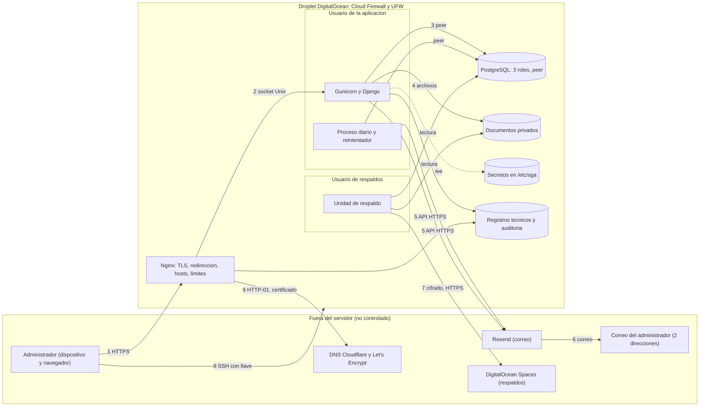

# Modelo de amenazas

**Sistema de Gestión de Alquileres**

**Identificador:** MA-SGA-001
**Versión:** 0.4 — Borrador para revisión
**Fecha:** 23 de octubre de 2026
**Estado:** Borrador; no aprobado. **Autoverificación del asistente: no lo ha revisado otra persona** (DP-23)
**Base:** [ERS-SGA-001 v1.16](../fase-1-ers/ERS_SGA_001_v1.16_borrador.md), [DAS-SGA-001 v0.15](../fase-2-arquitectura/DAS_SGA_001_v0.15_borrador.md) (ADR-032), [MDD-SGA-001 v0.7](MODELO_DATOS_SGA_001_v0.7_borrador.md) y [DISENO_TECNICO_SGA_001 v0.7](DISENO_TECNICO_SGA_001_v0.7_borrador.md)
**Decisiones de método:** [actualización 2026-10-23 (w)](../actualizaciones/2026-10-23w_modelo-amenazas-decisiones/CAMBIOS.md)
**Qué cambia la v0.4:** incorpora las decisiones del solicitante del 23-oct-2026 sobre las cinco brechas que quedaban abiertas, y los requisitos CA-82 y CA-83 de la ERS v1.16: BR-05 (metadatos de las imágenes, actualización (zo)), BR-06 (sin antivirus, (zp)), BR-07 (registros de Nginx y Gunicorn, (zq)), BR-09 (dispositivo y llave SSH, (zr)) y BR-10 (preguntas al abogado, DP-31, (zs)); ADR-003 y ADR-032 decisiones 17 y 18 del DAS v0.15. **No añade amenazas nuevas ni cambia ningún nivel.** **Ninguna brecha queda «abierta» sin decisión**, pero BR-10 solo se resolvió remitiéndola al abogado y BR-07 deja sin decidir la rotación de journald, de la auditoría y de PostgreSQL. Reemplaza a la [v0.3](MODELO_AMENAZAS_SGA_001_v0.3_borrador.md), que se conserva sin cambios; la v0.2 y la v0.1 también.

**Qué cambió en la v0.3:** incorpora las decisiones del solicitante del 23-oct-2026 posteriores a la v0.2: BR-12 (segundo factor en el correo del administrador, actualización (ze)), BR-11 (CSP, actualización (zj)) y la parte de BR-07 que corresponde a PostgreSQL (actualización (zg)); los controles nuevos de PostgreSQL, Gunicorn, Nginx, la salida de los firewalls, el respaldo, TLS, CAA y el reinicio (actualizaciones (zg) a (zj), ADR-032 decisiones 12 a 16); y los requisitos RF-53, RNF-19, RNF-20, CA-79, CA-80 y CA-81 de la ERS v1.15. **No añade amenazas nuevas ni cambia ningún nivel** (sección 6). Reemplaza a la [v0.2](MODELO_AMENAZAS_SGA_001_v0.2_borrador.md), que se conserva sin cambios; la v0.1 también.

> **Control de acceso.** Este documento describe puntos débiles del sistema. No lo publiques fuera del repositorio privado; antes de subirlo a GitHub confirma que el repositorio es privado (no verificado, ADR-025).
>
> **Lo que este documento no es.** No es el documento de seguridad con análisis de riesgos que pide el Reglamento 37554-JP (ADR-021: fase 6, pendiente de abogado, DP-17 y DP-19), aunque puede servirle de insumo. No es asesoría legal. Tampoco certifica que el sistema sea seguro: el sistema no existe todavía y no hay controles aplicados.

Los identificadores `AM-nn` y `BR-nn` son **locales de este documento**, como los HT del diseño técnico o los H del modelo de datos; no forman parte de la lista compartida de la ERS y el DAS (RF, RN, RNF, CA, OL, DP, ADR, RE).

## 1. Alcance y exclusiones

**Dentro del alcance** (decisión del solicitante, 23-oct-2026): el sistema en producción de punta a punta.

| Tipo | Elementos |
|---|---|
| Entidades externas | Administrador (con su dispositivo y navegador); Resend (correo); DigitalOcean (Spaces, para los respaldos); DNS (Cloudflare) y Let's Encrypt |
| Procesos | Nginx; Gunicorn con Django; proceso diario y reintentador (temporizadores de systemd); unidad de respaldo; `unattended-upgrades` |
| Almacenes | PostgreSQL; documentos privados (cédulas y fotografías de contrato); archivo de secretos; respaldos cifrados; registros técnicos y de auditoría |
| Flujos | Inicio de sesión con segundo factor; subida y consulta de fotografías; correos; respaldo y restauración; administración por SSH; emisión del certificado |

**Fuera del alcance, a propósito:** la cadena de construcción (GitHub Actions y las dependencias de Python), el interior de DigitalOcean y de Resend, y la etapa A local (WSL). **Siguiente iteración:** la cadena de construcción, cuando exista código.

## 2. Método

- **Técnica:** STRIDE sobre un solo diagrama de flujo de datos, más una lista corta de preguntas de privacidad tomadas de LINDDUN (sección 7). Es la combinación elegida por el solicitante; usar solo tres categorías de LINDDUN es criterio del asistente, sin fuente.
- **Preguntas guía** (OWASP, Threat Modeling Cheat Sheet): ¿qué estamos construyendo?, ¿qué puede salir mal?, ¿qué vamos a hacer al respecto?, ¿lo hicimos suficientemente bien? La última queda **abierta** hasta que otra persona lo revise.
- **Riesgo** (simplificación del asistente de la metodología de riesgo de OWASP, que propone personalizarla): probabilidad (baja, media, alta) × impacto (bajo, medio, alto), **calculado con los controles ya decididos** y no con el sistema desnudo.

| Probabilidad \ Impacto | Bajo | Medio | Alto |
|---|---|---|---|
| Baja | Bajo | Bajo | Medio |
| Media | Bajo | Medio | Alto |
| Alta | Medio | Alto | Alto |

- **Respuesta a cada amenaza:** mitigar, eliminar, transferir o aceptar. Las respuestas marcadas "aceptar" son una **propuesta**: aceptar un riesgo lo decide el solicitante, y hoy **ninguno está aceptado**.
- **Criterio de impacto:** pesa más lo que la ERS ya define como grave: fuga de fotografías de documentos de identidad (Ley 8968), pérdida del acceso a la cuenta única y pérdida o alteración de los datos financieros.

## 3. Diagrama de flujo de datos

**Fronteras de confianza:** (a) internet / servidor, en Nginx; (b) Nginx / aplicación, por el socket Unix; (c) aplicación / base de datos y archivos, por los roles y los usuarios del sistema (ADR-027, ADR-032); (d) servidor / servicios de terceros (Resend, Spaces, DNS); (e) dispositivo del administrador / servidor, por SSH y por la sesión web.

## 4. Activos

| Activo | Por qué importa |
|---|---|
| Fotografías de cédulas y de contratos | Datos personales sensibles para la Ley 8968; su fuga es el mayor impacto de privacidad |
| Cuenta administradora (contraseña, TOTP, códigos, correo) | Cuenta única: quien la controla controla todo; no hay otro administrador que la recupere |
| Historial financiero (movimientos, ajustes, auditoría) | Inmutable por diseño (R12); su alteración invalida la contabilidad |
| Secretos (`SECRET_KEY`, claves de Resend, clave de cifrado del respaldo) | Permiten falsificar sesiones, enviar correo en nombre del dominio o abrir los respaldos |
| Respaldos | Son copia completa de todo lo anterior, fuera del servidor |
| Disponibilidad | Sin objetivo numérico; el RTO tolerable es de 24 horas (RNF-09) |

## 5. Supuestos

1. Hay un solo administrador de confianza (RE-07, DP-23) y no se modela un insider malicioso.
2. El sistema se aloja en un solo Droplet; la base y la aplicación comparten servidor (ADR-023, ADR-027).
3. El sitio va sin el proxy de Cloudflare (ADR-032): el servidor recibe directamente el tráfico y su IP es pública.
4. Los datos personales solo salen del servidor hacia Resend (correos con datos mínimos al administrador, RF-44) y hacia los respaldos cifrados.
5. Nada de lo descrito en el ADR-032 ni en las decisiones BR-01 a BR-04, BR-08, BR-11 y BR-12 está aplicado: no hay servidor ni cuentas. Las columnas de controles son decisiones de diseño, no hechos verificados.

## 6. Amenazas

Categorías STRIDE: **S** suplantación, **T** manipulación, **R** repudio, **I** revelación de información, **D** denegación de servicio, **E** elevación de privilegios. "Nivel" es el riesgo con los controles decididos. Probabilidad, impacto y nivel son **juicio del asistente, sin datos de ataques reales**.

| ID | Flujo o elemento | STRIDE | Amenaza | Controles decididos o previstos | Prob. | Imp. | Nivel | Respuesta (propuesta) | Brecha |
|---|---|---|---|---|---|---|---|---|---|
| AM-01 | Inicio de sesión (1) | S | Adivinar o reutilizar la contraseña del administrador | Contraseña de 15 o más caracteres, Argon2id (ADR-019), TOTP obligatorio (RF-27), espera creciente tras 5 fallos (CA-68); límite de 6 solicitudes por minuto por IP en la zona de autenticación (BR-08) | Baja | Alto | Medio | Mitigar | — |
| AM-02 | Dispositivo del administrador | S, E | Malware, robo del dispositivo o de la sesión; phishing que captura contraseña y TOTP | Sesión de 24 h máximo y 1 h de inactividad (CA-48); avisos de seguridad a dos direcciones (ADR-026); procedimiento del dispositivo en la fase 6 (sistema y navegador actualizados, cifrado de disco, bloqueo de pantalla; BR-09, decidida, lista de prácticas sin fuente leída). **El sistema no puede impedirlo; la llave física FIDO2 queda como mejora futura** | Media | Alto | **Alto** | Aceptar parcialmente y mitigar | — |
| AM-03 | Restablecimiento de contraseña (6) | S | Quien controle el correo del administrador pide un enlace de restablecimiento | Enlace de un solo uso y 15 minutos; el acceso sigue exigiendo TOTP; aviso a las dos direcciones; hasta 3 solicitudes por hora (CA-59). Las dos direcciones de avisos llevan el mejor segundo factor disponible (nunca SMS), dos factores y códigos de respaldo fuera del dispositivo (BR-12, decidida; RNF-19, CA-80). **El TOTP sigue siendo vulnerable al phishing en tiempo real; no se verificó qué segundo factor ofrece cada proveedor del correo** | Baja | Alto | Medio | Mitigar | — |
| AM-04 | Contador por cuenta | D | Fallar cinco veces a propósito deja la cuenta única en espera de hasta una hora aunque no sea el administrador | Tope de una hora, sin bloqueo permanente, restablecimiento siempre disponible (CA-68). El límite por IP de Nginx reduce el volumen pero **no lo evita** (corrección de BR-08) | Media | Medio | Medio | **Aceptar (decidido el 23-oct-2026)** | — |
| AM-05 | Registro de acciones | R | El administrador niega haber hecho una operación | Movimientos y ajustes inmutables, auditoría con actor y fecha (R12, RF-28) | Baja | Bajo | Bajo | Aceptar | — |
| AM-06 | Aplicación comprometida (3) | E | Con una falla en Django, el atacante usa el rol de la base de la aplicación | Rol sin `UPDATE` ni `DELETE` sobre el historial (R12, ADR-027); sin contraseñas de base; PostgreSQL solo por socket Unix (`listen_addresses` vacío, `pg_hba.conf` solo `local` con `peer`, `CONNECT` revocado a `PUBLIC`); sandboxing de systemd; salida de los firewalls denegada salvo DNS, 80, 443, NTP, SMTP de Resend e ICMP, que frena parcialmente la exfiltración pero no impide salir por el 443 (ADR-032, decisiones 12 y 14) | Baja | Alto | Medio | Mitigar | — |
| AM-07 | Subida de fotografías (1, 4) | T, E | Archivo malicioso con extensión o tipo falso, o que explote la biblioteca de imágenes | Lista blanca JPEG y PNG, tipo real verificado, nombre aleatorio, fuera de la raíz web, nunca ejecutable (ADR-003); 5 MiB (RF-02); el servidor decodifica la imagen completa y rechaza el archivo si falla (CA-83). **Sin antivirus** (BR-06, decidida: ClamAV pide 3 GiB y el Droplet tiene 2 GiB). **Que decodificar baste es criterio del asistente, sin medir; queda el riesgo de una falla en la biblioteca de imágenes**, cubierta solo por el proceso de dependencias (AM-16) | Media | Medio | Medio | Mitigar | — |
| AM-08 | Consulta de fotografías (1, 4) | I | Acceso a una cédula sin autorización, por ejemplo adivinando un identificador | Autorización en cada vista, sesión con segundo factor, sin URL pública, registro de cada acceso (RF-45, ADR-003); identificadores enteros adivinables (ADR-028) | Baja | Alto | Medio | Mitigar | — |
| AM-09 | Fotografías subidas | I | Metadatos de la imagen (por ejemplo, la ubicación) quedan en el archivo guardado | Reducción en el navegador (RF-50), que **no se da por garantía**; el servidor elimina los metadatos de los originales recibidos sin reducir y, si la medición de la entrega E2 con un iPhone y dos Android lo exige, también de los reducidos (BR-05, DP-27 resuelta; CA-82). **Método y biblioteca sin decidir; la medición no se ha hecho** | Media | Medio | Medio | Mitigar | — |
| AM-10 | Subidas (1) | D | Subidas masivas o lentas agotan memoria o disco | `client_max_body_size` de 6m en la ruta de subida y 1m en el resto, 5 MiB por archivo, máximo 10 fotografías por contrato, búfer de Nginx; `limit_req` en la zona general (10 por segundo, BR-08) | Baja | Bajo | Bajo | Mitigar | — |
| AM-11 | Respaldos y retención | I | Una foto eliminada por retención sigue en los respaldos hasta 35 días | Retención de 35 días (DP-07); regla de ciclo de vida (RE-11); sin dictamen (DP-18). Los respaldos se guardan cifrados en DigitalOcean (Nueva York): su tratamiento legal está en la consulta DP-31 | Media | Medio | Medio | Aceptar (por validar con el abogado) | BR-10 |
| AM-12 | HTTPS (1) | I, T | Interceptar o degradar la conexión | TLS 1.3 y 1.2; en 1.2 solo ECDHE con cifrado autenticado, sin CBC, transporte de clave RSA ni DH estático (la lista literal se toma del generador vigente en la etapa B y se verifica con un escáner externo); redirección; HSTS en etapas; CAA con `accounturi` y `http-01` (ADR-032, decisión 16). OCSP stapling sin tratar | Baja | Alto | Medio | Mitigar | — |
| AM-13 | Nginx (1, 2) | S | Cabecera `Host` falsa o `X-Forwarded-Proto` fingido por el cliente | `return 444` para hosts desconocidos, `X-Forwarded-Proto` sobrescrito, `SECURE_PROXY_SSL_HEADER` solo tras Nginx; `Host` y `X-Forwarded-*` sustituidos por Nginx, `server_tokens off`; Gunicorn escucha solo en un socket de systemd `0660` (ADR-032, decisión 13). A probar en la etapa A que Django detecte la conexión segura | Baja | Medio | Bajo | Mitigar | — |
| AM-14 | Servidor | D | Ataque volumétrico contra el sitio | Cloud Firewall; sin protección DDoS de Cloudflare (IP pública, sin proxy: decisión de ADR-032); sin objetivo de disponibilidad, RTO de 24 h | Media | Bajo | Bajo | Aceptar | — |
| AM-15 | SSH (8) | E | Fuerza bruta o robo de la llave de administración | Solo llave ed25519 con passphrase, sin contraseña ni `root`; Cloud Firewall limita el 22 a la IP del solicitante; `ufw limit` (ADR-032); copia de la llave fuera del dispositivo y cuándo revocarla, en el procedimiento de la fase 6 (BR-09, decidida). **Un segundo factor del SSH, como una llave física FIDO2, es mejora futura y no existe hoy** | Baja | Alto | Medio | Mitigar | — |
| AM-16 | Software del servidor | E | Falla conocida sin parchear en el sistema, Nginx, PostgreSQL o las dependencias de Python | `unattended-upgrades` de seguridad para el sistema con reinicio a las 04:00 y `Automatic-Reboot-WithUsers` en `false` (ADR-032); Django y las demás bibliotecas con `pip` en un entorno virtual y versiones fijadas, parches de seguridad alta en 3 días y moderada o baja en 14, django-announce, `pip-audit` en la integración continua y alertas de Dependabot (BR-04). **Una sola persona: una ausencia deja el parche sin aplicar**; la cadena de construcción sigue fuera del alcance | Baja | Alto | Medio | Mitigar | — |
| AM-17 | Secretos (SEC) | I | Con la aplicación comprometida se leen los secretos, que su grupo puede leer | Archivo en `/etc/sga/`, `0640`, dueño `root`; sandboxing; rotación anual y ante sospecha (ADR-032) | Baja | Alto | Medio | Mitigar | — |
| AM-18 | Repositorio y registros | I | Secretos filtrados en el repositorio, en registros o en volcados | Secretos fuera del repositorio y de la raíz web; sin tokens ni identidad completa en registros (ADR-017) | Baja | Alto | Medio | Mitigar | — |
| AM-19 | Rol dueño de la base | T | Quien use el rol dueño puede modificar cualquier cosa | Solo para migraciones, a mano; el propio ADR-027 reconoce que no protege contra quien lo use | Baja | Alto | Medio | Aceptar | — |
| AM-20 | Correo (5, 6) | I | Datos personales viajan a un tercero (Resend) | Mensajes con datos mínimos, sin número de documento ni imágenes (RF-44); solo al administrador. La consulta al abogado (DP-31) pregunta si esto es una «transferencia» del art. 14 de la Ley 8968; mientras tanto, ningún requisito cambia (BR-10) | Baja | Medio | Bajo | Mitigar (validar con abogado) | BR-10 |
| AM-21 | Correo falsificado | S | Un correo falso con el aspecto de un aviso o de un restablecimiento lleva al administrador a un sitio del atacante | Subdominio dedicado de envío y raíz sin enviar; SPF y DKIM por la verificación en Resend; DMARC con `p=none` en las pruebas y `p=reject` después (BR-02; requisito RNF-20, verificado con las cabeceras y el registro `_dmarc` en la etapa B, CA-81); los avisos no llevan enlaces de acceso ni códigos (ADR-026). **Supone que el proveedor del receptor respeta DMARC (no verificado)** | Baja | Alto | Medio | Mitigar | — |
| AM-22 | Resend | D | El servicio de correo falla o limita el envío | Hasta 5 reintentos; la recuperación procede sin el aviso (ADR-026, RF-24) | Media | Bajo | Bajo | Aceptar | — |
| AM-23 | Cuentas de proveedores | S, E | Toma de control de la cuenta de Cloudflare (dominio y DNS), DigitalOcean, Resend o GitHub | Mejor segundo factor en cada cuenta (llave o passkey en Cloudflare y GitHub, app autenticadora en DigitalOcean y Resend, nunca SMS), dos factores y códigos de respaldo fuera del dispositivo, correo dedicado, un solo usuario, bloqueo de transferencia del dominio y registro de cuentas (BR-01), ahora como requisito RNF-19 con revisión por inspección (CA-80). **El TOTP sigue siendo vulnerable al phishing en tiempo real** | Baja | Alto | Medio | Mitigar | — |
| AM-24 | Respaldos (7) | I | Robo de la copia en Spaces o de su clave | `age` con clave pública: el servidor solo tiene la pública; la privada, en dos copias fuera de línea, nunca en el servidor; restauración trimestral con esa copia (BR-03). **Con una sola persona, nadie más sabe dónde están las copias de la clave** | Baja | Alto | Medio | Mitigar | — |
| AM-25 | Respaldos (7) | T, D | Un atacante con las credenciales de subida borra o corrompe los respaldos; o la copia no se puede restaurar | Llave de Spaces limitada a un bucket (Read/Write/Delete: no existe "escribir sin borrar"), versionado, copia mensual descargada con llave de solo lectura y respaldo semanal del Droplet; prueba de restauración (RNF-09) (BR-03); el respaldo diario corre a las 05:00 y, si el último correcto tiene más de 26 horas, hay aviso, alerta web persistente y correo (RF-53, CA-79). **La llave del servidor puede borrar aun con versionado; el aviso no detecta un servidor caído ni comprueba la restauración** | Baja | Alto | Medio | Mitigar | — |
| AM-26 | Registros técnicos (LOG) | I | Datos personales en los registros de Nginx, Gunicorn o PostgreSQL | Sin tokens ni identidad completa (ADR-017); el número de documento no va en rutas (ADR-003); registro de PostgreSQL decidido: `log_statement = none`, `log_parameter_max_length = 0`, consultas lentas desde 1 000 ms y sin registrar las conexiones exitosas (ADR-032, decisión 12). Nginx registra con un formato propio sin la cadena de consulta y Gunicorn no tiene registro de acceso; rotación diaria y 14 días para el de Nginx (BR-07, ADR-032 decisión 17; los 14 días son propuesta sin fuente). **La rotación y la retención de journald, de la auditoría y de PostgreSQL siguen sin decidir; la IP del registro como dato personal no tiene dictamen** | Media | Medio | Medio | Mitigar | BR-07 |
| AM-27 | Certificado (9) | D | El certificado vence o su renovación falla y, con HSTS, el sitio queda inaccesible | Renovación automática de Certbot, prueba con `--dry-run` (ADR-023); HSTS con `max-age` corto al empezar (ADR-032). El registro CAA queda atado a la cuenta ACME: si se pierde, hay que actualizarlo para renovar | Media | Bajo | Bajo | Mitigar | — |
| AM-28 | Interfaz web (1) | T, S | Inyección de código en una página (XSS) o petición forzada (CSRF) que use la sesión del administrador | Plantillas de Django, cookies `Secure` (ADR-032) y la protección CSRF de Django (el escape automático y la protección CSRF son características de Django que no se verificaron en esta sesión); CSP estricta y fija enviada por un middleware propio, sin scripts ni estilos en línea, primero en `Report-Only` (BR-11, decidida; ADR-032, decisión 16). **La política concreta no se probó con la interfaz real y puede romper formularios o la reducción de fotografías** | Baja | Alto | Medio | Mitigar | — |

**Resumen de niveles:** 1 alto (AM-02), 20 medios y 7 bajos. Los niveles bajan respecto de la v0.1 por las decisiones del 23-oct-2026 (BR-01 a BR-04 y BR-08), pero **solo en el papel: serán reales cuando esas decisiones se apliquen y se verifiquen**. AM-04 pasa a "aceptar" por decisión del solicitante. **En la v0.3 ningún nivel cambia:** los controles nuevos precisan los existentes, pero ninguno baja la probabilidad ni el impacto lo bastante para cambiar de casilla en una escala de tres niveles (juicio del asistente). Las brechas ya decididas dejan de aparecer en la columna "Brecha" (AM-03 y AM-28).

## 7. Preguntas de privacidad (LINDDUN, versión reducida)

| Categoría | Pregunta | Respuesta hoy | Referencias |
|---|---|---|---|
| Revelación de datos | ¿Dónde pueden salir datos personales del control del administrador? | A Resend (correos con datos mínimos), a los respaldos cifrados en Spaces y, por error, a registros o a archivos con metadatos | AM-09, AM-20, AM-24, AM-26; DP-19 |
| Identificación y vinculación | ¿Se puede unir a una persona con su documento, su contrato y su pago? | Sí, por diseño: la ficha vincula el nombre, el documento, la fotografía, el contrato y los movimientos. La desasociación al terminar la retención conserva los movimientos sin identificación (RF-41) | RF-41, AM-11 |
| Incumplimiento normativo | ¿Qué obligaciones de la Ley 8968 dependen de que el sistema se comporte bien? | Consentimiento previo (RF-39), derechos del titular en cinco días hábiles (RF-40), retención y eliminación (RF-41), aviso de incidentes (RF-46). **Sin dictamen de abogado** | DP-17 a DP-21, AM-11 |

## 8. Brechas y propuestas

Las filas "Decidida" recogen decisiones del solicitante del 23-oct-2026 (con su actualización); ninguna está aplicada. **En la v0.4 ninguna brecha queda «Abierta»:** BR-10 está «remitida al abogado» y sigue sin resolver. Lo que cada decisión dejó sin cerrar consta en su fila. Cualquier requisito nuevo iría a la ERS por el procedimiento habitual.

| ID | Brecha | Estado | Amenazas | Decisión o propuesta |
|---|---|---|---|---|
| BR-01 | Las cuentas de los proveedores (Cloudflare, DigitalOcean, Resend, GitHub) no tenían ningún requisito | **Decidida** ([actualización (y)](../actualizaciones/2026-10-23y_br-01-cuentas-proveedores/CAMBIOS.md)) | AM-03, AM-23 | Mejor segundo factor disponible en cada una, nunca SMS; dos factores y códigos de respaldo fuera del dispositivo; correo dedicado distinto de los dos de avisos; registro de cuentas, bloqueo de transferencia del dominio, un solo usuario y revisión anual |
| BR-02 | La autenticación del correo del dominio (SPF, DKIM, DMARC) no estaba decidida | **Decidida** ([actualización (z)](../actualizaciones/2026-10-23z_br-02-autenticacion-correo/CAMBIOS.md)) | AM-21 | Envío desde un subdominio dedicado; DMARC en la raíz con `p=none` en las pruebas y `p=reject` al verificar; reportes a la dirección dedicada |
| BR-03 | Herramienta y custodia de la clave del respaldo, y permisos de las credenciales de subida | **Decidida** ([actualización (za)](../actualizaciones/2026-10-23za_br-03-respaldos-clave-spaces/CAMBIOS.md)) | AM-24, AM-25 | `age` con clave pública; clave privada en dos copias fuera de línea con prueba trimestral; llave de Spaces limitada, versionado y copia mensual con llave de solo lectura |
| BR-04 | No había proceso para actualizar las dependencias de Python | **Decidida** ([actualización (zb)](../actualizaciones/2026-10-23zb_br-04-dependencias-python/CAMBIOS.md)) | AM-16 | `pip` en un entorno virtual con versiones fijadas; alta en 3 días y moderada o baja en 14; django-announce, `pip-audit` y Dependabot |
| BR-05 | Los metadatos de las imágenes (DP-27) sin decisión | **Decidida** ([actualización (zo)](../actualizaciones/2026-10-23zo_br-05-metadatos-imagenes/CAMBIOS.md)) | AM-09 | Medir en la entrega E2 con un iPhone y dos Android si la reducción los elimina; el servidor los quita de los originales recibidos sin reducir y, si hace falta, también de los reducidos (CA-82). DP-27 resuelta en la ERS v1.16 |
| BR-06 | Análisis antivirus o de archivos sin decidir (ADR-003) | **Decidida** ([actualización (zp)](../actualizaciones/2026-10-23zp_br-06-antivirus/CAMBIOS.md)) | AM-07 | Sin antivirus; el servidor decodifica la imagen completa y rechaza el archivo si falla (CA-83). Se reevalúa si se aceptan otros formatos |
| BR-07 | Qué registran Nginx, Gunicorn y PostgreSQL | **Decidida en lo esencial** (PostgreSQL: [actualización (zg)](../actualizaciones/2026-10-23zg_endurecimiento-07-postgresql/CAMBIOS.md); Nginx y Gunicorn: [actualización (zq)](../actualizaciones/2026-10-23zq_br-07-registros-nginx-gunicorn/CAMBIOS.md)) | AM-26 | PostgreSQL: sin sentencias ni parámetros. Nginx: formato propio sin cadena de consulta; Gunicorn: sin registro de acceso; 14 días de rotación diaria para Nginx (propuesta). **Falta decidir** la rotación y la retención de journald, de la auditoría y de PostgreSQL, y revisar los registros con Lynis en la etapa B |
| BR-08 | Límite de solicitudes por IP en Nginx | **Decidida** ([actualización (zc)](../actualizaciones/2026-10-23zc_br-08-limite-solicitudes-nginx/CAMBIOS.md)) | AM-01, AM-04, AM-10 | Zona de autenticación (6 por minuto) y zona general (10 por segundo), respuesta 429 y modo de prueba. **Corrección:** no mitiga AM-04; AM-04 queda aceptado |
| BR-09 | El dispositivo del administrador y su llave SSH están fuera de lo que el sistema puede proteger | **Decidida** ([actualización (zr)](../actualizaciones/2026-10-23zr_br-09-dispositivo-y-llave-ssh/CAMBIOS.md)) | AM-02, AM-15 | Prácticas mínimas del dispositivo y de la llave SSH en un procedimiento de la fase 6; llave física FIDO2 como mejora futura. La lista de prácticas es del asistente, sin fuente leída |
| BR-10 | Transferencia de datos a Resend y DigitalOcean sin dictamen (DP-19) | **Remitida al abogado** ([actualización (zs)](../actualizaciones/2026-10-23zs_br-10-transferencia-a-proveedores/CAMBIOS.md)); **sin resolver** | AM-20, AM-11 | Nueva DP-31 en la ERS v1.16 con tres preguntas (¿es «transferencia» del art. 14?, ¿debe nombrarse a los proveedores en el consentimiento?, ¿aplica el art. 31 f)?). Ningún requisito cambia antes del dictamen; bloquea cargar datos reales. Incluye que el servidor completo está en Nueva York. No es asesoría legal |
| BR-11 | Política de contenido (CSP) sin decidir | **Decidida** ([actualización (zj)](../actualizaciones/2026-10-23zj_tls-caa-csp-reinicio/CAMBIOS.md)) | AM-28 | CSP estricta y fija con middleware propio de Django (5.2 no la trae integrada), primero en `Report-Only` en la etapa A. La política concreta es del asistente y no se probó con la interfaz |
| BR-12 | Las direcciones de correo del administrador (las dos de avisos, una de las cuales recibe el enlace de restablecimiento) no tenían requisito de segundo factor | **Decidida** ([actualización (ze)](../actualizaciones/2026-10-23ze_br-12-correo-del-administrador/CAMBIOS.md)) | AM-03 | Mejor segundo factor disponible, nunca SMS, dos factores y códigos de respaldo fuera del dispositivo, como en BR-01. Recogida en la ERS v1.15 como RNF-19 |

**Requisitos que nacieron de estas decisiones** (decididos el 23-oct-2026, [actualización (zl)](../actualizaciones/2026-10-23zl_ers-requisitos-nuevos-decisiones/CAMBIOS.md); redactados en la ERS v1.15): RF-53 y CA-79 (aviso de respaldo omitido), RNF-19 y CA-80 (cuentas de servicios externos), RNF-20 y CA-81 (correo autenticado). Los plazos de las dependencias, la custodia de la clave del respaldo y el límite de solicitudes no tienen requisito propio y quedan en el ADR-032.

## 9. Riesgo residual y aceptación

| Riesgo | Residual propuesto | Aceptado por el solicitante |
|---|---|---|
| AM-04 (alguien deja la cuenta en espera hasta una hora) | Medio: RF-27 y CA-68 sin cambios, con restablecimiento siempre disponible; el límite por IP solo reduce el volumen | **Aceptado el 23-oct-2026** (decisión del solicitante, BR-08) |
| AM-02 (dispositivo y sesión del administrador) | Alto: el sistema no puede impedirlo; el riesgo ya fue asumido en parte al elegir el restablecimiento por correo (ADR-026) | **Pendiente** |
| AM-23 (cuentas de proveedores) | Medio: el TOTP de DigitalOcean y de Resend es vulnerable al phishing en tiempo real | **Pendiente** |
| AM-25 (borrado de respaldos con la llave del servidor) | Medio: la copia mensual puede tener hasta un mes de antigüedad | **Pendiente** |
| AM-14 (denegación de servicio volumétrica) | Bajo, por la decisión de no usar el proxy de Cloudflare | **Pendiente** |
| AM-19 (rol dueño) | Medio: límite reconocido en ADR-027 | **Pendiente** |
| AM-11 (datos en respaldos hasta 35 días) | Medio, hasta el dictamen del abogado (DP-18) | **Pendiente** |
| El resto | Igual al nivel de la tabla, con la brecha correspondiente decidida (o remitida al abogado, BR-10) pero sin aplicar | **Pendiente** |

## 10. Qué no cubre este borrador y cómo se mantiene

- No cubre la cadena de construcción ni el interior de los proveedores (sección 1), ni un adversario con acceso de `root` al servidor, ni la seguridad física del dispositivo del administrador.
- No se verificó ningún control: no hay servidor. Los niveles son juicio del asistente, sin datos de ataques reales ni revisión de otra persona.
- No se usó una herramienta de modelado de amenazas ni se leyó NIST SP 800-30.
- **Mantenimiento** (OWASP: el modelo se actualiza a medida que cambia el sistema): revisarlo tras la respuesta del abogado a DP-31 (BR-10), al decidir la rotación y la retención de registros que BR-07 dejó pendientes, tras la medición de metadatos de la entrega E2 (BR-05), tras la revisión con otra persona, al empezar la E1, antes de cargar datos reales y tras cualquier incidente (RF-46). Cada revisión es una versión nueva.

## 11. Fuentes

| Fuente y URL | Tipo | Cómo se validó | Qué respalda |
|---|---|---|---|
| OWASP, Threat Modeling Cheat Sheet. https://cheatsheetseries.owasp.org/cheatsheets/Threat_Modeling_Cheat_Sheet.html | Guía de experto reconocido | Leída por resumen (23-oct-2026) | Cuatro preguntas; modelo con fronteras de confianza; STRIDE como ejemplo; respuesta por amenaza; riesgo residual; mantenimiento; control de acceso al artefacto |
| Microsoft, categorías de STRIDE. https://learn.microsoft.com/en-us/azure/security/develop/threat-modeling-tool-threats | Documentación del proveedor | Leída por resumen (23-oct-2026; página de 2017) | Definición de las seis categorías |
| LINDDUN. https://linddun.org/ | Marco académico (KU Leuven) | Leída por resumen (23-oct-2026) | Categorías de amenazas a la privacidad; mismo diagrama que STRIDE |
| Manifiesto del modelado de amenazas. https://www.threatmodelingmanifesto.org/ | Declaración de expertos | Leída (23-oct-2026) | Hacerlo, refinar de forma continua, iteraciones acotadas |
| OWASP, Risk Rating Methodology. https://community.owasp.org/OWASP_Risk_Rating_Methodology | Guía de experto reconocido | Leída por resumen (23-oct-2026) | Riesgo = probabilidad × impacto; niveles; personalizar el modelo |
| Fuentes de las decisiones BR-01, BR-02, BR-03, BR-04 y BR-08 (Cloudflare, GitHub, DigitalOcean, Resend, OWASP, RFC 7489, Google, age, restic, pip-audit, Dependabot, Django, Nginx) | Documentación de proveedores, guías y especificaciones | Cada una con su validación en las actualizaciones [(y)](../actualizaciones/2026-10-23y_br-01-cuentas-proveedores/CAMBIOS.md), [(z)](../actualizaciones/2026-10-23z_br-02-autenticacion-correo/CAMBIOS.md), [(za)](../actualizaciones/2026-10-23za_br-03-respaldos-clave-spaces/CAMBIOS.md), [(zb)](../actualizaciones/2026-10-23zb_br-04-dependencias-python/CAMBIOS.md) y [(zc)](../actualizaciones/2026-10-23zc_br-08-limite-solicitudes-nginx/CAMBIOS.md); casi todas leídas por resumen | Los controles nuevos de las filas AM-01, AM-03, AM-04, AM-10, AM-16, AM-21, AM-23, AM-24 y AM-25 |
| Fuentes de las decisiones BR-11, BR-12, PostgreSQL, Gunicorn, Nginx, salida de los firewalls, respaldo, TLS, CAA y reinicio (OWASP TLS, CSP, Forgot Password y MFA; documentación de PostgreSQL 18, Gunicorn, Nginx, DigitalOcean, Let's Encrypt, MDN, NIST SP 800-41 Rev. 1) | Documentación de proveedores, guías y estándares | Cada una con su validación en las actualizaciones [(ze)](../actualizaciones/2026-10-23ze_br-12-correo-del-administrador/CAMBIOS.md), [(zg)](../actualizaciones/2026-10-23zg_endurecimiento-07-postgresql/CAMBIOS.md), [(zh)](../actualizaciones/2026-10-23zh_endurecimiento-08-gunicorn-nginx/CAMBIOS.md), [(zi)](../actualizaciones/2026-10-23zi_salida-firewall-y-hora-respaldo/CAMBIOS.md), [(zj)](../actualizaciones/2026-10-23zj_tls-caa-csp-reinicio/CAMBIOS.md) y [(zl)](../actualizaciones/2026-10-23zl_ers-requisitos-nuevos-decisiones/CAMBIOS.md); casi todas leídas por resumen; el NIST, leído en local en parte | Los controles nuevos de las filas AM-03, AM-06, AM-12, AM-13, AM-21, AM-23, AM-25, AM-26, AM-27 y AM-28 |
| Fuentes de las decisiones BR-05, BR-06, BR-07, BR-09 y BR-10 (WHATWG sobre `toBlob`, OWASP File Upload y Logging, documentación de ClamAV y de Gunicorn, notas de OpenSSH 8.2, NIST SP 800-46 Rev. 2 y los arts. 14 y 31 f) de la Ley 8968) | Documentación de proveedores, guías, estándares y ley | Cada una con su validación en las actualizaciones [(zo)](../actualizaciones/2026-10-23zo_br-05-metadatos-imagenes/CAMBIOS.md), [(zp)](../actualizaciones/2026-10-23zp_br-06-antivirus/CAMBIOS.md), [(zq)](../actualizaciones/2026-10-23zq_br-07-registros-nginx-gunicorn/CAMBIOS.md), [(zr)](../actualizaciones/2026-10-23zr_br-09-dispositivo-y-llave-ssh/CAMBIOS.md) y [(zs)](../actualizaciones/2026-10-23zs_br-10-transferencia-a-proveedores/CAMBIOS.md); **casi todas solo por resultados de búsqueda**; los arts. 14 y 31 f) leídos en una copia municipal de 2021, no oficial | Los controles nuevos de las filas AM-02, AM-07, AM-09, AM-11, AM-15, AM-20 y AM-26 |
| Documentos del proyecto citados en las filas (ERS v1.15, DAS v0.14 y ADR-003, 017, 019, 022 a 028 y 032, modelo de datos v0.7) | Documentos del proyecto | Para esta versión se releyeron los CAMBIOS (ze), (zk), (zl) y (zm), el texto del ADR-032 y, de (zj), solo lo referido a la CSP; los de (zg), (zh) e (zi) se tomaron del ADR-032 sin releerlos; la ERS v1.15 no se releyó | Los controles de la sección 6 |

## 12. Historial y aprobación

| Versión | Fecha | Cambio | Aprobación |
|---|---|---|---|
| 0.1 | 23-oct-2026 | Primera versión: 28 amenazas, 11 brechas, preguntas de privacidad, sin revisión de otra persona | Ninguna |
| 0.2 | 23-oct-2026 | Incorpora las decisiones del solicitante sobre BR-01, BR-02, BR-03, BR-04 y BR-08 y la aceptación de AM-04; corrige que el límite por IP de Nginx no mitiga AM-04; nueva BR-12; niveles recalculados (1 alto, 20 medios, 7 bajos) | Ninguna |
| 0.3 | 23-oct-2026 | Incorpora BR-11 y BR-12 (decididas), BR-07 en lo de PostgreSQL (parcial), los controles de ADR-032 decisiones 12 a 16 y los requisitos RF-53, RNF-19, RNF-20 y CA-79 a CA-81; sin amenazas nuevas ni cambios de nivel | Ninguna |
| 0.4 | 23-oct-2026 | Incorpora BR-05, BR-06, BR-07 (Nginx y Gunicorn), BR-09 (decididas) y BR-10 (remitida al abogado, DP-31), CA-82 y CA-83 de la ERS v1.16 y el ADR-003 y las decisiones 17 y 18 del ADR-032 del DAS v0.15; sin amenazas nuevas ni cambios de nivel | Ninguna |

| Rol | Nombre | Decisión | Fecha |
|---|---|---|---|
| Responsable técnico | brandonC-developer (DP-23: ocupa los tres roles) | Pendiente | Pendiente |
| Revisor independiente | Sin designar | Pendiente | Pendiente |
