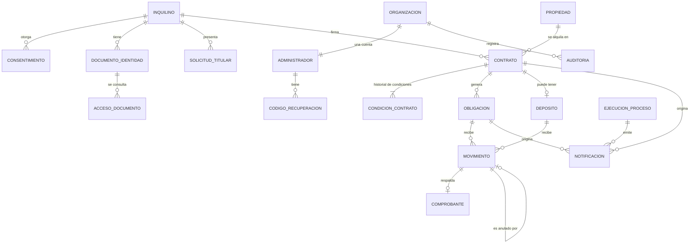

# Modelo lógico de datos

**Sistema de Gestión de Alquileres**

**Identificador:** MDD-SGA-001
**Versión:** 0.1 — Borrador para revisión
**Fecha:** 17 de octubre de 2026
**Estado:** Borrador; no aprobado
**Base:** [ERS-SGA-001 v1.6](../fase-1-ers/ERS_SGA_001_v1.6_borrador.md) (sección 7 y requisitos) y [DAS-SGA-001 v0.5](../fase-2-arquitectura/DAS_SGA_001_v0.5_borrador.md) (secciones 7 y 8)

Este documento es un **modelo lógico**: entidades, atributos, claves, restricciones y valores derivados. **No fija motor de base de datos, tipos físicos ni nombres de tabla definitivos** (ADR-002 sigue abierto). Los tipos son lógicos. Lo que no proviene de la ERS o del DAS se marca como *propuesta*.

## 1. Convenciones

| Tipo lógico | Significado |
|---|---|
| `id` | Identificador único e inmutable (formato por decidir: UUID o secuencia). |
| `fecha` | Fecha de calendario sin hora (vencimientos, períodos, fecha real de recepción). |
| `instante` | Marca de tiempo almacenada en UTC (registro, auditoría). Se presenta en la zona de la organización. |
| `dinero` | Decimal exacto (nunca flotante), con la moneda en una columna aparte. Escala: 2 decimales almacenados; el redondeo a la unidad entera aplica solo al prorrateo de CRC (ERS RN-12). |
| `moneda` | Código de 3 letras: `CRC` o `USD` (ERS RN-23). |
| `texto`, `entero`, `lógico` | Como indican. |

Regla general: **los movimientos no se editan ni se borran** (ERS 7.3, punto 6). Los saldos y los estados **no se almacenan**; se derivan (sección 5).

## 2. Diagrama entidad-relación

## 3. Entidades y atributos

### 3.1 Configuración y acceso

**ORGANIZACION** (una sola fila en v1) — *ERS RF-33, RF-21, RF-41, OL-13*

| Atributo | Tipo | Notas |
|---|---|---|
| id | id | |
| nombre_responsable | texto | Identidad del responsable de la base de datos (art. 5 de la Ley 8968, inciso h). Se completa con DP-23. |
| direccion_responsable | texto | Idem. |
| zona_horaria | texto | Identificador IANA; `America/Costa_Rica` por defecto (RF-33). |
| hora_proceso_diario | hora local | 07:00 por defecto (DP-02). |
| telefono_whatsapp_admin | texto | Destinatario de avisos (RF-44). |
| aceptacion_whatsapp_admin | instante | Fecha de aceptación de recibir mensajes. |
| anticipaciones_recordatorio | lista de enteros (máx. 3) | Días antes del vencimiento; por defecto `[3]` (RF-21). |
| retencion_fotos_anios | entero | 5 por defecto; no mayor que 10 (RF-41). |
| dias_gracia_defecto | entero | 7 (RN-06). |

**ADMINISTRADOR** (una sola fila en v1) — *RF-26, RF-27, RN-25*

| Atributo | Tipo | Notas |
|---|---|---|
| id | id | |
| usuario | texto | Único. |
| hash_contrasena | texto | Hash resistente; nunca la contraseña. |
| secreto_segundo_factor | texto cifrado | TOTP. |
| segundo_factor_activo | lógico | Obligatorio para operar (RNF-01). |
| creado_en, actualizado_en | instante | |

**CODIGO_RECUPERACION** — *RF-27*: `id`, `administrador_id`, `hash_codigo`, `usado_en` (instante, nulo si disponible), `creado_en`. Un código se usa una sola vez; no se guarda en claro.

### 3.2 Inquilinos y datos personales

**INQUILINO** — *RF-01 a RF-05, RN-10, RN-24*

| Atributo | Tipo | Notas |
|---|---|---|
| id | id | |
| nombre_completo | texto | Se anula al desasociar (ver sección 6). |
| tipo_documento | texto | `cedula`, `dimex`, `pasaporte` u `otro`. |
| numero_documento | texto | Se anula al desasociar. Único junto con `tipo_documento` entre inquilinos activos; duplicado → advertencia (RF-01), no bloqueo. |
| telefono, correo | texto | Se anulan al desasociar. |
| activo | lógico | No se puede poner en falso con contrato vigente o saldos (RF-04). |
| desasociado_en | instante | No nulo si ya se eliminaron los datos personales (RF-41). |
| creado_en, actualizado_en | instante | |

**CONSENTIMIENTO** — *RF-39, OL-13*: `id`, `inquilino_id`, `version_texto`, `medio` (`fisico` o `electronico`), `otorgado_en`, `revocado_en` (nulo si vigente).

**DOCUMENTO_IDENTIDAD** — *RF-01, RF-02, ADR-003*: `id`, `inquilino_id`, `cara` (`frente` o `reverso`), `referencia_archivo` (referencia protegida al almacenamiento privado, nunca una URL pública), `tipo_real_archivo`, `tamano_bytes`, `creado_en`, `eliminado_en`. El frente es obligatorio; el reverso, opcional.

**ACCESO_DOCUMENTO** — *RF-45*: `id`, `documento_id`, `actor` (administrador), `accion` (`consulta` o `descarga`), `ocurrido_en`. No guarda la imagen.

**SOLICITUD_TITULAR** — *RF-40, OL-15*: `id`, `inquilino_id`, `tipo` (`acceso`, `rectificacion`, `actualizacion`, `supresion`), `recibida_el` (fecha), `fecha_limite` (cinco días hábiles), `resuelta_el` (nulo si abierta), `resolucion` (texto).

### 3.3 Propiedades y contratos

**PROPIEDAD** — *RF-06*: `id`, `descripcion`, `direccion`, `inactiva` (lógico), `creado_en`. El estado *disponible* u *ocupada* se deriva del contrato vigente (sección 5).

**CONTRATO** — *RF-07 a RF-10, RF-36, RF-42*

| Atributo | Tipo | Notas |
|---|---|---|
| id | id | |
| inquilino_id | id | |
| propiedad_id | id | |
| destino | texto | `vivienda` u `otro` (OL-06, OL-08). |
| fecha_inicio | fecha | Fecha de entrega del bien; ancla el período (RN-03). |
| fecha_fin | fecha, nulo | Inclusive (RN-02). |
| moneda | moneda | |
| anulado | lógico | Contrato dado de baja (RN-30). |
| creado_en | instante | |

El monto, el día de vencimiento y los días de gracia **no viven en el contrato**: están en `CONDICION_CONTRATO`, para conservar el historial.

**CONDICION_CONTRATO** — *RF-10, RN-14, DP-22* (propuesta de estructura; la ERS pide conservar valor anterior, nuevo, fecha efectiva y motivo)

| Atributo | Tipo | Notas |
|---|---|---|
| id | id | |
| contrato_id | id | |
| monto_mensual | dinero | Mayor que cero. |
| dia_vencimiento | entero | De 1 a 31; por defecto, el día de `fecha_inicio` (DP-24). |
| dias_gracia | entero | |
| vigente_desde | fecha | Fecha efectiva. En un reajuste, inicio de período (RF-10). |
| tipo | texto | `inicial`, `reajuste` o `correccion`. |
| fecha_notificacion | fecha, nulo | Solo en reajustes. |
| porcentaje | decimal, nulo | Solo en reajustes. |
| tope_digitado | decimal, nulo | Solo en reajustes de vivienda (DP-22). |
| fuente_tope | texto, nulo | Certificación del INEC o publicación del MIVAH. |
| motivo | texto, nulo | Obligatorio en correcciones. |
| registrada_en | instante | |

La condición aplicable a un período es la de mayor `vigente_desde` que no supere el inicio del período. Las correcciones retroactivas **no sustituyen** filas: la nueva fila queda registrada y la obligación recalculada guarda cuál condición aplicó.

**DEPOSITO** — *RF-29 a RF-32*: `id`, `contrato_id` (único: un depósito por contrato), `importe_total`, `moneda`, `fecha_limite_acordada` (nulo), `notas`, `creado_en`. Si se corrige `importe_total`, se registra en auditoría y nunca puede quedar por debajo de lo abonado.

### 3.4 Obligaciones y movimientos

**OBLIGACION** — *RF-11 a RF-15, RF-43, RN-04, RN-05, RN-12, RN-13*

| Atributo | Tipo | Notas |
|---|---|---|
| id | id | |
| contrato_id | id | |
| tipo | texto | `regular` o `apertura` (CA-49, ERS 7.1). |
| periodo_inicio | fecha, nulo | Nulo solo en `apertura`. |
| periodo_fin | fecha, nulo | Idem. |
| fecha_vencimiento | fecha | Regla RN-05. |
| fecha_limite | fecha | `fecha_vencimiento` + días de gracia (RN-06). |
| importe_exigible | dinero | |
| moneda | moneda | La del contrato. |
| condicion_id | id, nulo | Condición aplicada (nulo en `apertura`). |
| datos_calculo | texto estructurado | Días cobrables, importe previo al redondeo, importe final y regla aplicada; se guarda cuando hubo prorrateo (RN-12, RN-13). |
| ajuste_manual_motivo | texto, nulo | Si el importe se ajustó a mano (RF-09). |
| anulada_en | instante, nulo | |
| motivo_anulacion | texto, nulo | Obligatorio si hay `anulada_en` (RN-17). |
| creado_en | instante | |

**MOVIMIENTO** — *RF-13, RF-16, RF-30, RF-34, RF-38, RN-22*

| Atributo | Tipo | Notas |
|---|---|---|
| id | id | |
| tipo | texto | `abono` o `reversion`. |
| obligacion_id | id, nulo | Exactamente uno de `obligacion_id` y `deposito_id` (restricción). |
| deposito_id | id, nulo | |
| importe_aplicado | dinero | Siempre positivo; en la moneda de la obligación o del depósito. |
| moneda_recibida | moneda | |
| importe_recibido | dinero | En `moneda_recibida`. Igual a `importe_aplicado` si la moneda coincide. |
| tipo_cambio | decimal, nulo | Ingresado a mano; obligatorio si las monedas difieren (RF-38). |
| fecha_real | fecha | No futura ni anterior al inicio del contrato (RN-29). |
| registrado_en | instante | Siempre se conserva (RN-29). |
| medio_pago | texto | `efectivo`, `transferencia`, `cheque` u `otro`. |
| observacion | texto, nulo | |
| anula_a | id, nulo | Solo en `reversion`: el movimiento original (RF-16). |
| motivo | texto, nulo | Obligatorio en `reversion`. |
| excepcion_motivo | texto, nulo | Solo en abonos de depósito sobre el tercero (RF-30). |

Un movimiento `abono` es **válido** si ninguna `reversion` apunta a él (RN-22). Una `reversion` nunca se anula.

**COMPROBANTE** — *RF-37, ADR-010*: `id`, `numero` (único, consecutivo, sin reutilizar), `movimiento_id` (único), `estado` (`vigente` o `anulado`), `emitido_en`. El contenido impreso se reconstruye a partir del movimiento y su contexto.

### 3.5 Notificaciones, procesos y auditoría

**NOTIFICACION** — *RF-21 a RF-25, RF-42, RF-44*

| Atributo | Tipo | Notas |
|---|---|---|
| id | id | |
| obligacion_id, contrato_id | id, nulo | Una u otra, según el tipo. |
| tipo | texto | `recordatorio`, `alerta_atraso`, `vencimiento_contrato`. |
| canal | texto | `web` o `whatsapp`. |
| clave_unica | texto | Obligación + tipo + anticipación + fecha (idempotencia, RF-21). Única. |
| programada_para | instante | |
| estado_web | texto, nulo | `nueva`, `leida`, `archivada` (solo canal web). |
| intentos | entero | Hasta 5 (RF-24). |
| resultado | texto | `pendiente`, `aceptado`, `entregado`, `fallido`, `cancelado`. |
| referencia_proveedor | texto, nulo | |
| ejecucion_id | id, nulo | Ejecución que la emitió. |

**EJECUCION_PROCESO** — *RNF-16, DAS 10.1* (propuesta): `id`, `fecha_local`, `iniciada_en`, `terminada_en`, `resultado`, `detalle`. Sirve para saber qué días corrió el proceso y emitir solo la alerta del día actual (RF-22).

**AUDITORIA** — *RF-28, RNF-06*: `id`, `entidad`, `registro_id`, `actor`, `accion`, `ocurrido_en`, `valor_anterior`, `valor_nuevo`. No guarda secretos ni documentos completos.

## 4. Claves y restricciones

| # | Restricción | Origen |
|---|---|---|
| R1 | `OBLIGACION`: único (`contrato_id`, `periodo_inicio`) para `regular`; a lo sumo una `apertura` por contrato. | RF-12, RN-04, RNF-04 |
| R2 | `CONTRATO`: dos contratos de una misma propiedad no comparten ningún día (`fecha_inicio` a `fecha_fin` inclusive; sin fin = abierto). **Depende del motor:** algunos lo imponen con una restricción de exclusión; si no, se valida en la aplicación dentro de una transacción bloqueando la propiedad. | RF-08, RN-02 |
| R3 | `CONDICION_CONTRATO`: `monto_mensual` > 0; `dia_vencimiento` entre 1 y 31; `dias_gracia` ≥ 0; `vigente_desde` no puede preceder a `fecha_inicio`. | ERS 7.3 |
| R4 | `MOVIMIENTO`: exactamente uno de `obligacion_id` y `deposito_id`; `importe_aplicado` > 0; `tipo_cambio` obligatorio si `moneda_recibida` ≠ moneda destino; `anula_a` y `motivo` obligatorios si `tipo` = `reversion`. | RF-16, RF-38 |
| R5 | `MOVIMIENTO`: una `reversion` apunta a un único `abono` que no tenga ya otra reversión. | RN-22 |
| R6 | El saldo derivado nunca es negativo: se valida al insertar el movimiento, con la fila de la obligación o depósito bloqueada para evitar dos abonos simultáneos. | RN-18, RF-35 |
| R7 | `COMPROBANTE`: `numero` único y consecutivo; la asignación ocurre en la misma transacción que el movimiento. | RF-37 |
| R8 | `DEPOSITO`: uno por contrato; a lo sumo tres abonos válidos, salvo confirmación con motivo en `excepcion_motivo`. | RN-27 |
| R9 | `NOTIFICACION`: `clave_unica` única. | RF-21, RNF-16 |
| R10 | `INQUILINO`: único (`tipo_documento`, `numero_documento`) solo entre activos, como **advertencia**, no como restricción dura. | RF-01 |
| R11 | `DOCUMENTO_IDENTIDAD`: nunca una URL pública; el nombre del archivo almacenado es aleatorio. | RNF-14 |
| R12 | Las filas de `MOVIMIENTO`, `COMPROBANTE`, `AUDITORIA` y `ACCESO_DOCUMENTO` no admiten `UPDATE` ni `DELETE` por la aplicación (salvo el estado del comprobante). | ERS 7.3, DAS 2 |

## 5. Valores derivados (no se almacenan)

| Valor | Cálculo | Referencia |
|---|---|---|
| Movimientos válidos de una obligación | Abonos sin reversión que apunte a ellos | RN-22 |
| **Saldo de obligación** | `importe_exigible` − suma de `importe_aplicado` de movimientos válidos | RF-35, RN-18 |
| **Estado de obligación** | `anulada` si `anulada_en` no es nulo; si no, `pagada` si saldo = 0; si no, `vencida` si hoy (zona de la organización) > `fecha_limite`; si no, `pendiente` | RF-14, RN-07 |
| **Fecha de pago completo** | `fecha_real` del movimiento válido que dejó el saldo en cero | Q-6 |
| Saldo y estado de depósito | `importe_total` − abonos válidos; `pendiente` (sin abonos), `parcialmente pagado` o `completado` | RF-31 |
| Estado de contrato | `anulado`; `futuro` si hoy < `fecha_inicio`; `finalizado` si `fecha_fin` < hoy; `por decidir` si hubo fin vencido sin cierre ni renovación; si no, `vigente` | RN-30, RF-42 |
| Estado de propiedad | `inactiva` si está marcada; `ocupada` si tiene un contrato vigente; si no, `disponible` | RF-06 |
| Período y vencimiento | Calculados por el servicio de obligaciones con las reglas RN-03 y RN-05 | RN-03, RN-05 |

## 6. Retención y desasociación (Ley 8968)

Cuando vence el plazo de retención del último contrato del inquilino (RF-41):

| Entidad | Acción |
|---|---|
| `DOCUMENTO_IDENTIDAD` | Se elimina el archivo del almacenamiento privado; la fila conserva `eliminado_en`. |
| `INQUILINO` | `nombre_completo`, `numero_documento`, `telefono` y `correo` se anulan; `desasociado_en` se completa. La fila y su `id` permanecen. |
| `CONSENTIMIENTO`, `SOLICITUD_TITULAR` | Se evalúa con asesoría legal (pueden requerirse como evidencia de cumplimiento). **Pendiente** (DP-18). |
| `CONTRATO`, `OBLIGACION`, `MOVIMIENTO`, `COMPROBANTE` | Se conservan sin datos de identificación; el comprobante impreso se regenera sin nombre. **Pendiente** de confirmar con DP-18 y DP-20. |
| Respaldos | 35 días de retención; la foto eliminada desaparece de ellos en ese plazo (DP-07). |

## 7. Transacciones críticas

| Operación | Debe ocurrir en una sola transacción |
|---|---|
| Registrar abono | Bloquear la obligación o depósito → validar saldo y fecha → insertar `MOVIMIENTO` → asignar `COMPROBANTE` → insertar `AUDITORIA` |
| Anular movimiento | Insertar la `reversion` → marcar el comprobante como `anulado` → insertar `AUDITORIA` |
| Reajuste o corrección | Insertar `CONDICION_CONTRATO` → recalcular las obligaciones afectadas → validar que ninguna quede bajo lo abonado → `AUDITORIA` |
| Generar obligación | Comprobar R1 → insertar `OBLIGACION` (idempotente) |
| Finalizar contrato | Actualizar `fecha_fin` → prorratear el último período → anular las posteriores sin movimientos → `AUDITORIA` |

## 8. Trazabilidad

| Entidad | Requisitos |
|---|---|
| ORGANIZACION, ADMINISTRADOR, CODIGO_RECUPERACION | RF-26, RF-27, RF-33, RN-25 |
| INQUILINO, DOCUMENTO_IDENTIDAD, ACCESO_DOCUMENTO | RF-01 a RF-05, RF-45 |
| CONSENTIMIENTO, SOLICITUD_TITULAR | RF-39, RF-40, RF-41 |
| PROPIEDAD, CONTRATO, CONDICION_CONTRATO | RF-06 a RF-10, RF-36, RF-42 |
| OBLIGACION | RF-11 a RF-15, RF-43 |
| MOVIMIENTO, COMPROBANTE | RF-13, RF-16, RF-34, RF-35, RF-37, RF-38 |
| DEPOSITO | RF-29 a RF-32 |
| NOTIFICACION, EJECUCION_PROCESO | RF-21 a RF-25, RF-42, RF-44 |
| AUDITORIA | RF-28 |

## 9. Problemas y decisiones que surgieron al modelar

| # | Hallazgo | Propuesta |
|---|---|---|
| H1 | **Contradicción de glosario.** El glosario de la ERS (sección 1.3) y el del borrador del DAS definen el saldo de apertura como un tipo de *movimiento*, pero la ERS 7.1 y el criterio CA-49 lo tratan como una *obligación* de tipo apertura. | Tratarlo como obligación `apertura` (como CA-49), y corregir ambos glosarios en la ERS v1.7 y el DAS v0.6. |
| H2 | La ERS no tiene entidad para el **historial de condiciones** (monto, vencimiento, gracia, reajuste), aunque RF-10 lo exige. | Entidad `CONDICION_CONTRATO` (sección 3.3). Añadirla a la sección 7.1 de la ERS. |
| H3 | La ERS no menciona la **organización** como entidad, pero guarda configuración (zona, hora, anticipaciones, teléfono, retención). | Entidad `ORGANIZACION` de una sola fila. Añadirla a la ERS. |
| H4 | **Numeración de comprobantes:** ¿una serie global o una por año? La ERS solo pide "consecutiva" (RF-37). | Una serie global (más simple). **Decisión pendiente** con DP-20; un abogado puede exigir otra cosa. |
| H5 | El `importe_aplicado` de un pago en otra moneda requiere una **regla de redondeo** del equivalente. | Redondear a 2 decimales (USD) o a la unidad entera (CRC) con empate hacia arriba, igual que RN-12. **Propuesta**; confirmar. |
| H6 | La restricción de **no solapamiento de contratos** (R2) depende del motor elegido. | Decidir con ADR-002; mientras tanto se valida en la aplicación. |
| H7 | **Identificadores:** ¿UUID o secuencia? Los comprobantes ya necesitan secuencia propia. | Decidir con la base de datos. |
| H8 | Qué ocurre con `CONSENTIMIENTO` y `SOLICITUD_TITULAR` al desasociar (¿evidencia legal?). | DP-18; pendiente de abogado. |

## 10. Qué no cubre este borrador

- Tipos físicos, índices concretos, particiones, migraciones y nombres de tablas.
- Contratos de API (siguiente producto de la fase 3), permisos por operación y flujos detallados.
- Datos de prueba.
- Revisión por otra persona; los ejemplos de derivación no se probaron contra una base de datos.
