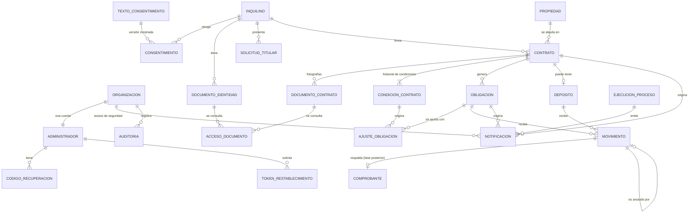

# Modelo lógico de datos

**Sistema de Gestión de Alquileres**

**Identificador:** MDD-SGA-001
**Versión:** 0.7 — Borrador para revisión (reemplaza a la [v0.6](MODELO_DATOS_SGA_001_v0.6_borrador.md), que se conserva con su nota del 23-oct-2026; la [v0.5](MODELO_DATOS_SGA_001_v0.5_borrador.md), la [v0.4](MODELO_DATOS_SGA_001_v0.4_borrador.md), la [v0.3](MODELO_DATOS_SGA_001_v0.3_borrador.md), la [v0.2](MODELO_DATOS_SGA_001_v0.2_borrador.md) y la [v0.1](MODELO_DATOS_SGA_001_v0.1_borrador.md) también)
**Fecha:** 23 de octubre de 2026
**Estado:** Borrador; no aprobado
**Base:** [ERS-SGA-001 v1.16](../fase-1-ers/ERS_SGA_001_v1.16_borrador.md) y [DAS-SGA-001 v0.15](../fase-2-arquitectura/DAS_SGA_001_v0.15_borrador.md). La v0.4 alinea el modelo con las decisiones del 20 y 21-oct-2026 (correo en lugar de WhatsApp, avisos de seguridad, restablecimiento de contraseña, recibo físico y comprobante como fase posterior). Los hallazgos H1, H2, H3, H9, H10, H11, H12 y H13 están incorporados en ellos; H4 es decisión provisional (DP-20).

**Qué cambia la v0.7 (23-oct-2026):** alinea el modelo con la ERS v1.14 (máximo de 10 fotografías por contrato, RF-52 y CA-76). `DOCUMENTO_CONTRATO.orden` queda limitado a entre 1 y 10 con un `CHECK` (nueva **R28**, propuesta) y el servicio rechaza la fotografía número 11 con un mensaje, bajo el bloqueo del contrato de H18. Hallazgo nuevo **H20** (el máximo y una futura eliminación de fotografías, DP-28). **El resto del modelo no cambia.** La conservación (DP-28) y las cifras definitivas de reducción (DP-29, a medir en la E2) siguen abiertas. Lo marcado "propuesta" no lo decidió el solicitante. **La v0.7 se probó en PostgreSQL el 23-oct-2026 (sección 12.3, autoverificación).**

Este documento es un **modelo lógico**: entidades, atributos, claves, restricciones y valores derivados. **No fija motor de base de datos, tipos físicos ni nombres de tabla definitivos** (ADR-002 sigue abierto). Los tipos son lógicos. Lo que no proviene de la ERS o del DAS se marca como *propuesta*.

## 1. Convenciones

| Tipo lógico | Significado |
|---|---|
| `id` | Identificador único e inmutable: entero de 64 bits autoincremental (`BigAutoField` de Django; ADR-028, decisión del 21-oct-2026). Los UUID se mantienen en `clave_solicitud` y en los nombres de archivo de las cédulas. |
| `fecha` | Fecha de calendario sin hora (vencimientos, períodos, fecha real de recepción). |
| `instante` | Marca de tiempo almacenada en UTC (registro, auditoría). Se presenta en la zona de la organización. |
| `dinero` | Decimal exacto (nunca flotante), con la moneda en una columna aparte. Escala: 2 decimales almacenados; el redondeo a la unidad entera aplica solo al prorrateo de CRC (ERS RN-12). |
| `moneda` | Código de 3 letras: `CRC` o `USD` (ERS RN-23). |
| `texto`, `entero`, `lógico` | Como indican. |

Regla general: **los movimientos y los ajustes de importe no se editan ni se borran** (ERS 7.3, punto 6). Los saldos, el importe exigible vigente y los estados **no se almacenan**; se derivan (sección 5).

### 1.1 Control del documento

| Versión | Fecha | Cambio | Origen | Aprobación |
|---|---|---|---|---|
| 0.1 | 17-oct-2026 | Primer borrador | "empieza el modelo de datos" | Ninguna |
| 0.2 | 17-oct-2026 | Ajustes de importe como filas nuevas (`AJUSTE_OBLIGACION`); auditoría sin valores personales; algoritmo de contraseña; fuentes; ADR propuestos; prueba en PostgreSQL (sección 12), hallazgo H11; fuentes de dinero, UTC e idempotencia; H12 y H13 (H13 aceptada, con `clave_solicitud` y R15) | Verificación de buenas prácticas de la fase 3; decisión del solicitante "procede con las dos recomendaciones" | Ninguna |
| 0.3 | 17-oct-2026 | Hora de notificación como fecha local, hora local y zona (DP-26); entidad `INCIDENTE_SEGURIDAD` (RF-46); H4 y H12 resueltas | DP-26 y H4 respondidas por el solicitante; ERS v1.8 | Ninguna |
| 0.4 | 21-oct-2026 | `MOVIMIENTO.numero_recibo_fisico` (RF-47, R16); `COMPROBANTE` como fase posterior; `ORGANIZACION` con correos (la segunda, del solicitante); `NOTIFICACION` con canal correo, avisos de seguridad y reintentos; entidad `TOKEN_RESTABLECIMIENTO`; H14; transacciones y trazabilidad ajustadas | ERS v1.9 y DAS v0.11 (decisiones del solicitante del 20 y 21-oct-2026) | Ninguna |
| 0.5 | 22-oct-2026 | Entidades `DOCUMENTO_CONTRATO` (RF-52) y `ARCHIVO_TEMPORAL` (HT-10); `ACCESO_DOCUMENTO` para ambos tipos de documento; restricciones R22 a R25; hallazgos H15 a H18; retención de la fotografía del contrato pendiente (DP-28) | ERS v1.11; decisiones del solicitante del 22-oct-2026 (cédula desde el perfil de la propiedad, fotografía del contrato, zona temporal) | Ninguna |
| 0.6 | 23-oct-2026 | Se retiran `ARCHIVO_TEMPORAL`, R24 y `sesion_hash`; R26 (contrato solo con el frente cargado) y R27 (5 MiB y tipo real); transacciones de fotografías directas; H18 adoptado; H19; probado en PostgreSQL el mismo día (sección 12.2) | ERS v1.12; decisiones del solicitante del 23-oct-2026 (sin zona temporal, bloqueo del contrato, tope de 5 MiB) | Ninguna |
| 0.7 | 23-oct-2026 | `DOCUMENTO_CONTRATO.orden` entre 1 y 10 (R28, propuesta de `CHECK`); la fotografía número 11 se rechaza bajo el bloqueo del contrato; H20; probado en PostgreSQL el mismo día (sección 12.3) | ERS v1.14; decisión del solicitante del 23-oct-2026 (máximo de 10 fotografías por contrato, DP-29) | Ninguna |

| Rol | Nombre | Decisión | Fecha |
|---|---|---|---|
| Responsable técnico | brandonC-developer (DP-23: ocupa los tres roles) | Pendiente | Pendiente |

### 1.2 Fuentes de las prácticas de diseño

| Práctica | Fuente | Cómo se validó | Limitaciones |
|---|---|---|---|
| Entradas inmutables y saldos calculados, no editados | [Fowler, *Accounting Transaction*](https://martinfowler.com/eaaDev/AccountingTransaction.html) | Leída por resumen | Borrador de mediados de los 2000. No trata reversiones ni correcciones: esa parte del modelo es criterio propio. |
| Evitar solapamiento de rangos con restricción de exclusión | [PostgreSQL, tipos de rango](https://www.postgresql.org/docs/current/rangetypes.html) | Leída por resumen | Solo vale si se elige PostgreSQL (ADR-002 abierto). |
| Hash de contraseñas: Argon2id, mínimo 19 MiB de memoria, 2 iteraciones, paralelismo 1 | [OWASP, Password Storage Cheat Sheet](https://cheatsheetseries.owasp.org/cheatsheets/Password_Storage_Cheat_Sheet.html) | Leída por resumen | Los parámetros son un mínimo; se afinan en el servidor real (menos de ~1 s por hash). |
| Dinero exacto: decimal y no flotante | [Python, módulo `decimal`](https://docs.python.org/3/library/decimal.html) y [PostgreSQL, tipos numéricos](https://www.postgresql.org/docs/current/datatype-numeric.html) | Ambas leídas por resumen | Respaldan `numeric`/decimal y el redondeo a mitad hacia arriba (`ROUND_HALF_UP`). Python: `round()` sin decimales redondea al par; usar `quantize` con el modo explícito. PostgreSQL: `numeric` es lento frente a enteros o flotantes, irrelevante a este volumen. |
| Instantes en UTC, con salvedad | [W3C, Working with Time Zones](https://www.w3.org/TR/timezone/) | Leída por resumen | Recomienda UTC "when in doubt", pero **no basta para eventos futuros en hora local** (cambios de reglas de zona); ver H12. Las fechas sin hora (vencimientos) se guardan sin zona, como indica la guía. |
| Idempotencia de operaciones reintentables | [Stripe, Idempotent requests](https://docs.stripe.com/api/idempotent_requests) | Leída por resumen | Clave única generada por el cliente (UUID v4), de hasta 255 caracteres; se compara con los parámetros originales y se descarta tras 24 h. Es el patrón para **peticiones**; nuestra `clave_unica` de notificaciones es una clave natural permanente, patrón distinto que esta fuente no respalda. Ver H13. |

## 2. Diagrama entidad-relación

## 3. Entidades y atributos

### 3.1 Configuración y acceso

**ORGANIZACION** (una sola fila en v1) — *ERS RF-33, RF-21, RF-41, OL-13*

| Atributo | Tipo | Notas |
|---|---|---|
| id | id | |
| nombre_responsable | texto | Identidad del responsable de la base de datos (art. 5 de la Ley 8968, inciso h). Se completa con DP-23. |
| direccion_responsable | texto | Idem. |
| zona_horaria | texto | Identificador IANA; `America/Costa_Rica` por defecto (RF-33). |
| hora_proceso_diario | hora local | 07:00 por defecto (DP-02). |
| correo_admin | texto | Destinatario de las notificaciones, los avisos de seguridad y el enlace de restablecimiento (RF-23, RF-27, RF-44). Dato personal del administrador. |
| correo_aviso_secundario | texto, nulo | Segunda dirección de los avisos de seguridad (RF-27): del propio solicitante, en otro proveedor (decisión del 21-oct-2026); no es dato de un tercero. Nunca recibe el enlace de restablecimiento. |
| telefono_whatsapp_admin | texto, nulo | **Futuro, fuera de la v1** (DP-04): destinatario de avisos por WhatsApp (RF-44). |
| aceptacion_whatsapp_admin | instante, nulo | **Futuro:** fecha de aceptación de recibir mensajes de WhatsApp. |
| anticipaciones_recordatorio | lista de enteros (máx. 3) | Días antes del vencimiento; por defecto `[3]` (RF-21). |
| retencion_fotos_anios | entero | 5 por defecto; no mayor que 10 (RF-41). |
| retencion_sin_contrato_meses | entero | 12 por defecto (propuesta); para inquilinos sin contrato o con todos anulados (RF-41, CA-66). |
| dias_gracia_defecto | entero | 7 (RN-06). |

**ADMINISTRADOR** (una sola fila en v1) — *RF-26, RF-27, RN-25*

| Atributo | Tipo | Notas |
|---|---|---|
| id | id | |
| usuario | texto | Único. |
| hash_contrasena | texto | Nunca la contraseña. Propuesta: Argon2id con al menos los parámetros mínimos de OWASP (sección 1.2), con sal única por contraseña. |
| secreto_segundo_factor | texto cifrado | TOTP. |
| segundo_factor_activo | lógico | Obligatorio para operar (RNF-01). |
| fallos_consecutivos | entero | Contador de intentos fallidos de la cuenta; se reinicia con un inicio de sesión correcto (RF-27, CA-68). |
| espera_hasta | instante, nulo | Hasta cuándo se exige esperar tras 5 o más fallos seguidos (1 minuto, duplicándose hasta 1 hora). |
| ultimo_intervalo_totp | entero, nulo | Último intervalo de 30 s aceptado, para no reutilizar un TOTP (CA-69). |
| creado_en, actualizado_en | instante | |

**CODIGO_RECUPERACION** — *RF-27* (10 por emisión; emitir nuevos invalida los anteriores): `id`, `administrador_id`, `hash_codigo`, `usado_en` (instante, nulo si disponible), `creado_en`. Un código se usa una sola vez; no se guarda en claro.

**TOKEN_RESTABLECIMIENTO** — *RF-27, CA-59* (propuesta de estructura): `id`, `administrador_id`, `hash_token` (nunca el token en claro), `creado_en` (instante), `expira_en` (instante; `creado_en` más 15 minutos, valor propuesto), `usado_en` (instante, nulo si no usado). Un token se usa una sola vez y no sirve vencido (R17). El enlace se envía solo a `correo_admin`. Los `creado_en` de las últimas 24 horas sirven para limitar a 3 solicitudes por hora (R18).

### 3.2 Inquilinos y datos personales

**INQUILINO** — *RF-01 a RF-05, RN-10, RN-24*

| Atributo | Tipo | Notas |
|---|---|---|
| id | id | |
| nombre_completo | texto | Obligatorio. Se anula al desasociar (ver sección 6). |
| tipo_documento | texto | `cedula`, `dimex`, `pasaporte` u `otro`. |
| numero_documento | texto | Se anula al desasociar. Único junto con `tipo_documento` entre inquilinos activos; duplicado → advertencia (RF-01), no bloqueo. |
| telefono, correo | texto, nulo | Opcionales (ERS RF-01, revisión del 21-oct-2026): contacto manual del administrador, sin uso automático. Se anulan al desasociar. |
| activo | lógico | No se puede poner en falso con contrato vigente o saldos (RF-04). |
| desasociado_en | instante | No nulo si ya se eliminaron los datos personales (RF-41). |
| creado_en, actualizado_en | instante | |

**TEXTO_CONSENTIMIENTO** — *RF-39, OL-13* (propuesta de estructura): `id`, `version` (única), `contenido` (el texto informativo completo mostrado), `vigente_desde`. Inmutable: una versión nueva es una fila nueva.

**CONSENTIMIENTO** — *RF-39, OL-13*: `id`, `inquilino_id`, `texto_id` (referencia a `TEXTO_CONSENTIMIENTO`; reemplaza al campo `version_texto`), `medio` (`fisico` o `electronico`), `otorgado_en`, `revocado_en` (nulo si vigente).

**DOCUMENTO_IDENTIDAD** — *RF-01, RF-02, ADR-003*: `id`, `inquilino_id`, `cara` (`frente` o `reverso`), `referencia_archivo` (referencia protegida al almacenamiento privado, nunca una URL pública), `tipo_real_archivo`, `tamano_bytes`, `creado_en`, `eliminado_en`. El frente es obligatorio **antes de crear un contrato** con el inquilino (R26), no para guardarlo; el reverso, opcional. El archivo se sube directo a la ficha del inquilino, sin zona temporal (ERS v1.12). A lo sumo una fila activa por cara (R25).

**ACCESO_DOCUMENTO** — *RF-45, RF-52*: `id`, `documento_id` (nulo; apunta a `DOCUMENTO_IDENTIDAD`), `documento_contrato_id` (nulo; apunta a `DOCUMENTO_CONTRATO`; propuesta), `actor` (administrador), `accion` (`consulta` o `descarga`), `ocurrido_en`. Exactamente uno de los dos documentos va informado (R23). No guarda la imagen.

**SOLICITUD_TITULAR** — *RF-40, OL-15*: `id`, `inquilino_id`, `tipo` (`acceso`, `rectificacion`, `actualizacion`, `supresion`), `origen` (`titular` o `revocacion`: la abre de oficio el sistema al revocar un consentimiento, RF-39), `recibida_el` (fecha), `fecha_limite` (cinco días hábiles), `resuelta_el` (nulo si abierta), `resolucion` (texto).

### 3.3 Propiedades y contratos

**PROPIEDAD** — *RF-06*: `id`, `alias` (texto corto, obligatorio y único; R20), `descripcion`, `direccion`, `inactiva` (lógico; no puede ponerse en verdadero con un contrato vigente, futuro o por decidir), `creado_en`. El estado *disponible* u *ocupada* se deriva del contrato vigente (sección 5).

**CONTRATO** — *RF-07 a RF-10, RF-36, RF-42*

| Atributo | Tipo | Notas |
|---|---|---|
| id | id | |
| inquilino_id | id | |
| propiedad_id | id | |
| destino | texto | `vivienda` u `otro` (OL-06, OL-08). |
| fecha_inicio | fecha | Fecha de entrega del bien; ancla el período (RN-03). |
| fecha_fin | fecha, nulo | Inclusive (RN-02). |
| moneda | moneda | |
| anulado_en | instante, nulo | Contrato dado de baja (RN-30, RF-48). Solo si no tiene movimientos válidos; se completa una sola vez. |
| motivo_anulacion | texto, nulo | Obligatorio si `anulado_en` no es nulo (R21). |
| creado_en | instante | |

El monto, el día de vencimiento y los días de gracia **no viven en el contrato**: están en `CONDICION_CONTRATO`, para conservar el historial.

**CONDICION_CONTRATO** — *RF-10, RN-14, DP-22* (propuesta de estructura; la ERS pide conservar valor anterior, nuevo, fecha efectiva y motivo)

| Atributo | Tipo | Notas |
|---|---|---|
| id | id | |
| contrato_id | id | |
| monto_mensual | dinero | Mayor que cero. |
| dia_vencimiento | entero | De 1 a 31; por defecto, el día de `fecha_inicio` (DP-24). |
| dias_gracia | entero | |
| vigente_desde | fecha | Fecha efectiva. En un reajuste, inicio de período (RF-10). |
| tipo | texto | `inicial`, `reajuste` o `correccion`. |
| fecha_notificacion | fecha, nulo | Solo en reajustes. |
| porcentaje | decimal, nulo | Solo en reajustes. |
| tope_digitado | decimal, nulo | Solo en reajustes de vivienda (DP-22). |
| fuente_tope | texto, nulo | Certificación del INEC o publicación del MIVAH. |
| motivo | texto, nulo | Obligatorio en correcciones. |
| registrada_en | instante | |

La condición aplicable a un período es la de mayor `vigente_desde` que no supere el inicio del período. Las correcciones retroactivas **no sustituyen** filas: la nueva fila queda registrada y cada obligación afectada recibe una fila de `AJUSTE_OBLIGACION` que apunta a esa condición.

**DEPOSITO** — *RF-29 a RF-32*: `id`, `contrato_id` (único: un depósito por contrato), `importe_total` (en la moneda del contrato; no hay campo propio de moneda, revisión del 21-oct-2026), `fecha_limite_acordada` (nulo), `notas`, `creado_en`. Si se corrige `importe_total`, se registra en auditoría y nunca puede quedar por debajo de lo abonado.

**DOCUMENTO_CONTRATO** — *RF-52, ADR-003* (propuesta de estructura): `id`, `contrato_id`, `orden` (entero de 1 a 10: número de la fotografía dentro del contrato; el máximo de 10 es decisión del solicitante del 23-oct-2026, ERS v1.14, y su expresión como `CHECK` es propuesta, R28), `referencia_archivo` (referencia protegida al almacenamiento privado, nunca una URL pública), `tipo_real_archivo`, `tamano_bytes`, `creado_en`. Una fotografía por fila. Está asociada al **contrato**, no al inquilino ni a la propiedad. **No tiene `eliminado_en`**: la conservación y eliminación dependen de DP-28; cuando se decida se añade lo que haga falta (sección 6).

### 3.4 Obligaciones y movimientos

**OBLIGACION** — *RF-11 a RF-15, RF-43, RN-04, RN-05, RN-12, RN-13*

| Atributo | Tipo | Notas |
|---|---|---|
| id | id | |
| contrato_id | id | |
| tipo | texto | `regular` o `apertura` (CA-49, ERS 7.1). |
| periodo_inicio | fecha, nulo | Nulo solo en `apertura`. |
| periodo_fin | fecha, nulo | Idem. |
| fecha_vencimiento | fecha | Regla RN-05; en `apertura`, la digita el administrador (por defecto, la fecha de apertura más los días de gracia del contrato; RF-43). |
| fecha_limite | fecha | `fecha_vencimiento` + días de gracia (RN-06); en `apertura`, igual a `fecha_vencimiento`. |
| importe_inicial | dinero | Importe con el que se creó la obligación. **No se modifica nunca**; los cambios posteriores son filas de `AJUSTE_OBLIGACION`. |
| moneda | moneda | La del contrato. |
| condicion_id | id, nulo | Condición aplicada al crearla (nulo en `apertura`). |
| datos_calculo | texto estructurado | Días cobrables, importe previo al redondeo, importe final y regla aplicada; se guarda cuando hubo prorrateo al crearla (RN-12, RN-13). |
| anulada_en | instante, nulo | Se completa una sola vez (excepción registrada, igual que el estado del comprobante). |
| motivo_anulacion | texto, nulo | Obligatorio si hay `anulada_en` (RN-17). |
| creado_en | instante | |

**AJUSTE_OBLIGACION** — *RF-09, RF-10, RN-14* (propuesta de estructura; resuelve el hallazgo H9)

| Atributo | Tipo | Notas |
|---|---|---|
| id | id | |
| obligacion_id | id | |
| tipo | texto | `reajuste`, `correccion`, `prorrateo_fin` (RF-09, RN-12) o `ajuste_manual` (RF-09). |
| importe_delta | dinero | Con signo; distinto de cero. Suma al importe de la obligación. |
| condicion_id | id, nulo | Condición que lo originó (reajuste o corrección). |
| motivo | texto | Obligatorio en `correccion` y `ajuste_manual`. |
| registrado_en | instante | |

Cada fila conserva el importe anterior y el nuevo implícitos: anterior = importe vigente antes de ella; nuevo = anterior + `importe_delta`. Una equivocación se corrige con otra fila, nunca editando.

**MOVIMIENTO** — *RF-13, RF-16, RF-30, RF-34, RF-38, RN-22*

| Atributo | Tipo | Notas |
|---|---|---|
| id | id | |
| tipo | texto | `abono` o `reversion`. |
| obligacion_id | id, nulo | Exactamente uno de `obligacion_id` y `deposito_id` (restricción). |
| deposito_id | id, nulo | |
| importe_aplicado | dinero | Siempre positivo; en la moneda de la obligación o del depósito. |
| moneda_recibida | moneda | |
| importe_recibido | dinero | En `moneda_recibida`. Igual a `importe_aplicado` si la moneda coincide. |
| tipo_cambio | decimal, nulo | Ingresado a mano, en colones por dólar; obligatorio si las monedas difieren (RF-38). El `importe_aplicado` lo calcula el sistema a partir de `importe_recibido` y este valor, a dos decimales con empate hacia arriba. |
| fecha_real | fecha | No futura ni anterior al inicio del contrato (RN-29). |
| registrado_en | instante | Siempre se conserva (RN-29). |
| medio_pago | texto | `efectivo`, `transferencia`, `cheque` u `otro`. |
| observacion | texto, nulo | |
| numero_recibo_fisico | texto, nulo | Número del recibo de papel entregado fuera del sistema (RF-47). Único cuando no es nulo (R16). Se conserva aunque el movimiento se anule. |
| anula_a | id, nulo | Solo en `reversion`: el movimiento original (RF-16). |
| motivo | texto, nulo | Obligatorio en `reversion`. |
| excepcion_motivo | texto, nulo | Solo en abonos de depósito sobre el tercero (RF-30). |
| clave_solicitud | uuid | Generada por el formulario (UUID v4) antes de enviar; única (R15). Evita duplicar el movimiento si el envío se repite (H13). |

Un movimiento `abono` es **válido** si ninguna `reversion` apunta a él (RN-22). Una `reversion` nunca se anula.

**COMPROBANTE** (**fase posterior**; no existe en la v1, decisión del solicitante del 21-oct-2026) — *RF-37, ADR-010*: `id`, `numero` (único, consecutivo, sin reutilizar), `movimiento_id` (único), `estado` (`vigente` o `anulado`), `emitido_en`. El contenido impreso se reconstruye a partir del movimiento y su contexto.

### 3.5 Notificaciones, procesos y auditoría

**NOTIFICACION** — *RF-21 a RF-25, RF-27, RF-42, RF-44*

| Atributo | Tipo | Notas |
|---|---|---|
| id | id | |
| obligacion_id, contrato_id | id, nulo | Una u otra, según el tipo; ninguna en los avisos de seguridad. |
| tipo | texto | `recordatorio`, `alerta_atraso`, `vencimiento_contrato`, `contrato_por_decidir` (notificación web persistente hasta el cierre o la renovación; RF-42), `aviso_seguridad`, `proceso_diario_fallido` (RF-49). |
| evento_seguridad | texto, nulo | Solo en `aviso_seguridad`: `uso_codigo_recuperacion`, `nuevos_codigos`, `cambio_segundo_factor`, `cambio_contrasena`, `restablecimiento_contrasena`, `cambio_correo`, `intentos_fallidos` o `rescate_servidor` (RF-27; ADR-026). |
| canal | texto | `web` o `correo`; `whatsapp` queda para el futuro (DP-04). |
| destinatario_tipo | texto | `administrador` o `secundaria` (solo avisos de seguridad). Se guarda el tipo y no la dirección, para no copiar datos personales a cada fila (propuesta). |
| clave_unica | texto | Obligación + tipo + anticipación + fecha (idempotencia, RF-21). Única. |
| fecha_programada | fecha | Fecha local según la zona de la organización (DP-26). |
| hora_programada | hora local | Hora local; el instante exacto se calcula al ejecutar con la zona de `ORGANIZACION` (DP-26). |
| estado_web | texto, nulo | `nueva`, `leida`, `archivada` (solo canal web). |
| intentos | entero | Hasta 5 (RF-24). |
| proximo_intento_en | instante, nulo | Cuándo el reintentador de intervalo corto debe volver a intentar (ADR-013, ADR-026); nulo si no hay reintento pendiente. Propuesta. |
| resultado | texto | `pendiente`, `aceptado`, `entregado`, `fallido`, `cancelado`. |
| referencia_proveedor | texto, nulo | |
| ejecucion_id | id, nulo | Ejecución que la emitió. |

**INCIDENTE_SEGURIDAD** — *RF-46, OL-19* (propuesta de estructura): `id`, `ocurrio_en` (instante), `conocido_en` (instante), `naturaleza` (texto), `datos_comprometidos` (texto, sin copiar los datos), `acciones_inmediatas` (texto), `fecha_limite_aviso` (fecha, cinco días hábiles), `estado` (`abierto` o `atendido`). Los avisos van en `AVISO_INCIDENTE`: `id`, `incidente_id`, `destinatario` (`titular` o `agencia`), `inquilino_id` (nulo si es la Agencia), `emitido_en`, `contenido_minimo` (texto). No se guardan datos personales del inquilino en el texto del incidente (R14).

**EJECUCION_PROCESO** — *RNF-16, DAS 10.1* (propuesta): `id`, `fecha_local`, `iniciada_en`, `terminada_en`, `resultado`, `detalle`. Sirve para saber qué días corrió el proceso y emitir solo la alerta del día actual (RF-22).

**AUDITORIA** — *RF-28, RNF-06*: `id`, `entidad`, `registro_id`, `actor` (el usuario o `sistema`), `tipo_actor` (`administrador` o `proceso`), `ejecucion_id` (nulo, salvo si lo hizo el proceso diario), `ip_origen` (texto, nulo; solo en eventos de autenticación y de seguridad de la cuenta; RF-28), `accion` (incluye `inicio_sesion`, `inicio_sesion_fallido` y `cierre_sesion`), `ocurrido_en`, `campos_modificados` (lista de nombres de campo), `valor_anterior` y `valor_nuevo` (solo para campos **no personales**: estados, importes, fechas, motivos). Para campos personales (`nombre_completo`, `numero_documento`, `telefono`, `correo`, imagen de cédula) se registra únicamente **que cambiaron**, nunca su valor. No guarda secretos ni documentos completos. Así la auditoría no retiene datos personales que la desasociación debe eliminar (sección 6).

## 4. Claves y restricciones

| # | Restricción | Origen |
|---|---|---|
| R1 | `OBLIGACION`: único (`contrato_id`, `periodo_inicio`) para `regular`; a lo sumo una `apertura` por contrato. | RF-12, RN-04, RNF-04 |
| R2 | `CONTRATO`: dos contratos de una misma propiedad no comparten ningún día (`fecha_inicio` a `fecha_fin` inclusive; sin fin = abierto). **Se impone con una restricción de exclusión de PostgreSQL con `btree_gist` (ADR-031); no cuentan los contratos anulados (decisión del solicitante, 21-oct-2026).** | RF-08, RN-02 |
| R3 | `CONDICION_CONTRATO`: `monto_mensual` > 0; `dia_vencimiento` entre 1 y 31; `dias_gracia` ≥ 0; `vigente_desde` no puede preceder a `fecha_inicio`. | ERS 7.3 |
| R4 | `MOVIMIENTO`: exactamente uno de `obligacion_id` y `deposito_id`; `importe_aplicado` > 0; `tipo_cambio` obligatorio si `moneda_recibida` ≠ moneda destino; `anula_a` y `motivo` obligatorios si `tipo` = `reversion`. | RF-16, RF-38 |
| R5 | `MOVIMIENTO`: una `reversion` apunta a un único `abono` que no tenga ya otra reversión. | RN-22 |
| R6 | El saldo derivado nunca es negativo: se valida al insertar el movimiento, con la fila de la obligación o depósito bloqueada para evitar dos abonos simultáneos. | RN-18, RF-35 |
| R7 | `COMPROBANTE` (fase posterior): `numero` único y **sin huecos**; se toma de un contador en tabla, con bloqueo de fila, dentro de la misma transacción que el movimiento. **No usar una secuencia de base de datos**: deja huecos al revertir (H11). | RF-37 |
| R8 | `DEPOSITO`: uno por contrato; a lo sumo tres abonos válidos, salvo confirmación con motivo en `excepcion_motivo`. | RN-27 |
| R9 | `NOTIFICACION`: `clave_unica` única. | RF-21, RNF-16 |
| R10 | `INQUILINO`: único (`tipo_documento`, `numero_documento`) solo entre activos, como **advertencia**, no como restricción dura. | RF-01 |
| R11 | `DOCUMENTO_IDENTIDAD` y `DOCUMENTO_CONTRATO`: nunca una URL pública; el nombre del archivo almacenado es aleatorio. | RNF-14, RF-52 |
| R12 | Las filas de `MOVIMIENTO`, `AJUSTE_OBLIGACION`, `COMPROBANTE`, `AUDITORIA` y `ACCESO_DOCUMENTO` no admiten `UPDATE` ni `DELETE` por la aplicación (salvo el estado del comprobante). **Se aplica con el rol de base de datos de la aplicación, que solo tiene `SELECT` e `INSERT` en esas tablas, más guardas en Django (ADR-027, decisión del 21-oct-2026).** `OBLIGACION.importe_inicial` tampoco se actualiza; `anulada_en` se completa una sola vez. | ERS 7.3, DAS 2, ADR-027 |
| R13 | `AJUSTE_OBLIGACION`: `importe_delta` ≠ 0; `motivo` obligatorio en `correccion` y `ajuste_manual`; el importe vigente resultante nunca queda por debajo de la suma de movimientos válidos, con la obligación bloqueada al insertar. | RF-10, RN-14 |
| R14 | `AUDITORIA` no almacena valores de campos personales ni secretos (ver su definición). | RF-28, RF-41, RNF-06 |
| R19 | `AUDITORIA`: si `tipo_actor` = `proceso`, `actor` = `sistema` y `ejecucion_id` es obligatorio; si es `administrador`, `ejecucion_id` es nulo. No existe una cuenta `sistema` en `ADMINISTRADOR` (RF-27). | RF-28, HT-06 |
| R20 | `PROPIEDAD`: `alias` único y no vacío. | RF-06, CA-63 |
| R21 | `CONTRATO`: `anulado_en` solo si no existe ningún movimiento válido de sus obligaciones ni de su depósito, y `motivo_anulacion` obligatorio; se completa una sola vez. Los contratos anulados no cuentan para R2. | RF-48, CA-62 |
| R22 | `DOCUMENTO_CONTRATO`: único (`contrato_id`, `orden`). | RF-52 |
| R28 | `DOCUMENTO_CONTRATO`: `orden` entre 1 y 10 (a lo sumo 10 fotografías por contrato, junto con R22). El servicio rechaza la número 11 con un mensaje antes de insertar, ya con la fila del contrato bloqueada (H18); el `CHECK` es la segunda defensa. **Propuesta del asistente** de expresarlo como `CHECK`; el máximo lo decidió el solicitante. | RF-52, CA-76, DP-29 |
| R23 | `ACCESO_DOCUMENTO`: exactamente uno de `documento_id` y `documento_contrato_id` no es nulo. | RF-45, RF-52 |
| R24 | **Retirada en la v0.6** (era la regla de la zona temporal, `ARCHIVO_TEMPORAL`; ver H19). El número no se reutiliza. | — |
| R25 | `DOCUMENTO_IDENTIDAD`: a lo sumo una fila con `eliminado_en` nulo por (`inquilino_id`, `cara`). Reemplazar una fotografía marca la anterior como eliminada. **Propuesta del asistente:** la ERS no pide una sola fotografía por cara, pero RF-51 la deja implícita. | RF-01, RF-51 |
| R26 | `CONTRATO`: solo se crea si el inquilino tiene al menos una fila de `DOCUMENTO_IDENTIDAD` con `cara` = `frente` y `eliminado_en` nulo; la comprobación va en la misma transacción que crea el contrato. No se expresa como restricción de una sola tabla: la aplica el servicio (propuesta). El reemplazo del frente marca la anterior y inserta la nueva en una sola transacción (R25), así que nunca hay un instante visible sin frente. **Regla propuesta por el asistente y aceptada por el solicitante (23-oct-2026), sin fuente.** | RF-01, RF-07, CA-78 |
| R27 | `DOCUMENTO_IDENTIDAD` y `DOCUMENTO_CONTRATO`: `tamano_bytes` entre 1 y 5 242 880 (5 MiB, ERS v1.12) y `tipo_real_archivo` entre `image/jpeg` e `image/png`. **Propuesta del asistente** de expresarlo como `CHECK`; el control real es la validación del servidor (RF-02). | RF-02 |
| R15 | `MOVIMIENTO`: `clave_solicitud` única. Un reintento con la misma clave no crea otro movimiento; la aplicación devuelve el ya registrado. | H13 |
| R16 | `MOVIMIENTO`: `numero_recibo_fisico` único cuando no es nulo (índice único parcial o equivalente). | RF-47, CA-61 |
| R17 | `TOKEN_RESTABLECIMIENTO`: se acepta solo si `usado_en` es nulo y la hora actual es anterior a `expira_en`; al usarlo se completa `usado_en` en la misma transacción que fija la contraseña nueva, se invalidan los demás tokens pendientes y las sesiones abiertas, y se avisa a las dos direcciones. | RF-27, CA-59 |
| R18 | `TOKEN_RESTABLECIMIENTO`: a lo sumo 3 solicitudes (filas creadas) por hora para la cuenta; la solicitud siguiente se rechaza con la misma respuesta externa que una aceptada (sin revelar el estado). El límite numérico es propuesta del asistente. | RF-27, CA-59 |

## 5. Valores derivados (no se almacenan)

| Valor | Cálculo | Referencia |
|---|---|---|
| Movimientos válidos de una obligación | Abonos sin reversión que apunte a ellos | RN-22 |
| **Importe exigible vigente** | `importe_inicial` + suma de `importe_delta` de sus ajustes | RF-10, RF-35 |
| **Saldo de obligación** | importe exigible vigente − suma de `importe_aplicado` de movimientos válidos | RF-35, RN-18 |
| **Estado de obligación** | `anulada` si `anulada_en` no es nulo; si no, `pagada` si saldo = 0; si no, `vencida` si hoy (zona de la organización) > `fecha_limite`; si no, `pendiente` | RF-14, RN-07 |
| **Fecha de pago completo** | `fecha_real` del movimiento válido que dejó el saldo en cero | Q-6 |
| Saldo y estado de depósito | `importe_total` − abonos válidos; `pendiente` (sin abonos), `parcialmente pagado` o `completado` | RF-31 |
| Estado de contrato | `anulado`; `futuro` si hoy < `fecha_inicio`; `finalizado` si `fecha_fin` < hoy; `por decidir` si hubo fin vencido sin cierre ni renovación; si no, `vigente` | RN-30, RF-42 |
| **Inquilino con frente cargado** | Existe una fila de `DOCUMENTO_IDENTIDAD` con `cara` = `frente` y `eliminado_en` nulo; sin ella, el inquilino aparece "sin frente" en su ficha y no admite contratos nuevos (R26). DP-30 (resuelta en la ERS v1.13): la lista de inquilinos filtra los «Sin frente» con este derivado y los que nunca se completan siguen la retención de RF-41 | RF-01, RF-03, RF-07, CA-78 |
| Estado de propiedad | `inactiva` si está marcada; `ocupada` si tiene un contrato vigente; si no, `disponible` | RF-06 |
| Período y vencimiento | Calculados por el servicio de obligaciones con las reglas RN-03 y RN-05 | RN-03, RN-05 |

## 6. Retención y desasociación (Ley 8968)

Cuando vence el plazo de retención del último contrato del inquilino (RF-41):

| Entidad | Acción |
|---|---|
| `DOCUMENTO_IDENTIDAD` | Se elimina el archivo del almacenamiento privado; la fila conserva `eliminado_en`. |
| `INQUILINO` | `nombre_completo`, `numero_documento`, `telefono` y `correo` se anulan; `desasociado_en` se completa. La fila y su `id` permanecen. La misma desasociación se ejecuta a petición del titular (RF-40, CA-65) y para quien no tiene contrato o los tiene todos anulados, con el plazo de `retencion_sin_contrato_meses` (RF-41, CA-66). |
| `CONSENTIMIENTO`, `SOLICITUD_TITULAR` | Se evalúa con asesoría legal (pueden requerirse como evidencia de cumplimiento). **Pendiente** (DP-18). |
| `CONTRATO`, `OBLIGACION`, `MOVIMIENTO`, `COMPROBANTE` (fase posterior) | Se conservan sin datos de identificación; el comprobante impreso se regenera sin nombre. El `numero_recibo_fisico` se conserva con el movimiento. **Pendiente** de confirmar con DP-18 y DP-20. |
| `DOCUMENTO_CONTRATO` | **Pendiente (DP-28):** la fotografía contiene datos personales del inquilino y del arrendador, y la retención de cinco años de RN-24 es la de la fotografía de la cédula. Hasta que se decida no se elimina ni se desasocia. |
| `ORGANIZACION.correo_aviso_secundario` | Dirección del propio solicitante; se conserva mientras esté configurada. |
| `AUDITORIA` | No contiene valores personales (R14), por lo que no requiere depuración. Las filas anteriores a una regla de este tipo no existen: se aplica desde el inicio. |
| Respaldos | 35 días de retención; la foto eliminada desaparece de ellos en ese plazo (DP-07). |

## 7. Transacciones críticas

| Operación | Debe ocurrir en una sola transacción |
|---|---|
| Registrar abono | Bloquear la obligación o depósito → validar saldo y fecha → insertar `MOVIMIENTO` (con `numero_recibo_fisico` si se anotó, R16) → insertar `AUDITORIA`. En la fase posterior del comprobante, también asignar `COMPROBANTE` antes de la auditoría |
| Anular movimiento | Insertar la `reversion` → insertar `AUDITORIA`; en la fase posterior, marcar el comprobante como `anulado` |
| Restablecer contraseña | Validar `TOKEN_RESTABLECIMIENTO` (R17) → fijar la contraseña nueva → completar `usado_en` → insertar `NOTIFICACION` de seguridad para las dos direcciones → `AUDITORIA` |
| Evento de seguridad de la cuenta | Aplicar el evento (por ejemplo, usar un código de recuperación) → insertar la `NOTIFICACION` de seguridad en la misma transacción (ADR-026) → `AUDITORIA`; el envío ocurre después y no bloquea el evento |
| Reajuste o corrección | Insertar `CONDICION_CONTRATO` → insertar un `AJUSTE_OBLIGACION` por obligación afectada → validar que ninguna quede bajo lo abonado (si alguna lo hace, se revierte todo) → `AUDITORIA` |
| Generar obligación | Comprobar R1 → insertar `OBLIGACION` (idempotente) |
| Finalizar contrato | Actualizar `fecha_fin` → `AJUSTE_OBLIGACION` de tipo `prorrateo_fin` en el último período → anular las posteriores sin movimientos → `AUDITORIA` |
| Registrar inquilino (sin fotografías, ERS v1.12) | Insertar `INQUILINO` y `CONSENTIMIENTO` → insertar `AUDITORIA` |
| Agregar o reemplazar la fotografía del documento (desde la ficha o desde el perfil de la propiedad, RF-03 y RF-51) | Comprobar el consentimiento vigente → si ya hay una fila activa en esa cara, marcarla con `eliminado_en` (R25) → insertar `DOCUMENTO_IDENTIDAD` con el archivo ya guardado con nombre aleatorio → insertar `AUDITORIA`. Si la base falla, el archivo recién guardado se borra en la misma petición (propuesta, H19) |
| Crear contrato | Comprobar R26 (frente cargado) y R2 (solape) → insertar `CONTRATO` y su `CONDICION_CONTRATO` inicial → insertar `AUDITORIA` |
| Agregar la fotografía del contrato | **Bloquear la fila del contrato** (H18, `SELECT … FOR UPDATE`) → calcular el `orden`; si ya hay 10, rechazar con un mensaje (R28) → insertar `DOCUMENTO_CONTRATO` (R22) con el archivo ya guardado → insertar `AUDITORIA`. Si la base falla, el archivo se borra en la misma petición (propuesta, H19) |

## 8. Trazabilidad

| Entidad | Requisitos |
|---|---|
| ORGANIZACION, ADMINISTRADOR, CODIGO_RECUPERACION, TOKEN_RESTABLECIMIENTO | RF-26, RF-27, RF-33, RN-25 |
| INQUILINO, DOCUMENTO_IDENTIDAD, ACCESO_DOCUMENTO | RF-01 a RF-05, RF-45, RF-50, RF-51 |
| DOCUMENTO_CONTRATO | RF-52 (máximo de 10: R28) |
| TEXTO_CONSENTIMIENTO, CONSENTIMIENTO, SOLICITUD_TITULAR | RF-39, RF-40, RF-41 |
| PROPIEDAD, CONTRATO, CONDICION_CONTRATO | RF-06 a RF-10, RF-36, RF-42 |
| OBLIGACION, AJUSTE_OBLIGACION | RF-09 a RF-15, RF-43 |
| MOVIMIENTO, COMPROBANTE (fase posterior) | RF-13, RF-16, RF-34, RF-35, RF-37, RF-38, RF-47 |
| DEPOSITO | RF-29 a RF-32 |
| NOTIFICACION, EJECUCION_PROCESO | RF-21 a RF-25, RF-27, RF-42, RF-44 |
| INCIDENTE_SEGURIDAD, AVISO_INCIDENTE | RF-46 |
| AUDITORIA | RF-28 |

## 9. Problemas y decisiones que surgieron al modelar

| # | Hallazgo | Propuesta |
|---|---|---|
| H1 | **Contradicción de glosario.** El glosario de la ERS (sección 1.3) y el del borrador del DAS definen el saldo de apertura como un tipo de *movimiento*, pero la ERS 7.1 y el criterio CA-49 lo tratan como una *obligación* de tipo apertura. | Tratarlo como obligación `apertura` (como CA-49), y corregir ambos glosarios. **Incorporado en la ERS v1.7 y el DAS v0.6.** |
| H2 | La ERS no tiene entidad para el **historial de condiciones** (monto, vencimiento, gracia, reajuste), aunque RF-10 lo exige. | Entidad `CONDICION_CONTRATO` (sección 3.3). Añadirla a la sección 7.1 de la ERS. **Incorporado en la ERS v1.7.** |
| H3 | La ERS no menciona la **organización** como entidad, pero guarda configuración (zona, hora, anticipaciones, teléfono, retención). | Entidad `ORGANIZACION` de una sola fila. Añadirla a la ERS. **Incorporado en la ERS v1.7.** |
| H4 | **Numeración de comprobantes:** ¿una serie global o una por año? La ERS solo pide "consecutiva" (RF-37). | Serie global. **Decisión provisional del solicitante (17-oct-2026)**, sujeta a DP-20; un abogado o contador puede exigir otra cosa. |
| H5 | El `importe_aplicado` de un pago en otra moneda requiere una **regla de redondeo** del equivalente. | Redondear a 2 decimales (USD) o a la unidad entera (CRC) con empate hacia arriba, igual que RN-12. **Propuesta**; confirmar. Probado en PostgreSQL (sección 12); sigue pendiente de confirmar por el solicitante. |
| H6 | La restricción de **no solapamiento de contratos** (R2) depende del motor elegido. | Decidir con ADR-002; PostgreSQL lo impone con una restricción de exclusión (sección 1.2). Mientras tanto se valida en la aplicación. |
| H7 | **Identificadores:** ¿UUID o secuencia? Los comprobantes ya necesitan secuencia propia. | **Resuelta el 21-oct-2026 (ADR-028):** entero de 64 bits autoincremental para todas las entidades; UUID solo en `clave_solicitud` y nombres de archivo. El número de comprobante (fase posterior) sigue con su contador en tabla, no con la secuencia del identificador (R7, H11). |
| H8 | Qué ocurre con `CONSENTIMIENTO` y `SOLICITUD_TITULAR` al desasociar (¿evidencia legal?). | DP-18; pendiente de abogado. **Abierta** (DP-18). |
| H9 | **Importe modificable (v0.1).** Las correcciones sobrescribían `importe_exigible` y el valor anterior solo quedaba en la auditoría. Decisión del solicitante: registrar los ajustes como filas nuevas. | Entidad `AJUSTE_OBLIGACION`; importe vigente derivado. **Incorporado en la ERS v1.7 (7.1 y RF-10) y el DAS v0.6 (ADR-016).** |
| H10 | **RF-28 vs Ley 8968.** RF-28 exige guardar "valores anteriores y nuevos"; si incluyen nombre, documento o teléfono, la auditoría retendría datos que RF-41 manda desasociar. | Auditar valores solo de campos no personales y, para los personales, solo que cambiaron (R14). **Requiere ajustar la redacción de RF-28 en la ERS v1.7** (incorporado); validar con abogado (DP-18). |
| H11 | **Huecos en la numeración.** La prueba mostró que una secuencia de PostgreSQL entrega números que se pierden si la transacción falla (el comprobante real era el 2 y la secuencia ya iba en 4); la documentación lo confirma. RF-37 exige consecutivos. | Contador en tabla con bloqueo de fila (R7). Revisar el texto de ADR-010 en el DAS v0.6. |
| H12 | **UTC y eventos futuros.** `NOTIFICACION.programada_para` es un instante UTC calculado de antemano a partir de la hora local 07:00; si cambiaran las reglas de la zona, quedaría desfasado (W3C). Costa Rica no tiene horario de verano, pero la regla puede cambiar. | **Resuelta (DP-26, 17-oct-2026):** guardar fecha y hora locales; el instante se calcula al ejecutar. |
| H13 | **Registro duplicado de abonos.** El modelo no protegía contra el mismo abono enviado dos veces (doble clic o reintento de red): R6 solo evita el sobrepago. | **Aceptada por el solicitante (17-oct-2026).** `clave_solicitud` única en `MOVIMIENTO` (R15), según el patrón de Stripe. Probada en PostgreSQL. |
| H14 | **Avisos de seguridad y restablecimiento de contraseña sin entidad (v0.4).** El modelo no tenía dónde guardar el aviso de un evento de la cuenta (sin obligación asociada), la segunda dirección ni el enlace de restablecimiento. | Propuesta del asistente derivada de ERS v1.9 y ADR-026: tipo `aviso_seguridad` con `evento_seguridad` y `destinatario_tipo` en `NOTIFICACION`; `proximo_intento_en` para el reintentador; entidad `TOKEN_RESTABLECIMIENTO` con hash, vencimiento y un solo uso (R17); `correo_admin` y `correo_aviso_secundario` en `ORGANIZACION`. **No decidida por el solicitante.** |
| H15 | **Fotografía del contrato sin entidad (v0.5).** La ERS v1.11 (RF-52) pide guardar fotografías del contrato, asociadas al contrato; el modelo no tenía dónde. | Entidad `DOCUMENTO_CONTRATO` (una fotografía por fila, con `orden`) y `ACCESO_DOCUMENTO` con dos referencias excluyentes (R23). Propuesta del asistente derivada de RF-52. **La conservación queda abierta en DP-28.** |
| H16 | **Zona temporal sin registro (v0.5).** El solicitante decidió (22-oct-2026) recibir cada archivo en una zona temporal con identificador de un solo uso y caducidad de 24 horas (HT-10); el modelo no tenía dónde guardarlo. | Entidad `ARCHIVO_TEMPORAL` (R24). **Histórico: reemplazado en la v0.6 por H19** (el solicitante quitó la zona temporal el 23-oct-2026). |
| H17 | **Una fotografía por cara (v0.5).** El modelo no impedía varias filas de `DOCUMENTO_IDENTIDAD` por inquilino y cara, y RF-51 agrega fotografías desde otro lugar. | R25 (una fila activa por cara). **Propuesta del asistente**, sin confirmar con el solicitante. |
| H18 | **Orden de las fotografías del contrato bajo concurrencia (v0.5, hallado en la prueba del 22-oct-2026).** Si dos sesiones agregan una fotografía al mismo contrato a la vez y calculan el orden como el máximo más uno, ambas obtienen el mismo número; R22 rechaza a la segunda, pero con un error. | Bloquear la fila del contrato antes de calcular el orden (`SELECT … FOR UPDATE`): la segunda sesión espera y obtiene el orden siguiente. Probado en PostgreSQL con dos sesiones reales (sección 12.1). **Adoptado por el solicitante el 23-oct-2026** (opción recomendada por el asistente, con fundamento en la documentación de PostgreSQL sobre bloqueos de fila). |
| H19 | **Sin zona temporal (v0.6).** El solicitante decidió (23-oct-2026) registrar al inquilino primero y subir las fotografías después, directo a su ficha o al contrato; el frente se exige antes de crear un contrato. Eso retira `ARCHIVO_TEMPORAL`, R24 y `sesion_hash`, pero abre dos puntos: (a) un inquilino puede quedar sin frente (DP-30, resuelta el 23-oct-2026); (b) como el archivo se escribe antes de insertar la fila, un fallo de la base podría dejar un archivo huérfano. | (a) R26 y el valor derivado "inquilino con frente cargado"; DP-30 se resolvió: filtro «Sin frente» y retención de RF-41, sin plazo nuevo. (b) **Propuesta del asistente, no probada:** borrar el archivo recién escrito en la misma petición si la transacción falla; un barrido periódico de archivos sin fila sería la alternativa si eso no basta. |
| H20 | **Máximo de 10 fotografías y futura eliminación (v0.7).** El máximo se expresa con `orden` entre 1 y 10, que cuenta bien mientras las fotografías no se borren. Si DP-28 llegara a permitir eliminar o desasociar una, `max(orden) + 1` podría superar 10 con menos de 10 fotografías, o dejar huecos. | **Propuesta del asistente:** mientras no se decida DP-28, no hay borrado y `orden` coincide con el número de fotografías. Si se permite borrar, contar las filas existentes y reasignar o reutilizar el menor `orden` libre. **Abierta** (depende de DP-28). |

## 10. Decisiones de diseño que requieren ADR (propuestas)

Incorporadas al DAS v0.6 con los números indicados.

| Propuesta | Decisión | Alternativa descartada |
|---|---|---|
| ADR-014 | Historial de condiciones como entidad `CONDICION_CONTRATO` | Guardar monto, vencimiento y gracia en el contrato |
| ADR-015 | Saldo de apertura como obligación de tipo `apertura` (H1) | Tratarlo como movimiento |
| ADR-016 | Ajustes de importe como filas inmutables (H9) | Sobrescribir el importe y auditar |
| ADR-017 | Auditoría sin valores personales (H10) | Auditar todos los valores |
| ADR-018 | Comprobantes en serie global (H4, con DP-20) | Serie por año |
| ADR-019 | Hash de contraseñas con Argon2id | bcrypt, scrypt o PBKDF2 |
| ADR-020 | Clave de solicitud única en cada movimiento (H13) | Sin protección contra envíos repetidos |

## 11. Qué no cubre este borrador

- Índices concretos adicionales, particiones, orden de las migraciones y nombres de tablas. Los tipos físicos principales y la restricción de solape de contratos constan en la sección 13 y en el ADR-031 del DAS.
- Contratos de API (siguiente producto de la fase 3), permisos por operación y flujos detallados.
- Datos de prueba.
- Una decisión de arquitectura sobre la subida directa de archivos sin zona temporal: no consta como ADR en el DAS; si el solicitante la quiere formalizar, se numera en el DAS.
- Revisión por otra persona. La prueba en PostgreSQL (sección 12) es autoverificación mía, no revisión de pares.

## 12. Prueba en PostgreSQL (autoverificación, 17-oct-2026)

Se montó una base desechable en un servidor PostgreSQL 18.4 aparte (puerto 54329, sin tocar el servicio instalado) y se probó el modelo con un script de **32 comprobaciones: 32 correctas**. El script y su salida están en la carpeta de evidencia de la actualización [2026-10-17c](../actualizaciones/2026-10-17c_ERS-v1.7_DAS-v0.6/CAMBIOS.md). Esto **no fija ADR-002**: solo muestra que las restricciones son expresables y se cumplen.

| Probado | Resultado |
|---|---|
| R1 (período duplicado, segunda apertura), R15 (envío repetido), R2 (solape de un día, contrato abierto, contiguo válido), R3 (monto cero, día 32), R4, R5, R6 (sobrepago), R7 (consecutivos, un comprobante por movimiento), R12 (UPDATE y DELETE bloqueados), R13 | Cumplen |
| Derivaciones: saldo, estado vencida, saldo tras anulación, importe vigente tras corrección | Correctas |
| Prorrateo RN-12 (300 000 × 11 / 31 = 106 452) y empates de redondeo H5 (1,005 → 1,01; 0,5 → 1) | Correctos en PostgreSQL |
| H11: huecos de la secuencia | Confirmado; el contador en tabla no los tiene |

La prueba de esta sección es de las versiones anteriores; las entidades y restricciones de la v0.5 se probaron aparte (sección 12.1, que en parte ya no aplica).
**No probado:** R3 `vigente_desde` ≥ `fecha_inicio` (requiere otra tabla), R8 (tope de abonos de depósito), R9 a R11, R14, concurrencia real (dos abonos simultáneos), carga con 50 propiedades y el tiempo de respuesta de RNF-08.
**Fuente:** [PostgreSQL, funciones de secuencia](https://www.postgresql.org/docs/current/functions-sequence.html), leída por resumen: las secuencias "cannot be used to obtain gapless sequences".

### 12.1 Prueba de las entidades nuevas de la v0.5 (autoverificación, 22-oct-2026; histórica)

**Qué sigue aplicando en la v0.6:** las comprobaciones de R22, R23, R25, R12 sobre `ACCESO_DOCUMENTO`, la derivación del inquilino de RF-51 y la concurrencia de R22 con y sin bloqueo del contrato (H18). **Ya no aplican, porque la entidad se retiró:** todo lo de `ARCHIVO_TEMPORAL` (R24, su limpieza, la concurrencia de R24, `expira_en`) y la parte de R11 y del `CHECK` de destino que la mencionaba. R26 y R27 se probaron en la sección 12.2. Lo que sigue es lo que se hizo con la v0.5.

Se montó un servidor PostgreSQL 18.4 desechable (puerto 54329, directorio temporal borrado al terminar; no se tocó el servicio instalado) y se probaron `DOCUMENTO_CONTRATO`, `ARCHIVO_TEMPORAL`, `ACCESO_DOCUMENTO` y las restricciones R11, R12, R22 a R25: **36 comprobaciones de una sola sesión, 36 correctas, y 5 pruebas de concurrencia con dos sesiones reales, 5 correctas**. Script y salida: [actualización 2026-10-22 (m)](../actualizaciones/2026-10-22m_prueba-modelo-v0.5/CAMBIOS.md). Esto no es revisión por otra persona.

| Probado | Resultado |
|---|---|
| R22 (orden único por contrato; orden cero), R23 (ningún documento o los dos), R25 (segundo frente activo; reemplazo tras marcar eliminado; el reverso es otra cara) | Cumplen |
| R24 (segundo uso, vencido, inexistente, ya limpiado, archivo de contrato usado como cédula) y atomicidad: lo rechazado queda sin usar | Cumple |
| R24 limpieza: elimina solo lo vencido y no asociado | Cumple |
| R12 sobre `ACCESO_DOCUMENTO` (UPDATE y DELETE) | Cumple |
| R11 como CHECK propuesto (URL y ruta rechazadas), destino y cara, `expira_en` = `creado_en` + 24 horas | Cumplen |
| RF-51: el inquilino vigente de una propiedad, con un contrato anulado solapado y uno futuro | Un solo inquilino; propiedad sin contrato, ninguno |
| **Concurrencia R24**: dos sesiones usan el mismo identificador | La segunda espera el bloqueo (2,1 s) y falla; queda una sola fotografía |
| **Concurrencia R22 sin bloqueo del contrato** | La segunda sesión recibe el mismo orden y R22 la rechaza (error visible): hallazgo H18 |
| **Concurrencia R22 con bloqueo del contrato** | Las dos se registran con órdenes distintos |

**No probado:** que el proceso de limpieza también borre el archivo del disco (aquí solo la fila), `sesion_hash` (ligadura a la sesión, sin decidir), tipos físicos con Django (`sqlmigrate`), el tope (fijado el 23-oct-2026 en 5 242 880 bytes, R27 sin probar) y carga con 50 propiedades.

**Corrección del 23-oct-2026:** la cifra "(2,1 s)" de la fila "Concurrencia R24" de la tabla anterior era un defecto del cronómetro de aquel script, que paraba el reloj de la segunda sesión después de esperar a la primera; **no demuestra que la segunda esperara**. Lo que sí demuestra el bloqueo es el resultado: la segunda sesión solo pudo fallar con "no válido" después de que la primera confirmara, porque antes quedaba bloqueada. La medición se corrigió en la prueba de la v0.6 (sección 12.2).

### 12.2 Prueba de la v0.6 (autoverificación, 23-oct-2026)

Servidor PostgreSQL 18.4 desechable (puerto 54329, directorio temporal borrado al terminar; no se tocó el servicio instalado; al terminar el puerto quedó libre). **37 comprobaciones de una sola sesión, 37 correctas, y 6 pruebas de concurrencia y de archivo huérfano con sesiones reales de `psql`, 6 correctas.** Script y salida: [actualización 2026-10-23 (h)](../actualizaciones/2026-10-23h_prueba-modelo-v0.6/CAMBIOS.md). Esquema mínimo, no el de producción. Esto no es revisión por otra persona.

| Probado | Resultado |
|---|---|
| **R26**: contrato con un inquilino sin fotografías, con solo el reverso, o sin frente tras marcarlo eliminado | Rechazado, sin dejar contrato; con el frente se crea; tras reemplazar el frente sigue con frente |
| **R27**: 5 242 880 bytes se acepta; 5 242 881, cero bytes y PDF se rechazan, en cédula y en fotografía del contrato | Cumple |
| Reemplazo rechazado (5 242 881 bytes) | Se deshace todo: el frente anterior sigue activo |
| Consentimiento: agregar una fotografía sin consentimiento vigente | Rechazado |
| R25, R22, R23, R12 sobre `ACCESO_DOCUMENTO`, R11 como `CHECK`, R2 (solape) y la derivación de RF-51 | Cumplen, como en la v0.5 |
| **Concurrencia H18 sin bloqueo del contrato** | La segunda sesión calcula el mismo orden y R22 la rechaza con un error |
| **Concurrencia H18 con bloqueo del contrato** | La segunda espera (2 s, medidos con el cronómetro corregido) y se registra con el orden siguiente: 1, 2, 3, 4 |
| **Concurrencia R25**: dos reemplazos simultáneos del mismo frente | La segunda espera (2,1 s) y falla con error de R25; queda un solo frente activo, el de la primera |
| **Concurrencia R26**: crear el contrato mientras otra sesión reemplaza el frente | Se crea en 0,1 s sin esperar; el frente anterior sigue activo hasta la confirmación, así que nunca hay un instante visible sin frente |
| **Archivo huérfano (H19b)**: patrón de borrar el archivo si falla la transacción | Con la transacción fallida el archivo desaparece y no queda fila; con la confirmada el archivo y la fila quedan |

**Hallazgo de la prueba:** dos reemplazos simultáneos del mismo frente no se corrompen, pero la segunda sesión recibe un error de R25 y el usuario tendría que reintentar. Es un caso raro (una sola cuenta administradora) y no se propone cambiar nada; queda anotado.
**No probado:** que el borrado del archivo ocurra con Django y el disco real (la prueba usa PowerShell y un archivo simulado, es el patrón y no la implementación), el tipo real del archivo (lo verifica la aplicación, no la base), tipos físicos con `sqlmigrate`, carga con 50 propiedades, el caso de un fallo del proceso entre escribir el archivo y borrarlo (quedaría huérfano; un barrido periódico sería la alternativa) y que `R26` se aplique en la aplicación real, que aquí es una función SQL.

### 12.3 Prueba de la v0.7 (autoverificación, 23-oct-2026)

Servidor PostgreSQL 18.4 desechable (puerto 54329, directorio temporal borrado al terminar; no se tocó el servicio instalado; al terminar el puerto quedó libre). **44 comprobaciones de una sola sesión, 44 correctas, y 7 pruebas de concurrencia y de archivo huérfano con sesiones reales de `psql`, 7 correctas.** Script y salida: [actualización 2026-10-23 (n)](../actualizaciones/2026-10-23n_prueba-modelo-v0.7/CAMBIOS.md). Esquema mínimo, no el de producción. Esto no es revisión por otra persona. Todo lo de la sección 12.2 (R22, R23, R25, R26, R27, H18, H19b) se repitió y cumple igual.

| Probado | Resultado |
|---|---|
| **R28**: las 10 fotografías de un contrato se aceptan, con órdenes 1 a 10 | Cumple |
| **R28**: la fotografía número 11 | La rechaza el servicio con el mensaje de R28 ("el contrato ya tiene el máximo de 10 fotografías"), no el `CHECK`; las 10 anteriores se conservan |
| **R28**: `INSERT` directo con `orden` 11 | Lo rechaza el `CHECK` (segunda defensa) |
| **R28**: otro contrato | No se ve afectado y sigue aceptando |
| **Concurrencia R28**: contrato con 9 fotografías y dos sesiones que agregan a la vez | La primera registra la 10; la segunda espera (2,1 s, con el cronómetro corregido) y el servicio la rechaza con el mensaje de R28; quedan 10 filas con `orden` máximo 10 |
| **H20**: borrar una fotografía de un contrato lleno y agregar otra | Con 9 filas, `max(orden) + 1` da 11 y el `CHECK` lo rechaza: **el hallazgo es real**. Con la regla actual (sin borrado, DP-28) no ocurre; si se permite borrar hay que reutilizar el menor `orden` libre |

**No probado:** lo mismo que en la sección 12.2 (borrado del archivo con Django y disco real, tipo real del archivo, `sqlmigrate`, carga con 50 propiedades) y la solución propuesta de H20 (reutilizar el menor `orden` libre), que aquí solo se mostró que hace falta.

## 13. Tipos físicos decididos (21-oct-2026, ADR-031)

| Dato | Tipo físico en PostgreSQL (por confirmar con `sqlmigrate`) | Notas |
|---|---|---|
| Identificadores | `bigint` autoincremental (`BigAutoField`) | ADR-028 |
| Importes (`importe_inicial`, `importe_delta`, `importe_aplicado`, `importe_recibido`, depósito) | `numeric(14,2)` | Tamaño propuesto por el asistente; colones redondeados a unidad entera por el servicio |
| `tipo_cambio` | `numeric(12,4)` | Propuesta; ingresado a mano (RF-38) |
| Moneda | texto de 3 letras con `CHECK` (`CRC` o `USD`) | RF-33 |
| Fechas de calendario (vencimiento, período, fecha real, inicio y fin de contrato) | `date` | Sin hora ni zona |
| Instantes (`registrado_en`, `ocurrido_en`, `creado_en`, `expira_en`) | `timestamp with time zone`, guardado en UTC (`USE_TZ = True`) | W3C; ver sección 1.2 |
| `tamano_bytes` de `DOCUMENTO_IDENTIDAD` y `DOCUMENTO_CONTRATO` | `integer` con `CHECK` entre 1 y 5 242 880 (R27, propuesta) | 5 MiB (ERS v1.12) |
| `orden` de `DOCUMENTO_CONTRATO` | `smallint` con `CHECK` entre 1 y 10 (R28, propuesta) | Máximo de 10 fotografías por contrato (ERS v1.14) |
| Solape de contratos (R2) | Restricción de exclusión con `btree_gist` sobre propiedad y rango de fechas `[inicio, fin]`, sin límite superior si el contrato es abierto | Los contratos anulados no cuentan (decisión del solicitante, 21-oct-2026; ADR-031) |